# 编译器中的格（Lattice）：一张全景地图

## 写在前面：为什么需要"鸟瞰"

学编译器时，格（lattice）通常是零散出现的：**讲活跃变量（live variable analysis）** 时用到**幂集格（powerset lattice）**，讲 **常量传播（constant propagation）** 时用到 **平坦格（flat lattice）**，讲**范围分析（range analysis）** 时用到 **区间格（interval domain）**，讲 JIT 时又出现一套"类型格"（type lattice）。每次都像在学一个新东西。

其实它们背后是**同一套框架**，只是换了零件。本文不逐个罗列分析，而是先画出这套框架的全貌，再说明每个零件放在哪里、为什么这样设计、彼此之间有什么关系，最后汇总这些零件在 **LLVM** 中分别对应哪些实现。

全文的核心可以压缩成一句话：

> **编译器的静态分析（static analysis），是用一个"信息格"（information lattice）来近似程序所有可能的运行行为：用偏序（partial order）比较信息的精确程度，用 join 在控制流汇合处（control-flow join point）合并信息，用单调性（monotonicity）和有限高度（finite height，或加宽 widening）保证计算停止，用 Galois 连接（Galois connection）保证结果可信（soundness）。**

---

## 一、总图：五层结构

把编译器中与格相关的知识按"依赖关系"叠起来，得到下面这张图。后文的每一节都对应其中一层。

```mermaid
flowchart BT
    subgraph L1["理论层 Theory：为什么能算、为什么对"]
        direction LR
        T1["偏序<br/>Partial Order"]
        T2["格<br/>Lattice"]
        T3["单调函数<br/>Monotone Function"]
        T4["不动点定理<br/>Fixpoint Theorems"]
        T5["链条件<br/>Chain Conditions"]
        T6["Galois 连接<br/>Galois Connection"]
    end
    subgraph L2["框架层 Framework：如何把程序变成方程"]
        direction LR
        F1["单调数据流框架<br/>Monotone Dataflow Framework<br/>Kildall / Kam-Ullman"]
        F2["抽象解释<br/>Abstract Interpretation<br/>Cousot"]
    end
    subgraph L3["域层 Domain：用什么格表示信息"]
        direction LR
        D1["集合类<br/>Set-based"]
        D2["值类<br/>Value-based"]
        D3["关系类<br/>Relational"]
        D4["性质/类型类<br/>Property / Type"]
        D5["组合子<br/>Combinators<br/>乘积 / 映射 / 提升 / 析取"]
    end
    subgraph L4["求解层 Solver：怎样算出不动点"]
        direction LR
        S1["迭代 / Worklist"]
        S2["稀疏分析<br/>Sparse on SSA"]
        S3["过程间摘要<br/>Summary-based"]
        S4["IFDS / IDE"]
        S5["Datalog"]
        S6["加宽 / 收窄<br/>Widening / Narrowing"]
    end
    subgraph L5["应用层 Client：分析结果被谁使用"]
        direction LR
        C1["寄存器分配<br/>Register Allocation"]
        C2["死代码删除<br/>DCE"]
        C3["常量折叠<br/>Constant Folding"]
        C4["边界检查消除<br/>Bounds Check Elimination"]
        C5["去虚化<br/>Devirtualization"]
        C6["栈上分配<br/>Stack Allocation"]
    end
    L1 -->|"保证可算且可信"| L2
    L2 -->|"提供方程组"| L3
    L3 -->|"决定能表达什么"| L4
    L4 -->|"决定算得多快"| L5
```

读这张图的方式：

- **自下而上**看"为什么"：理论层保证可算且正确，框架层把程序翻译成格上的方程，域层决定能表达什么，求解层决定算得多快，应用层决定算出来有什么用。
- **自上而下**看"怎么设计"：先确定优化需要什么信息，再选格，再选求解器，最后检查理论条件是否满足。

---

## 二、格要回答的五个问题

任何一个基于格的分析，都在回答下面五个问题。把这五问记住，遇到任何新分析都能快速拆解。

| 问题            | 对应的数学概念                                        | 例：常量传播（Constant Propagation） | 例：活跃变量（Liveness） |
| ------------- | ---------------------------------------------- | ---------------------------- | ---------------- |
| 1. 信息长什么样？    | 格的元素（lattice element）                          | 每个变量是 ⊥ / 某个常量 / ⊤           | 一个变量集合           |
| 2. 哪个信息更精确？   | 偏序（partial order）⊑                             | ⊥ ⊑ 3 ⊑ ⊤                    | 集合包含 ⊆           |
| 3. 路径汇合时怎么合并？ | 连接（join）⊔                                      | 3 ⊔ 3 = 3，3 ⊔ 4 = ⊤          | 并集 ∪             |
| 4. 计算何时停止？    | 高度（height）/ 链条件（chain condition）/ 加宽（widening） | 高度为 2，必然停止                   | 高度为变量数           |
| 5. 结果为什么可信？   | Galois 连接 / 可靠性（soundness）                     | ⊤ 不会被误当成常量                   | 活跃的变量不会被漏掉       |

前三个问题决定了**格本身**，第四个决定了**能否算完**（termination），第五个决定了**算出来的东西能否用于优化**。

---

## 三、理论层：最少够用的数学

### 1. 概念速查

| 概念        | 英文                                    | 定义要点                                                                                  | 编译器中的直觉                  |
| --------- | ------------------------------------- | ------------------------------------------------------------------------------------- | ------------------------ |
| 偏序 ⊑      | Partial order                         | 自反（reflexive）、反对称（antisymmetric）、传递（transitive）；不要求两两可比                               | x ⊑ y：y 比 x 更保守，描述了更多可能性 |
| 格         | Lattice                               | 任意两元素都有最小上界 ⊔（join / least upper bound, LUB）和最大下界 ⊓（meet / greatest lower bound, GLB） | 任意两条路径的信息都能合并            |
| 完全格       | Complete lattice                      | 任意子集都有上下确界（supremum / infimum），因此有 ⊥（bottom）和 ⊤（top）                                  | 不动点一定存在                  |
| 半格        | Semilattice（join- / meet-semilattice） | 只要求有 ⊔（或只有 ⊓）                                                                         | 许多分析只用到 join，半格就够了       |
| 单调函数      | Monotone function                     | x ⊑ y ⇒ f(x) ⊑ f(y)                                                                   | 输入越保守，输出也越保守             |
| 可分配函数     | Distributive function                 | f(x ⊔ y) = f(x) ⊔ f(y)                                                                | 先合并再计算和先计算再合并结果相同        |
| 升链条件（ACC） | Ascending Chain Condition             | 不存在无限严格上升链（infinite strictly ascending chain）                                         | 迭代不会永远往上爬                |
| 高度        | Height                                | 最长严格上升链的长度                                                                            | 每个程序点最多变化的次数             |

### 2. 两个不动点定理（Fixpoint Theorems）

- **Tarski**：完全格上的单调函数一定有最小不动点（least fixpoint, LFP）。它回答"答案存在吗"。
- **Kleene**：在满足 ACC 的格上，从 ⊥ 开始反复应用 f，即 ⊥, f(⊥), f(f(⊥)), …，会在有限步内到达最小不动点。它回答"怎么算出来"，这一过程称为 **Kleene 迭代（Kleene iteration）**。

所有 **worklist 算法** 本质上都是 Kleene 迭代的工程化。

### 3. Galois 连接：分析为什么可信

程序的**具体语义**（concrete semantics）是一个巨大的集合，比如"所有可能的运行状态"，记为 𝒫(States)。分析无法直接处理它，于是用一个小格 A（**抽象域**，abstract domain）来近似，两者之间用一对函数连接：

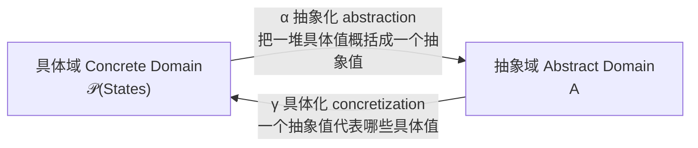

Galois 连接条件：

$\alpha(C) \sqsubseteq a \iff C \subseteq \gamma(a)$

以符号格（sign domain）为例：γ(+) = {1, 2, 3, …}，α({2, 5, 7}) = +，α({−1, 3}) = ⊤。

**可靠性（soundness）条件**：抽象转移函数（abstract transfer function）f♯ 必须"罩得住"具体转移函数 f：

$f(\gamma(a)) \subseteq \gamma(f^\sharp(a))$

直觉上就是：**抽象值可以说多，但不能说少。**&#x5206;析说 x 可能是 {1, 2}，实际只会是 1，这没关系（只损失精度 precision）；分析说 x 一定是 1，实际却可能是 2，优化就会出错（不可靠 unsound）。

### 4. 约定的方向问题（Orientation Convention）

不同文献对 ⊤/⊥ 的用法**正好相反**，这是初学者最常见的困惑来源：

| 流派          | 起点 | 汇合运算   | "放弃精确性"记作 | 代表                                                               |
| ----------- | -- | ------ | --------- | ---------------------------------------------------------------- |
| 抽象解释、多数现代教材 | ⊥  | join ⊔ | ⊤         | Cousot、Møller & Schwartzbach、MLIR、**LLVM `ValueLatticeElement`** |
| 经典数据流框架     | ⊤  | meet ∧ | ⊥         | 龙书（Dragon Book）、HotSpot C2 的 `Type::meet`                        |

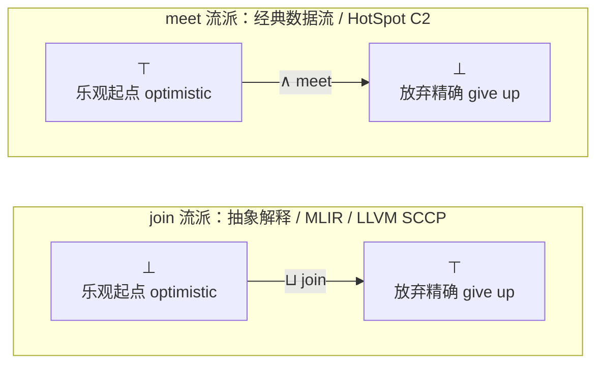

两者只是把格上下翻转（order dual），算法完全一样。**本文统一采用第一种。**&#x9605;读时只需抓住一个不变量：**从乐观（optimistic）的一端出发，单调地走向保守（conservative）的一端。**

---

## 四、框架层：两种视角，同一件事

### 1. 单调数据流框架（Monotone Dataflow Framework）

由 Kildall（1973）提出、Kam 与 Ullman（1977）推广。一个分析实例由四个部分组成：

$(G,\ L,\ F,\ \iota)$

即：控制流图 G（Control Flow Graph, CFG）、格 L、转移函数族 F（transfer functions）、入口初始值 ι（initial value）。

于是每个节点 n 得到一个方程：

$\text{out}[n] = f_n\Big(\bigsqcup_{p \in \text{pred}(n)} \text{out}[p]\Big)$

整个程序变成一个方程组（equation system），解就是它的最小不动点。

### 2. 抽象解释（Abstract Interpretation）

由 Cousot 夫妇（1977）提出，从语义出发：先定义具体语义，再通过 Galois 连接推导出抽象语义。它比数据流框架更一般，能处理无限高度的格（引入加宽 widening 与收窄 narrowing），也能系统地推导转移函数并证明可靠性。

### 3. 两者的关系

|      | 单调数据流框架          | 抽象解释                 |
| ---- | ---------------- | -------------------- |
| 出发点  | 工程：怎样在 CFG 上传播信息 | 语义：怎样近似程序行为          |
| 正确性  | 通常靠直觉或单独证明       | 由 Galois 连接内建        |
| 格的高度 | 一般要求有限           | 允许无限，用加宽处理           |
| 典型场景 | 编译器优化            | 验证器（verifier）、静态检查工具 |

**数据流分析可以看作抽象解释的一个特例。** &#x7F16;译器的日常优化多采用前者的表述，但设计新的、复杂的分析时，后者给出了更可靠的方法论。

---

## 五、域层：设计一个格的七个坐标轴

与其背诵"格动物园"，不如先掌握描述一个格的**坐标系**。任何格都可以在下面七个维度上定位：

| 维度       | 取值                                                                            | 说明                           |
| -------- | ----------------------------------------------------------------------------- | ---------------------------- |
| ① 描述对象   | 集合 / 值 / 关系 / 性质                                                              | 记录"哪些东西"，还是"某个值"，还是"变量之间的约束" |
| ② 形状     | 链（chain）/ 平坦（flat）/ 幂集（powerset）/ 区间（interval）/ 层次（hierarchy）/ 多面体（polyhedra） | 决定 join 的行为                  |
| ③ 高度     | 有限且小 / 有限但大 / 无限                                                              | 决定是否需要加宽                     |
| ④ 关系性    | 非关系（non-relational）/ 关系（relational）                                           | 是否记录变量之间的联系，如 x < y          |
| ⑤ 方向     | may / must；前向（forward）/ 后向（backward）                                          | 决定用 ∪ 还是 ∩，沿控制流还是逆控制流        |
| ⑥ 起点     | 乐观（optimistic，⊥）/ 悲观（pessimistic，⊤）                                           | 乐观起点更精确，但必须算到不动点才能使用结果       |
| ⑦ 转移函数性质 | 可分配（distributive）/ 仅单调（monotone only）                                         | 决定 MFP 是否等于 MOP，见第八节         |

前两个维度描述"格长什么样"，③④决定"算起来有多贵"，⑤⑥决定"怎么用"，⑦决定"精度损失在哪里"。

### 关于⑥：乐观与悲观

这是一个经常被忽视的设计选择：

- **悲观（pessimistic）**：从保守端出发，随时停下来结果都是安全的，但精度差。
- **乐观（optimistic）**：从 ⊥ 出发，假设一切顺利，再逐步修正，精度高，但**中途不能停**，否则结果可能不安全。

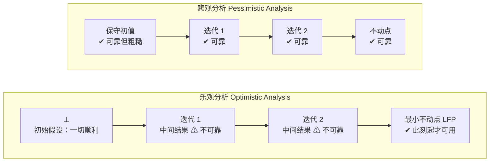

SCCP（Sparse Conditional Constant Propagation，稀疏条件常量传播）能比普通常量传播找到更多常量，正是因为它对"代码是否可达"（reachability）采取了乐观假设。LLVM 的 Attributor 框架则显式提供了两种出口：`indicateOptimisticFixpoint` 和 `indicatePessimisticFixpoint`。

---

## 六、格的家族图谱

按"描述对象"这一维度，编译器中的格可以分成五大家族。

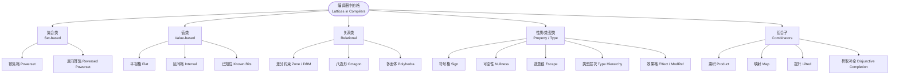

### 1. 集合类（Set-based）：经典数据流分析的主场

元素是某个有限集合的子集，高度等于集合大小，可以用**位向量（bit vector）**&#x5B9E;现，速度极快。

| 分析     | 英文                    | 方向    | may/must | 汇合 | 用途                       |
| ------ | --------------------- | ----- | -------- | -- | ------------------------ |
| 活跃变量   | Live Variables        | 后向    | may      | ∪  | 寄存器分配、死代码删除              |
| 到达定义   | Reaching Definitions  | 前向    | may      | ∪  | use-def 链（use-def chain） |
| 可用表达式  | Available Expressions | 前向    | must     | ∩  | 公共子表达式消除（CSE）            |
| 非常忙表达式 | Very Busy Expressions | 后向    | must     | ∩  | 代码提升（code hoisting）      |
| 支配节点   | Dominators            | 前向    | must     | ∩  | SSA 构建、循环识别              |
| 确定赋值   | Definite Assignment   | 前向    | must     | ∩  | Java/C# 的"变量使用前必须赋值"检查   |
| 指针指向   | Points-to Analysis    | 视算法而定 | may      | ∪  | 别名分析（alias analysis）     |

**关键直觉**：must 分析用 ∩，并不是另一套理论，只是把幂集格倒过来（以 ⊇ 为偏序、全集为 ⊥）。翻转之后，它和 may 分析一样都在用 join。

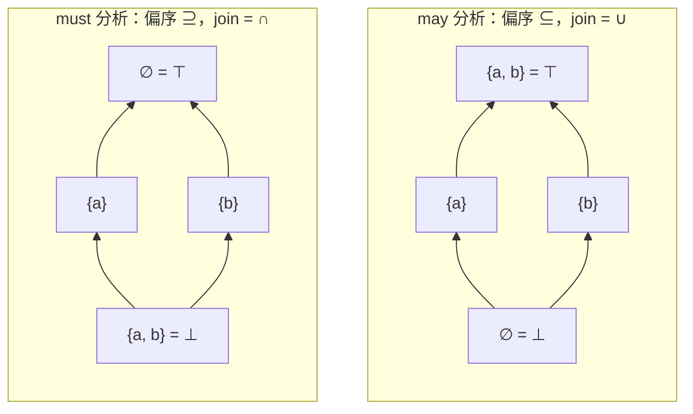

这一类分析的转移函数几乎都是 gen/kill 形式：f(S) = gen ∪ (S − kill)，它们**都是可分配的**，所以不丢精度。

### 2. 值类（Value-based）：描述"一个值是什么"

| 格   | 英文              | 形状               | 高度 | 用途          | 工程实例                                          |
| --- | --------------- | ---------------- | -- | ----------- | --------------------------------------------- |
| 平坦格 | Flat lattice    | ⊥ / 所有常量 / ⊤     | 2  | 常量传播        | GCC CCP、LLVM SCCP                             |
| 区间格 | Interval domain | [l, u]           | 无限 | 范围分析、边界检查消除 | LLVM `ConstantRange`、GCC `irange`、eBPF 校验器    |
| 已知位 | Known bits      | 每位 {0, 1, ?} 的乘积 | 位宽 | 位运算优化       | LLVM `KnownBits`、eBPF `tnum`（tristate number） |

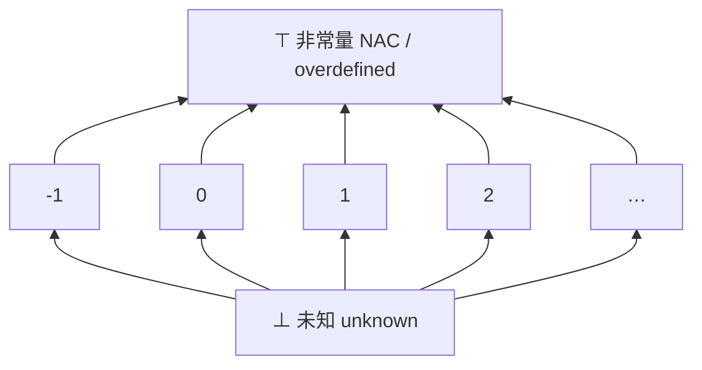

平坦格说明了一点：**决定终止的是高度，而不是元素个数。**&#x5B83;有无穷多个元素，但每个值最多变化两次（⊥ → 常量 → ⊤）。


区间格则相反：元素是"有限"的区间，但存在无限上升链 [0,0] ⊑ [0,1] ⊑ [0,2] ⊑ …，必须靠加宽（widening）才能终止。

LLVM 的 `ValueLatticeElement` 是一个实用的混合体，状态包括 unknown、undef、constant、notconstant、constantrange、overdefined，实际上是平坦格和区间格的拼接（详见第十一节）。

### 3. 关系类（Relational）：记录变量之间的约束

非关系域（non-relational domain）对每个变量单独记录信息。关系域（relational domain）则记录变量之间的联系，因此能证明"x < y"这类性质。代价是复杂度显著上升：

| 域       | 英文                                   | 能表达的约束     | 单次运算代价（n 为变量数）    |
| ------- | ------------------------------------ | ---------- | ----------------- |
| 区间（非关系） | Interval                             | a ≤ x ≤ b  | O(n)              |
| 差分约束    | Zone / Difference Bound Matrix (DBM) | x − y ≤ c  | O(n³)（闭包 closure） |
| 八边形     | Octagon                              | ±x ± y ≤ c | O(n³)             |
| 多面体     | Polyhedra                            | Σ aᵢxᵢ ≤ c | 最坏指数级             |

**生产级编译器几乎只用非关系域**，因为它们需要在编译预算内处理成千上万个变量。关系信息通常用其他手段间接获得，例如 SSA 形式本身、LLVM 的 ScalarEvolution 符号分析、`ConstraintElimination` 的线性约束系统，或 ABCD 这类基于不等式图的边界检查消除。完整的关系域主要出现在 Astrée、IKOS 等验证工具中。

### 4. 性质/类型类（Property / Type）：不关心具体值，只关心某个性质

| 格      | 英文                 | 结构                                     | 用途                                              |
| ------ | ------------------ | -------------------------------------- | ----------------------------------------------- |
| 符号格    | Sign domain        | ⊥ / {−, 0, +} / ⊤                      | 除零检查、下标检查                                       |
| 可空性格   | Nullness lattice   | ⊥ / {Null, NonNull} / MaybeNull        | 空指针检查消除、Kotlin 空安全（null safety）                 |
| 逃逸链    | Escape lattice     | NoEscape ⊑ ArgEscape ⊑ GlobalEscape    | 栈上分配、标量替换（scalar replacement）、锁消除（lock elision） |
| 内存效果   | Mod/Ref lattice    | 每个位置上 {NoModRef, Ref, Mod, ModRef} 的乘积 | 函数属性推断、调用周围的优化                                  |
| 类型层次   | Type hierarchy     | 子类型关系，⊥ 为 Nothing/never                | 类型推断、去虚化、JIT 特化                                 |
| 内联缓存状态 | Inline cache state | uninit → mono → poly → mega            | 动态语言 JIT 的类型反馈（type feedback）                   |

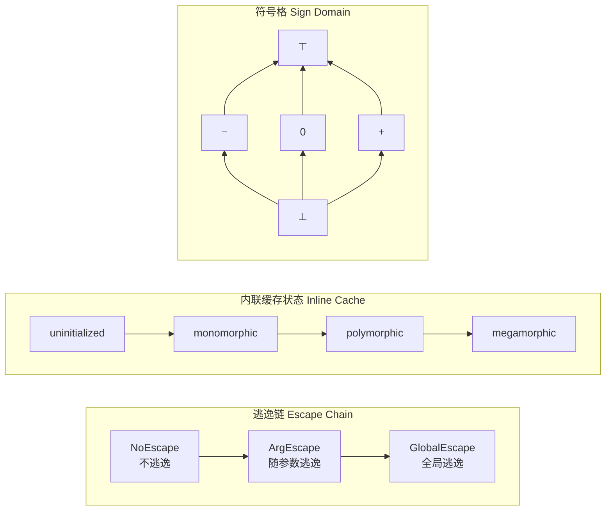

两点值得注意：

- LLVM 的 `MemoryEffects` 中，ModRef 的四个值恰好是 𝒫({Ref, Mod}) 的幂集格，这是"小格拼大格"的又一个例子。
- 类型层次在有接口多继承时，两个类型可能有多个"最小"公共上界（minimal common supertype），严格来说不构成格。编译器通常会退到一个更大的上界（如 `Object`），或者引入交集/联合类型（intersection / union type）来补成格。V8 TurboFan、HotSpot C2 的类型系统都是精心设计过的格，同时编码了常量、范围、可空性、精确类型等多种信息。

### 5. 组合子（Combinators）：用小格拼出大格

实际的分析很少只用一个"原子格"。下面这些构造方法是搭建复杂分析的积木：

| 构造         | 英文                              | 定义             | 高度        | 典型用法                                             |
| ---------- | ------------------------------- | -------------- | --------- | ------------------------------------------------ |
| 乘积 L₁ × L₂ | Product lattice                 | 逐分量比较与合并       | h₁ + h₂   | 同时追踪区间和已知位                                       |
| 映射 K → L   | Map lattice / Pointwise lifting | 对每个键逐点比较与合并    | |K| · h   | "每个变量一份信息"                                       |
| 提升 L⊥      | Lifted lattice                  | 在 L 下方加一个新的 ⊥  | h + 1     | 区分"不可达"与"可达但未知"                                  |
| 约简乘积       | Reduced product                 | 乘积后让分量互相精化     | ≤ h₁ + h₂ | 区间 [0,3] 加"是偶数"得到 {0, 2}                         |
| 析取补全 𝒫(L) | Disjunctive completion          | 保留多个抽象值的并，而不合并 | 通常很大      | 路径敏感分析                                           |
| 函数格 L → L  | Function lattice                | 以单调函数为元素，逐点比较  | 可能很大      | 过程摘要（procedure summary）、IDE 中的边函数（edge function） |

**一个重要推论**：映射格的高度是"键的数量 × 分量高度"。比如 k 个变量的常量传播，每个程序点的高度是 2k，这直接决定了最坏迭代次数。

---

## 七、敏感性（Sensitivity）：在格的定义域上多加一个维度

分析的"精度"常用几种敏感性来描述。从格的视角看，**每一种敏感性都对应一次格的构造**，代价就是格变大或变高：

| 敏感性   | 英文                | 格的形状                         | 直觉                 |
| ----- | ----------------- | ---------------------------- | ------------------ |
| 流不敏感  | Flow-insensitive  | Var → L                      | 整个函数共享一份信息         |
| 流敏感   | Flow-sensitive    | Point → (Var → L)            | 每个程序点一份信息          |
| 路径敏感  | Path-sensitive    | Point → 𝒫(Var → L)          | 不同路径的信息分开保存，不急于合并  |
| 上下文敏感 | Context-sensitive | (Context × Point) → …        | 同一个函数在不同调用点分别分析    |
| 字段敏感  | Field-sensitive   | 抽象位置（abstract location）细分到字段 | `p.f` 和 `p.g` 分开追踪 |

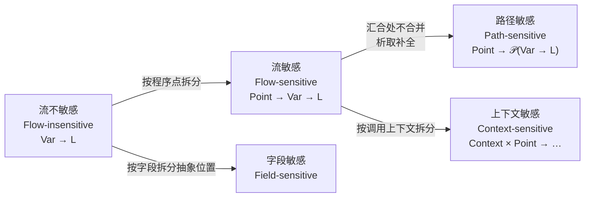

这张表把看似零散的"精度旋钮"统一了起来：**提高精度 = 用组合子把格做大 = 付出更高的时间与空间代价。**

例如 Andersen 风格的指针分析（Andersen-style points-to analysis）通常是流不敏感的（Var → 𝒫(Obj)），所以能处理整个程序；而 Rust 借用检查（borrow checker）需要流敏感的信息，所以只在单个函数的 MIR 上运行。

---

## 八、精度的天花板：MOP 与 MFP

**理想答案 MOP**（Meet/Join Over all Paths）：沿每一条路径分别计算，最后再合并。路径可能有无穷多条，一般无法计算；Kam 与 Ullman 证明了对一般的单调框架，MOP 是不可计算的（undecidable）。

**实际答案 MFP**（Maximal / Minimal Fixed Point，取决于格的方向约定；本文的 join 约定下是最小不动点）：在每个汇合点先合并，再继续传播，也就是 worklist 算出来的东西。

| 转移函数              | MFP 与 MOP 的关系        | 例子              |
| ----------------- | -------------------- | --------------- |
| 可分配（distributive） | MFP = MOP            | 所有 gen/kill 型分析 |
| 仅单调（monotone）     | MOP ⊑ MFP（MFP 可能更保守） | 常量传播、区间分析       |

一个经典例子：

```c
if (c) { x = 2; y = 3; } else { x = 3; y = 2; }
z = x + y;    // 每条路径上 z 都是 5
```

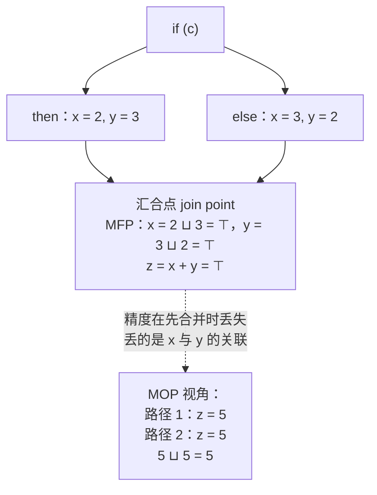

在汇合点 x = 2 ⊔ 3 = ⊤、y = 3 ⊔ 2 = ⊤，于是 z = ⊤。**精度在"先合并"时丢失了，丢的是 x 和 y 之间的关联。**

于是，精度损失在格的世界里有三个主要来源，也对应三个"补救方向"：

| 损失来源        | 补救方向                                                                | 代价     |
| ----------- | ------------------------------------------------------------------- | ------ |
| 汇合点过早合并     | 路径敏感（path-sensitivity）、析取补全                                         | 格变宽    |
| 非关系域丢失变量间联系 | 关系域（relational domain）                                              | 运算变贵   |
| 加宽跳得太远      | 收窄（narrowing）、阈值加宽（widening with thresholds）、延迟加宽（delayed widening） | 迭代次数增加 |

---

## 九、求解层：算法谱系

确定了格和方程，下一步是求解。不同的算法本质上都是 Kleene 迭代，区别在于**以什么顺序、在什么粒度上传播**。

最典型的 worklist 算法如下：

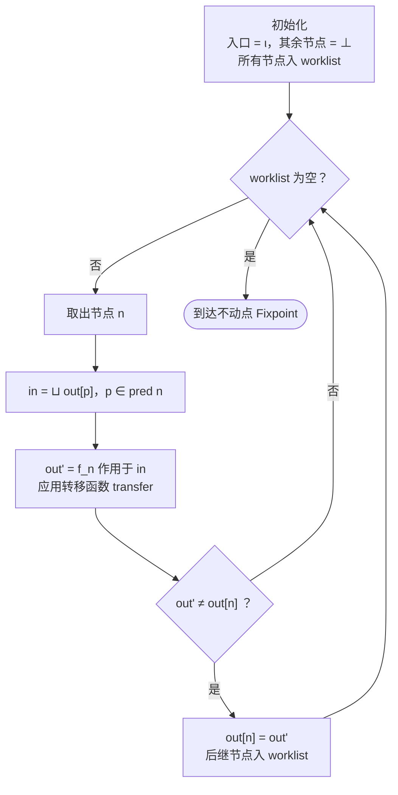

| 算法             | 英文                                                                                                | 适用场景         | 核心思想                                   | 代表实现                              |
| -------------- | ------------------------------------------------------------------------------------------------- | ------------ | -------------------------------------- | --------------------------------- |
| 轮询迭代           | Round-robin iteration                                                                             | 小型 CFG、教学    | 按逆后序（reverse post-order, RPO）反复扫描，直到不变 | 教科书                               |
| Worklist       | Worklist algorithm                                                                                | 通用           | 只重算信息发生变化的节点                           | 几乎所有编译器                           |
| 稀疏分析           | Sparse analysis                                                                                   | SSA 形式       | 沿 def-use 边传播，跳过无关指令                   | SCCP、MLIR sparse 框架               |
| 弱拓扑序 + 加宽      | Weak Topological Order (WTO) + widening                                                           | 无限高度格        | 只在循环头加宽，按嵌套结构迭代                        | Astrée、IKOS（Bourdoncle 算法）        |
| 过程间摘要          | Summary-based interprocedural analysis                                                            | 多函数          | 为函数计算摘要 L → L，在调用点套用                   | 函数属性推断、LLVM Attributor            |
| IFDS / IDE     | Interprocedural, Finite, Distributive, Subset problems / Interprocedural Distributive Environment | 有限、可分配的过程间问题 | 转化为图可达性（graph reachability）问题          | Soot/Heros、WALA、PhASAR            |
| 约束求解 / Datalog | Constraint solving / Datalog                                                                      | 指针分析等        | 把分析写成单调规则，求最小模型（least model）           | Andersen 分析、Doop、Soufflé、Polonius |

几点值得一提的联系：

- **SSA 就是为稀疏分析而生的**：φ 节点（φ-node）恰好位于控制流汇合处，它的语义就是 join。SSA 把"每个程序点一份 Var → L"压缩成"每个 SSA 值一份 L"，格一下子小了很多。
- **IFDS 的前提正是第八节的可分配性**：只有可分配的转移函数才能被分解成"单个事实到单个事实"的边，进而变成图可达性。
- **Datalog 本身就是幂集格上的最小不动点计算**：每条规则都是单调的，求值过程（semi-naive evaluation）就是从空集出发不断加入新事实。Flix、Ascent 等语言把 Datalog 扩展到了任意格上。
- **复杂度上界几乎总是"节点数 × 格高度 × 单次转移代价"**，这就是第三节"高度"概念如此重要的原因。

---

## 十、在编译器流水线中定位

把视角拉回编译器本身，格在每个阶段都有出现：

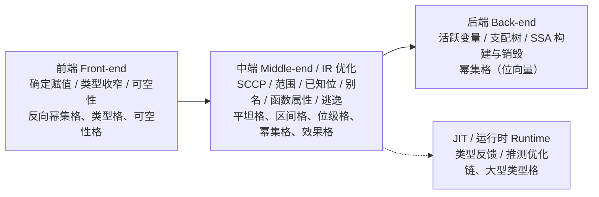

| 阶段         | 分析                                                   | 使用的格                             |
| ---------- | ---------------------------------------------------- | -------------------------------- |
| 前端 / 类型检查  | 确定赋值、流敏感类型收窄（TypeScript narrowing、Kotlin smart cast） | 反向幂集格、类型格                        |
|            | 可空性检查                                                | 可空性格                             |
| 中端 / IR 优化 | 常量传播、SCCP                                            | 平坦格 × 可达性格                       |
|            | 范围分析、已知位                                             | 区间格、位级格                          |
|            | 别名与指针分析                                              | 幂集格（流不敏感居多）                      |
|            | 函数属性推断（纯函数、只读、不抛异常）                                  | 效果格、链                            |
|            | 逃逸分析（Escape Analysis）                                | 逃逸链                              |
| 后端         | 活跃变量 → 寄存器分配                                         | 幂集格（位向量）                         |
|            | 支配树 → SSA 构建与销毁                                      | 反向幂集格                            |
| JIT / 运行时  | 类型反馈、内联缓存                                            | 只增不减的链                           |
|            | 推测优化（speculative optimization）、类型特化                  | 大型类型格（C2 `Type`、V8 Typer）        |
| 验证器        | JVM 字节码校验（bytecode verification）                     | 类型格，分支汇合处做 join                  |
|            | Linux eBPF 校验器                                       | 区间 × tnum 的乘积                    |
| 语言安全检查     | Rust 借用检查                                            | 幂集格（借用集合、活跃性），Polonius 用 Datalog |

### 主流框架的抽象接口

成熟的编译器基础设施通常会把"格"做成显式的接口，这本身就说明了这套抽象的通用性：

| 框架         | 格相关的核心抽象                                                                                             |
| ---------- | ---------------------------------------------------------------------------------------------------- |
| LLVM       | `ValueLatticeElement`、`ConstantRange`、`KnownBits`、`MemoryEffects`；Attributor 框架中的抽象状态（详见第十一节）        |
| GCC        | CCP 的 UNDEFINED / CONSTANT / VARYING；`irange` 与 ranger 框架                                            |
| MLIR       | `mlir/Analysis/DataFlow`：`Lattice<T>` 要求提供 `join`，并区分稀疏（`SparseForwardDataFlowAnalysis`）与稠密（dense）分析 |
| rustc      | `rustc_mir_dataflow` 中的 `JoinSemiLattice` trait                                                      |
| HotSpot C2 | `Type` 体系，以 `meet` 为核心运算（采用与本文相反的方向约定）                                                               |
| V8         | TurboFan/Turboshaft 的类型系统，把类型视为值的集合                                                                  |

---

## 十一、LLVM 中的实现汇总

> **版本说明**：以下基于 LLVM 主线近年版本（约 17–20）的代码结构，类名与头文件路径大体稳定，但具体成员、选项默认值、新增的 attribute 可能随版本变化，阅读源码时请以你所用版本为准。

### 1. 总览：LLVM 没有"一个通用的格库"

先说一个重要事实：**LLVM 核心（`llvm/lib/Analysis`、`llvm/lib/Transforms`）并没有统一的 `Lattice` 基类**。格是"分散在各个分析中、各自手写"的：`ConstantRange`、`KnownBits`、`MemoryEffects` 各自是独立的值类型，各自提供 join/meet 风格的合并操作。真正提供**通用格接口**的是三处：

| 通用框架                | 位置                                                             | 格的接口                                  |
| ------------------- | -------------------------------------------------------------- | ------------------------------------- |
| Attributor          | `llvm/Transforms/IPO/Attributor.h`                             | `AbstractState` / `AbstractAttribute` |
| MLIR DataFlow       | `mlir/Analysis/DataFlowFramework.h`、`mlir/Analysis/DataFlow/*` | `Lattice<T>`、`AnalysisState`          |
| Clang FlowSensitive | `clang/Analysis/FlowSensitive/*`                               | `DataflowLattice`（`join`、`widen`）     |

下图把本文的五层结构映射到 LLVM 的具体组件上：

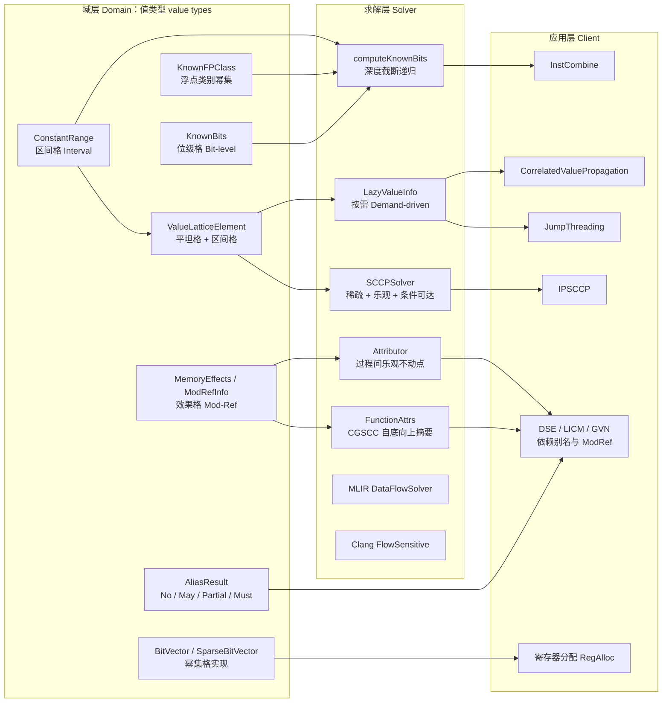


### 2. 域层：LLVM 中的"原子格"

| 格（本文章节）                | LLVM 实现                                                                                         | 位置                                                   | 格的含义与合并操作                                                                                                                                                                                 | 主要使用者                                                             |                                          |
| ---------------------- | ----------------------------------------------------------------------------------------------- | ---------------------------------------------------- | ----------------------------------------------------------------------------------------------------------------------------------------------------------------------------------------- | ----------------------------------------------------------------- | ---------------------------------------- |
| 区间格 Interval（§六.2）     | `ConstantRange`                                                                                 | `llvm/IR/ConstantRange.h`                            | 环绕区间（wrapped range） [Lower, Upper)；`getFull()` = ⊤，`getEmpty()` = ⊥；`unionWith` = join，`intersectWith` = meet；另有一整套按指令的抽象运算（`add`、`mul`、`shl`、`binaryOp`、`castOp` 等）即抽象转移函数               | SCCP、LVI、SCEV、`computeConstantRange`、`!range` metadata            |                                          |
| 已知位 Known Bits（§六.2）   | `KnownBits`                                                                                     | `llvm/Support/KnownBits.h`                           | 两个 `APInt`：`Zero`（已知为 0 的位）与 `One`（已知为 1 的位），同一位两者都置位即冲突（`hasConflict`）。`intersectWith` 保留双方共同确定的位，是 join；`unionWith` 是 meet。同样是"逐位的三值乘积格"。                                               | InstCombine、`SimplifyQuery`、SelectionDAG、GlobalISel               |                                          |
| 浮点类别 FP Class          | `KnownFPClass` + `FPClassTest`                                                                  | `llvm/Support/KnownFPClass.h`（旧版在 `ValueTracking.h`） | 对 {sNaN, qNaN, ±Inf, ±Normal, ±Subnormal, ±Zero} 的位掩码，正是一个**幂集格**；"可能是 NaN" 等性质可直接查询                                                                                                      | `computeKnownFPClass`、浮点化简                                        |                                          |
| 平坦格 + 区间格（§六.2）        | `ValueLatticeElement`                                                                           | `llvm/Analysis/ValueLattice.h`                       | 状态：`unknown` ⊑ `undef` ⊑ {`constant`、`notconstant`、`constantrange`、`constantrange_including_undef`} ⊑ `overdefined`；`mergeIn` = join；`markOverdefined` = 置 ⊤                              | SCCPSolver、LazyValueInfo                                          |                                          |
| 效果格 Mod/Ref（§六.4）      | `ModRefInfo`、`MemoryEffects`                                                                    | `llvm/Support/ModRef.h`                              | `ModRefInfo` ∈ {NoModRef, Ref, Mod, ModRef}，用位掩码表示，即 𝒫({Ref, Mod})；`MemoryEffects` 对每类内存位置（`ArgMem`、`InaccessibleMem`、`Other`，新版另有 errno/target 位置）各存一个 `ModRefInfo`，即**乘积格**；\`operator | \` = join                                                         | `memory(...)` 属性、AAResults、FunctionAttrs |
| 别名结果 Alias Result      | `AliasResult`                                                                                   | `llvm/Analysis/AliasAnalysis.h`                      | NoAlias / MayAlias / PartialAlias / MustAlias；MayAlias 相当于 ⊤。`AAResults` 依次询问多个 AA 实现，取最精确的结论，相当于对多个分析结果取 meet                                                                            | `BasicAA`、`TBAA`、`ScopedNoAliasAA`、`GlobalsAA`、`SCEVAA`           |                                          |
| 幂集格（§六.1）              | `BitVector`、`SmallBitVector`、`SparseBitVector`                                                  | `llvm/ADT/`                                          | 位向量 / 稀疏位集，join = `\|=`，meet = `&=`，gen/kill 的底层载体                                                                                                                                        | `LiveVariables`、`LivePhysRegs`、`ReachingDefAnalysis`、RegAlloc     |                                          |
| 性质类：可空 / 对齐 / 逃逸（§六.4） | IR 属性（attribute）：`nonnull`、`align`、`dereferenceable`、`noundef`、`nocapture`（新版为 `captures(...)`） | `llvm/IR/Attributes.td`                              | 这些属性本身就是"分析结果的持久化形式"，每一种是一条小链；`isKnownNonZero` 在 `ValueTracking` 中按需计算；`CaptureTracking` 判断指针是否逃逸                                                                                         | Attributor（`AANonNull`、`AANoCapture`、`AAAlign` 等）、`FunctionAttrs` |                                          |

### 3. 组合子：LLVM 中的体现

| 组合子（§六.5）                   | LLVM 中的体现                                                                                                                                              |
| --------------------------- | ------------------------------------------------------------------------------------------------------------------------------------------------------ |
| 乘积 Product                  | `MemoryEffects`（位置 × ModRefInfo）；`KnownBits`（逐位三值的乘积）；`ValueLatticeElement` 中 `constantrange_including_undef` 将"范围"与"可能为 undef"并联                      |
| 映射 Map                      | SCCPSolver 的 `ValueState`（`Value → ValueLatticeElement`）；LVI 的缓存 `(Value, BasicBlock) → ValueLatticeElement`；Clang 的 `MapLattice<Key, ElementLattice>` |
| 提升 Lifted                   | SCCPSolver 的 `BBExecutable`（基本块是否可达），与值格组合后即 "可达性 × 值" 的提升格；`unknown` 即新加的 ⊥                                                                           |
| 约简乘积 Reduced product        | `ConstantRange::fromKnownBits` / `toKnownBits`、`KnownBits::fromConstantRange`：区间与已知位互相精化；`computeKnownBits` 会同时参考 `!range` metadata 与已知位               |
| 函数格 Function lattice        | 函数摘要：以 `memory(...)`、`nounwind`、`willreturn` 等函数属性形式存在，由 `FunctionAttrs` 在 CGSCC 上推断                                                                   |
| 析取补全 Disjunctive completion | LLVM 没有显式实现；路径敏感信息靠**代码复制**换取，如 `JumpThreading`、LVI 的"边上取值"`getValueOnEdge`（按分支条件在每条入边上收窄）                                                             |

### 4. 求解层：LLVM 中的算法谱系

| 算法（§九）              | LLVM 实现                                                                                                                                                                                        | 说明                                                                                                                                                           |
| ------------------- | ---------------------------------------------------------------------------------------------------------------------------------------------------------------------------------------------- | ------------------------------------------------------------------------------------------------------------------------------------------------------------ |
| 稀疏 + 乐观 + 条件可达      | `SCCPSolver`（`llvm/Transforms/Utils/SCCPSolver.h`）；入口 `SCCPPass`（`Scalar/SCCP.cpp`）、`IPSCCPPass`（`IPO/SCCP.cpp`）                                                                               | 三个 worklist：基本块 `BBWorkList`、指令 `InstWorkList`、优先处理的 `OverdefinedInstWorkList`；沿 def-use 边传播（稀疏），只处理已标记可达的边（`KnownFeasibleEdges`，条件可达），所有值从 `unknown` 开始（乐观） |
| 按需（demand-driven）分析 | `LazyValueInfo`（`Analysis/LazyValueInfo.h`）                                                                                                                                                    | 不做全函数不动点，而是"查询某值在某点的范围"时才向前驱递归求解，并缓存；利用分支条件、`llvm.assume`、`!range` 做路径条件收窄                                                                                   |
| 深度截断的后向递归           | `computeKnownBits`、`computeNumSignBits`、`isKnownNonZero`（`Analysis/ValueTracking.h`）                                                                                                           | 沿 use-def 链向"操作数"方向递归，深度上限 `MaxAnalysisRecursionDepth`（6）。**不是不动点迭代，而是用深度截断代替终止性证明**：可靠但不完备；对 φ 循环做特殊的 recurrence 匹配                                         |
| 过程间摘要 Summary-based | `FunctionAttrs`（`IPO/FunctionAttrs.cpp`）：`PostOrderFunctionAttrsPass` 在调用图 SCC 上自底向上推断 `readnone` / `readonly` / `nounwind` / `nocapture` 等；`ReversePostOrderFunctionAttrsPass` 推断 `norecurse` | 摘要即第六节的"函数格"元素；SCC 内部通过合并成员效果（join）处理递归                                                                                                                      |
| 过程间乐观不动点            | `Attributor`（`IPO/Attributor.h`、`AttributorAttributes.cpp`）                                                                                                                                    | 详见下文第 6 小节                                                                                                                                                   |
| 迭代支配前沿 IDF          | `IDFCalculator`（`Analysis/IteratedDominanceFrontier.h`）+ `PromoteMemToReg`（mem2reg）                                                                                                            | 利用支配前沿放置 φ，即 SSA 构建所需的汇合点                                                                                                                                    |
| 稀疏化的内存表示            | `MemorySSA`（`Analysis/MemorySSA.h`）                                                                                                                                                            | 为内存状态建立 SSA 形式（MemoryDef / MemoryUse / MemoryPhi），是"把稀疏分析推广到内存"的思路                                                                                           |
| 标准数据流（CodeGen）      | `LiveVariables`（`CodeGen/LiveVariables.h`）、`ReachingDefAnalysis`、`LivePhysRegs`                                                                                                                | `LiveVariables` 利用虚拟寄存器的 SSA 性质逐变量回溯标记活跃块；物理寄存器 live-in 以位向量做后向迭代                                                                                            |
| 区间式活跃表示             | `LiveIntervals`、`LiveRange`、`LiveRegMatrix`                                                                                                                                                    | 把"活跃集合"压缩为区间列表，用于寄存器分配的冲突判定，是位向量的稀疏化表示                                                                                                                       |
| IFDS / IDE          | **LLVM 主线没有**；外部项目 **PhASAR**（基于 LLVM IR 的 IFDS/IDE 框架）                                                                                                                                        | 需要可分配性，见第八节                                                                                                                                                  |
| Datalog / 全程序指针分析   | **LLVM 主线没有** Andersen/Steensgaard 的生产级实现；历史上有 `CFLAndersAA` / `CFLSteensAA`（在较新版本中已被移除）；外部项目 **SVF**                                                                                          | LLVM 的 AA 以局部、廉价为主（`BasicAA` 等）                                                                                                                              |

### 5. 终止与精度控制：LLVM 用的是"工程化加宽"

LLVM 极少使用教科书式的 widening/narrowing，而是用**各种硬编码的上限**把无限高度的格强行变成有限的。这是理解 LLVM 分析行为（"为什么这里没优化"）的关键：

| 机制        | 所在位置                                                                                          | 作用                                          | 对应理论概念                                   |
| --------- | --------------------------------------------------------------------------------------------- | ------------------------------------------- | ---------------------------------------- |
| 范围扩展次数上限  | `ValueLatticeElement::MergeOptions`（`setCheckWiden`、`setMaxWidenSteps`）与 `NumRangeExtensions` | 同一个值的范围被反复扩大超过阈值后，直接退化为 `overdefined`       | **阈值加宽**（widening with threshold）：直接跳到 ⊤ |
| 递归深度上限    | `MaxAnalysisRecursionDepth`（`ValueTracking`）                                                  | 超过深度返回"什么都不知道"                              | 以截断保证终止，等价于把格的有效高度截断                     |
| 迭代次数上限    | Attributor 的 `MaxFixpointIterations`（选项 `attributor-max-iterations`，默认 32 左右）                 | 超限后对尚未收敛的属性强制 `indicatePessimisticFixpoint` | **悲观回退**：乐观分析必须在不动点处才可靠，所以超限只能放弃         |
| 状态数/分析量上限 | 各类 `cl::opt` 阈值，如 SCCP/IPSCCP 对被跟踪的函数、结构返回值（`MRVFunctionsTracked`）的限制                         | 控制格的规模（键的数量）                                | 映射格高度 = |K|·h，限制 K                       |
| 单调性的显式保证  | `ValueLatticeElement::mergeIn` 只能"上升"；SCCP 中 `markOverdefined` 只增不减                           | 保证每个值最多上升有限次                                | 单调性 + 有限高度 ⇒ Kleene 迭代终止                 |

LLVM **没有** Bourdoncle 式的弱拓扑序加宽，也没有通用的收窄（narrowing）阶段；LVI 通过"在条件分支的边上取交集"获得类似收窄的效果。

### 6. 两个案例拆解

#### 案例 A：SCCPSolver 的格与流程

`ValueLatticeElement` 的状态可以画成下面的 Hasse 图（简化示意；实际合并时 `constant` 与 `notconstant` 在整数上会按需转为 `constantrange`）：

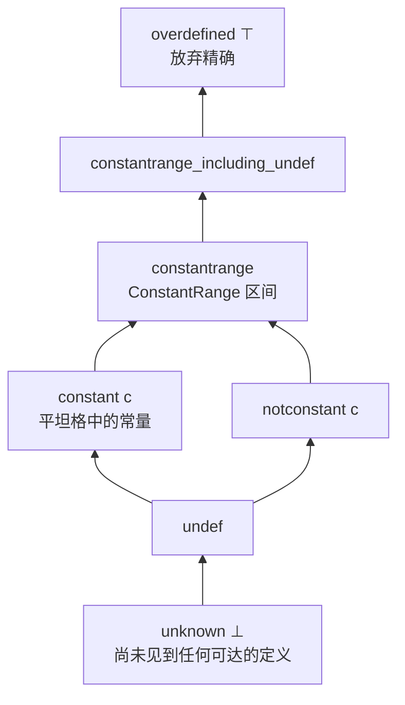

SCCPSolver 的整体流程，对应本文第九节的稀疏 worklist：

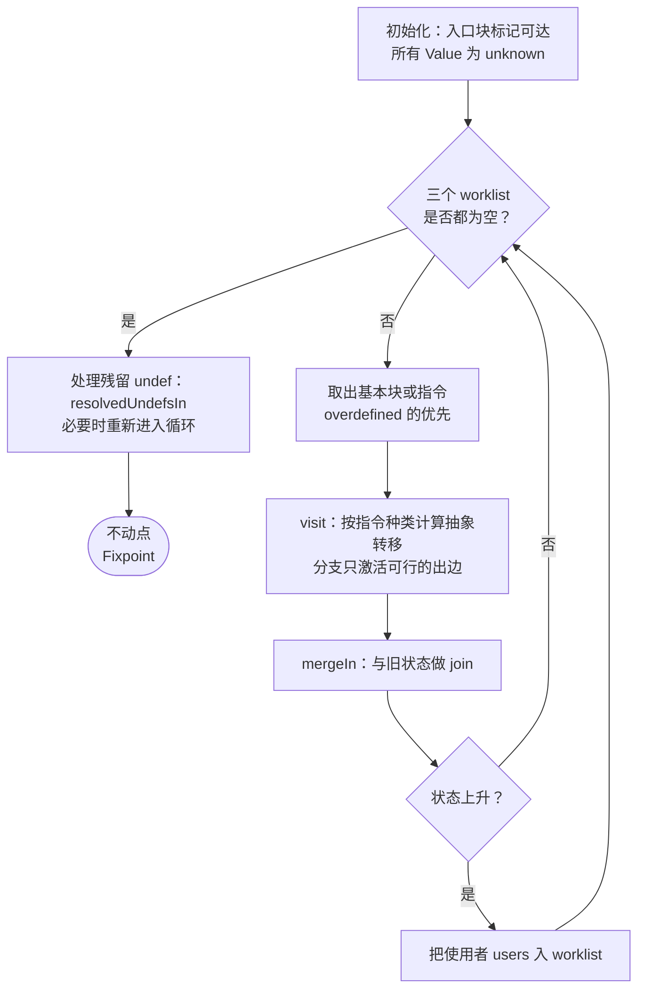

用本文的"五个问题"回顾它：

| 问题        | SCCP 的回答                                                         |
| --------- | ---------------------------------------------------------------- |
| 信息长什么样    | `Value → ValueLatticeElement`，加上"基本块是否可达"                        |
| 偏序 / join | 上图的 Hasse 图；`mergeIn`                                            |
| 如何停止      | 单个值最多上升有限次 + `MaxWidenSteps` 阈值加宽                                |
| 为何可信      | 乐观假设下只有到达不动点后才应用（`SCCPPass` 在 solve 结束后才改写 IR），且 `undef` 在最后统一处理 |
| 精度损失      | 转移函数不可分配（见第八节），所以会丢变量间的关联；这也是 LVI 的路径条件收窄补强的原因                   |

#### 案例 B：Attributor 的"已知 / 假设"双状态

Attributor 把格元素分成两个界：

- **known**：已经被证明的信息（保守下界）。
- **assumed**：目前乐观假设的信息（乐观上界）。

不动点算法让 assumed 不断向 known 靠拢，两者重合即收敛。这正是本文第五节"乐观 vs 悲观"的显式实现。

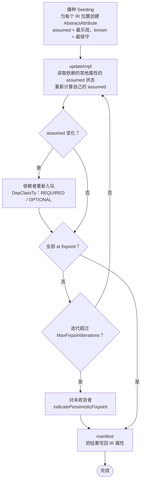

Attributor 中常见的状态类型与对应属性：

| 状态 / 属性                               | 格                    | 例                                                                 |
| ------------------------------------- | -------------------- | ----------------------------------------------------------------- |
| `BooleanState`                        | 2 元素链                | `AANoUnwind`、`AANoSync`、`AANonNull`、`AANoCapture`（部分）             |
| `IncIntegerState` / `DecIntegerState` | 整数链（越大 / 越小越精确）      | `AAAlign`、`AADereferenceable`（字节数）                                |
| `BitIntegerState`                     | 位掩码（幂集格）             | `AAMemoryBehavior`（读写位）、`AAMemoryLocation`                        |
| `IntegerRangeState`                   | 区间格（`ConstantRange`） | `AAValueConstantRange`                                            |
| `PotentialConstantIntValuesState`     | 小幂集（有限集合，带上限）        | `AAPotentialConstantValues`                                       |
| 其他                                    | 可达性、存活               | `AAIsDead`、`AAReachability`、`AAHeapToStack`、`AAUndefinedBehavior` |

### 7. LLVM 生态中的其他格实现

| 项目                        | 位置                                                                         | 格相关实现                                                                                                                                                                                                                                                                                                                                                                                                            |
| ------------------------- | -------------------------------------------------------------------------- | ---------------------------------------------------------------------------------------------------------------------------------------------------------------------------------------------------------------------------------------------------------------------------------------------------------------------------------------------------------------------------------------------------------------- |
| MLIR                      | `mlir/Analysis/DataFlowFramework.h`、`mlir/Analysis/DataFlow/`              | `DataFlowSolver` 统一调度；`Lattice<ValueT>` 要求 `ValueT` 提供 `join`（部分也有 `meet`）；`SparseForwardDataFlowAnalysis` / `SparseBackwardDataFlowAnalysis` / `DenseForwardDataFlowAnalysis`；内置 `DeadCodeAnalysis`（乐观可达性）、`SparseConstantPropagation`（平坦格）、`IntegerRangeAnalysis`（`ConstantIntRanges`：signed/unsigned 的 min/max 四元组，经 `InferIntRangeInterface` 让各方言提供抽象转移）、`LivenessAnalysis`。框架本身不内置通用的加宽策略，终止性依赖格高度或具体分析自行处理 |
| Clang FlowSensitive       | `clang/Analysis/FlowSensitive/`                                            | `DataflowAnalysis<Derived, LatticeT>`：格需提供 `join`（返回 `LatticeJoinEffect`）与 `operator==`，可选 `widen`；`MapLattice` 即映射格；`Environment` 带路径条件；应用：`clang-tidy` 的 `bugprone-unchecked-optional-access`（本质是一个可空性/有值性格）                                                                                                                                                                                                   |
| Clang 经典分析                | `clang/Analysis/Analyses/`                                                 | `LiveVariables`（后向位集）、`UninitializedValues`（确定赋值，用于 `-Wuninitialized`）、`ThreadSafety`（锁集合格）                                                                                                                                                                                                                                                                                                                      |
| SelectionDAG / GlobalISel | `SelectionDAG::computeKnownBits`、`GISelValueTracking`（旧名 `GISelKnownBits`） | 在 DAG / MIR 上重复实现的 KnownBits 分析                                                                                                                                                                                                                                                                                                                                                                                  |
| ScalarEvolution           | `Analysis/ScalarEvolution.h`                                               | `SCEV` 以符号方式表示归纳变量（`{start,+,step}` 的 add-rec），`getUnsignedRange` / `getSignedRange` 给出 `ConstantRange`；是 LLVM 里最接近"关系信息"的设施之一                                                                                                                                                                                                                                                                                   |
| ConstraintElimination     | `Transforms/Scalar/ConstraintElimination.cpp`                              | 沿支配树维护线性不等式系统（Fourier–Motzkin 风格），证明比较恒真/恒假；一种受限的关系推理，不是完整的关系域                                                                                                                                                                                                                                                                                                                                                   |
| DemandedBits              | `Analysis/DemandedBits.h`；`SimplifyDemandedBits`（InstCombine）              | **后向**位级分析：哪些位会被使用者观察到，与前向的 `KnownBits` 互补                                                                                                                                                                                                                                                                                                                                                                       |

### 8. "LLVM 里没有格"的地方

并不是所有分析都值得做成格迭代。几个典型的反例：

| 分析            | LLVM 的做法                                                                        | 原因                                 |
| ------------- | ------------------------------------------------------------------------------- | ---------------------------------- |
| 支配关系          | `DominatorTreeBase`（`Support/GenericDomTree.h`）使用 **Semi-NCA** 算法，而非迭代数据流       | 专用算法接近线性，且支持增量更新（`DomTreeUpdater`） |
| 公共子表达式 / 冗余消除 | `GVN`、`EarlyCSE` 基于值编号（value numbering）与哈希                                      | 比 must 数据流（可用表达式）更强，能识别语义等价        |
| 类型层次 / 去虚化    | IR 中没有子类型格（opaque pointer）；通过 `!type` metadata 与 `WholeProgramDevirt`、CFI 在链接期做 | 子类型信息主要在前端（Clang）和链接期              |
| 路径敏感          | `JumpThreading` 复制代码，而不是在格中保存多个析取分量                                             | 用代码膨胀换取析取补全                        |


### 9. 阅读 LLVM 格实现的建议路线

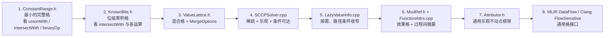

---

## 十二、设计一个新分析的检查清单

当你需要为某个优化设计分析时，可以按下面的顺序思考，这也是把第一节总图"自上而下"走一遍：

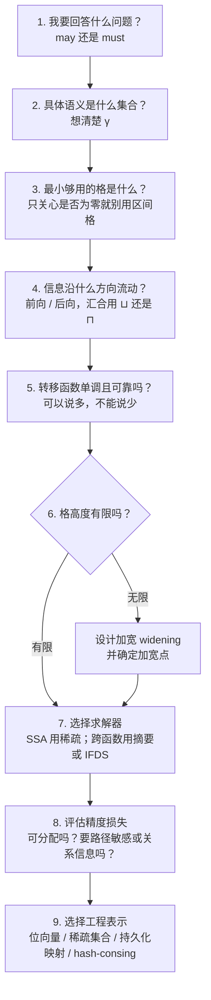

1. **我要回答什么问题？** 是"可能"（may）还是"必然"（must）？这决定 may/must。
2. **具体语义是什么集合？** 想清楚 γ：每个抽象值代表哪些具体情况。
3. **能回答问题的最小格是什么？** 只关心是否为零，就不要用区间格。
4. **信息沿什么方向流动？** 前向还是后向，汇合用什么。
5. **转移函数是否单调、是否可靠？** 逐条指令检查"可以说多、不能说少"。
6. **格的高度是多少？** 无限高度就要设计加宽，并确定在哪里加宽（widening point，通常是循环头）。
7. **选择求解器。** 有 SSA 就优先稀疏分析；跨函数就考虑摘要或 IFDS。
8. **评估精度损失。** 转移函数可分配吗？是否需要路径敏感或关系信息？
9. **选择工程表示。** 位向量、稀疏集合、持久化映射（persistent map）、hash-consing 等都会显著影响性能。

---

## 十三、常见误区

| 误区                   | 正确理解                                                           |
| -------------------- | -------------------------------------------------------------- |
| ⊤ 一定表示"好"，⊥ 一定表示"坏"  | 只是约定，不同流派正好相反，关键是"从乐观走向保守"                                     |
| must 分析与 may 分析是两套理论 | must 分析只是把幂集格倒过来，算法完全相同                                        |
| 元素无穷多的格无法终止          | 决定终止的是高度（或 ACC），平坦格无穷宽但高度为 2                                   |
| 最小不动点就是最精确的答案        | 它是 MFP；转移函数不可分配时，可能比 MOP 更保守                                   |
| 关系域更精确，所以总该用它        | 代价可能是 O(n³) 乃至指数级，编译器通常承受不起                                    |
| 乐观分析的中间结果也能用         | 不能，乐观分析只有在不动点处才可靠；LLVM Attributor 超过迭代上限时必须强制悲观回退              |
| 加宽只是工程技巧             | 它是无限高度格上保证终止的必要手段，代价是精度；LLVM 中表现为 `MaxWidenSteps`、递归深度上限等硬编码阈值 |
| 类型层次天然是格             | 多继承下可能不存在唯一的最小上界，需要额外处理                                        |
| 编译器里的每个分析都是格上的数据流    | LLVM 的支配树用 Semi-NCA，GVN 用值编号，都不是通用格迭代                          |

---

## 十四、学习路线

| 阶段   | 内容                     | 推荐资料                                                                                                                                    |
| ---- | ---------------------- | --------------------------------------------------------------------------------------------------------------------------------------- |
| 入门   | 幂集格、活跃变量、到达定义、worklist | 《编译原理》（龙书）第 9 章                                                                                                                         |
| 系统化  | 单调框架、格论、MOP/MFP、过程间分析  | Møller & Schwartzbach《Static Program Analysis》讲义                                                                                        |
| 理论深化 | 抽象解释、Galois 连接、加宽      | Nielson 等《Principles of Program Analysis》；Cousot & Cousot 1977                                                                          |
| 经典论文 | 数据流框架、SCCP、IFDS        | Kildall 1973；Kam & Ullman 1977；Wegman & Zadeck 1991；Reps, Horwitz & Sagiv 1995                                                          |
| 工程实践 | 读真实实现                  | LLVM `ConstantRange.h`、`KnownBits.h`、`SCCPSolver.cpp`、`Attributor.h`；MLIR `Analysis/DataFlow`；rustc `rustc_mir_dataflow`（顺序见第十一节第 9 小节） |

---

## 结语

回到开头的总图，可以把整个领域概括为三句话：

1. **格是信息的刻度尺**（lattice as a ruler of information）：元素是信息，偏序比较精度，join 合并路径，⊥ 和 ⊤ 是两端。
2. **分析是刻度尺上的单调爬升**（monotone ascent）：从乐观的一端出发，靠单调性和有限高度（或加宽）停在不动点上，靠 Galois 连接保证这个不动点可信。
3. **所有的设计选择都是精度与代价的权衡**（precision vs. cost）：选更细的格、做更多的组合、加更多的敏感性、用关系域，都能换来精度，代价是格更大、更高、运算更贵。

掌握这三句话之后，再遇到任何一个新的编译器分析，无论是 LLVM 里的 `ValueLatticeElement`、`KnownBits`，还是 MLIR 的 `IntegerRangeAnalysis`，都可以问同样的问题：它用的是哪把尺子？在哪里合并？为什么会停？精度丢在了哪里？答案清楚了，这个分析也就看懂了。

---

## 附录：术语中英对照表

| 中文           | English                                                  | 缩写 / 备注                   |
| ------------ | -------------------------------------------------------- | ------------------------- |
| 格            | Lattice                                                  |                           |
| 偏序           | Partial order                                            | ⊑                         |
| 半格           | Semilattice                                              |                           |
| 完全格          | Complete lattice                                         |                           |
| 最小上界 / 连接    | Join / Least Upper Bound                                 | ⊔，LUB                     |
| 最大下界 / 交     | Meet / Greatest Lower Bound                              | ⊓ 或 ∧，GLB                 |
| 上确界 / 下确界    | Supremum / Infimum                                       |                           |
| 单调函数         | Monotone function                                        |                           |
| 可分配函数        | Distributive function                                    |                           |
| 不动点          | Fixpoint                                                 |                           |
| 最小 / 最大不动点   | Least / Greatest Fixpoint                                | LFP / GFP                 |
| Kleene 迭代    | Kleene iteration                                         |                           |
| 升链条件         | Ascending Chain Condition                                | ACC                       |
| 高度           | Height                                                   |                           |
| 平坦格          | Flat lattice                                             |                           |
| 幂集格          | Powerset lattice                                         |                           |
| 区间域          | Interval domain                                          |                           |
| 符号域          | Sign domain                                              |                           |
| 已知位          | Known bits                                               |                           |
| 乘积格          | Product lattice                                          |                           |
| 映射格          | Map lattice                                              |                           |
| 提升格          | Lifted lattice                                           |                           |
| 约简乘积         | Reduced product                                          |                           |
| 析取补全         | Disjunctive completion                                   |                           |
| 函数格          | Function lattice                                         |                           |
| Galois 连接    | Galois connection                                        | α 抽象化，γ 具体化               |
| 抽象化 / 具体化    | Abstraction / Concretization                             |                           |
| 抽象域 / 具体域    | Abstract / Concrete domain                               |                           |
| 可靠性          | Soundness                                                | 反义：unsound                |
| 精度           | Precision                                                |                           |
| 终止性          | Termination                                              |                           |
| 转移函数         | Transfer function                                        |                           |
| 控制流图         | Control Flow Graph                                       | CFG                       |
| 汇合点          | Join point / Merge point                                 |                           |
| 数据流分析        | Dataflow analysis                                        |                           |
| 单调数据流框架      | Monotone dataflow framework                              |                           |
| 抽象解释         | Abstract interpretation                                  |                           |
| 理想路径解 / 不动点解 | Meet/Join Over all Paths / Maximal (Minimal) Fixed Point | MOP / MFP                 |
| 前向 / 后向      | Forward / Backward                                       |                           |
| 可能 / 必然分析    | May / Must analysis                                      |                           |
| 活跃变量分析       | Live variable analysis                                   |                           |
| 到达定义         | Reaching definitions                                     |                           |
| 可用表达式        | Available expressions                                    |                           |
| 非常忙表达式       | Very busy expressions                                    |                           |
| 支配关系         | Dominance                                                |                           |
| 确定赋值         | Definite assignment                                      |                           |
| 常量传播         | Constant propagation                                     |                           |
| 稀疏条件常量传播     | Sparse Conditional Constant Propagation                  | SCCP                      |
| 范围分析         | Range analysis / Value range analysis                    |                           |
| 指针分析 / 别名分析  | Points-to analysis / Alias analysis                      |                           |
| 逃逸分析         | Escape analysis                                          |                           |
| 去虚化          | Devirtualization                                         |                           |
| 边界检查消除       | Bounds check elimination                                 |                           |
| 加宽 / 收窄      | Widening / Narrowing                                     |                           |
| 阈值加宽         | Widening with thresholds                                 |                           |
| 弱拓扑序         | Weak Topological Order                                   | WTO                       |
| 乐观 / 悲观      | Optimistic / Pessimistic                                 |                           |
| 非关系域 / 关系域   | Non-relational / Relational domain                       |                           |
| 差分约束         | Zone / Difference Bound Matrix                           | DBM                       |
| 八边形域         | Octagon domain                                           |                           |
| 多面体域         | Polyhedra domain                                         |                           |
| 流敏感          | Flow-sensitive                                           |                           |
| 路径敏感         | Path-sensitive                                           |                           |
| 上下文敏感        | Context-sensitive                                        |                           |
| 字段敏感         | Field-sensitive                                          |                           |
| 工作表算法        | Worklist algorithm                                       |                           |
| 稀疏分析         | Sparse analysis                                          |                           |
| 静态单赋值        | Static Single Assignment                                 | SSA                       |
| φ 节点         | φ-node (phi node)                                        |                           |
| 支配前沿         | Dominance frontier                                       | IDF 为迭代支配前沿               |
| 过程间分析        | Interprocedural analysis                                 |                           |
| 摘要           | Summary                                                  |                           |
| 图可达性         | Graph reachability                                       |                           |
| 内联缓存         | Inline cache                                             | mono / poly / megamorphic |
| 类型反馈         | Type feedback                                            |                           |
| 推测优化         | Speculative optimization                                 |                           |
| 标量替换         | Scalar replacement                                       |                           |
| 锁消除          | Lock elision                                             |                           |
| 公共子表达式消除     | Common Subexpression Elimination                         | CSE                       |
| 值编号          | Value numbering                                          |                           |
| 位向量          | Bit vector                                               |                           |
| 调用图强连通分量     | Call graph SCC                                           | CGSCC                     |
| 按需分析         | Demand-driven analysis                                   |                           |
