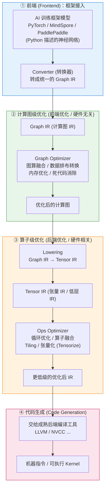

# Pipeline

在深入具体优化技术之前，先建立一个全局观：一个 AI 模型从**框架代码**到**能在硬件上高效执行的机器指令**，中间到底经历了哪些阶段。理解这条主线，能让后续所有的「图优化、算子融合、tiling、张量化、代码生成」等技术点都各归其位。

AI 编译器采用**多层架构**设计，核心是「**两层 IR + 两类优化**」：

- **高层 IR（Graph IR / 计算图 IR）** + **前端优化**（硬件无关）
- **低层 IR（Tensor IR / 张量 IR）** + **后端优化**（硬件相关）





AI 编译器采用多层架构，整体流水线如下：

```text
AI 框架模型 (PyTorch / MindSpore / PaddlePaddle ...)
        │  converter
        ▼
   Graph IR ──► Graph Optimizer（前端优化，硬件无关）
        │
        ▼
   Tensor IR ──► Operator Optimizer（后端优化，硬件相关）
        │
        ▼
     Codegen（代码生成）──► 机器指令
```


这条流水线可以浓缩为一句话：

> **框架模型 → Graph IR →（前端优化）→ Tensor IR →（后端优化）→ 低层 IR → 机器码**


## 子章节

| 章节 | 对应阶段 | 内容 |
| --- | --- | --- |
| [graph-IR](docs/AI-compiler/pipeline/graph-IR/index.md) | 入口 | 框架模型经 `converter` 转换为统一的计算图 IR |
| [graph-optimizer](docs/AI-compiler/pipeline/graph-optimizer/index.md) | 前端优化 | 图级优化：结构化简（融合 / 代数化简 / 消除）、并行与设备放置、精度与量化、调度与执行、算子变换、分布式通信、动态 Shape 与控制流 |
| [tensor-IR](docs/AI-compiler/pipeline/tensor-IR/index.md) | 低级 IR | Graph IR 到 Tensor IR 的生成，及其与传统编译器 IR 的差异 |
| [operator-optimizer](docs/AI-compiler/pipeline/operator-optimizer/index.md) | 后端优化 | 算子分类与挑战、算子库、Auto Tuning；算子级优化（循环分块 / 重排 / 向量化 / 并行化）、Polyhedral 多面体编译、Auto-Tiling 与 Auto-Tensorize |
| [codegen](docs/AI-compiler/pipeline/codegen/index.md) | 代码生成 | 将优化后的低级 IR 转换为机器指令；目标 IR（LLVM IR / PTX / SPIR-V）；指令优化（硬件原语映射、指令调度与流水线） |
| [Memory-Optimization](docs/AI-compiler/pipeline/Memory-Optimization/index.md) | 横切（全栈） | 内存复用与池化、静态内存规划、In-place、重计算、访存对齐与合并、Layout 优化 |
| [LLM-Specific-Optimization](docs/AI-compiler/pipeline/LLM-Specific-Optimization/index.md) | 横切（跨层） | FlashAttention、PagedAttention、Prefix Cache、MoE 路由通信流水化、稀疏计算、KV 缓存量化等大模型专项优化 |

### 两层 IR、两类优化的对比

AI 编译器的核心设计哲学，是把**硬件无关**的优化和**硬件相关**的优化解耦到两层 IR 上，各司其职：

| 维度        | 前端优化（Graph 级）          | 后端优化（算子 / Tensor 级）       |
| --------- | ---------------------- | ------------------------- |
| **对象**    | 整个计算图的拓扑结构             | 单个算子的内部实现                 |
| **视野**    | 局部或全局视野                | 只关注单个算子节点                 |
| **关注点**   | 算子节点的融合、消除、化简          | 输入输出、内存、循环方式、计算逻辑的编排与转换   |
| **目标**    | 使计算图整体的计算与存储开销最小       | 使单个算子在目标硬件上性能最优           |
| **硬件相关性** | 硬件无关（通用优化）             | 硬件相关（依赖 ISA、内存带宽、算力、存储层次） |
| **典型手段**  | 图算融合、数据排布转换、内存优化、死代码消除 | 循环优化、算子融合、Tiling、张量化      |
| **IR 层级** | Graph IR（高层）           | Tensor IR（低层）             |
前端优化具有局部或全局的视野，后端优化只关注单个算子节点。

## 优化技术全景

AI 编译器是连接上层深度学习框架与底层硬件（GPU / [ASIC](docs/AI-compiler/pipeline/tag-ASIC=application-specific-integrated-circuit.txt)）的核心工具链，通过多级 IR 完成**计算图化简**、算子重构、内存优化、硬件指令映射，核心目标是**破解访存瓶颈、提升算力利用率**，尤其适配 Transformer、MoE 等大模型场景。

> **核心动机**：现代硬件算力增长 >> 内存带宽增长，很多算子是"访存密集型（Memory-Bound）"，瓶颈在于反复读写中间结果而非计算本身。因此绝大多数优化，本质都围绕**减少访存 / 隐藏延迟 / 提升硬件利用率**三条主线展开。

### 优化技术与 Pipeline 阶段的对应

各类优化技术按所处的编译阶段归入对应子章节；其中内存优化与大模型专项优化跨越多个阶段，作为横切章节单独列出。

| Pipeline 阶段 | 优化类别 | 优化对象 | 核心目标 | 关键技术 | 详见 |
| --- | --- | --- | --- | --- | --- |
| Graph IR（前端） | **图级优化** | 完整计算图 | 减少访存 & kernel 启动开销 | 算子融合 · 代数化简 · 冗余消除 · 布局变换 · 算子等价替换 | [graph-optimizer](docs/AI-compiler/pipeline/graph-optimizer/index.md) |
| Tensor IR（后端） | **算子级优化** | 单个算子内核 | 最大化单 SM 利用率 | 循环分块 · 循环重排 · 向量化 · 并行化 · 自动调优 · Polyhedral · Auto-Tiling / Auto-Tensorize | [operator-optimizer](docs/AI-compiler/pipeline/operator-optimizer/index.md) |
| 代码生成（后端） | **指令优化** | 硬件指令 & 流水线 | 隐藏延迟、打满硬件流水线 | 硬件原语映射 · 指令调度与流水线 · 多 SM 负载均衡 | [codegen](docs/AI-compiler/pipeline/codegen/index.md) |
| 贯穿全编译栈 | **内存优化** | 张量生命周期与显存 | 降低峰值内存、提升带宽利用率 | 内存复用与池化 · 静态内存规划 · 访存对齐与合并 | [Memory-Optimization](docs/AI-compiler/pipeline/Memory-Optimization/index.md) |
| 跨层级组合 | **大模型专项优化** | Transformer / MoE / 长上下文 | 针对大模型场景的定制化编译 | FlashAttention · PagedAttention · Prefix Cache · MoE 路由通信流水化 · 稀疏计算 · KV 缓存量化 · 混合精度 & 量化融合 | [LLM-Specific-Optimization](docs/AI-compiler/pipeline/LLM-Specific-Optimization/index.md) |

### 主流技术栈对应

- **通用全栈编译器**：Apache TVM、MLIR（LLVM 生态）、XLA（Google）
- **NVIDIA 生态专属**：TensorRT、TensorRT-LLM、Triton DSL
- **大模型推理编译框架**：vLLM、TensorRT-LLM、SGLang

### 阅读建议

- 想快速建立系统性认知 → 按流水线顺序阅读：[graph-optimizer](docs/AI-compiler/pipeline/graph-optimizer/index.md) → [operator-optimizer](docs/AI-compiler/pipeline/operator-optimizer/index.md) → [codegen](docs/AI-compiler/pipeline/codegen/index.md)，再补读 [Memory-Optimization](docs/AI-compiler/pipeline/Memory-Optimization/index.md)
- 关注大模型场景（面试 / 工程实践的热点） → 直接进入 [LLM-Specific-Optimization](docs/AI-compiler/pipeline/LLM-Specific-Optimization/index.md)
- 关注传统"打地基"式的优化 → 从 [graph-optimizer](docs/AI-compiler/pipeline/graph-optimizer/index.md) 开始

## Progressive Lowering
https://feishu.doubao.com/docx/A1dJdKAjuoAJUYx9OMLcS5UGnph

## 参考

- [【AI系统】AI 编译器后端优化](https://cloud.tencent.com/developer/article/2472318?policyId=1003)

