# AI 编译器的权衡图：从 Halide 三角到资源兑换图

> *Trade-off Graph of AI Compilers: from the Halide Triangle to a Resource Exchange Graph*

## 读者导航

| 你想要 | 建议阅读 |
|---|---|
| 5 分钟抓住主旨 | 摘要 → 〇 → 十一 |
| 理解整套框架 | 三（顶点）→ 四（边）→ 五（汇率） |
| 拿来做性能优化 | 六（相图与案例）→ 十（一页纸流程） |
| 从编译器实现的角度看 | 七 |
| 关心趋势与预测 | 5.2（内存墙）→ 八 |

---

## 摘要（TL;DR）

- **Halide 三角（Halide trade-off triangle）**：局部性、并行度、冗余计算**三者不可兼得**。
- **AI 编译器的权衡图（trade-off graph）**：资源之间**可以互相兑换**，但每条渠道的 **汇率（exchange rate）** 不同、依赖当前状态，并且随硬件代际**漂移（drift）**；此外，AI 编译器还可以**拿质量做让步**，这是 Halide 从未有过的自由度。
- 一句话：**顶点是资源，边是技术，汇率随硬件漂移，目标在图外。**
- 这张图能跨越多个五年，靠的是一条建模纪律：

> **顶点只放可度量、可定价、与具体技术无关的资源；技术只能作边。**
>
> FlashAttention 迟早会过时，但“用计算换数据移动”这条边不会。

---

## 〇、先用一个类比理解整张图

把编译器看成一个**外汇交易员**：

| 外汇市场 | 权衡图中的对应物 | 英文 |
|---|---|---|
| 各国货币 | 资源顶点：计算、带宽、容量、并行、精度、工作量、能量 | resource vertex |
| 换汇渠道（银行、柜台） | 优化技术：算子融合、量化、KV Cache …… | edge / technique |
| 汇率 | 多算 1 次浮点运算能少搬多少字节 | exchange rate |
| 汇率随经济周期变化 | 汇率随硬件代际变化 | rate drift |
| 手里最缺的那种货币 | 当前的瓶颈资源 | **binding vertex**（约束顶点） |
| 真正想买的东西 | 目标：时延、吞吐 / 成本、质量 | objective |
| 用房子的面积换价格 | 用质量换资源（量化、早退） | concession（让步） |
| 交易手续费 | 编译时间、搜索预算 | meta-resource（元资源） |

交易员不需要记住所有银行的名字，他只关心三件事：**现在最缺哪种钱、哪条渠道最划算、汇率最近往哪个方向变。** 本文就是在搭这样一张汇率表。

---

## 一、起点：Halide 三角

### 1.1 三角讲的是什么

Halide（Ragan-Kelley 等，PLDI 2013）把图像处理程序拆成 **算法（algorithm，算什么）** 和 **调度（schedule，怎么算）**，并指出**调度空间**里有一个绕不开的三方权衡：

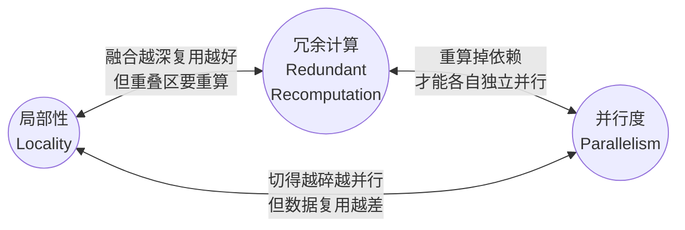

以“两级模糊（two-stage blur）”为例，四种典型调度各占三角的一角或一条边：

| 调度 | 做法 | 并行度 | 局部性 | 冗余计算 |
|---|---|---|---|---|
| 广度优先（breadth-first, `compute_root`） | 先把整张中间图算完写回内存，再算下一级 | 高 | **差** | 无 |
| 完全融合（full fusion, `inline`） | 每个输出像素现场算它要用的中间值 | 高 | 好 | **高** |
| 滑动窗口（sliding window） | 按行流式计算，复用上一行的结果 | **差** | 好 | 无 |
| 分块融合（tiled fusion, `compute_at`） | 按 tile 融合，只重算 tile 边缘（halo） | 较高 | 好 | 少 |

没有哪种调度能三项全优，所以叫“三角”。

### 1.2 三角背后的三个隐含前提

Halide 用三个量就能穷尽调度空间，是因为它默认了三件事不变：

| 前提 | 含义 | 被固定的量 |
|---|---|---|
| **语义固定**（semantics-preserving） | 换调度不许改变结果，精度不能动 | 精度 |
| **工作量固定**（fixed workload） | 算法要求算多少像素，就必须算多少 | 工作量 |
| **机器固定**（fixed machine） | 单节点，存储层级固定 | 拓扑 |

这三样被钉死以后，剩下的自由度正好三个：**算多少（含冗余）、搬多少、同时算多少**，也就是三角的三个角。

**AI 编译器这十年做的事，就是把这三个常量一个个“解冻”（unfreeze）成变量。**

---

## 二、解冻时间线：新顶点从哪来

| 被解冻的常量  | 大致时间      | 成为的顶点        | 代表技术                                                                     |
| ------- | --------- | ------------ | ------------------------------------------------------------------------ |
| 数值精度    | 2017–2023 | **N**        | 混合精度（mixed precision）、INT8、FP8、微缩放格式（MX, microscaling）                   |
| 设备拓扑    | 2019–2026 | **M 阶梯的最外层** | ZeRO/FSDP、张量/流水线/专家并行（TP/PP/EP）、分离式推理（P/D disaggregation）、超节点（SuperPod）  |
| 形状 / 批量 | 2020–2024 | **P 的动态化**   | 动态形状（dynamic shape）、连续批处理（continuous batching）、PagedAttention            |
| 工作量     | 2021–2026 | **A**        | 混合专家（MoE）、早退（early exit）、测试时扩展（test-time scaling）、推理预算（reasoning budget） |
| 能量      | 2025–     | **E**        | 功耗墙（power wall）、每 token 电费、机架功率密度（rack power density）                    |

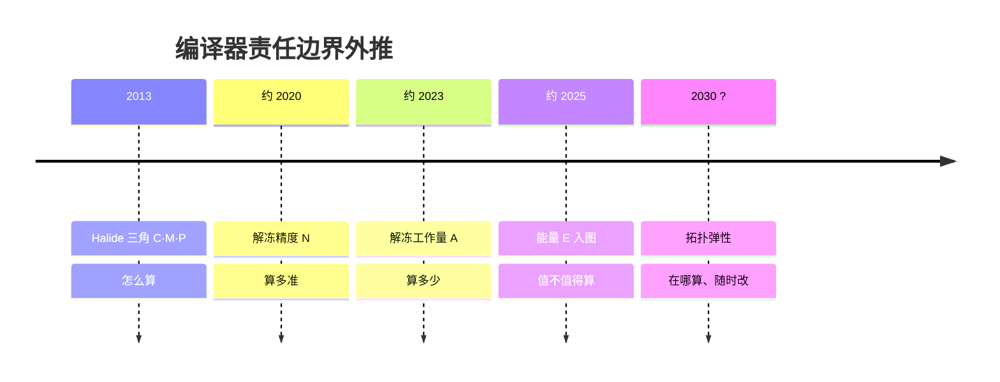

规律是：**每解冻一个常量，编译器负责的范围就往外扩一层。** Halide 时代的编译器只管“怎么算”，今天的 AI 编译器还要管“算多准”“算多少”“在哪算”和“值不值得算”。

---

## 三、图的定义：顶点、汇率、目标

### 3.1 形式化定义

$$
\mathcal{G}_h = (\mathcal{V},\ \mathcal{E},\ r_h)
$$

| 符号 | 含义 |
|---|---|
| $\mathcal{V}$ | **顶点集**：$\{C,\ M_{\text{bw}},\ M_{\text{cap}},\ P,\ N,\ A,\ E\}$，七个可度量资源（M 拆成带宽与容量，见 3.5） |
| $\mathcal{E}$ | **边集**：每条边 $u \xrightarrow{\ \tau\ } v$ 表示技术 $\tau$ **牺牲 $u$、改善 $v$** |
| $r_h(\tau;\,s)$ | **汇率**：$\Delta v_{\text{改善}} / \Delta u_{\text{牺牲}}$。依赖硬件 $h$，也依赖当前状态 $s$（workload、batch、已做过的优化），是**边际值**而非常数 |
| 约束 | 容量上限（HBM 80 GB）、功率上限（700 W）、质量下限（准确率不低于基线 −1%） |
| 目标 | 时延 $T$、吞吐 / 成本 $D$、质量 $Q$，放在**图外** |

> 为避免混淆：边集用花体 $\mathcal{E}$，能量顶点用正体 $E$。

### 3.2 建模纪律：什么能当顶点

原始版本说“顶点必须是守恒量”，这个说法过头了：计算、带宽、能量都会被消耗，并不守恒。真正需要的是三个性质：

| 性质 | 含义 | 反例 |
|---|---|---|
| **可度量**（measurable） | 有量纲、能用 profiler 测出来 | “优化程度” |
| **可定价**（priceable） | 能折算成对目标的边际影响（见 5.3 影子价格） | “代码优雅度” |
| **技术无关**（technique-agnostic） | 不随某项技术的兴衰而出现或消失 | “FlashAttention”“KV Cache” |

**为什么技术不能当顶点？** 如果把 FlashAttention 画成顶点，等它被取代，图就得重画；把它画成边 $C \to M_{\text{bw}}$（用重算换访存），后来任何“用计算换访存”的技术都只是同一条边上的新渠道，图不用改。**顶点稳定，边可替换。**

### 3.3 分层看：四层结构

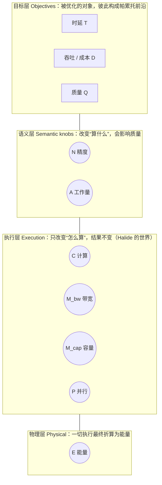

- **Halide 只活在执行层**，这一层里的变换都是**保语义变换（semantics-preserving transformation）**。
- **AI 编译器往上加了语义层，往下加了物理层。** 语义层的变换是**改语义变换（semantics-altering transformation）**，于是“质量”第一次进入了编译器的代价模型。

### 3.4 七个顶点：旋钮与账本

| 符号 | 资源 | 英文 | 量纲 | 类型 | 成熟度 |
|---|---|---|---|---|---|
| **A** | 工作量 | Workload | 每请求“决定要做”的计算量 | 旋钮（决策变量） | 成形中 |
| **N** | 精度 | Numerical Precision | bits / value，可以是向量 | 旋钮（决策变量） | 成熟 |
| **P** | 并行度 | Parallelism | 并发单元 × 占用率（occupancy） | 旋钮（决策变量） | 成熟 |
| **C** | 计算 | Compute | 实际执行的 FLOPs（含冗余） | 账本（派生量） | 成熟 |
| **M_bw** | 数据搬运量 | Data Movement | 各级存储的读写 bytes | 账本（派生量） | 成熟 |
| **M_cap** | 驻留容量 | Memory Capacity | 各级存储的峰值占用 bytes | 账本（约束量） | 成熟 |
| **E** | 能量 | Energy | J / token 或 J / 任务 | 账本（派生量） | 刚入图 |

七个顶点并不相互独立，分成两类：

- **旋钮（knob）**：A、N、P，再加上调度（分块、融合、放置位置），是编译器真正能直接拨动的东西。
- **账本（ledger）**：C、M、E 由旋钮决定：

$$
C \approx A \cdot (1+\rho),\qquad
M_{\ell} = f_{\ell}(\text{调度},\ N),\qquad
E \approx e_{\text{flop}}\, C + \sum_{\ell} e_{\ell}\, M_{\text{bw},\ell} + p_{\text{s}}\, T
$$

其中 $\rho$ 是冗余率（重算、padding、投机执行中被丢弃的部分），$\ell$ 是存储层级，$e$ 是单位能耗，$p_{\text{s}}$ 是静态功率。

**为什么账本也要画成顶点？** 因为工程师谈论和测量的就是它们：profiler 报的是 FLOPs 和 bytes，不是“调度参数”。图的边描述“拨旋钮时账本怎么变”。

**C 与 A 最容易混淆**：A 是“决定算多少”（生成几个 token、激活几个专家），改了会影响结果；C 是“实际算了多少”，多出来的冗余不影响结果。

### 3.5 M：拆成存量和流量，再展开成阶梯

“数据移动”其实混了两种性质不同的东西：

| | **M_bw：流量（flow）** | **M_cap：存量（stock）** |
|---|---|---|
| 问题 | 要搬多少字节 | 同时要放多少字节 |
| 作用方式 | 是**价格**：多搬就多花时间 | 是**约束**：放不下就跑不了 |
| 超标后果 | 变慢 | OOM、只能切分或卸载 |
| 典型优化 | 融合、量化、大 tile | 重计算、ZeRO、PagedAttention、offloading |

两者又都按存储层级展开成一段阶梯：

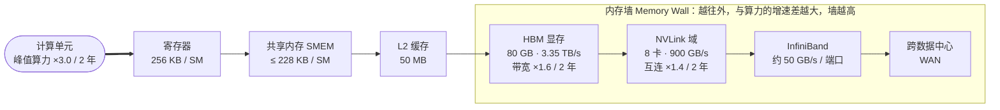

（H100 SXM 一代的量级；增速取自 Gholami 等，*AI and Memory Wall*，IEEE Micro 2024。）

这张阶梯图要同时看两个方向：

- **横向（同一代硬件内部）**：每往外一级，带宽低约一个数量级、能耗高约一个数量级，容量大约一到两个数量级。这是**静态价差**。
- **纵向（跨代）**：算力每 2 年约 ×3.0，HBM 带宽只有 ×1.6，互连只有 ×1.4。**越外层增速越慢，与算力的差距拉得越快。** 这是**动态价差**，也就是**内存墙（memory wall）**，详见 5.2。

由此可以得到两个结论：

1. **“通信（communication）”不是新顶点，只是 M 阶梯的最外几级。** 2020–2023 年分布式训练让人觉得冒出了一个“新维度”，其实是那几年阶梯最外层成了瓶颈：这一级增速最慢，墙最先、也最高。
2. **M 内部也有边，称为层间兑换（inter-level exchange）**：例如 ZeRO/FSDP 用外层带宽（跨卡通信）换内层容量（单卡显存）。

### 3.6 目标层：不能流通，但可以让步

时延、吞吐 / 成本、质量是**目标（objective）**，它们和资源有两点不同：

1. **目标不能在资源之间流通。** 时延是资源消耗的函数，而不是一种可以拿去兑换的资源。以单个 kernel 为例：

$$
T \;\approx\; T_{\text{ovh}} \;+\; \operatorname{agg}\!\left(\frac{C}{\Pi},\ \frac{M_{\text{bw},1}}{B_1},\ \dots,\ \frac{M_{\text{bw},L}}{B_L}\right)
$$

   其中 $\Pi$ 是峰值算力，$B_\ell$ 是第 $\ell$ 级带宽，$T_{\text{ovh}}$ 是固定开销（kernel 启动、调度），$\operatorname{agg}$ 是聚合方式：**完全串行时是求和，完全重叠时是取最大值**（见 4.5）。

2. **目标可以被“让步”（concession）来换资源。** 比如牺牲一点质量换更低位宽。这是 AI 编译器与 Halide 的根本区别：Halide 的质量是硬约束，AI 编译器的质量是可以谈判的预算。

目标之间彼此也有权衡，构成一条**帕累托前沿（Pareto frontier）**：比如 batch 越大吞吐越高，但单请求时延也越高（见 4.6）。

所以，**把时延或质量画成资源顶点是错的**；正确的画法是：目标在图外，资源与目标之间用“让步边”相连，目标与目标之间是前沿上的取舍。

---

## 四、边：兑换图

### 4.1 全景图

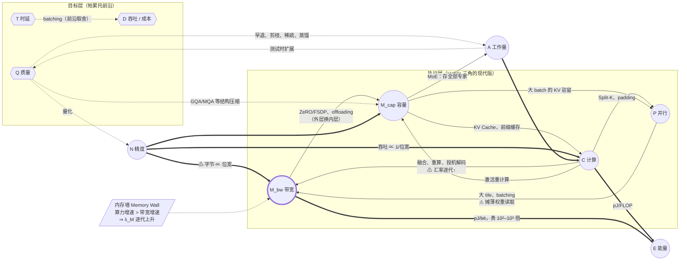

**三种线型：**

| 线型 | 名称 | 连接 | 含义 |
|---|---|---|---|
| 实线 `-->` | **兑换边（trade edge）** | 资源 → 资源 | 保语义的主动交易，汇率由技术和硬件决定 |
| 虚线 `-.->` | **让步边（concession edge）** | 目标 ↔ 资源 / 目标 ↔ 目标 | 改语义的交易，或目标前沿上的取舍 |
| 粗线 `==>` | **传导边（propagation edge）** | 旋钮 → 账本 | 不需要交易，起点变化会**自动**传到终点 |

**内存墙在全景图上的位置。** 它不是顶点也不是边，而是**作用在 M_bw 上的一股持续压力**：M_bw 节点加粗；所有带 ⚠ 的边（改善 M_bw 的边）汇率都随内存墙变得越来越划算。**结构图回答“能怎么换”，内存墙回答“为什么总是往 M 换”。**

### 4.2 兑换边：执行层内部

行是**牺牲的资源**，列是**改善的资源**：

| 牺牲 ↓ ／ 改善 → | **C** | **M_bw** | **M_cap** | **P** |
|---|---|---|---|---|
| **C（多算）** | — | **重算换搬运**：算子融合（operator fusion）、FlashAttention、halo 重算、投机解码（speculative decoding） | **重算换容量**：激活重计算（activation recomputation / gradient checkpointing）、FlashAttention 不存注意力矩阵 | **冗余换并行**：Split-K、padding、分桶（bucketing）、分组矩阵乘（grouped GEMM） |
| **M_bw（多搬）** | **预计算**：查找表（lookup table）、权重预打包（weight pre-packing） | **布局变换（layout transformation）**：一次转置，换后续合并访存（coalesced access） | **层间兑换**：ZeRO/FSDP（通信换显存）、offloading（PCIe 带宽换 HBM 容量） | **TP/PP**：用跨卡通信换更多并行单元 |
| **M_cap（多占）** | **缓存换计算**：KV Cache、前缀缓存（prefix caching）、`compute_root` | **复制换通信**：数据并行（DP）每卡一份权重，省掉参数通信 | — | **驻留换并发**：更多 KV 驻留，支撑更大 batch |
| **P（少并行）** | **去冗余**：不做 Split-K 省掉归约 | **粗粒度换复用**：大 tile、深度融合、大 batch 摊薄权重读取 | — | — |

> **投机解码属于 $C \to M_{\text{bw}}$。** 它多花草稿模型和被拒 token 的计算，换来“读一次权重验证多个 token”，**输出分布不变（lossless）**，是保语义变换，不是让步。

### 4.3 让步边：用质量换资源

| 边 | 方向 | 代表技术 | 是否训练期决定 |
|---|---|---|---|
| $Q \dashrightarrow N$ | 让出一点质量，换更低位宽 | 训练后量化（PTQ）、量化感知训练（QAT）、FP8 训练 | 两者皆有 |
| $Q \dashrightarrow A$ | 让出一点质量，少做工作 | 早退（early exit）、级联（cascade）、token 剪枝、2:4 结构化稀疏（structured sparsity）、低秩分解（low-rank）、稀疏注意力、蒸馏（distillation） | 两者皆有 |
| $Q \dashrightarrow M_{\text{cap}}$ | 改模型结构，缩小驻留状态 | GQA / MQA / MLA（缩小 KV Cache） | 训练期 |
| $A \dashrightarrow Q$ | 多做工作，换更高质量 | 测试时扩展：best-of-n、更长思维链（chain-of-thought）、更多扩散步数 | 推理期 |

让步边的定价需要知道**质量的影子价格**：在质量预算内，多让 0.1% 准确率能省多少资源（见 5.3）。Halide 从未处理过这类边，因为它的前提是“结果不许变”。

### 4.4 传导边：N 和 A 是乘数

| 传导 | 关系 | 量级（H100 SXM，稠密） |
|---|---|---|
| $N \Rightarrow M_{\text{bw}}, M_{\text{cap}}$ | 字节数 ∝ 位宽 | BF16 → FP8，字节减半 |
| $N \Rightarrow C$ | 张量核吞吐 ≈ ∝ 1 / 位宽 | TF32 ≈ 495 → BF16 ≈ 989 → FP8 ≈ 1979 TFLOPS |
| $N \Rightarrow P$ | 元素更小，tile 和 batch 能放得更大 | 同样的 SMEM / HBM 装下约 2 倍数据 |
| $A \Rightarrow C, M$ | 少做的工作直接从账本扣除 | 少激活一个专家 ≈ 少一份 FFN 的计算和权重读取 |
| $C, M \Rightarrow E$ | 能量计价 | 见 5.4 |

**N 是一条“一对多”的边**（扇出（fan-out），也可看作超边（hyperedge））：位宽减半，**同时**带来吞吐翻倍、字节减半、并行空间变大。这就是量化成为过去五年性价比最高的优化的原因。

### 4.5 不在边上的优化：重叠与去开销

有两类重要优化**不交易任何资源**，而是改变“记账方式”，因此在图上找不到对应的边：

**① 重叠（overlap）：把求和变成取最大值。**

$$
\underbrace{\frac{C}{\Pi} + \frac{M_{\text{bw}}}{B}}_{\text{串行}}
\;\;\longrightarrow\;\;
\underbrace{\max\!\left(\frac{C}{\Pi},\ \frac{M_{\text{bw}}}{B}\right)}_{\text{完全重叠}}
$$

| 层级 | 技术 |
|---|---|
| kernel 内 | 双缓冲（double buffering）、TMA 异步拷贝（Tensor Memory Accelerator）、线程束专用化（warp specialization） |
| 卡间 | 计算与通信重叠（compute-communication overlap）、ZeRO 预取（prefetch） |
| 流水线 | 1F1B 调度、交错流水线（interleaved pipeline）减少气泡 |

重叠是“免费午餐”，但有上限：最多把时间压到最大项。**所以重叠做到头之后，仍然要回到图上兑换。** 另外，重叠还会减少静态能耗 $p_{\text{s}} T$。

**② 去开销（overhead elimination）：消掉 $T_{\text{ovh}}$。**

CUDA Graphs、持久化 kernel（persistent kernel）、减少 kernel 数量的融合。小 batch 解码时，$T_{\text{ovh}}$ 往往不可忽视（见 6.2）。

> 一个实用的顺序：**先去开销、再做重叠、最后兑换**。前两者不牺牲任何资源，只有它们做完了，影子价格才是真实的。

### 4.6 目标层的前沿：时延与吞吐

增大 batch 是推理服务里最核心的取舍。以解码为例，每一步需要读一遍权重 $S_W$，再读每个请求自己的 KV Cache $S_{\text{KV}}$：

$$
T_{\text{step}}(b) \approx \frac{S_W + b \cdot S_{\text{KV}}}{B_{\text{HBM}}},
\qquad
\text{吞吐} = \frac{b}{T_{\text{step}}(b)},
\qquad
b \le \frac{\bar{M}_{\text{cap}} - S_W}{S_{\text{KV}}}
$$

7B 模型、BF16、上下文 4K、H100（80 GB，3.35 TB/s）：

| batch $b$ | 标准多头注意力（KV 2 GB / 请求） | | | GQA，KV 头数 1/4（0.5 GB / 请求） | | |
|---|---|---|---|---|---|---|
| | 每步时延 | 吞吐（token/s） | 显存 | 每步时延 | 吞吐（token/s） | 显存 |
| 1 | 4.8 ms | 209 | 16 GB | 4.3 ms | 231 | 15 GB |
| 8 | 9.0 ms | 893 | 30 GB | 5.4 ms | 1489 | 18 GB |
| 32 | 23.3 ms | 1375 | 78 GB | 9.0 ms | 3573 | 30 GB |
| 128 | 放不下 | — | — | 23.3 ms | 5498 | 78 GB |

从表里能读出三件事：

1. **小 batch 时吞吐几乎是免费的**：$b \cdot S_{\text{KV}} \ll S_W$ 时，时延几乎不变。
2. **$b \cdot S_{\text{KV}}$ 接近 $S_W$ 后，每多一点吞吐都要付时延**，前沿开始弯曲。
3. **GQA（让步边 $Q \dashrightarrow M_{\text{cap}}$）把整条前沿往外推**：同样 23 ms 时延，吞吐从 1375 提到 5498。

### 4.7 复合技术 = 图上的路径

真实技术往往是一条**路径（path）**，按路径来理解比背技术名字有用得多：

| 技术 | 路径 | 读法 |
|---|---|---|
| 仅权重量化（weight-only INT4） | $Q \dashrightarrow N \Rightarrow M_{\text{bw}}, M_{\text{cap}}$ | 让出少量质量 → 4 bit → 读取量和占用都降到 1/4 |
| FP8 训练 | $Q \dashrightarrow N \Rightarrow C, M$ | 一次让步，两份收益 |
| FlashAttention | $C \to M_{\text{bw}}$ + $C \to M_{\text{cap}}$ + $P \to M_{\text{bw}}$ | 重算注意力矩阵、分块进 SMEM，不写回 HBM 也不存 $O(n^2)$ 中间结果 |
| MoE | $M_{\text{cap}} + M_{\text{bw}}^{\text{外层}} \to A \Rightarrow C$ | 存全部专家、承担 all-to-all 通信，换每 token 少算 |
| ZeRO-3 / FSDP | $M_{\text{bw}}^{\text{外层}} \to M_{\text{cap}}$，再加重叠 | 通信换显存，用预取把通信藏到计算后面 |
| 投机解码 | $C \to M_{\text{bw}}$ | 多算草稿，换更少的权重读取；无损 |
| PagedAttention | $M_{\text{cap}}$ 的碎片回收 → $P$ | 减少浪费的驻留，支撑更大 batch |
| 推理模型 / 长思维链 | $A \dashrightarrow Q$ | 多做工作，换更高的任务成功率 |

**遇到新技术，先问它走的是哪条路径。** 答出来了，它的适用场景（瓶颈在终点时有效）和失效场景（终点不是瓶颈时白付代价）也就清楚了。

---

## 五、汇率：从“不可兼得”到“值不值得换”

### 5.1 核心汇率：机器平衡比

$$
R_{\text{machine}} = \frac{\Pi_{\text{peak}}\ \text{(FLOP/s)}}{B_{\text{HBM}}\ \text{(bytes/s)}}
$$

**机器平衡比（machine balance）**可以直接读成汇率：每搬 1 字节，机器同时能做多少次浮点运算。

| 硬件 | 峰值算力（BF16/FP16 稠密，TFLOPS） | HBM 带宽（TB/s） | $R$（FLOP/byte） |
|---|---|---|---|
| NVIDIA V100 SXM | 125 | 0.9 | ≈ 139 |
| NVIDIA A100 SXM | 312 | 2.0 | ≈ 153 |
| NVIDIA H100 SXM | 989 | 3.35 | **≈ 295** |
| NVIDIA H200 SXM | 989 | 4.8 | ≈ 206 |
| NVIDIA B200（HGX） | ≈ 2250 | 8.0 | ≈ 281 |
| AMD MI300X | ≈ 1307 | 5.3 | ≈ 247 |
| Google TPU v5e | 197 | 0.82 | ≈ 240 |
| Google TPU v5p | 459 | 2.77 | ≈ 166 |

（公开规格的量级，不同功耗档位略有差异。）

两点补充：

- **框架不依赖 GPU。** TPU 的脉动阵列（systolic array）靠大容量片上缓冲提高复用，相当于在 M 阶梯里多插了一级，但汇率的量级相同。昇腾等国产加速器的平衡比同样在百级 FLOP/byte，具体以厂商口径为准。
- **端侧的墙最高。** 端侧 NPU 算力为数十 TOPS（INT8），而 LPDDR 带宽只有约 50–130 GB/s，平衡比可达数百 op/byte，且容量更紧。这就是端侧大模型几乎全靠量化的原因：$N \Rightarrow M$ 在那里最值钱。

### 5.2 内存墙：汇率的长期漂移

**内存墙（memory wall）** 由 Wulf 和 McKee 在 1995 年提出，原意是处理器速度的增长快于内存速度的增长。在权衡图里，它是**汇率随时间漂移的方向**。

#### 代际视角：R 并不是每代都涨

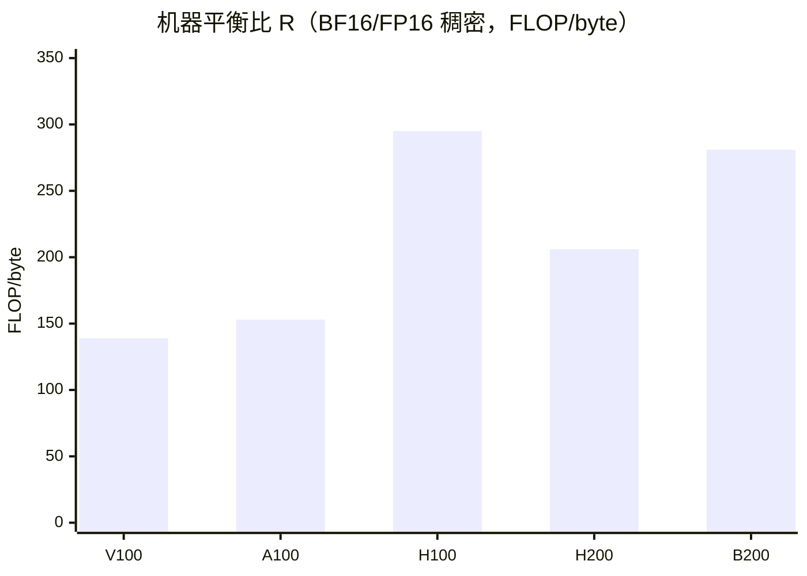

H200 的算力与 H100 相同，只把带宽从 3.35 提到 4.8 TB/s，$R$ 因此降到约 206。**这不是内存墙消失的反例，反而是证据：正因为瓶颈在 M，厂商才会专门出一代产品花钱补 M。** 补一次只能暂时压低，下一代算力一翻倍，$R$ 又涨回来。

#### 长期视角：增速差决定墙的高度

| 指标 | 每 2 年增速 | 10 年累计 |
|---|---|---|
| 峰值算力（peak FLOPS） | ×3.0 | ≈ ×243 |
| DRAM 带宽（DRAM bandwidth） | ×1.6 | ≈ ×10 |
| 互连带宽（interconnect bandwidth） | ×1.4 | ≈ ×5 |

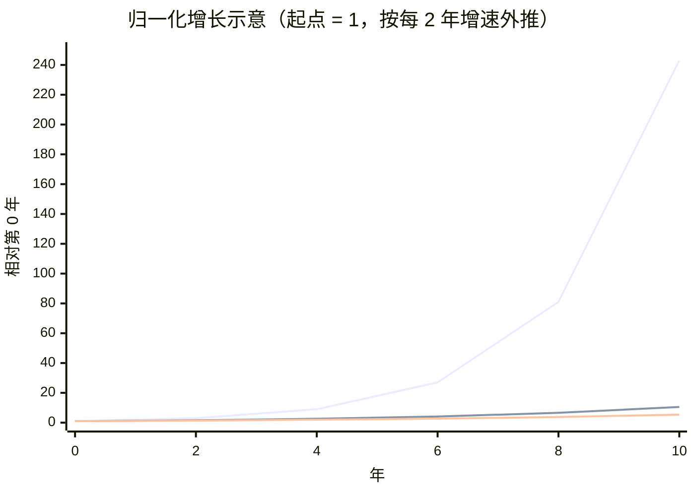

（三条线自上而下分别为：算力、DRAM 带宽、互连带宽。数据：Gholami 等，IEEE Micro 2024。）

由此得到 $R$ 的长期漂移速度：

$$
\frac{R_{t+2}}{R_t} \approx \frac{3.0}{1.6} \approx 1.9\ \ (\text{HBM}),
\qquad
\frac{3.0}{1.4} \approx 2.1\ \ (\text{互连})
$$

**越往阶梯外层，墙涨得越快。** 用影子价格的语言（见 5.3），内存墙就是“M 相对 C 的价格 $\lambda_M / \lambda_C$ 长期上升”：

> $R$ 长期上升 → M 的相对价格上升 → **图上划算的兑换几乎都指向 M。**

过去五年的主旋律为什么是融合、重算、注意力分块、量化？因为 **$C \to M_{\text{bw}}$ 和 $N \Rightarrow M$ 这两条边的汇率一直在变得更划算。**

#### 内存墙其实有两堵

| 类型 | 英文 | 含义 | 对应顶点 | 逼出的技术 |
|---|---|---|---|---|
| **带宽墙** | Bandwidth Wall | 算力增速 > 带宽增速 | $M_{\text{bw}}$ 价格上升 | 融合、重算、量化 |
| **容量墙** | Capacity Wall | 模型规模增速（Transformer 参数约 ×410 / 2 年）远超单卡显存增速（约 ×2 / 2 年） | $M_{\text{cap}}$ 约束收紧 | ZeRO/FSDP、TP/PP、offloading、PagedAttention |

这也是把 M 拆成 $M_{\text{bw}}$ 与 $M_{\text{cap}}$ 的直接理由：两堵墙的成因不同，对策也不同。

### 5.3 通用判据：影子价格

不同资源的量纲各不相同（FLOPs、bytes、bits、焦耳），汇率要能比较，必须先换算成同一种“货币”。这个换算系数叫**影子价格（shadow price）**。

把编译看成一个约束优化问题：

$$
\min_{x}\ T(x)
\quad \text{s.t.}\quad
M_{\text{cap}}(x) \le \bar{M},\quad
\frac{E(x)}{T(x)} \le \bar{p},\quad
Q(x) \ge \bar{Q}
$$

其中 $x$ 是所有旋钮。每个资源 $u$ 的影子价格 $\lambda_u$ 是“多用一单位 $u$，目标变差多少”，数学上就是**拉格朗日乘子（Lagrange multiplier）**。在取最大值的时延模型里，它非常具体：

$$
\lambda_C = \frac{\partial T}{\partial C} =
\begin{cases} 1/\Pi & \text{计算是最大项} \\ 0 & \text{否则} \end{cases}
\qquad
\lambda_{M} = \frac{\partial T}{\partial M_{\text{bw}}} =
\begin{cases} 1/B & \text{访存是最大项} \\ 0 & \text{否则} \end{cases}
$$

一条边 $\tau$（牺牲 $\Delta u$，改善 $\Delta v$）值得走，当且仅当：

$$
\lambda_v \cdot \Delta v \;>\; \lambda_u \cdot \Delta u
\quad\Longleftrightarrow\quad
r_h(\tau;\,s) \;>\; \frac{\lambda_u}{\lambda_v}
$$

几个直接推论：

1. **binding vertex 就是影子价格最高的顶点。**
2. **非瓶颈资源的影子价格为 0**（互补松弛，complementary slackness）。所以访存受限时 $\lambda_C \approx 0$，**重算几乎免费**，直到计算也被占满为止。
3. **让步边的定价**靠质量约束的乘子 $\lambda_Q$：$\lambda_Q$ 小（质量预算宽松）时量化很便宜，接近质量底线时会突然变贵。
4. **影子价格是局部的**。每走一条边，状态 $s$ 改变，$\lambda$ 跟着重算，这就是瓶颈迁移（见 6.2）。

### 5.4 其他汇率的量级

- **层级比价**：寄存器 / SMEM / L2 / HBM / NVLink / IB，带宽与能耗大约每级差一个数量级。
- **能量比价**：45 nm 工艺下（Horowitz, ISSCC 2014；Han 等 2016 整理），一次 FP32 加法约 0.9 pJ，读 32 bit SRAM 约 5 pJ，读 32 bit DRAM 约 640 pJ，**DRAM 与加法相差约 700 倍**。工艺进步后数字会变，但“搬运比计算贵两到三个数量级”一直成立，所以把能量算进来只会让 M 更贵。
- **P 的收益是阶梯形的**：填满所有 SM 后收益迅速变平，还会出现**波次量化（wave quantization）**：H100 有 132 个 SM，133 个 block 要跑两轮，第二轮只有 1 个 block 在干活，利用率接近减半。

---

## 六、相图：先找 binding vertex

工程上不需要同时优化七个维度，**只需要知道现在哪个顶点最贵，然后沿能改善它的边去兑换。**

### 6.1 三区间屋顶线模型

对每个 kernel 计算**算术强度（arithmetic intensity）** $I = \text{FLOPs} / \text{bytes}$，代入**屋顶线模型（Roofline model）**：

$$
\Pi_{\text{attain}} = \min\!\big(\Pi_{\text{peak}},\ I \cdot B\big)
$$

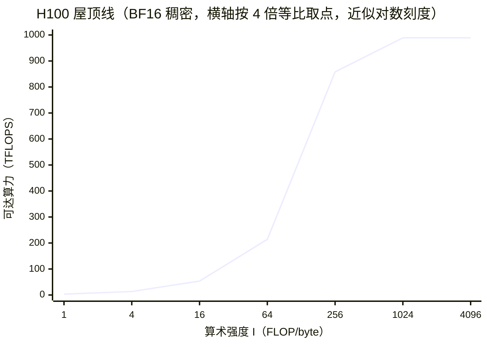

（拐点在 $I = R \approx 295$。batch = 1 的解码 $I \approx 1$，落在最左端；大矩阵乘的 $I$ 可达数千，落在平台上。）

经典屋顶线只有两个区间，实际工程中还需要第三个：

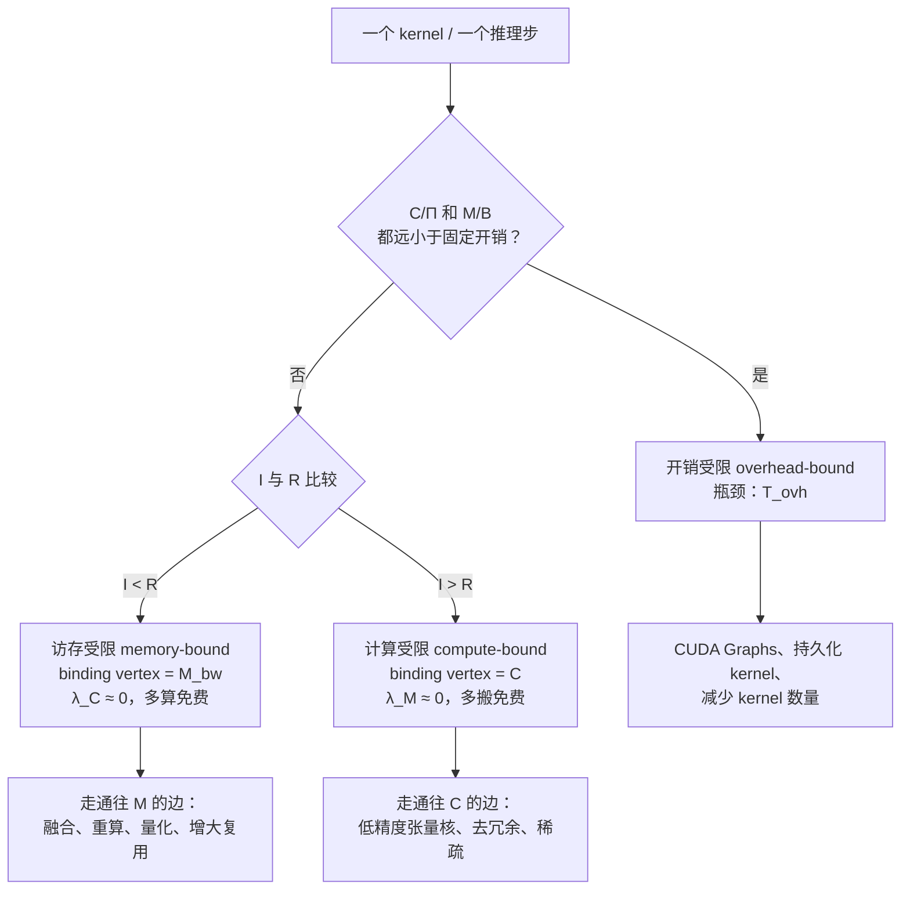

**分层屋顶线（hierarchical Roofline）**：M 是一段阶梯，每一级都有自己的“屋顶”。对每一级 $\ell$ 分别计算 $I_\ell = \text{FLOPs} / \text{bytes}_\ell$：

$$
\Pi_{\text{attain}} = \min\!\Big(\Pi_{\text{peak}},\ \min_{\ell}\ I_\ell \cdot B_\ell\Big)
$$

**取到最小值的那一级就是 binding level。** 分布式场景下，这一级往往是 NVLink 或 IB。

### 6.2 推理案例：H100 上 7B 模型解码

7B 参数、BF16 权重、batch = 1：

**① 定相。** 每个参数读 2 字节、做 2 次浮点运算，$I \approx 1 \ll R \approx 295$，**严重访存受限**，算力利用率不到 1%。

- 读权重：$14\ \text{GB} / 3.35\ \text{TB/s} \approx 4.2\ \text{ms}$，上限约 240 token/s；
- 计算：$14\ \text{GFLOP} / 989\ \text{TFLOPS} \approx 0.014\ \text{ms}$；
- 固定开销：一步约 300–400 个 kernel，按每个约 4 μs 估算，约 1.2–1.6 ms（PyTorch eager 模式往往更高）。

**② 定向。** binding vertex 是 $M_{\text{bw}}$，候选的边：

| 手段 | 路径 | 效果 | 代价 |
|---|---|---|---|
| 增大 batch | $P \to M_{\text{bw}}$ | 一次读权重服务 $b$ 个请求 | 单请求时延上升；受 $M_{\text{cap}}$ 约束（见 4.6） |
| INT4 仅权重量化 | $Q \dashrightarrow N \Rightarrow M_{\text{bw}}$ | 权重 14 GB → 3.5 GB | 少量精度损失；反量化计算因 $\lambda_C \approx 0$ 几乎免费 |
| 投机解码 | $C \to M_{\text{bw}}$ | 读一次权重验证 $k$ 个 token | 草稿和被拒 token 的计算；无损 |
| P/D 分离 | 用 $M$ 最外层换按相分区 | prefill（计算受限）与 decode（访存受限）各自对症 | 跨机传输 KV Cache |

**③ 预判：瓶颈会迁移两次。**

- **INT4 之后**：读权重降到约 1.05 ms，**已经小于固定开销 1.2–1.6 ms**，系统进入开销受限。此时再做任何访存优化都无效，必须先上 CUDA Graphs。
- **加大 batch 之后**：每个请求都有自己的 KV Cache，无法像权重那样共享，注意力部分的 $I$ 依然约为 1，瓶颈从“权重带宽”迁到“KV 带宽与容量”，下一组边是 PagedAttention、KV Cache 量化、前缀缓存。

$$
M_{\text{bw}}\ (\text{权重}) \xrightarrow{\ \text{INT4}\ } T_{\text{ovh}} \xrightarrow{\ \text{CUDA Graphs + batching}\ } M_{\text{bw}}, M_{\text{cap}}\ (\text{KV})
$$

**每兑换一次，binding vertex 都可能换人。**

### 6.3 训练案例：容量墙与流水线气泡

7B 模型、混合精度 Adam 训练：

**① 容量墙。** 每个参数需要 16 字节（FP16 权重 2 + FP16 梯度 2 + FP32 主权重、一阶矩、二阶矩共 12），7B 模型合计约 112 GB，**单卡 80 GB 放不下**，还没算激活。binding vertex 是 $M_{\text{cap}}$。

- 走 $M_{\text{bw}}^{\text{外层}} \to M_{\text{cap}}$：ZeRO-3 在 8 卡上分片，每卡约 14 GB；
- 走 $C \to M_{\text{cap}}$：激活重计算，再省掉大部分激活显存；
- 代价是跨卡通信，于是用**重叠**（预取下一层参数）把通信藏起来。

**② 流水线气泡（pipeline bubble）。** 模型更大时要做流水线并行。$p$ 个阶段、$m$ 个 micro-batch 时，气泡开销约为：

$$
\text{bubble} \approx \frac{p-1}{m}
\qquad\xrightarrow{\ \text{交错调度，每卡 } v \text{ 个虚拟阶段}\ }\qquad
\frac{1}{v}\cdot\frac{p-1}{m}
$$

气泡是 **P 的浪费**。减少它有两条边：增大 $m$（每个 micro-batch 变小，$I$ 下降，可能掉进访存受限区），或交错调度（通信量约增大 $v$ 倍，走 $M_{\text{bw}}^{\text{外层}} \to P$）。**又是一次瓶颈迁移的取舍。**

### 6.4 系统层面的瓶颈迁移

| 时期 | Binding vertex | 主题技术 |
|---|---|---|
| 2020–2022 | M 最外层（通信） | ZeRO/FSDP、TP/PP、自动并行策略搜索（auto-parallelism） |
| 2022–2024 | $M_{\text{cap}}$ | FlashAttention、PagedAttention、GQA/MQA |
| 2024–2026 | $M_{\text{bw}}$（解码纯访存受限） | KV Cache 量化、投机解码、P/D 分离 |
| 2026–2030（预测） | **A 与 E** | 自适应推理（adaptive inference）、能效调度（energy-aware scheduling） |

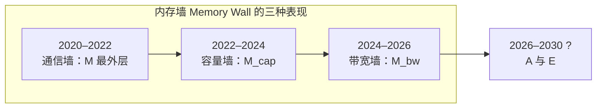

**2020–2026 年的三个阶段，其实是同一堵内存墙在阶梯不同位置的三种表现**：最先卡住的是增速最慢的最外层，然后是容量，最后是 HBM 带宽。预测中的下一阶段也绕不开内存墙：自适应推理靠少做工作来少搬数据，能量核算则让 M 更贵。

**权衡图的用处是看清瓶颈往哪个方向迁移，而不是把所有维度罗列一遍。**

---

## 七、编译器视角：编译器是一个自动化交易员

### 7.1 编译器的三个组成部分

| 交易员需要 | 编译器对应 | 在权衡图上 |
|---|---|---|
| 知道有哪些渠道 | **搜索空间（search space）**：可以施加的变换 | 当前允许走的边 |
| 知道汇率和价格 | **代价模型（cost model）**：解析模型、学习模型或实测 | 估计 $r_h(\tau; s)$ 和 $\lambda$ |
| 决定怎么交易 | **搜索策略（search strategy）**：贪心、动态规划、进化、ILP | 在图上找路径 |

### 7.2 编译器组件在图上的位置

| 编译器组件 | 主要走的边 | 代表系统 |
|---|---|---|
| 图级融合（graph-level fusion） | $C \to M_{\text{bw}}$ | XLA、TorchInductor、TVM Relax |
| 算子调度与代码生成（scheduling / codegen） | 执行层内部，即 Halide 三角本身 | Halide、TVM（Ansor / MetaSchedule）、Triton |
| 内存规划与重物化（rematerialization） | $C \leftrightarrow M_{\text{cap}}$ | XLA remat、Checkmate（ILP 求最优重计算） |
| 自动并行 / 分片（auto-sharding） | $M^{\text{外层}} \leftrightarrow M_{\text{cap}} \leftrightarrow P$ | GSPMD、Alpa（算子间 + 算子内两级搜索） |
| 量化与混合精度 | $Q \dashrightarrow N$ | TensorRT、各类量化工具链 |
| 重叠调度 | 不是边，把求和变成取最大值 | 通信重叠 pass、warp specialization 代码生成 |
| 运行时调度 | 目标前沿（时延 / 吞吐） | vLLM、SGLang 的 batching 与调度器 |

### 7.3 元资源：编译本身也有成本

编译器自己也在花钱，这类成本称为**元资源（meta-resource）**：

| 元资源 | 和运行性能的交易 | 例子 |
|---|---|---|
| 编译时间 / 搜索预算 | 搜得越久，越接近最优 | Ansor 调一个模型要数小时；Triton autotune 增加首次运行时延 |
| JIT 预热 | 运行时编译换更贴合实际形状的代码 | 冷启动 TTFT 变长 |
| 重编译次数 | 动态形状每变一次就要重编译 | **分桶 + padding**：用冗余计算 $C$ 换更少的重编译次数 |
| 工程复杂度 | 手写 kernel 性能高、维护成本也高 | 手写 FlashAttention 与编译器生成之间的取舍 |

当负载越来越动态，**元资源会从可以忽略变成必须定价**，这也是第八节“编译期与运行期边界消失”的根源。

---

## 八、未来五年：可检验的预测

每条预测都附上检验标准，到时间点可以对照证伪。

### H1：A 成为一等顶点

调度将包含“决定算多少”。MoE、自适应推理和推理预算会把工作量从 **超参数（hyperparameter）** 变成**编译期 / 运行期的显式决策变量**；代价模型必须回答“多算 20% 换 3% 准确率值不值”，也就是给 $A \dashrightarrow Q$ 定价。目标函数也会变：在智能体（agentic）负载下，“每 token 成本”退化成中间指标，真正的指标是**每任务成本（cost per task）**。

- **检验**：到 2030 年，主流推理服务框架是否把“推理预算 / 思考长度”作为调度器的一等参数，并按请求难度自动分配；主要模型评测是否普遍同时报告“每任务成本”。

### H2：E 入图，作用是让 M 更贵，而不是重新排序

由 $E \approx e_{\text{flop}} C + \sum_\ell e_\ell M_{\text{bw},\ell} + p_{\text{s}} T$，且 $e_\ell \gg e_{\text{flop}}$，能量核算只会让“减少数据移动”更划算。此外还会出现一条新的目标层取舍：**动态调频调压（DVFS）**，用时延换能量。

- **检验**：到 2030 年，主流编译器或 autotuner 是否提供“以能耗为目标”的选项；端侧和功率受限场景是否最先以 E 为 binding vertex；“降低访存”的技术是否普遍以“降低能耗”来宣传。
- **反证**：如果出现某类技术以增加数据移动为代价、显著降低总能耗并成为主流，说明 E 重排了图。

### H3：N 从一个点展开成一个向量

精度不再是全局选一个 dtype，而是 **逐张量（per-tensor）、逐层（per-layer）、逐阶段（per-phase）** 的调度变量，并配上**误差反馈闭环（error-feedback loop）**：

$$
N \;\longrightarrow\; \mathbf{n} = \big(n_{\text{layer},\,\text{tensor},\,\text{phase}}\big)
$$

- **检验**：到 2028 年，主流推理框架是否默认支持并自动搜索逐层混合精度；主流训练框架是否按层自动选择 FP8 / MX 格式。

### 结构性变化：编译期与运行期的边界消失

Halide 的静态调度默认“编译期能看到全部”。动态、智能体式、长尾的负载打破了这个前提，调度会从 **编译期约定（compile-time decision）** 变成 **运行期契约（runtime contract）**：即时编译（JIT）+ 在线自动调优（online autotuning）+ 投机执行（speculative execution）。这相当于把 **P** 和元资源也解冻成运行时可调的维度。

- **检验**：动态形状编译和在线调优是否成为主流框架的默认路径，而不是需要手动开启的选项。

---

## 九、这张图的边界

### 9.1 什么情况下图会失效

| 场景 | 后果 |
|---|---|
| **非冯·诺依曼架构（non-von Neumann）**：存内计算（PIM）、光互连、模拟计算 | C 与 M 分不开，**顶点合并** |
| **计算变得极其便宜** | 图退化成接近一维 |
| **模型范式变化**，静态计算图前提消失（持续学习（continual learning）、世界模型） | 编译期优化失去地基 |
| **能量计量方式剧变** | E 的汇率失去意义 |

### 9.2 这张图本身的建模局限

- **汇率是局部线性化的。** 大步兑换时汇率会变（比如 batch 从 1 到 128），只能分步走、每步重算 $\lambda$。
- **多租户干扰不在图内。** 共享 GPU 时，别人的 workload 会改变你的有效带宽与容量。
- **数值稳定性只部分被 Q 刻画。** 低精度训练发散这类问题是离散失败，不是连续的质量损失。
- **工程成本只以元资源粗略出现。** 手写 kernel 与可维护性之间的取舍很难精确定价。

即使顶点合并，方法论也不变：

> **先列出可定价的资源 → 再找可以兑换的边 → 最后给汇率定价，并随状态更新。**

---

## 十、一页纸使用流程

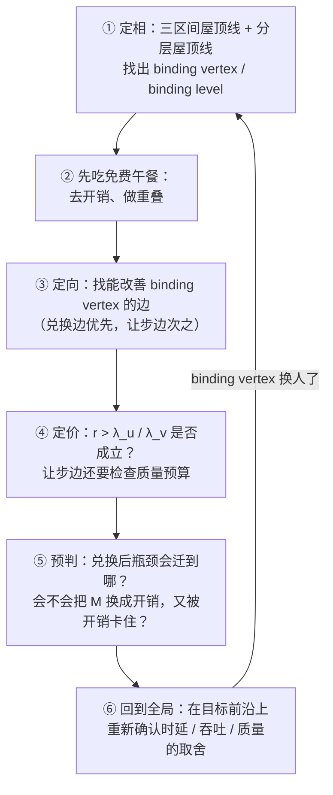

**第 ⑤ 步是手工优化最常翻车的地方**：把 kernel 从访存受限推成了计算受限，结果整个系统变成了通信受限；或者像 6.2 那样，量化之后瓶颈变成了 kernel 启动开销。

---

## 十一、与 Halide 三角的关系

> **Halide 三角，是这张图在 N、A、E 全部冻结、去掉所有让步边、并把 M 压成一级（不区分带宽与容量、不分层）之后，在 {C, M, P} 上的导出子图（induced subgraph）。**

它没有过时，它是一个特例。AI 编译器做的事，就是把这个特例一层层展开：

| 年份 | 新增 | 编译器开始负责 |
|---|---|---|
| 2013 | Halide 三角（C·M·P） | 怎么算 |
| 约 2020 | + 精度 N | 算多准 |
| 约 2023 | + 工作量 A | 算多少 |
| 约 2025 | + 能量 E | 值不值得算 |
| 2030 ? | + 拓扑弹性 | 在哪算、随时改 |

顶点还会继续增加，但纪律不变：

> **顶点是资源，边是技术，汇率随硬件漂移，目标在图外。**

以后有新技术出现，只需要做一件事：**在这张图上找到它对应的边或路径，并判断那条边的终点是不是你现在的瓶颈。**

---

## 参考文献

1. Ragan-Kelley J. et al. *Halide: A Language and Compiler for Optimizing Parallelism, Locality, and Recomputation in Image Processing Pipelines.* PLDI 2013.
2. Williams S., Waterman A., Patterson D. *Roofline: An Insightful Visual Performance Model for Multicore Architectures.* CACM 2009.
3. Wulf W., McKee S. *Hitting the Memory Wall: Implications of the Obvious.* ACM SIGARCH Computer Architecture News, 1995.
4. Gholami A. et al. *AI and Memory Wall.* IEEE Micro, 2024.
5. Horowitz M. *Computing's Energy Problem (and What We Can Do About It).* ISSCC 2014.
6. Han S. et al. *Deep Compression.* ICLR 2016.
7. Micikevicius P. et al. *Mixed Precision Training.* ICLR 2018.
8. Rouhani B. et al. *Microscaling Data Formats for Deep Learning.* arXiv 2023.
9. Chen T. et al. *Training Deep Nets with Sublinear Memory Cost.* arXiv 2016.
10. Jain P. et al. *Checkmate: Breaking the Memory Wall with Optimal Tensor Rematerialization.* MLSys 2020.
11. Rajbhandari S. et al. *ZeRO: Memory Optimizations Toward Training Trillion Parameter Models.* SC 2020.
12. Narayanan D. et al. *Efficient Large-Scale Language Model Training on GPU Clusters Using Megatron-LM.* SC 2021.
13. Xu Y. et al. *GSPMD: General and Scalable Parallelization for ML Computation Graphs.* arXiv 2021.
14. Zheng L. et al. *Alpa: Automating Inter- and Intra-Operator Parallelism for Distributed Deep Learning.* OSDI 2022.
15. Chen T. et al. *TVM: An Automated End-to-End Optimizing Compiler for Deep Learning.* OSDI 2018.
16. Zheng L. et al. *Ansor: Generating High-Performance Tensor Programs for Deep Learning.* OSDI 2020.
17. Tillet P. et al. *Triton: An Intermediate Language and Compiler for Tiled Neural Network Computations.* MAPL 2019.
18. Dao T. et al. *FlashAttention: Fast and Memory-Efficient Exact Attention with IO-Awareness.* NeurIPS 2022.
19. Kwon W. et al. *Efficient Memory Management for Large Language Model Serving with PagedAttention.* SOSP 2023.
20. Leviathan Y. et al. *Fast Inference from Transformers via Speculative Decoding.* ICML 2023.
21. Fedus W. et al. *Switch Transformers.* JMLR 2022.
22. Ainslie J. et al. *GQA: Training Generalized Multi-Query Transformer Models from Multi-Head Checkpoints.* EMNLP 2023.
23. Zhong Y. et al. *DistServe: Disaggregating Prefill and Decoding for Goodput-optimized LLM Serving.* OSDI 2024.
24. Snell C. et al. *Scaling LLM Test-Time Compute Optimally Can Be More Effective than Scaling Model Parameters.* arXiv 2024.

---

## 附录：术语对照表

| 中文 | 英文 | 一句话解释 |
|---|---|---|
| 权衡图 | Trade-off Graph | 以资源为顶点、技术为边的兑换图 |
| 顶点 / 边 / 路径 | Vertex / Edge / Path | 资源 / 单个兑换手段 / 多个手段串联 |
| 兑换边 / 让步边 / 传导边 | Trade / Concession / Propagation Edge | 保语义交易 / 用质量交易 / 自动传导 |
| 旋钮 / 账本 | Knob / Ledger | 可直接调的决策变量 / 由旋钮决定的派生量 |
| 汇率 | Exchange Rate | 牺牲一单位 u 能改善多少 v，随状态与硬件变化 |
| 约束顶点 | Binding Vertex | 影子价格最高、真正卡住性能的资源 |
| 影子价格 | Shadow Price | 资源的边际价值，即拉格朗日乘子 |
| 互补松弛 | Complementary Slackness | 非瓶颈资源的影子价格为 0 |
| 帕累托前沿 | Pareto Frontier | 多个目标之间无法同时改进的边界 |
| 元资源 | Meta-resource | 编译时间、搜索预算等编译本身的成本 |
| 导出子图 | Induced Subgraph | 保留部分顶点及其间所有边的子图 |
| 保语义 / 改语义变换 | Semantics-preserving / -altering Transformation | 是否改变计算结果 |
| 算法 / 调度 | Algorithm / Schedule | 算什么 / 怎么算 |
| 局部性 | Locality | 被复用的数据离计算单元有多近 |
| 冗余计算 / 重算 | Redundant Computation / Recomputation | 为省搬运或换并行而重复计算 |
| 重物化 | Rematerialization | 编译器层面的重计算决策 |
| 算子融合 | Operator Fusion | 多个算子合成一个 kernel，中间结果不落 HBM |
| 激活重计算 | Activation Recomputation（Gradient Checkpointing） | 反向时重算激活，不存储 |
| 布局变换 | Layout Transformation | 改变数据排布以获得合并访存 |
| 重叠 | Overlap | 让计算与搬运同时进行，把求和变成取最大值 |
| 双缓冲 / TMA / 线程束专用化 | Double Buffering / Tensor Memory Accelerator / Warp Specialization | kernel 内实现重叠的手段 |
| 持久化 kernel / CUDA 图 | Persistent Kernel / CUDA Graphs | 消除 kernel 启动开销 |
| 机器平衡比 | Machine Balance | 峰值算力 / 峰值带宽 |
| 算术强度 | Arithmetic Intensity | 每字节数据做了多少次运算 |
| 屋顶线模型 / 分层屋顶线 | Roofline / Hierarchical Roofline | 按 I 与 R 判断瓶颈；对每级存储各画一条屋顶 |
| 访存 / 计算 / 开销受限 | Memory- / Compute- / Overhead-bound | 瓶颈在带宽 / 算力 / 固定开销 |
| 内存墙 | Memory Wall | 算力增速长期快于带宽与容量增速 |
| 带宽墙 / 容量墙 | Bandwidth Wall / Capacity Wall | 内存墙的两种形式 |
| 波次量化 | Wave Quantization | block 数不是 SM 数整数倍造成的利用率损失 |
| 占用率 | Occupancy | SM 上活跃线程束占可容纳上限的比例 |
| 脉动阵列 | Systolic Array | TPU 的矩阵计算单元结构 |
| 混合精度 / 微缩放格式 | Mixed Precision / Microscaling（MX） | 不同计算用不同位宽 / 小块共享缩放因子 |
| 训练后量化 / 量化感知训练 | PTQ / QAT | 训练后量化 / 训练中模拟量化 |
| 结构化稀疏 / 低秩分解 | Structured Sparsity（2:4）/ Low-rank Factorization | 按固定模式剪枝 / 用小矩阵乘积近似大矩阵 |
| 数据 / 张量 / 流水线 / 专家并行 | DP / TP / PP / EP | 按数据 / 张量维度 / 层 / 专家切分 |
| 流水线气泡 | Pipeline Bubble | 流水线首尾的空闲时间 |
| 零冗余优化器 / 全分片数据并行 | ZeRO / FSDP | 分片存放优化器状态、梯度和参数 |
| 卸载 | Offloading | 把数据放到 CPU 内存或 SSD |
| 混合专家 | Mixture of Experts（MoE） | 每个 token 只激活部分专家 |
| 连续批处理 | Continuous Batching | 请求随到随进，按迭代粒度组 batch |
| 分页注意力 | PagedAttention | 像虚拟内存分页一样管理 KV Cache |
| 分组 / 多查询注意力 | GQA / MQA | 多个查询头共享 KV 头，缩小 KV Cache |
| 前缀缓存 | Prefix Caching | 复用相同前缀的 KV Cache |
| 投机解码 | Speculative Decoding | 小模型起草、大模型并行验证，结果无损 |
| 预填充 / 解码 | Prefill / Decode | 处理输入提示 / 逐 token 生成 |
| 分离式推理 | P/D Disaggregation | prefill 与 decode 部署在不同资源池 |
| 早退 / 级联 / 蒸馏 | Early Exit / Cascade / Distillation | 提前输出 / 先小后大 / 用大模型教小模型 |
| 测试时扩展 | Test-time Scaling | 推理时多花计算换质量 |
| 首 token 时延 / 每 token 时延 | TTFT / TPOT | Time To First Token / Time Per Output Token |
| 动态调频调压 | DVFS | 调整频率和电压，用时延换能量 |
| 存内计算 | Processing-in-Memory（PIM） | 在存储器内部完成计算 |
| 搜索空间 / 代价模型 / 搜索策略 | Search Space / Cost Model / Search Strategy | 编译器自动调优的三要素 |
| 即时编译 / 自动调优 | JIT Compilation / Autotuning | 运行时编译 / 搜索调度参数 |
