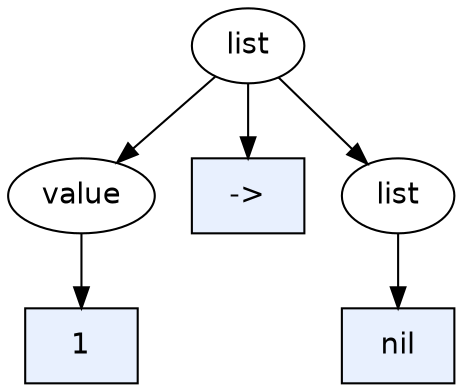

# 单链表的文法与解析器实现

## 摘要

本文讨论**单链表**的文本表示应当如何用 **上下文无关文法（CFG）** 描述，并据此实现一个**递归下降解析器**。全文分两部分：

**第一部分：文法**

1. 单链表的递归定义，以及它与文法产生式的对应关系；
2. 右递归、左递归和 EBNF 三种文法写法的等价性与差异；
3. 三种具体文本语法的 CFG：`1 -> 2 -> nil`、`1,2,3`（非空）、`1,2,3`（允许空表），以及它们的常见错误写法。

**第二部分：解析器**

4. 一个基于右递归文法的 Python 解析器，能够输出解析树、构造真实的单链表，并给出带位置信息的错误报告。

## 目录

**第一部分：文法**

1. 单链表的递归定义
2. 单链表的文法形式
3. 文法与语法树结构
4. 常见误区：链表"只能右递归"
5. 文法选择与分析方法
6. 三种具体语法的文法

**第二部分：解析器实现**

7. 解析器设计
8. 解析器实现
9. 使用说明与运行示例
10. 设计说明与局限
11. 总结

附录 A：术语表

---

# 第一部分：文法

## 1. 单链表的递归定义

### 1.1 数学定义

1. 空表是一个链表（基础情形）；
2. 如果 `L` 是一个链表，`v` 是一个值，那么 `Cons(v, L)` 也是一个链表（递归情形）；
3. 除此之外没有别的链表。

写成构造器形式：

```
List → Nil | Cons(value, List)
```

### 1.2 在编程语言中的对应

```haskell
-- Haskell
data List a = Nil | Cons a (List a)
```

```c
/* C：NULL 表示空表 */
struct Node {
    int value;
    struct Node *next;    /* 唯一的自身引用 */
};
```

### 1.3 链表与树的区别

链表的定义中，自身**只出现一次**，属于线性递归。树的定义中，自身出现两次或更多次，属于树形递归：

```
List → Nil   | Cons(value, List)           （1 个自身引用 → 链表）
Tree → Empty | Node(Tree, value, Tree)     （2 个自身引用 → 二叉树）
```

链表可以看作每个节点只有一个孩子的树。

## 2. 单链表的文法形式

链表的文本形式本质上是"若干个元素排成一列"。描述这种结构有三种常见写法。

### 2.1 右递归
空格分隔的可空列表:

```ebnf
list → value list | ε
```

带分隔符的非空列表（如 `1, 2, 3`）：

```ebnf
list → value ',' list | value
```

### 2.2 左递归
空格分隔的可空列表:

```ebnf
list → list value | ε
```

带分隔符的非空列表：

```ebnf
list → list ',' value | value
```

### 2.3 EBNF 重复

```ebnf
list → { value } # 空格分隔的可空列表
list → value { ',' value } # 带分隔符的非空列表
```

EBNF 中重复有两种记法，不能混用：

| 记法风格 | 0 次或多次 | 1 次或多次 | 可选 | 分组 |
|---|---|---|---|---|
| 经典 / ISO EBNF | `{ x }` | `x { x }` | `[ x ]` | `( x )` |
| 正则风格（W3C EBNF、ANTLR 等） | `( x )*` | `( x )+` | `( x )?` | `( x )` |

例如，以下两种写法等价：

```ebnf
expr → expr '+' term | term      (* BNF，左递归 *)
expr → term { '+' term }         (* 经典 EBNF *)
```

把上式中的 `+` 换成 `,`、`term` 换成 `value`，得到的就是列表文法。

### 2.4 语言等价性

上述三种写法**生成的字符串集合完全相同**。

从形式语言理论看，右线性文法（`A → a A`）与左线性文法（`A → A a`）都恰好描述正则语言，表达能力相同。平铺的列表 `value*` 是正则语言，所以两种递归方向都能描述它。

## 3. 文法与语法树结构

语言相同，不代表语法树相同。以输入 `1 2 3` 为例：

```
右递归 list → value list          左递归 list → list value

      list                                  list
     /    \                                /    \
    1     list                          list     3
         /    \                        /    \
        2     list                  list     2
             /    \                /    \
            3     list           list    1
                   |               |
                   ε               ε
```

| | 右递归 | 左递归 |
|---|---|---|
| 树的延伸方向 | 向右下 | 向左下 |
| 对应的链表结构 | cons list：`Cons(1, Cons(2, Cons(3, Nil)))` | snoc list：`Snoc(Snoc(Snoc(Lin, 1), 2), 3)` |
| 外层节点存放 | 第一个元素 | 最后一个元素 |
| 天然适合的处理方式 | 从头拆解（`foldr`） | 从左累积（`foldl`） |
| 用于二元运算时的结合性 | 右结合 | 左结合 |

由此可以得出：

- 只要求描述相同的字符串时，左右递归都可以；
- 要求语法树与 cons 链表结构一一对应时，必须使用右递归；
- EBNF 重复形式得到的是扁平结构，不携带结合性信息，结构需要在语义动作中构造。

### 3.1 文本中显式写出构造器的情况

如果文本直接写出构造过程，基础情形写在哪一侧，决定了哪个递归方向能与结构直接对应。

Haskell 风格的 `1 : 2 : 3 : []`，`[]` 在最右边，自然文法为右递归：

```ebnf
list → value ':' list | '[]'
```

snoc 风格的 `[] :> 1 :> 2 :> 3`，`[]` 在最左边，自然文法为左递归：

```ebnf
list → list ':>' value | '[]'
```

即便如此，也能写出生成相同字符串、方向相反的文法。例如对 `1 : 2 : 3 : []`：

```ebnf
list   → prefix '[]'
prefix → prefix value ':' | ε
```

此时语法树不再直接对应 `:` 的结构，构造 AST 时需要额外处理。

## 4. 常见误区：链表"只能右递归"

这个说法在两个层面上都不成立。

### 4.1 数据结构层面

决定左右递归的不是字段在内存中的先后顺序，而是 **`next` 指针指向序列的哪一部分**：

| 指针指向 | 定义 | 类型 |
|---|---|---|
| 当前元素**之后**的部分 | `List → Cons(value, List)` | 右递归（cons list） |
| 当前元素**之前**的部分 | `List → Snoc(List, value)` | 左递归（snoc list） |

同一条物理链 `p → [3] → [2] → [1] → NULL` 有两种解读：

- 解读为 cons list，表示 `[3, 2, 1]`，`p` 指向第一个元素；
- 解读为 snoc list，表示 `[1, 2, 3]`，`p` 指向最后一个元素。

可见单向链表本身没有方向，方向取决于解读方式。

### 4.2 右递归成为默认约定的原因

1. 链表通常由头指针代表，人们自然把头指针所指元素当作第一个元素；
2. 沿 `next` 遍历的顺序与从左到右的阅读顺序一致；
3. 基础情形 `Nil` 落在序列末尾，符合"拆出第一个、递归处理其余"的思路，与数学归纳法一致；
4. 历史传统：Lisp 的 `cons`/`car`/`cdr` 奠定了这种结构，ML、Haskell 等语言沿用至今。

### 4.3 左递归链表的实际应用

- **从左到右累积**：每读一个元素就加到头部，得到的链表从 snoc 视角看就是按读入顺序排列的。函数式编程中"先累积、最后 `reverse`"，本质上就是把 snoc list 转换为 cons list。
- **栈**：每个节点指向更早压入的元素，即 `stack → stack value`。LR 分析器的分析栈就是这种结构。
- **历史记录**：例如撤销栈，当前状态指向上一个状态。

双向链表同时具备 `prev`（snoc 视角）和 `next`（cons 视角）两个方向。由于存在相互引用，它不再是简单的归纳定义，通常不用文法描述。

## 5. 文法选择与分析方法

既然几种写法在语言层面等价，实际选择通常取决于分析方法：

| 分析方法 | 推荐写法 | 原因 |
|---|---|---|
| LL / 递归下降 | 右递归（必要时提取左公因子）或 EBNF `{ }` | 左递归会使递归下降陷入无限递归 |
| LR（yacc、bison） | 左递归 | 每读一个元素即可归约，分析栈深度保持常数 |

在 LR 分析中，如果使用右递归 `list → value list`，所有元素都必须先压栈，读到末尾才开始归约，长列表可能导致栈溢出。因此 Bison 手册建议列表使用左递归：

```yacc
list : list item
     | /* empty */
     ;
```

## 6. 三种具体语法的文法

前面讨论的是抽象的"值序列"。落到具体文本上，分隔符和空表的表示方式不同，文法也随之不同。下面依次讨论三种语法：

| 语法 | 示例 | 特点 |
|---|---|---|
| 箭头 + `nil` | `1 -> 2 -> 3 -> nil` | 每个元素后都有分隔符，`nil` 显式表示结尾 |
| 逗号分隔（非空） | `1`、`1,2`、`1,2,3` | 分隔符只在元素之间，至少一个元素 |
| 逗号分隔（允许空） | 空串、`1`、`1,2,3` | 同上，但允许空表 |

### 6.1 箭头 + nil：`1 -> 2 -> 3 -> nil`

这是最直接对应 `List → Nil | Cons(value, List)` 的写法：

```ebnf
list  → value '->' list
      | 'nil'
value → NUMBER | IDENT | STRING
```

- 基础情形 `'nil'` 就是空表，`nil` 本身是一个合法的链表；
- 每个元素后都跟一个 `->`，最后以 `nil` 结尾；
- 代价是最常见的写法多了 `-> nil` 两个 token。

**LL(1) 判定**：`list` 的两个产生式的 FIRST 集合互不相交：

| 产生式 | FIRST 集合 |
|---|---|
| `list → value '->' list` | `{ NUMBER, IDENT, STRING }` |
| `list → 'nil'` | `{ NIL }` |

因此只需向前看一个 token 就能确定使用哪个产生式，文法是 LL(1) 的，可以直接用于**递归下降**。第二部分的解析器就基于这份文法。

### 6.2 逗号分隔的非空表：`1,2,3`

#### 6.2.1 要描述的语言

`1`、`1,2`、`1,2,3` 这类输入有共同特征：

- 至少有一个元素（非空）；
- 元素之间用 `,` 分隔；
- 首尾都没有逗号，也没有终止符 `nil`。

用正则风格的 EBNF 写就是：

```ebnf
NUMBER ( ',' NUMBER )*
```

#### 6.2.2 形式化定义

CFG 是一个四元组 $G = (V, \Sigma, R, S)$。以右递归版本为例：

| 组成 | 内容 |
|---|---|
| $V$（非终结符） | `{ List }` |
| $\Sigma$（终结符） | `{ NUMBER, ',' }` |
| $R$（产生式） | `List → NUMBER ',' List` 和 `List → NUMBER` |
| $S$（开始符号） | `List` |

#### 6.2.3 几种等价写法

**右递归（对应 cons 结构）**

```bnf
List → NUMBER ',' List
     | NUMBER
```

**左递归（对应 snoc 结构，适合 LR 分析器）**

```bnf
List → List ',' NUMBER
     | NUMBER
```

**提取左公因子（LL(1)，适合递归下降）**

右递归版本的两个产生式都以 `NUMBER` 开头，FIRST 集合都是 `{ NUMBER }`，向前看一个 token 无法区分，**不是 LL(1)**。提取左公因子后：

```bnf
List → NUMBER Tail
Tail → ',' NUMBER Tail
     | ε
```

此时 `Tail` 的两个分支可以区分：下一个 token 是 `,` 就选第一个分支；否则（$\text{FOLLOW}(\text{Tail}) = \{ \$ \}$，即输入结束）选 ε。

**EBNF**

```ebnf
List = NUMBER , { ',' , NUMBER } ;
```

以上四种写法生成的语言完全相同。

#### 6.2.4 推导示例

以右递归文法为例：

```
1      :  List ⇒ NUMBER

1,2    :  List ⇒ NUMBER ',' List
              ⇒ NUMBER ',' NUMBER

1,2,3  :  List ⇒ NUMBER ',' List
              ⇒ NUMBER ',' NUMBER ',' List
              ⇒ NUMBER ',' NUMBER ',' NUMBER
```

`1,2,3` 在两种递归方向下的解析树：

```
右递归                         左递归

   List                               List
  /  |  \                            /  |  \
 1   ,  List                      List  ,   3
       /  |  \                   /  |  \
      2   ,  List             List  ,   2
               |                |
               3                1
```

#### 6.2.5 一个常见的错误写法：歧义

```bnf
List → List ',' List
     | NUMBER
```

它生成的语言也正确，但**有歧义**：`1,2,3` 有两棵不同的解析树，分别对应 `(1,2),3` 和 `1,(2,3)`。

```
     List                    List
    /  |  \                 /  |  \
 List  ,  List           List  ,  List
 / | \      |              |     / | \
1  ,  2     3              1    2  ,  3
```

文法同时允许**左右两种结合方式**，就会出现歧义。前面几种写法都只在一侧递归，因此没有歧义。

#### 6.2.6 展开到字符级别

如果不把 `NUMBER` 当作现成的词法单元，而是让 CFG 一直描述到字符，可以写成：

```ebnf
List   → Number ',' List
       | Number
Number → Digit Number
       | Digit
Digit  → '0' | '1' | '2' | '3' | '4' | '5' | '6' | '7' | '8' | '9'
```

这样 `12,345` 这类多位数也能被生成。如果还要允许逗号两侧有空格，通常交给词法分析器丢弃空白，而不写进文法。

### 6.3 逗号分隔且允许空表

#### 6.3.1 要描述的语言

| 输入 | 含义 |
|---|---|
| （空串 ε） | 空链表 |
| `1` | 单元素 |
| `1,2` | 两个元素 |
| `1,2,3` | 三个元素 |

规律是：可以为空；不为空时，元素之间用 `,` 分隔，首尾都没有逗号：

```ebnf
ε | NUMBER ( ',' NUMBER )*
```

这里的"空"指空串 ε，而不是字面上的单词 `nil`。

#### 6.3.2 关键点：空表要和非空表分开处理

难点在于：**逗号只能出现在两个元素之间**，不能出现在开头或结尾。

最直接的想法是在 6.2 的文法里加一条 ε 产生式：

```bnf
List → NUMBER ',' List
     | NUMBER
     | ε            (* 错误 *)
```

问题在于，ε 不仅可以作为整个列表出现，也可以出现在递归的尾部，接在逗号后面：

```
List ⇒ NUMBER ',' List
     ⇒ NUMBER ',' ε
     =  NUMBER ','            （对应 "1,"）
```

同理还能推导出 `1,2,` 等带尾逗号的串。也就是说，这个文法接受了**非法的语言**。

解决办法是引入一个只描述**非空**列表的辅助非终结符，让 ε 只在最外层出现一次：

```bnf
List     → ε
         | NonEmpty

NonEmpty → NUMBER
         | NUMBER ',' NonEmpty
```

这样，空表只能由 `List → ε` 直接得到。一旦进入 `NonEmpty`，就只能以 `NUMBER` 结尾，从而不会产生尾逗号。

#### 6.3.3 正确的 CFG

**右递归（对应 cons 结构）**

```bnf
Start → List
      | ε
List  → NUMBER ',' List
      | NUMBER
```

形式化定义 $G = (V, \Sigma, R, S)$：

| 组成 | 内容 |
|---|---|
| $V$ | `{ Start, List }` |
| $\Sigma$ | `{ NUMBER, ',' }` |
| $R$ | 上面 4 条产生式 |
| $S$ | `Start` |

**左递归（对应 snoc 结构，适合 LR / yacc）**

```bnf
Start → List
      | ε
List  → List ',' NUMBER
      | NUMBER
```

**LL(1) 版本（适合递归下降）**

右递归版本中 `List` 的两个产生式都以 `NUMBER` 开头，不是 LL(1)。提取左公因子后：

```bnf
Start → NUMBER Tail
      | ε
Tail  → ',' NUMBER Tail
      | ε
```

LL(1) 检查：

| 非终结符 | 产生式 | 选择条件 |
|---|---|---|
| `Start` | `NUMBER Tail` | 下一个 token 是 `NUMBER` |
| `Start` | `ε` | 下一个 token 是 `$`（输入结束） |
| `Tail` | `',' NUMBER Tail` | 下一个 token 是 `,` |
| `Tail` | `ε` | 下一个 token 是 `$`（$\text{FOLLOW}(\text{Tail}) = \{ \$ \}$） |

每个非终结符的各个分支的选择集合互不相交，所以它是 LL(1) 文法。

**EBNF**

```ebnf
Start = [ NUMBER , { ',' , NUMBER } ] ;
```

`[ ]` 表示可选，对应空表；`{ }` 表示重复 0 次或多次。

以上四种写法生成的语言完全相同。

#### 6.3.4 推导示例

使用 LL(1) 版本：

```
空     :  Start ⇒ ε

1      :  Start ⇒ NUMBER Tail
               ⇒ NUMBER

1,2    :  Start ⇒ NUMBER Tail
               ⇒ NUMBER ',' NUMBER Tail
               ⇒ NUMBER ',' NUMBER

1,2,3  :  Start ⇒ NUMBER Tail
               ⇒ NUMBER ',' NUMBER Tail
               ⇒ NUMBER ',' NUMBER ',' NUMBER Tail
               ⇒ NUMBER ',' NUMBER ',' NUMBER
```

`1,2,3` 的解析树：

```
        Start
       /     \
      1      Tail
           /  |  \
          ,   2   Tail
                /  |  \
               ,   3   Tail
                         |
                         ε
```

空输入的解析树只有一个节点：

```
Start
  |
  ε
```

#### 6.3.5 常见错误写法对照

| 写法 | 问题 |
|---|---|
| `List → NUMBER ',' List \| ε` | 生成 `1,`、`1,2,`，结尾多一个逗号 |
| `List → ',' NUMBER List \| ε` | 生成 `,1,2`，开头多一个逗号 |
| `List → List ',' List \| NUMBER \| ε` | 有歧义，还会生成 `,`、`,,1` 等 |
| `List → NUMBER ',' List \| NUMBER \| ε` | 生成 `1,`，且 `1` 等串推导不唯一 |

共同原因都是：**把 ε 放进了会和逗号相邻的位置**。正确的做法是让 ε 只作为整个列表的一个选项出现，或者只出现在"逗号 + 元素"这一组的重复里（如 LL(1) 版本中的 `Tail`）。

### 6.4 三种语法的对比

| | `1 -> 2 -> nil` | `1,2,3`（非空） | 空 / `1,2,3` |
|---|---|---|---|
| 右递归文法 | `list → value '->' list \| 'nil'` | `List → NUMBER ',' List \| NUMBER` | `Start → List \| ε` + 非空版 `List` |
| 基础情形 | `'nil'`（空表） | `NUMBER`（单元素表） | `ε`（外层）+ `NUMBER`（内层） |
| 能否表示空表 | 能，写作 `nil` | 不能 | 能，写作空串 |
| 非终结符个数（不含 `value`） | 1 | 1 | 2 |
| 是否 LL(1) | 是（`nil` 与值可区分） | 否，需先提取左公因子 | 提取左公因子后是 |
| 分隔符位置 | 每个元素后都有 `->` | 只在元素之间 | 只在元素之间 |

`->` 版本只用一个非终结符，是因为每个元素后面都跟着分隔符，`nil` 显式标记了结尾，正好对应 `Nil | Cons(value, List)`。逗号版本的分隔符只在元素之间，读起来更自然；但基础情形变成了单元素表，递归下降时要先提取左公因子；若还要允许空表，又因为空表没有显式标记，需要额外的非终结符把"空"和"非空"区分开。

---

# 第二部分：解析器实现

## 7. 解析器设计

### 7.1 目标

解析形如 `1 -> 2 -> 3 -> nil` 的单链表文本，并输出：

1. 解析树（树状图和括号形式）；
2. 由解析树构造的真实单链表；
3. 可选的 Graphviz DOT 图；
4. 出错时给出行号、列号和位置指示。

### 7.2 文法

采用 6.1 的右递归文法，使解析树与 cons 链表结构一一对应；它又是 LL(1) 的，可以直接写成递归下降：

```ebnf
list  → value '->' list
      | 'nil'
value → NUMBER | IDENT | STRING
```

### 7.3 词法单元

| 词法单元 | 正则表达式 | 示例 |
|---|---|---|
| `ARROW` | `->` | `->` |
| `NUMBER` | `-?\d+(?:\.\d+)?` | `42`、`-7`、`3.14` |
| `STRING` | `"(?:[^"\\]\|\\.)*"` | `"hello"` |
| `IDENT` | `[A-Za-z_][A-Za-z0-9_]*` | `a`、`foo_bar` |
| `NIL` | 关键字 | `nil` |
| `EOF` | 输入结束 | |

`ARROW` 必须排在 `NUMBER` 之前匹配，否则 `->` 中的 `-` 可能被当作负号。`nil` 先按 `IDENT` 匹配，再通过关键字表改为 `NIL`。

### 7.4 总体流程

```
源文本
  │  tokenize()
  ▼
Token 序列
  │  Parser.parse()            每个非终结符对应一个方法
  ▼
解析树 PTNode（具体语法树，保留所有终结符）
  ├─ format_tree()      → 树状图
  ├─ format_brackets()  → 括号形式
  ├─ to_dot()           → Graphviz DOT
  └─ build_linked_list() → 单链表 Node（去除语法细节）
                             ├─ format_cons()
                             └─ format_linked_list()
```

### 7.5 文法与代码的对应关系

| 文法 | 代码 |
|---|---|
| `list → 'nil'` | `if tok.kind == "NIL": ...` |
| `list → value '->' list` | `parse_value()` → `expect("ARROW")` → `parse_list()` |
| `value → NUMBER \| IDENT \| STRING` | `parse_value()` |

## 8. 解析器实现

保存为 `linked_list_parser.py`，只依赖 Python 3.7+ 标准库。

```python
#!/usr/bin/env python3  
"""  
单链表文法解析器（递归下降）  
  
文法（右递归，LL(1)）:  
    list  → value '->' list          | 'nil'    value → NUMBER | IDENT | STRING  
用法:  
    python linked_list_parser.py "1 -> 2 -> 3 -> nil"    python linked_list_parser.py --dot "a -> b -> nil" > tree.dot    python linked_list_parser.py            # 进入交互模式  
"""  
  
import argparse  
import ast  
import re  
import sys  
from dataclasses import dataclass, field  
from typing import List, Optional  
  
  
# ============================================================  
# 1. 词法分析  
# ============================================================  
  
@dataclass  
class Token:  
    kind: str  # NUMBER / IDENT / STRING / ARROW / NIL / EOF  
    text: str  
    pos: int  # 在源字符串中的偏移，用于报错  
  
  
# 顺序很重要：ARROW 必须在 NUMBER 之前，否则 "->" 中的 "-" 可能被误认  
TOKEN_SPEC = [  
    ("WS", r"\s+"),  # r前缀表示原始字符串，不进行转义  
    ("ARROW", r"->"),  
    ("NUMBER", r"-?\d+(?:\.\d+)?"),  # ?: 表示: 非捕获分组（non-capturing group）  
    # 该regex的结构为: (?:A|B)*，它表示普通字符或转义序列,重复零次或多次  
    # [^"\\]: 任意不是双引号、也不是反斜杠的字符(普通字符)  
    # \\.   : 一个反斜杠加任意一个字符,即转义序列,如 \"、\n、\\  
    ("STRING", r'"(?:[^"\\]|\\.)*"'),  
    ("IDENT", r"[A-Za-z_][A-Za-z0-9_]*"),  # identifier  
]  
"""  
MASTER_RE的值为: (?P<WS>\s+)|(?P<ARROW>->)|(?P<NUMBER>-?\d+(?:\.\d+)?)|(?P<STRING>"(?:[^"\\]|\\.)*")|(?P<IDENT>[A-Za-z_][A-Za-z0-9_]*)  
- 整个表达式由 5 个命名分组用 |(或)连接  
- (?P<名字>模式) 是 Python 的命名捕获组语法,匹配后可通过 m.lastgroup 知道是哪一组匹配成功,即 token 的类型。  
- | 从左到右依次尝试,第一个匹配成功的分支胜出,所以顺序很重要。  
"""  
MASTER_RE = re.compile("|".join(f"(?P<{name}>{pat})" for name, pat in TOKEN_SPEC))  
  
KEYWORDS = {"nil": "NIL"}  
VALUE_KINDS = {"NUMBER", "IDENT", "STRING"}  # 链表的节点的值类型  
FIXED_KINDS = {"ARROW", "NIL", "EOF"}  # 文本固定的 token，报错时无需重复显示内容  
  
TOKEN_NAMES = {  
    "ARROW": "'->'",  
    "NIL": "'nil'",  
    "NUMBER": "数字",  
    "IDENT": "标识符",  
    "STRING": "字符串",  
    "EOF": "输入结束",  
}  
  
  
class ParseError(Exception):  
    def __init__(self, message: str, pos: int, source: str):  
        super().__init__(message)  
        self.message = message  
        self.pos = pos  
        self.source = source  
  
    def __str__(self) -> str:  
        line_start = self.source.rfind("\n", 0, self.pos) + 1  
        line_end = self.source.find("\n", self.pos)  
        if line_end == -1:  
            line_end = len(self.source)  
        line = self.source[line_start:line_end]  
        lineno = self.source.count("\n", 0, self.pos) + 1  
        col = self.pos - line_start  
        return (f"语法错误（第 {lineno} 行，第 {col + 1} 列）：{self.message}\n"  
                f"  {line}\n"  
                f"  {' ' * col}^")  
  
  
def tokenize(source: str) -> List[Token]:  
    tokens: List[Token] = []  
    pos = 0  
    while pos < len(source):  
        m = MASTER_RE.match(source, pos)  
        if not m:  
            raise ParseError(f"非法字符 {source[pos]!r}", pos, source)  
        kind, text = m.lastgroup, m.group()  
        if kind == "IDENT":  
            kind = KEYWORDS.get(text, "IDENT")  
        if kind != "WS":  
            tokens.append(Token(kind, text, pos))  
        pos = m.end()  
    tokens.append(Token("EOF", "", len(source)))  
    return tokens  
  
  
def describe(tok: Token) -> str:  
    name = TOKEN_NAMES.get(tok.kind, tok.kind)  
    return name if tok.kind in FIXED_KINDS else f"{name} {tok.text!r}"  
  
  
# ============================================================  
# 2. 解析树（具体语法树）  
# ============================================================  
  
@dataclass  
class PTNode:  
    label: str  # 非终结符名，或终结符类别  
    children: List["PTNode"] = field(default_factory=list)  
    token: Optional[Token] = None  # 只有终结符（叶子）才有  
  
    @property  
    def is_terminal(self) -> bool:  
        return self.token is not None  
  
  
# ============================================================  
# 3. 递归下降解析器：每个非终结符对应一个方法  
# ============================================================  
  
class Parser:  
    def __init__(self, source: str):  
        self.source = source  
        self.tokens = tokenize(source)  
        self.i = 0  # 当前token的索引  
  
    # ---------- 辅助 ----------    def peek(self) -> Token:  
        return self.tokens[self.i]  
  
    def error(self, message: str):  
        raise ParseError(message, self.peek().pos, self.source)  
  
    def expect(self, kind: str) -> PTNode:  
        tok = self.peek()  
        if tok.kind != kind:  
            self.error(f"期望 {TOKEN_NAMES[kind]}，实际得到 {describe(tok)}")  
        self.i += 1  
        return PTNode(kind, token=tok)  
  
    # ---------- 入口 ----------    def parse(self) -> PTNode:  
        tree = self.parse_list()  
        if self.peek().kind != "EOF":  
            self.error(f"'nil' 之后不应再有内容，实际得到 {describe(self.peek())}")  
        return tree  
  
    # list → value '->' list | 'nil'  
    def parse_list(self) -> PTNode:  
        tok = self.peek()  
        if tok.kind == "NIL":  
            return PTNode("list", [self.expect("NIL")])  
        if tok.kind in VALUE_KINDS:  
            value = self.parse_value()  
            arrow = self.expect("ARROW")  
            rest = self.parse_list()  # 右递归  
            return PTNode("list", [value, arrow, rest])  
        self.error(f"期望一个值或 'nil'，实际得到 {describe(tok)}")  
  
    # value → NUMBER | IDENT | STRING  
    def parse_value(self) -> PTNode:  
        tok = self.peek()  
        if tok.kind in VALUE_KINDS:  
            return PTNode("value", [self.expect(tok.kind)])  
        self.error(f"期望一个值，实际得到 {describe(tok)}")  
  
  
# ============================================================  
# 4. 解析树的输出  
# ============================================================  
  
def node_label(node: PTNode) -> str:  
    if node.is_terminal:  
        return f"{node.label} {node.token.text!r}"  
    return node.label  
  
  
def format_tree(root: PTNode) -> str:  
    """树状图形式"""  
    lines = [node_label(root)]  
  
    def walk(node: PTNode, prefix: str):  
        for idx, child in enumerate(node.children):  
            last = idx == len(node.children) - 1  
            lines.append(prefix + ("└── " if last else "├── ") + node_label(child))  
            walk(child, prefix + ("    " if last else "│   "))  
  
    walk(root, "")  
    return "\n".join(lines)  
  
  
def format_brackets(node: PTNode) -> str:  
    """括号形式，如 [list [value 1] -> [list nil]]"""    if node.is_terminal:  
        return node.token.text  
    inner = " ".join(format_brackets(c) for c in node.children)  
    return f"[{node.label} {inner}]"  
  
  
def to_dot(root: PTNode) -> str:  
    """Graphviz DOT 格式，可用 `dot -Tpng tree.dot -o tree.png` 渲染"""  
    lines = ["digraph ParseTree {",  
             '  node [fontname="Helvetica"];']  
    counter = 0  
  
    def esc(s: str) -> str:  
        return s.replace("\\", "\\\\").replace('"', '\\"')  
  
    def visit(node: PTNode) -> str:  
        nonlocal counter  
        my_id = f"n{counter}"  
        counter += 1  
        if node.is_terminal:  
            lines.append(f'  {my_id} [label="{esc(node.token.text)}", shape=box, '  
                         f'style=filled, fillcolor="#e8f0fe"];')  
        else:  
            lines.append(f'  {my_id} [label="{node.label}", shape=ellipse];')  
        for child in node.children:  
            lines.append(f"  {my_id} -> {visit(child)};")  
        return my_id  
  
    visit(root)  
    lines.append("}")  
    return "\n".join(lines)  
  
  
# ============================================================  
# 5. 由解析树构造真实的单链表  
# ============================================================  
  
@dataclass  
class Node:  
    value: object  
    next: Optional["Node"] = None  
  
  
def convert_value(value_node: PTNode) -> object:  
    tok = value_node.children[0].token  
    if tok.kind == "NUMBER":  
        return float(tok.text) if "." in tok.text else int(tok.text)  
    if tok.kind == "STRING":  
        return ast.literal_eval(tok.text)  
    return tok.text  
  
  
def build_linked_list(tree: PTNode) -> Optional[Node]:  
    """沿着右递归的 list 节点向下走，依次接到链表尾部"""  
    head: Optional[Node] = None  
    tail: Optional[Node] = None  
    node = tree  
    while len(node.children) == 3:  # list → value '->' list  
        value_node, _arrow, node = node.children  
        new = Node(convert_value(value_node))  
        if tail is None:  
            head = new  
        else:  
            tail.next = new  
        tail = new  
    return head  # 到达 list → 'nil'  
  
def format_linked_list(head: Optional[Node]) -> str:  
    parts = []  
    cur = head  
    while cur is not None:  
        parts.append(repr(cur.value))  
        cur = cur.next  
    parts.append("None")  
    return " -> ".join(parts)  
  
  
def format_cons(head: Optional[Node]) -> str:  
    values = []  
    cur = head  
    while cur is not None:  
        values.append(repr(cur.value))  
        cur = cur.next  
    return "".join(f"Cons({v}, " for v in values) + "Nil" + ")" * len(values)  
  
  
# ============================================================  
# 6. 命令行入口  
# ============================================================  
  
def run(source: str, dot: bool = False) -> int:  
    try:  
        tree = Parser(source).parse()  
    except ParseError as e:  
        print(e, file=sys.stderr)  
        return 1  
  
    if dot:  
        print(to_dot(tree))  
        return 0  
  
    head = build_linked_list(tree)  
    print("== 解析树 ==")  
    print(format_tree(tree))  
    print("\n== 括号形式 ==")  
    print(format_brackets(tree))  
    print("\n== Cons 形式 ==")  
    print(format_cons(head))  
    print("\n== 构造的单链表 ==")  
    print(format_linked_list(head))  
    return 0  
  
  
def repl():  
    print("输入单链表，例如 1 -> 2 -> 3 -> nil（空行或 Ctrl-D 退出）")  
    while True:  
        try:  
            line = input("list> ")  
        except EOFError:  
            print()  
            break  
        if not line.strip():  
            break  
        run(line)  
        print()  
  
  
def main():  
    ap = argparse.ArgumentParser(description="单链表文法解析器")  
    ap.add_argument("source", nargs="?", help="要解析的单链表文本")  
    ap.add_argument("--dot", action="store_true", help="以 Graphviz DOT 格式输出解析树")  
    args = ap.parse_args()  
  
    if args.source is None:  
        repl()  
    else:  
        sys.exit(run(args.source, dot=args.dot))  
  
  
if __name__ == "__main__":  
    main()
```

## 9. 使用说明与运行示例

### 9.1 运行环境

| 项目 | 要求 |
|---|---|
| Python | 3.7 及以上（使用了 `dataclasses`） |
| 第三方依赖 | 无 |
| 可选工具 | Graphviz（用于把 DOT 渲染为图片） |

### 9.2 命令行用法

| 命令 | 作用 |
|---|---|
| `python linked_list_parser.py "1 -> 2 -> nil"` | 解析并输出全部结果 |
| `python linked_list_parser.py --dot "1 -> 2 -> nil"` | 只输出 DOT 格式的解析树 |
| `python linked_list_parser.py` | 进入交互模式 |

解析成功时退出码为 `0`，失败时为 `1`，错误信息输出到标准错误。

### 9.3 正常输入

```bash
$ python linked_list_parser.py "1 -> 2 -> 3 -> nil"
```

```
== 解析树 ==
list
├── value
│   └── NUMBER '1'
├── ARROW '->'
└── list
    ├── value
    │   └── NUMBER '2'
    ├── ARROW '->'
    └── list
        ├── value
        │   └── NUMBER '3'
        ├── ARROW '->'
        └── list
            └── NIL 'nil'

== 括号形式 ==
[list [value 1] -> [list [value 2] -> [list [value 3] -> [list nil]]]]

== Cons 形式 ==
Cons(1, Cons(2, Cons(3, Nil)))

== 构造的单链表 ==
1 -> 2 -> 3 -> None
```

解析树沿右下方延伸，正是第 3 节所述的右递归形状，与 `Cons(1, Cons(2, Cons(3, Nil)))` 一一对应。

### 9.4 空链表

```bash
$ python linked_list_parser.py "nil"
```

```
== 解析树 ==
list
└── NIL 'nil'

== 括号形式 ==
[list nil]

== Cons 形式 ==
Nil

== 构造的单链表 ==
None
```

### 9.5 混合类型与紧凑写法

```bash
$ python linked_list_parser.py 'a -> "hi" -> -3.5 -> nil'
```

```
== 构造的单链表 ==
'a' -> 'hi' -> -3.5 -> None
```

空白不是必需的，`1->-2->nil` 同样可以解析为 `1 -> -2 -> None`。词法分析时 `ARROW` 先于 `NUMBER` 匹配，所以 `->` 不会被误认为负号。

### 9.6 错误报告

所有错误都给出行号、列号和位置指示：

| 输入 | 错误原因 |
|---|---|
| `1 -> 2` | 缺少结尾的 `-> nil` |
| `1 -> -> nil` | 箭头之间缺少值 |
| `1 -> nil -> 2` | `nil` 之后还有内容 |
| `1 -> @` | 非法字符 |

```
$ python linked_list_parser.py "1 -> 2"
语法错误（第 1 行，第 7 列）：期望 '->'，实际得到 输入结束
  1 -> 2
        ^

$ python linked_list_parser.py "1 -> -> nil"
语法错误（第 1 行，第 6 列）：期望一个值或 'nil'，实际得到 '->'
  1 -> -> nil
       ^

$ python linked_list_parser.py "1 -> nil -> 2"
语法错误（第 1 行，第 10 列）：'nil' 之后不应再有内容，实际得到 '->'
  1 -> nil -> 2
           ^

$ python linked_list_parser.py "1 -> @"
语法错误（第 1 行，第 6 列）：非法字符 '@'
  1 -> @
       ^
```

对于数字、标识符、字符串这类内容不固定的 token，错误信息会同时显示类别和文本，例如 `实际得到 数字 '2'`；对于 `->`、`nil` 这类文本固定的 token，只显示一次，避免出现 `'->' '->'` 这样的重复。

### 9.7 交互模式

```
$ python linked_list_parser.py
输入单链表，例如 1 -> 2 -> 3 -> nil（空行或 Ctrl-D 退出）
list> x -> y -> nil
== 解析树 ==
...
list>
```

### 9.8 生成解析树图片

```bash
$ python linked_list_parser.py --dot "1 -> nil" > tree.dot
$ dot -Tpng tree.dot -o tree.png
```

`tree.dot` 的内容为：



图中非终结符显示为椭圆，终结符显示为蓝色方框。

## 10. 设计说明与局限

### 10.1 解析树与 AST 分离

| | 解析树 `PTNode` | 单链表 `Node` |
|---|---|---|
| 性质 | 具体语法树（CST） | 抽象结构（相当于 AST） |
| 内容 | 保留 `->`、`nil` 等全部终结符 | 只保留值和链接关系 |
| 用途 | 展示文法推导过程、调试文法 | 供后续程序使用 |

这与编译器中"先得到解析树，再转换为 AST"的流程一致。修改文本语法（例如把 `->` 换成 `,`）只影响词法和解析部分，`Node` 结构不必改变。

### 10.2 递归深度限制

`parse_list` 是右递归，每个元素占用一层 Python 调用栈。Python 默认递归上限约为 1000，因此元素数接近这个数量时会触发 `RecursionError`。这正是第 5 节所说的现象：右递归适合 LL 分析，但递归深度与输入长度成正比。

`build_linked_list`、`format_linked_list`、`format_cons` 都用循环实现，不受此限制；而 `format_tree`、`format_brackets`、`to_dot` 是递归遍历，同样受到限制。

可选的解决办法如下：

**(1) 调大递归上限。** 简单，但只是推迟问题：

```python
sys.setrecursionlimit(100_000)
```

**(2) 用循环构造同样形状的树。** 按 EBNF 形式 `list → { value '->' } 'nil'` 循环读取，再从后往前组装成右递归形状的树。解析阶段不再递归，树的结构保持不变：

```python
    # list → { value '->' } 'nil'，结果仍是右递归形状的树
    def parse_list_iterative(self) -> PTNode:
        pairs = []
        while self.peek().kind in VALUE_KINDS:
            value = self.parse_value()
            arrow = self.expect("ARROW")
            pairs.append((value, arrow))
        if self.peek().kind != "NIL":
            self.error(f"期望一个值或 'nil'，实际得到 {describe(self.peek())}")
        tree = PTNode("list", [self.expect("NIL")])
        for value, arrow in reversed(pairs):    # 从最内层向外组装
            tree = PTNode("list", [value, arrow, tree])
        return tree
```

若要彻底消除限制，树的输出函数也需改为显式栈遍历。

**(3) 直接使用扁平的解析树。** 让 `list` 节点直接包含所有 `value` 和 `->` 子节点。这样最简单，但解析树不再与 cons 结构一一对应，`build_linked_list` 也要相应修改。

### 10.3 左递归版本（LR 分析器）

如果使用 yacc / bison 这类 LR 分析器生成器，按第 5 节的建议，应改用左递归文法。由于 `nil` 写在末尾，可以把元素部分单独提出来（即 3.1 节中"方向相反的文法"技巧）：

```yacc
list   : prefix NIL
       ;
prefix : prefix value ARROW      /* 左递归，分析栈深度为常数 */
       | /* empty */
       ;
value  : NUMBER | IDENT | STRING
       ;
```

这时语法树是左递归形状，在语义动作中每次把新元素接到链表尾部，最终得到的仍然是同一个单链表。这说明：**文法的递归方向与最终构造出的数据结构是两回事，二者通过语义动作连接。**

### 10.4 可扩展方向

| 方向 | 做法 |
|---|---|
| 支持 `[1, 2, 3]` 语法 | 增加 `LBRACKET`、`COMMA`、`RBRACKET` 三种 token，文法改为 `list → '[' [ value { ',' value } ] ']'`；方括号内部正是 6.3 节允许空表的逗号文法，递归下降时用其 LL(1) 版本（`Start`/`Tail`） |
| 支持嵌套链表 | 在 `value` 中增加 `list` 产生式，链表就变成了树形递归 |
| 错误恢复 | 出错时跳到下一个 `->` 或 `nil` 继续分析，一次报告多个错误 |
| 支持注释 | 在 `TOKEN_SPEC` 中增加 `("COMMENT", r"#[^\n]*")`，与 `WS` 一样丢弃 |

### 10.5 简单测试

```python
import unittest
from linked_list_parser import Parser, ParseError, build_linked_list, format_linked_list


def parse_to_str(src: str) -> str:
    return format_linked_list(build_linked_list(Parser(src).parse()))


class TestParser(unittest.TestCase):
    def test_basic(self):
        self.assertEqual(parse_to_str("1 -> 2 -> 3 -> nil"), "1 -> 2 -> 3 -> None")

    def test_empty(self):
        self.assertEqual(parse_to_str("nil"), "None")

    def test_mixed(self):
        self.assertEqual(parse_to_str('a -> "hi" -> -3.5 -> nil'),
                         "'a' -> 'hi' -> -3.5 -> None")

    def test_compact(self):
        self.assertEqual(parse_to_str("1->-2->nil"), "1 -> -2 -> None")

    def test_errors(self):
        for bad in ["1 -> 2", "1 -> -> nil", "1 -> nil -> 2", "1 -> @", ""]:
            with self.assertRaises(ParseError, msg=bad):
                Parser(bad).parse()


if __name__ == "__main__":
    unittest.main()
```

## 11. 总结

**文法部分**

1. **单链表是线性递归结构**：`List → Nil | Cons(value, List)`，自身引用只出现一次。
2. **文法层面三种写法等价**：右递归、左递归和 EBNF 重复生成相同的字符串集合，都描述正则语言 `value*`。
3. **语法树层面方向不同**：右递归对应 cons list，左递归对应 snoc list，EBNF 重复得到扁平结构。
4. **"链表只能右递归"是误解**：单向链表本身没有方向，右递归只是与阅读顺序、遍历顺序一致的默认约定；栈、累积列表、LR 分析栈都是左递归结构。
5. **文法选择取决于分析方法**：LL / 递归下降用右递归（必要时提取左公因子）或 EBNF，LR 分析器用左递归。
6. **具体语法决定基础情形**：`-> nil` 以空表为基础情形，天然 LL(1)；逗号分隔以单元素表为基础情形，需要提取左公因子；允许空表时，ε 只能放在最外层或"逗号 + 元素"的重复里，否则会产生首尾多余的逗号；同时在左右两侧递归会引入歧义。

**实现部分**

7. 解析器采用 LL(1) 右递归文法，每个非终结符对应一个方法；解析树与链表结构分离；错误报告带有精确位置；右递归带来的调用栈深度问题可以通过循环解析解决；改用 LR 时换成左递归文法，最终数据结构不变。

## 附录 A：术语表

| 术语 | 说明 |
|---|---|
| CFG | 上下文无关文法，四元组 $G = (V, \Sigma, R, S)$ |
| BNF | 巴科斯-诺尔范式，用产生式描述上下文无关文法 |
| EBNF | 扩展 BNF，增加了重复 `{ }`、可选 `[ ]`、分组 `( )` 等记法 |
| 左递归 | 产生式右部以自身开头，如 `A → A a` |
| 右递归 | 产生式右部以自身结尾，如 `A → a A` |
| 提取左公因子 | 把多个以相同前缀开头的产生式改写为"公共前缀 + 新非终结符"，使其满足 LL(1) |
| 歧义文法 | 存在某个串有两棵或以上不同解析树的文法 |
| 正则语言 | 可由右线性或左线性文法、正则表达式、有限自动机描述的语言 |
| FIRST 集合 | 从某个符号串推导出的所有串中，可能出现在开头的终结符集合 |
| FOLLOW 集合 | 在某个句型中可能紧跟在某非终结符之后的终结符集合（含输入结束 `$`） |
| LL(1) | 从左到右扫描、最左推导、向前看 1 个 token 即可确定产生式的分析方法 |
| LR | 从左到右扫描、最右推导逆序（归约）的自底向上分析方法 |
| 递归下降 | 为每个非终结符编写一个函数的 LL 分析实现方式 |
| 归约 | LR 分析中把栈顶符合某产生式右部的符号替换为左部非终结符的操作 |
| 解析树 / CST | 具体语法树，完整保留推导过程中的所有符号 |
| AST | 抽象语法树，去掉分隔符等语法细节，只保留语义结构 |
| cons list | 外层节点存放第一个元素的链表，右递归结构 |
| snoc list | 外层节点存放最后一个元素的链表，左递归结构（`snoc` 是 `cons` 的倒写） |
| 线性递归 / 树形递归 | 定义中自身引用出现一次 / 多次 |
