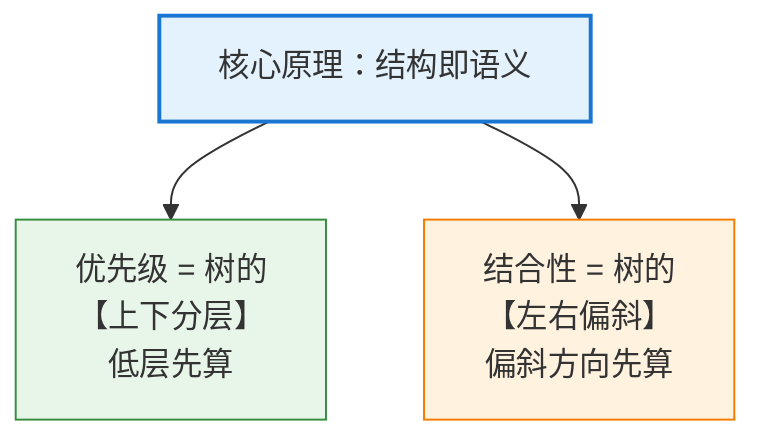
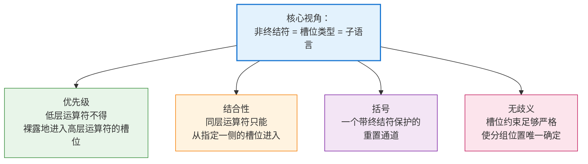
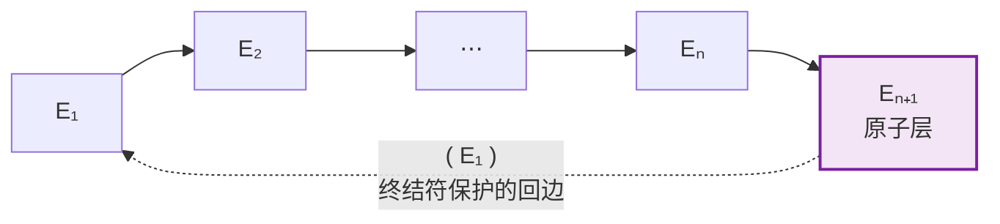
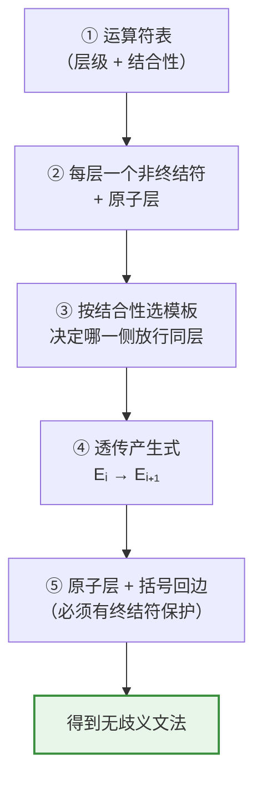
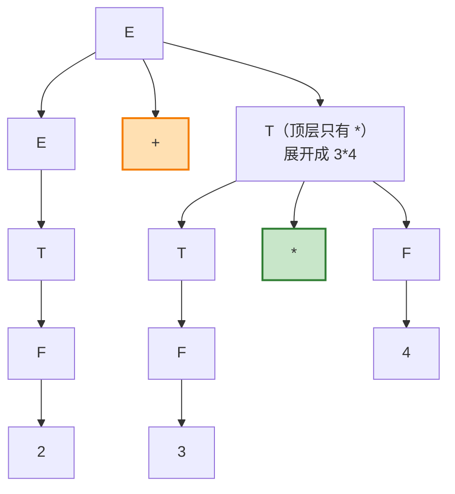
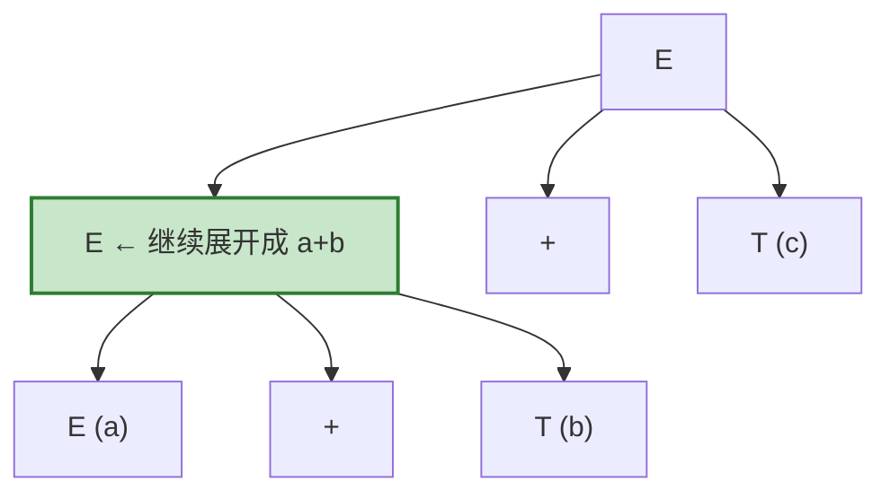
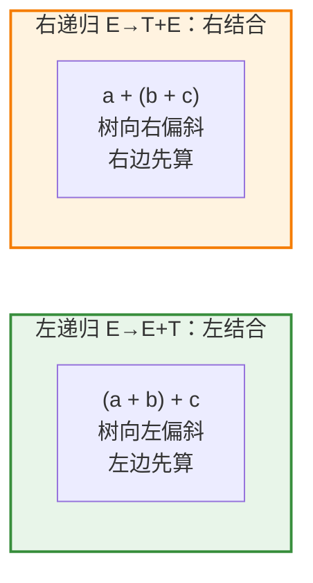
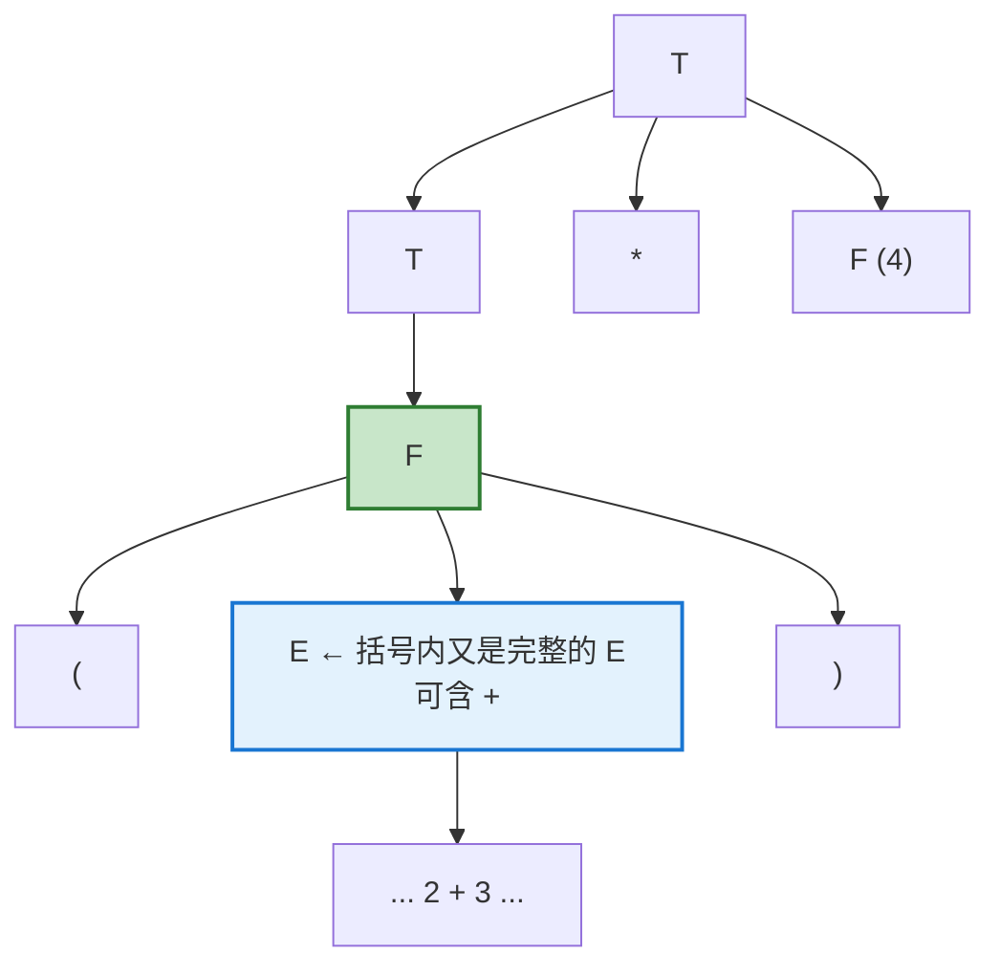
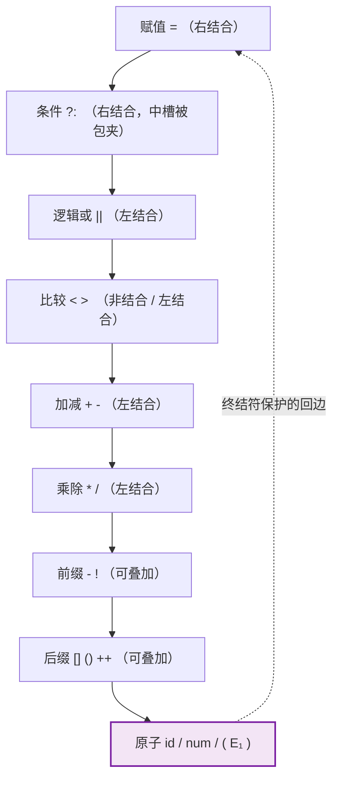
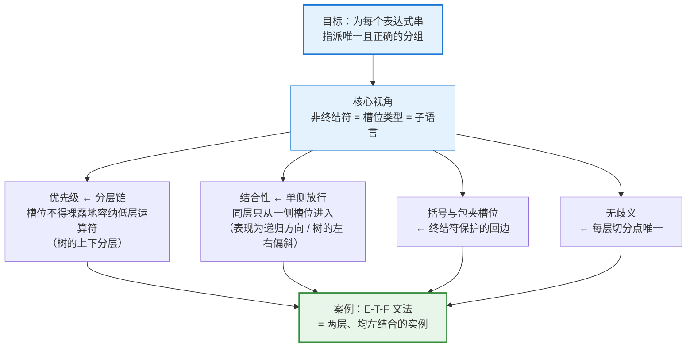

# 上下文无关文法如何编码优先级与结合性：一套系统的方法论

核心思路: constraint structure: 将实现运算符和结合性的问题转换为约束生成的解析树的现状，因为parse tree的structure能够编码precedence和associativity，CFG通过约束运算符的操作数从而实现对生成的解析树(parse tree)的约束。这其实是structure is semantic中的constraint structure。

## 0. 引言：编译器怎么"知道"运算规则

我们从小就知道 `2 + 3 * 4` 等于 $14$ 而不是 $20$，因为"乘法优先于加法"；也知道 `8 - 3 - 2` 等于 $3$ 而不是 $7$，因为"减法从左往右算"。这两条直觉分别叫做**优先级（precedence）**和**结合性（associativity）**。

编译器怎么"知道"这些规则？答案是：**这些规则并没有写在解析器的代码里，而是直接编码在文法的结构中。**

**以龙书的 E-T-F 文法为案例**: 龙书 4.1.2 节（Representative Grammars）给出了经典的表达式文法：

$$
\begin{align*}
E &\rightarrow E + T \mid T \\
T &\rightarrow T * F \mid F \\
F &\rightarrow (E) \mid \mathbf{id}
\end{align*}
$$

它把三个概念分层：

- **E（expression，表达式）**：由 `+` 连接的若干项；
- **T（term，项）**：由 `*` 连接的若干因子；
- **F（factor，因子）**：括号表达式或标识符。

常见的讲解止步于"分层带来优先级，左递归带来左结合"。本文想回答更一般的问题：**对任意一组运算符及其优先级、结合性规定，怎样系统地构造出一个无歧义的 CFG 来实现它？为什么这套构造一定正确？** E-T-F 文法只是这套方法在"两个左结合二元运算符"情形下的一个实例。

---

## 1. 问题的本质：这是"分组"问题，不是"语言"问题

### 1.1 优先级与结合性是文法的性质

先澄清优先级与结合性到底约束了什么。

`2 + 3 * 4` 这个**字符串**本身没有歧义，有歧义的是它的**分组方式（grouping）**：可以读成 $2+(3*4)$，也可以读成 $(2+3)*4$。**优先级**与**结合性**规定的，是**在没有括号时，一个表达式串应当被组织成哪一棵运算树**。由此得出第一个基本结论：

> **优先级与结合性是文法的性质，而不是语言的性质。**

例如下面两个文法生成**完全相同的字符串集合**：

$$
G_1:\ E \rightarrow E + \mathbf{id} \mid \mathbf{id} \qquad\qquad G_2:\ E \rightarrow \mathbf{id} + E \mid \mathbf{id}
$$

但 $G_1$ 把 `a+b+c` 组织为 $(a+b)+c$，$G_2$ 则组织为 $a+(b+c)$。形式语言理论只关心"哪些串合法"，**编译器**却关心"每个串对应哪棵树"。**CFG 之所以能承载优先级与结合性，是因为它不仅定义了串的集合，还为每个串指派了推导结构，也就是解析树。**

因此整个问题可以重新表述为：

> 设计一个 CFG，使得对每个合法的表达式串，它**恰好**给出**一棵**解析树，而且这棵树的分组方式符合预定的**优先级**与**结合性**。

这包含两个要求：**正确性**（树的形状对）和**唯一性**（无歧义）。

### 1.2 结构即语义：树形决定求值顺序

为什么"树的形状对"就等于"运算规则对"？关键洞见是：

> **一个无歧义文法生成的解析树，其形状唯一决定了运算的求值顺序。谁在树的底部（离叶子近），谁就先被计算。**

因此，只要文法能强制生成**特定形状**的解析树，它就能强制特定的**求值顺序**，而求值顺序正是优先级和结合性的本质。树的形状有两个维度，恰好对应这两条规则：

剩下的问题是：文法用什么手段去约束树的形状？下一节给出统一的回答。

---

## 2. 统一视角：操作数槽位约束

### 2.1 从"树的形状"到"槽位的类型"

一棵运算树的形状，完全由一个局部问题决定：

> **某个运算符的某个操作数位置上，能直接放一个以什么运算符为顶层的子表达式？**

我们把**运算符**的每个**操作数位置**称为一个**槽位（slot）**。例如二元 `-` 有左槽位和右槽位。

- 规定"`*` 的槽位不能直接放以 `+` 为顶层的表达式"，就得到了"`*` 优先于 `+`"；
	- tips: 如果 `*` 的槽位直接放以 `+` 为顶层的表达式，由于`*`的优先级跟高，那么`+`的操作数就会被`*`结合
- 规定"`-` 的右槽位不能直接放以 `-` 为顶层的表达式"，就得到了"`-` 左结合"。
	- tips: 显然这种约束对应的parse tree是left recursion的

所以：

> **优先级和结合性，本质上都是对操作数槽位的约束。优先级约束不同层级运算符之间的嵌套，结合性约束同层级运算符之间的嵌套。**

### 2.2 非终结符就是槽位类型

在 CFG 中，槽位约束怎么表达？答案是：**产生式右部每个操作数位置上写哪个非终结符，就规定了这个槽位接受什么。** 每个非终结符 $A$ 定义了一个子语言 $L(A)$，即"允许放进这个槽位的表达式集合"。

> **设计表达式文法，就是设计一组嵌套的子语言，再把它们分配给各个槽位。**

这是本文的核心视角。后面的分层、递归方向、括号回路，都只是这一视角下的具体技法。

---

## 3. 优先级的通用机制：分层链

分层链即**precedence cascade**，编译原理教材中的标准术语。Louden 的 *Compiler Construction: Principles and Practice* 把"按优先级分组、每层一个非终结符"的方法称为 **precedence cascade**。cascade 有"逐级下沉"之意，与 $E_1 \to E_2 \to \cdots \to E_{n+1}$ 的单向结构很贴合。

### 3.1 通用模板

设有 $n$ 个优先级层级，编号 $1$（最低，结合最松）到 $n$（最高，结合最紧）。为每个层级引入一个非终结符 $E_i$，再加一个原子层 $E_{n+1}$：

$$
\begin{align*}
E_1 &\rightarrow \cdots\ \text{（第 1 层运算符）}\ \cdots \mid E_2 \\
E_2 &\rightarrow \cdots\ \text{（第 2 层运算符）}\ \cdots \mid E_3 \\
&\ \ \vdots \\
E_n &\rightarrow \cdots\ \text{（第 n 层运算符）}\ \cdots \mid E_{n+1} \\
E_{n+1} &\rightarrow (E_1) \mid \mathbf{id} \mid \mathbf{num} \mid \cdots
\end{align*}
$$

每一层都有一条**透传产生式** $E_i \rightarrow E_{i+1}$，意思是"本层可以没有运算符，直接下沉"。第 $i$ 层运算符的操作数槽位只使用 $E_i$ 或 $E_{i+1}$，**绝不使用比 $i$ 更低的层**。

tips: **透传产生式** 指的是 **unit production**，它指的是右部只有一个非终结符的产生式

相关内容: [[front-end/syntax-analysis/parsing-algorithm/bottom-up/LR-parser/unit-reduction-elimination|unit-reduction-elimination]] 
### 3.2 语义不变式：每个非终结符"能装什么"

这个模板之所以能实现**优先级**，可以用一个精确的不变式来刻画：

> **不变式（优先级）**：$L(E_i)$ 恰好是这样一些表达式：其中所有**顶层**运算符（即不在任何括号内的运算符）的层级都 $\geq i$。

可以对层级做归纳来验证。$E_{n+1}$ 只产生原子和带括号的表达式，没有顶层运算符。$E_i$ 的产生式只引入第 $i$ 层运算符，并把操作数交给 $E_i$ 或 $E_{i+1}$，因而顶层运算符层级都 $\geq i$。

由不变式立刻得到优先级的保证：**第 $i$ 层运算符的任何槽位，都不可能裸露地容纳一个层级低于 $i$ 的运算符。** 低优先级运算符要想出现在高优先级运算符的操作数里，唯一的办法是被括号包起来。

### 3.3 为什么"低优先级在上层、高优先级在下层"

依赖关系是单向向下的：$E_1 \to E_2 \to \cdots \to E_{n+1}$。反过来不行：高层的非终结符不能直接展开出一个裸的低层运算符。从根出发，推导只能逐层下沉，于是：

- 低层级（低优先级）的运算符只能出现在树的上部，离根近；
- 高层级（高优先级）的运算符被"压"到下部，离叶子近，成为低层运算符的操作数。

**层级的高低，直接转化为树中嵌套的深浅。** 结合第 1.2 节的"结构即语义"：层级越高 → 子树越深 → 越先计算。**分层，就是优先级。**

---

## 4. 结合性的通用机制：同层运算符从哪一侧放行

优先级解决了"不同运算符谁先算"。对同一层级，例如 `8 - 3 - 2`，还需要决定"相同层级的运算符连续出现时从哪边开始算"，也就是同层运算符可以出现在哪个槽位里。

### 4.1 三种结合性，三种模板

对第 $i$ 层的二元运算符 $\oplus$：

| 结合性 | 产生式 | 左槽位 | 右槽位 | `a⊕b⊕c` 的分组 |
|---|---|---|---|---|
| **左结合** | $E_i \rightarrow E_i \oplus E_{i+1} \mid E_{i+1}$ | $E_i$（**放行**同层） | $E_{i+1}$（**拒绝**同层） | $(a\oplus b)\oplus c$ |
| **右结合** | $E_i \rightarrow E_{i+1} \oplus E_i \mid E_{i+1}$ | $E_{i+1}$（拒绝同层） | $E_i$（**放行**同层） | $a\oplus(b\oplus c)$ |
| **非结合** | $E_i \rightarrow E_{i+1} \oplus E_{i+1} \mid E_{i+1}$ | $E_{i+1}$（拒绝同层） | $E_{i+1}$（拒绝同层） | **语法错误**，必须加括号 |

这张表说明了结合性在文法中的实质：

> **结合性 = 同层运算符在哪一侧的槽位被放行。** 放行的那一侧使用本层非终结符 $E_i$，形式上表现为递归；拒绝的一侧使用下一层 $E_{i+1}$。

"左递归带来左结合"只是这条规律在左侧放行时的表现。递归出现在哪一侧，同层嵌套就只能往哪一侧延伸，树就往哪一侧偏斜，偏斜一侧的子树更深、先被计算。用一句话概括：**递归项在左 → 左结合；递归项在右 → 右结合。递归的方向，就是结合的方向。**

### 4.2 三种情形的实际用途

- **左结合**：`-`、`/`、`%` 等算术运算符，以及多数语言中的 `+`、`*`。
- **右结合**：幂运算 `^`（$2^{3^2} = 2^9$）、赋值 `=`（`a = b = c`）、条件运算符 `?:`、函数类型箭头 `->`。
- **非结合**：比较运算符。在一些语言中 `a < b < c` 被直接判为语法错误，因为 $(a<b)<c$ 和 $a<(b<c)$ 都不是程序员想要的含义。

对于 `+` 和 `*` 这类满足数学结合律的运算，左结合还是右结合结果相同；但对于 `-` 和 `/`，方向至关重要：`8 - 3 - 2` 必须是 $(8-3)-2 = 3$。

### 4.3 同一层可以有多个运算符

同一层的多个运算符共享同一个非终结符即可，它们之间按本层的结合性互相嵌套：

$$
E_i \rightarrow E_i + E_{i+1} \mid E_i - E_{i+1} \mid E_{i+1}
$$

于是 `a - b + c` 被分组为 $(a-b)+c$。由此还能看出一个约束：**同一层内的运算符必须具有相同的结合性。** 如果一个运算符左结合、另一个右结合，那么 `a ⊕ b ⊗ c` 的分组就没有一致的定义。这正是 Yacc 等工具要求同一层声明统一结合性的原因。

---

## 5. 原子层与括号：受保护的回边

单向的分层链有一个后果：一旦下沉到高层级，就再也回不到低层级。括号提供了唯一的回边：

$$
E_{n+1} \rightarrow (E_1)
$$

它让最底层重新通向最顶层，使括号内可以重新出现任意层级的运算符。这就是优先级的"逃生舱"：程序员可以借助它**手动覆盖默认优先级**。在槽位视角下，这条回边的作用是：

> **括号把任意表达式"封装"成一个原子，而原子可以进入任何槽位。**

被封装的表达式位于原子层，比任何运算符所在的层都低，因此在树中更深、先被计算。括号用一条规则就实现了"人为提升优先级"。

这条回边必须满足一个关键条件：**回边上必须有终结符保护**。$(E_1)$ 中的 `(` 和 `)` 保证"回到顶层"在输入串中有可见的痕迹。如果写成无保护的 $E_{n+1} \rightarrow E_1$，就会出现不消耗任何终结符的环路 $E_1 \Rightarrow^+ E_1$，前面所有的层级约束随之失效，文法也立刻变成有歧义的。

> **一般原则**：表达式文法的依赖图应当是一条从低层级到高层级的单向链，所有反向的边都必须经过终结符（括号、方括号、函数调用的括号等）。

---

## 6. 无歧义性：为什么这套模板保证唯一的解析树

### 6.1 无歧义是"结构即语义"的前提

第 1.2 节的推理链是：**解析树的形状唯一 → 求值顺序唯一 → 优先级与结合性被确定地捕获**。这条链的第一环要求文法无歧义：如果一个串有两棵解析树，求值顺序就无法确定，"结构决定语义"也就无从谈起。

### 6.2 歧义从何而来

对照朴素文法

$$
E \rightarrow E + E \mid E * E \mid (E) \mid \mathbf{id}
$$

它的问题在于**所有槽位都是同一个非终结符 $E$，没有任何约束**。由此产生两类歧义：

- **优先级歧义**：`*` 的槽位接受顶层为 `+` 的表达式，反之亦然，所以 `a+b*c` 有两棵树（一棵先算 `+`，一棵先算 `*`）；
- **结合性歧义**：`+` 的左右槽位都接受顶层为 `+` 的表达式，所以 `a+b+c` 有两棵树。

**歧义，正是槽位约束缺失的结果。** 分层让不同层的运算符不再"平起平坐"地竞争，消除了第一类歧义；单侧放行给同层运算符规定了唯一的结合方向，消除了第二类。

### 6.3 唯一性的证明思路

以左结合层为例。设 $w \in L(E_i)$，考察 $w$ 中第 $i$ 层的顶层运算符：

1. **如果 $w$ 中没有第 $i$ 层的顶层运算符**：产生式 $E_i \rightarrow E_i \oplus E_{i+1}$ 会引入一个第 $i$ 层的顶层运算符（其中的 $\oplus$ 不在括号内），所以不能用它。根节点只能使用 $E_i \rightarrow E_{i+1}$。
2. **如果有**：根节点必须使用 $E_i \rightarrow E_i \oplus E_{i+1}$。由不变式，右槽位 $E_{i+1}$ 中不含第 $i$ 层的顶层运算符，所以这个 $\oplus$ **只能是 $w$ 中最右边那个第 $i$ 层顶层运算符**。切分点因此唯一。

再对左右两部分归纳，即得整棵树唯一。右结合层的论证对称，切分点是**最左边**那个同层顶层运算符。非结合层中同层顶层运算符至多一个。

> **无歧义的根源**：在每一层，槽位约束都把"根节点在哪个运算符处切分"唯一地确定了下来。

---

## 7. 构造算法：从运算符表到文法

把以上内容整理成一个可以照着执行的流程：

1. **列出运算符表**：把运算符按优先级从低到高分为 $n$ 层，并为每层标注结合性（左、右或非结合）。
2. **为每层创建非终结符** $E_1, \dots, E_n$，另设原子层 $E_{n+1}$。
3. **为第 $i$ 层的每个运算符写产生式**，按结合性选择模板：
   - 左结合：$E_i \rightarrow E_i \oplus E_{i+1}$
   - 右结合：$E_i \rightarrow E_{i+1} \oplus E_i$
   - 非结合：$E_i \rightarrow E_{i+1} \oplus E_{i+1}$
4. **为每层加透传产生式** $E_i \rightarrow E_{i+1}$。
5. **写原子层**：$E_{n+1} \rightarrow (E_1) \mid \mathbf{id} \mid \cdots$，并确保所有回到上层的边都有终结符保护。
6. **以 $E_1$ 为开始符号。**

---

## 8. 案例：E-T-F 文法是这套方法的一个实例

### 8.1 逐项对照

E-T-F 文法对应的运算符表是：

| 层级 | 运算符 | 结合性 | 非终结符 |
|---|---|---|---|
| 1（最低） | `+` | 左 | $E$ = $E_1$ |
| 2 | `*` | 左 | $T$ = $E_2$ |
| 原子层 | `( )`、`id` | — | $F$ = $E_3$ |

代入第 7 节的算法：

- 第 1 层左结合：$E \rightarrow E + T$，透传 $E \rightarrow T$；
- 第 2 层左结合：$T \rightarrow T * F$，透传 $T \rightarrow F$；
- 原子层：$F \rightarrow (E) \mid \mathbf{id}$，其中括号回边 $F \rightarrow (E)$ 有终结符 `(`、`)` 保护；
- 开始符号为 $E$。

得到的正是龙书的文法：

$$
\begin{align*}
E &\rightarrow E + T \mid T \\
T &\rightarrow T * F \mid F \\
F &\rightarrow (E) \mid \mathbf{id}
\end{align*}
$$

分层结构一目了然：

$$
\underbrace{E \rightarrow E + T \mid T}_{\text{最上层：} +} \qquad \underbrace{T \rightarrow T * F \mid F }_{\text{中间层：} *} \qquad \underbrace{F \rightarrow (E) \mid \mathbf{id}}_{\text{最底层：原子}}
$$

依赖链 $E \to T \to F$ 是单向的：$E$ 的产生式用到 $T$，$T$ 的产生式用到 $F$，但 $T$ 不能直接展开出裸的 `+`，$F$ 也不能直接展开出裸的 `*`。要让一个 `+` 出现在树里，必须从 $E$ 层开始；而 `+` 的操作数 $T$ 内部才轮到 `*` 出现。于是 `*` 天然被"埋"在比 `+` 更深的层次。

E-T-F 文法并不是一个需要死记的特例，它是"两层、都左结合"这组参数代入通用模板后的结果。换一张运算符表，同样的流程会产出另一个文法。

### 8.2 用不变式解读 E、T、F

把第 3.2 节的不变式翻译到这个文法上，三个非终结符的含义就很清楚了：

| 非终结符 | 子语言 $L(\cdot)$ 的刻画  | 典型成员                | 不属于它的串      |
| ---- | ------------------- | ------------------- | ----------- |
| $F$  | 没有任何顶层运算符（原子或整体带括号） | `a`、`(a+b)`         | `a*b`、`a+b` |
| $T$  | 顶层运算符只有 `*`         | `a`、`a*b`、`(a+b)*c` | `a+b`       |
| $E$  | 顶层运算符可以是 `+` 或 `*`  | 所有合法表达式             | —           |

文法里的每个槽位因此都有明确的类型：

- `+` 的左槽位是 $E$：可以放以 `+` 为顶层的表达式，即同层放行，所以左结合；
- `+` 的右槽位是 $T$：不能放顶层 `+`；
- `*` 的左槽位是 $T$：可以放顶层 `*`，不能放顶层 `+`；
- `*` 的右槽位是 $F$：只能放原子。

### 8.3 优先级的验证：`2 + 3 * 4`

**观察这棵树**：

- `+` 出现在**顶部**（$E \rightarrow E + T$）；
- `*` 出现在**下方**，藏在右边那个 $T$ 内部（$T \rightarrow T * F$）；
- 由于 `*` 离叶子更近、位于树的更低层，**它对应的子树 `3 * 4` 会先被归约（先计算）**，其结果再作为 `+` 的右操作数。

按第 6.3 节的切分论证：`2 + 3 * 4` 中唯一的第 1 层顶层运算符是 `+`，所以根节点必须在 `+` 处切分，用 $E \rightarrow E + T$。右半部分 `3 * 4` 落进 $T$ 槽位，它的顶层只有 `*`，满足 $L(T)$ 的刻画。

#### 为什么不可能生成"`2 + 3` 先算"的树

另一种分组 $(2+3)*4$ 为什么不可能？这段推理有三个容易被弄错的细节，值得逐一点明。

**① `2 + 3` 是 `*` 的操作数，不是 `+` 的操作数。**

被排除的那棵树对应的分组是 $(2+3) * 4$，其根节点在 `*` 处切分，使用的产生式是 $T \rightarrow T * F$。也就是说，这棵树的最外层运算符是 `*` 而非 `+`。因此 `2 + 3` 所要充当的角色，是 `*` 的左操作数。

**② 为什么落到 $T$ 身上：因为 `*` 的左槽位在文法中就是 $T$。**

$$
T \rightarrow \underbrace{T}_{\text{左槽位}} * \underbrace{F}_{\text{右槽位}}
$$

所以"`2 + 3` 进入 `*` 的左槽位"这一要求，严格等价于要求存在推导：

$$
T \Rightarrow^{*} 2 + 3
$$

但 $L(T)$ 不含顶层为 `+` 的串：$T$ 的两条产生式 $T \rightarrow T * F \mid F$ 都不引入 `+`，这条推导不存在。文法从语法上就**堵死了**这条路，这正是"乘法优先级高于加法"被强制的机制。

**③ $F \rightarrow (E)$ 并不构成反例，因为它必须带上括号。**

有读者会想：$T \Rightarrow F \Rightarrow (E)$，而 $E$ 里明明有 `+`，那 $T$ 岂不是能推出 `+`？关键在于 $F \rightarrow (E)$ 的右部**包含终结符 `(` 和 `)`**，因此这条路径只能推出 `(2 + 3)` 这种**带括号**的串，推不出裸的 `2 + 3`：

$$
T \Rightarrow F \Rightarrow (E) \Rightarrow^{*} (2+3) \quad\text{而非}\quad 2+3
$$

括号就是第 5 节说的"终结符保护"。所以想要 $(2+3)*4$ 的分组，源代码里**必须**写出括号。这不是文法的漏洞，而是括号回边被设计出来的用途（见第 8.5 节）。

### 8.4 结合性的验证：`a + b + c`

`a + b + c` 有两个第 1 层顶层运算符。$E \rightarrow E + T$ 的右槽位 $T$ 不接受顶层 `+`，所以根节点只能在**最右边**的 `+` 处切分：

$$
E \Rightarrow \underbrace{E}_{a+b} + \underbrace{T}_{c}
$$

左半部分 `a + b` 再递归地在它最右边的 `+` 处切分：

**观察这棵树的形状**：

- 递归不断地在**左子树**展开：$E \Rightarrow E + T \Rightarrow (E + T) + T \Rightarrow \cdots$；
- 树整体**向左下方偏斜**；
- 因此 `a + b` 这个左边的子树位于更深处，**先被计算**，结果再与 `c` 相加；
- 分组为 $(a+b)+c$，这就是**左结合**。

对比：如果把这一层写成右递归 $E \rightarrow T + E \mid T$（即第 4.1 节表中的右结合模板），`a + b + c` 会生成**向右偏斜**的树，`b + c` 先算，变成 $a + (b + c)$：

对 `+` 来说左右结合的结果相同，但如果把这一层换成 `-`，`8 - 3 - 2` 就必须按左结合分组才能得到 $3$。这正是龙书选择左递归形式的原因：它匹配了算术运算符的标准左结合约定。

### 8.5 括号的验证：`(2 + 3) * 4`

括号强制 `2 + 3` 被包进一个 $F$，而 $F$ 位于比 `*` 更低的层，于是 `2 + 3` 反而先算了：

一旦进入括号，就从最底层的 $F$ "跳回"最高层的 $E$，形成回路 $E \to T \to F \to (E) \to \cdots$，括号里的表达式重新拥有完整的 `+`、`*` 结构。而 `(` 与 `)` 这对终结符保证了这条回路不会破坏层级约束。

### 8.6 参数变化：同一模板的其他实例

保持层次结构不变、只改参数，就能看出每个设计选择的作用：

| 修改 | 文法 | 效果 |
|---|---|---|
| 第 1 层加入 `-` | $E \rightarrow E + T \mid E - T \mid T$ | `-` 与 `+` 同级、左结合 |
| 第 2 层改为右结合 | $T \rightarrow F * T \mid F$ | `a*b*c` 分组为 $a*(b*c)$ |
| 交换两层 | $E \rightarrow E * T \mid T$，$T \rightarrow T + F \mid F$ | `+` 优先于 `*`，`2+3*4` 得 $20$ |
| 去掉分层 | $E \rightarrow E + E \mid E * E \mid (E) \mid \mathbf{id}$ | 槽位失去约束，文法有歧义 |

---

## 9. 推广：二元运算符之外的情形

前面的模板只覆盖二元中缀运算符。真实语言还有一元运算符、三元运算符、下标、函数调用等。它们都可以纳入同一个"槽位约束"视角。

### 9.1 前缀与后缀一元运算符

一元运算符只有一个槽位，结合性的问题退化为"能否叠加"：

- **前缀**（如 `-`、`!`）：$E_i \rightarrow -\,E_i \mid E_{i+1}$。槽位放行本层，所以 `--a`、`!!a` 可以叠加，自然地从右向左组合。
- **后缀**（如 `a++`、阶乘 `n!`）：$E_i \rightarrow E_i\,!\mid E_{i+1}$。叠加方向是从左向右。

一元运算符同样按层级参与优先级。例如 C 中一元 `-` 高于 `*`，所以 `-a * b` 是 $(-a)*b$。

### 9.2 一个微妙案例：幂运算与一元负号

数学惯例和 Python 都规定 `-2 ** 2` 等于 $-4$，即幂运算优先于前缀负号；而 `2 ** -1` 又必须合法。Python 的文法大致写作：

$$
\begin{align*}
\textit{factor} &\rightarrow -\,\textit{factor} \mid \textit{power} \\
\textit{power} &\rightarrow \textit{primary} \;\texttt{**}\; \textit{factor} \mid \textit{primary}
\end{align*}
$$

注意 `**` 的右槽位是 $\textit{factor}$，它比 `**` 所在的层**更低**，这似乎违反了第 3 节"槽位不得使用更低层"的规则。它之所以仍然无歧义，是因为前缀运算符的左侧被一个终结符 `-` 封住了：`2 ** -3` 中的 `-3` 不可能与它左边的任何东西重新组合，切分点仍然唯一。

这说明第 3 节的规则是**充分条件**，而不是必要条件。更本质的判据是第 6 节的那一条：**每一层的切分点都必须唯一确定。**

### 9.3 被终结符包夹的槽位：可以直接回到顶层

三元条件运算符 `c ? a : b` 的常见写法是（右结合）：

$$
E_i \rightarrow E_{i+1} \;?\; E_1 \;:\; E_i \mid E_{i+1}
$$

中间槽位直接使用了最顶层的 $E_1$（在 C 中是逗号表达式那一层）。这和括号回边是同一个道理：中间槽位的左右两侧分别被 `?` 和 `:` 包夹，相当于一对"括号"。同样的结构还有：

- 数组下标：$\textit{postfix} \rightarrow \textit{postfix}\,[\,E_1\,]$
- 函数调用：$\textit{postfix} \rightarrow \textit{postfix}\,(\,\textit{args}\,)$

> **推广原则**：一个槽位如果两侧都被终结符包夹，它就不参与优先级与结合性的竞争，可以安全地接受任意层级的表达式。括号 $(E)$ 只是这个原则最简单的实例。

### 9.4 一张完整的分层图

把以上情形合起来，一个类 C 语言的表达式文法大致呈现如下结构（从上到下优先级递增）：

E-T-F 文法就是这张图中"加减—乘除—原子"三层的截取。

---

## 10. 与解析算法的关系

### 10.1 编码在文法里，与解析器无关

本文讨论的是**文法层面**的编码：只要文法无歧义，解析树就唯一，分组就确定，无论用 LR、LL、Earley 还是手写递归下降去构造它。解析算法负责"找到"那棵树，而树的形状由文法决定。

### 10.2 LL 解析与左递归消除

自顶向下解析器无法直接处理左递归 $E \rightarrow E + T$。标准做法是改写为：

$$
\begin{align*}
E &\rightarrow T\,E' \\
E' &\rightarrow +\,T\,E' \mid \varepsilon
\end{align*}
$$

改写后语言不变，分层（优先级）也保留了，但**解析树的形状变成了向右偏斜**。这时结合性不再由树形直接体现，需要在语义动作中通过继承属性（或递归下降里的循环累加）重新恢复左结合。这再次印证了第 1 节的结论：结合性是文法的性质，文法一改，就需要另外的手段把它补回来。

### 10.3 优先级爬升与 Pratt 解析

当层级很多时（C 有十几层），逐层书写非终结符非常冗长。**优先级爬升（precedence climbing）**和 **Pratt 解析**把 $E_1, \dots, E_n$ 这条链压缩成一个带参数的函数 `parse(minPrec)`：参数 `minPrec` 就是"当前槽位接受的最低层级"，也就是第 3.2 节不变式中的 $i$。左结合时递归调用 `parse(prec + 1)`，右结合时调用 `parse(prec)`，恰好对应第 4.1 节表中"拒绝同层"与"放行同层"的区别。

### 10.4 另一条路线：歧义文法加消歧声明

Yacc/Bison 采用不同的思路：允许写有歧义的朴素文法 $E \rightarrow E + E \mid E * E \mid \cdots$，再用 `%left`、`%right`、`%nonassoc` 声明来解决 LR 分析表中的移进-归约冲突。这样文法更短，但优先级与结合性就**移出了文法本身**，变成了解析器构造阶段的附加规则。两条路线的对比：

| | 分层文法 | 歧义文法 + 优先级声明 |
|---|---|---|
| 优先级/结合性在哪里 | 文法结构中 | 解析器生成工具的声明中 |
| 文法规模 | 层级多时冗长 | 简洁 |
| 与解析算法的关系 | 任何算法都适用 | 依赖 LR 冲突消解机制 |
| 可推理性 | 可用不变式严格证明 | 依赖对冲突消解规则的理解 |

---

## 11. 适用边界

分层编码很强大，但并非万能：

- **同层结合性必须一致**（第 4.3 节）。
- **有些规则依赖语义而非语法**。例如 C 中 `(T)*p` 究竟是类型转换还是乘法，取决于 `T` 是否为类型名，纯 CFG 无法区分，需要符号表参与解析。
- **有些语言的"结合性"是特殊语义**。Python 的 `a < b < c` 表示 `a < b and b < c`，既不是左结合也不是右结合。文法只负责把它识别为一个比较链，链的含义由后续阶段定义。
- **悬空 else（dangling else）**本质上也是一个"类优先级"问题，可以用同样的分层思想（区分 matched / unmatched 语句）解决，也可以用消歧声明解决。

---

## 12. 总结

1. **问题的本质**：优先级与结合性约束的是**分组**，而不是串的集合。它们是**文法**的性质，CFG 通过为每个串指派解析树来承载它们；而无歧义文法的树形唯一决定了求值顺序，即**结构即语义**。
2. **统一视角**：二者都是**操作数槽位约束**。在 CFG 中，槽位约束由"在该位置写哪个非终结符"来表达。
3. **优先级 ← 分层**：每个优先级层级一个非终结符，依赖关系单向向下。不变式"$L(E_i)$ 的顶层运算符层级都 $\geq i$"保证低优先级运算符无法裸露地进入高优先级运算符的槽位。低优先级在上、高优先级在下，层级越高 → 子树越深 → 越先计算。
4. **结合性 ← 单侧放行**：同层运算符从左槽位放行则左结合，从右槽位放行则右结合，两侧都不放行则非结合。"递归项在左 → 左结合"只是这条规律的一种表现。
5. **括号 ← 受保护的回边**：括号是优先级的"逃生舱"，让程序员手动覆盖默认优先级；所有回到上层的边都必须有终结符保护。更一般地，被终结符包夹的槽位可以安全地接受任意层级的表达式。
6. **无歧义 ← 切分点唯一**：在每一层，槽位约束都唯一确定了根节点的切分位置，从而保证整棵树唯一。这是"树形唯一 → 求值顺序唯一"这条推理链成立的前提。
7. **E-T-F 文法**是"两层、均左结合"这组参数代入通用构造算法的产物。理解了构造方法，任何运算符表都能被系统地翻译成一个正确、无歧义的文法。

**最深刻的启示**：优先级与结合性不是解析器额外实现的逻辑，而是文法作者通过给每个槽位分配合适的子语言，预先刻进语法结构中的。解析器构造出唯一的解析树时，正确的求值顺序就"免费"地随之确定了。这正是形式文法的优雅之处：**用结构表达语义**。

---

**整合说明**（供参考，可删除）：

- 第二篇的**引言**（`2+3*4`、`8-3-2` 的直觉，E/T/F 三层含义）并入新增的第 0 节；
- 第二篇的**"结构即语义"**核心原理及其示意图并入第 1.2 节，作为"正确性"要求的依据；
- 第二篇关于**单向下降链**的论述分别融入第 3.3 节（通用版）和第 8.1 节（E-T-F 版）；
- 第二篇的**"一句话"总结**（"分层就是优先级"、"递归的方向就是结合的方向"）融入第 3.3、4.1 节；
- 第二篇对 `2+3*4` 的**树形观察**和**三个易错细节**并入第 8.3 节；
- 第二篇的**左递归树**和**左右递归对比图**并入第 8.4 节；
- 第二篇的**括号"逃生舱"**论述并入第 5 节，`(2+3)*4` 的解析树单独成为第 8.5 节；
- 第二篇的**无歧义前提**论述成为第 6.1 节；
- 第二篇结尾提出的三个延伸方向（LL 左递归消除、Yacc 消歧声明、一元负号与幂运算）在第一篇的第 10.2、10.4、9.1–9.2 节已有覆盖，故不再单独保留。