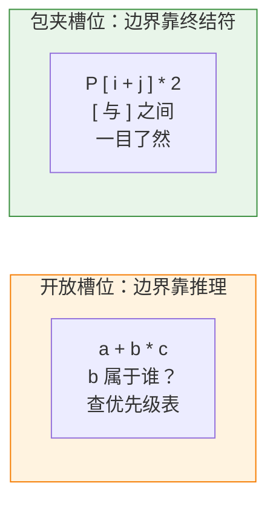
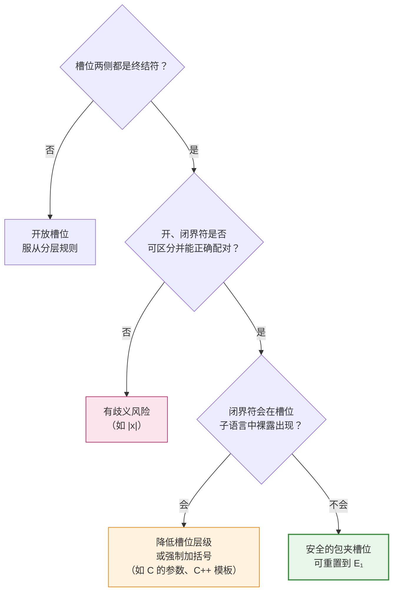

# 包夹槽位（Delimited Slot）：给子表达式砌一道墙

## 1. 一个"违规"的产生式

在表达式文法里，分层链（precedence cascade）有一条铁律：**运算符的槽位不能直接使用比本层更低的非终结符。** `*` 的操作数槽位写的是 $T$ 或 $F$，绝不能写 $E$，否则 `a + b * c` 就会出现两棵解析树。

但打开 C 语言的标准文法，会看到这样的产生式：

$$
\textit{postfix-expression} \rightarrow \textit{postfix-expression}\ \texttt{[}\ \textit{expression}\ \texttt{]}
$$

下标运算位于 C 的最高优先级层，它的槽位却直接引用了最顶层的 $\textit{expression}$。`a[i + j]`、`a[x = 1, y]` 都是合法的，方括号里可以写任意复杂的表达式。

这条产生式并没有破坏无歧义性。原因在于这个槽位的两侧都被终结符包住了：左边是 `[`，右边是 `]`。我们把这种槽位称为**包夹槽位（delimited slot）**。

本文要回答三个问题：

1. 为什么两侧有终结符，就可以无视优先级？
2. 包夹槽位在什么条件下会失效？
3. 这个视角能帮我们解释和解决哪些实际问题？

---

## 2. 先理解问题：开放槽位上的拔河

### 2.1 优先级在解决什么问题

看 `a + b * c`。中间的 `b` 同时挨着两个运算符：

```
a  +  b  *  c
   ←  b  →
  +拉     *拉
```

`+` 想把 `b` 拉进自己的右操作数，`*` 想把 `b` 拉进自己的左操作数。这是一场**拔河（tug of war）**。优先级和结合性就是拔河的裁判规则：

- **优先级**：不同层的运算符相争，高优先级获胜；
- **结合性**：同层的运算符相争，按约定方向判定胜负。

这场拔河之所以会发生，是因为操作数槽位的**边界是开放的**：`+` 的右槽位从 `+` 之后开始，但在哪里结束，文法事先没有确定，需要和右边的运算符"谈判"。

### 2.2 开放边（open side）

可以给槽位的每一侧分类：

- **封闭边**：这一侧紧挨着一个终结符，边界由这个终结符确定；
- **开放边（open side）**：这一侧的边界要看相邻运算符争夺的结果。

普通的二元中缀运算符，每个槽位都有一条开放边：

$$
E_i \rightarrow \underbrace{E_i}_{\text{左开右闭}}\ \oplus\ \underbrace{E_{i+1}}_{\text{左闭右开}}
$$

`+` 的左槽位，右侧被 `+` 封住，左侧却可能与更左边的运算符拔河；右槽位则相反。

**分层链的全部作用，就是为每一条开放边规定拔河规则。** 一个槽位的开放边越多，需要的规则就越多。

### 2.3 封闭所有边，拔河就消失了

如果一个槽位的左右两侧都是终结符：

```
  P  [  i  +  j  ]  *  2
     ↑           ↑
     墙          墙
```

槽位的起点是 `[` 之后，终点是与之匹配的 `]` 之前。这两个位置在**输入串中写得清清楚楚**，无需与任何运算符谈判。

- 墙外的运算符（如后面的 `*`）拉不到墙内的 `j`：它只能看到 `P[...]` 这个整体；
- 墙内的运算符（如 `+`）也拉不到墙外的东西：`+` 的右操作数止于 `]`。

两侧都被封闭，就没有拔河，也就不需要优先级。槽位内部因此可以 **重置（reset）** 到最顶层，从 $E_1$ 重新开始，就像一个独立的小程序。

> **包夹槽位**：两侧都紧邻终结符的槽位。它的边界由终结符直接确定，不参与优先级和结合性的竞争，因此可以安全地接受任意层级的表达式。

可以把它想象成一个**信封**：寄信的人在里面写什么都可以，邮递员只看信封；信封一旦封口，信的内容不会和外面的东西搅在一起。

---

## 3. 形式化：什么是包夹槽位

### 3.1 定义

设产生式形如：

$$
A \rightarrow \alpha\ \ a\ \ X\ \ b\ \ \beta
$$

其中 $a$、$b$ 是终结符，$X$ 是非终结符，并且 $X$ **紧挨着** $a$ 和 $b$。此时 $X$ 所在的位置就是一个包夹槽位，$a$ 称为**开界符（opening delimiter）**，$b$ 称为**闭界符（closing delimiter）**。

括号回边（parenthesized back edge）是最简单的实例：

$$
F \rightarrow \texttt{(}\ E\ \texttt{)}
$$

### 3.2 为什么安全：切分点由终结符给出

回顾无歧义性的判据：**每一层的切分点（split point）都必须唯一确定。**

对开放槽位，切分点要靠"层级"和"递归方向"推理出来。例如左结合层必须切在最右边的同层运算符处。

对包夹槽位，切分点就是开界符和闭界符本身。只要能唯一地找到与 $a$ 匹配的那个 $b$，$X$ 覆盖的子串就是唯一的，与 $X$ 内部有什么运算符无关。



### 3.3 唯一的前提：找得到正确的闭界符

"只要能唯一地找到匹配的 $b$"这个前提并不是自动成立的。写成规则就是：

> **闭界条件（closing condition）**：在 $L(X)$ 的串中，闭界符 $b$ 不能**裸露地**出现。若出现，必须被 $X$ 内部的另一对界定符保护起来。

换句话说，墙内不能有一扇和墙外大门长得一模一样、又没上锁的门；否则解析器分不清走到哪扇门才算出了院子。

对方括号来说这个条件天然满足：$\textit{expression}$ 中出现的 `]` 一定属于某个内层的 `[...]`，`a[b[i]]` 中第一个 `]` 匹配内层的 `[`，层层嵌套，匹配唯一。

后面第 5 节会看到，许多真实的语言设计问题，正是这个条件被违反的结果。

---

## 4. 包夹槽位的家族

找到这个模式后，会发现它在语言里随处可见。

| 构造 | 产生式（示意） | 开界符 | 闭界符 | 槽位接受 |
|---|---|---|---|---|
| 括号（parentheses） | $F \rightarrow (E_1)$ | `(` | `)` | 完整表达式 |
| 下标（subscript） | $P \rightarrow P\,[E_1]$ | `[` | `]` | 完整表达式 |
| 三元条件中槽（ternary middle） | $C \rightarrow O\ ?\ E_1 : C$ | `?` | `:` | 完整表达式 |
| 条件语句的条件（condition） | $S \rightarrow \texttt{if}\,(E_1)\,S$ | `(` | `)` | 完整表达式 |
| 代码块（block） | $S \rightarrow \{\ \textit{stmts}\ \}$ | `{` | `}` | 任意语句序列 |
| 返回语句（return） | $S \rightarrow \texttt{return}\ E_1\ ;$ | `return` | `;` | 完整表达式 |
| 字符串插值（interpolation） | `"... ${ E } ..."` | `${` | `}` | 完整表达式 |

几个值得注意的点：

**界定符不一定是括号。** 三元条件运算符中的 `?` 和 `:` 并不像括号，但在中间槽位看来，它们就是一对开闭界符。所以 C 语言的文法写作：

$$
\textit{conditional-expression} \rightarrow \textit{logical-OR-expression}\ \texttt{?}\ \textit{expression}\ \texttt{:}\ \textit{conditional-expression}
$$

中间槽位用了顶层的 $\textit{expression}$（连逗号表达式都可以放），左右两个槽位却必须服从分层规则，因为它们各有一条开放边。**同一个构造里，包夹槽位和开放槽位可以共存。**

**界定符也不一定是符号。** `return` 和 `;` 也构成一对界定符，所以 `return` 后面可以写任意表达式，无需关心优先级。

**包夹槽位不改变外部视角。** 对墙外的运算符而言，`P[...]`、`f(...)`、`(...)` 都像一个原子。下标和函数调用之所以放在最高优先级层，是因为它们的**左槽位** $P$ 仍然是开放的，需要和前缀运算符争夺操作数。例如 `-a[i]` 应理解为 `-(a[i])`；而方括号里面的内容，完全不参与这场争夺。

---

## 5. 墙上有漏洞：闭界条件被违反的情形

包夹槽位的威力来自"边界由终结符确定"。如果闭界符在槽位内部也能裸露出现，墙就漏了。下面三个真实案例说明了这一点。

### 5.1 函数参数与逗号：C 语言的谨慎设计

C 语言中，逗号有两种身份：

- 逗号运算符（comma operator）：`x = (a, b)`，是优先级最低的运算符，属于顶层 $\textit{expression}$；
- 参数分隔符：`f(a, b)`。

对每一个函数参数来说，它的槽位被 `(` 或 `,` 开启，被 `,` 或 `)` 关闭。如果参数槽位接受完整的 $\textit{expression}$，那么 `f(a, b)` 就有两种解读：两个参数 `a` 和 `b`，或者一个参数——逗号表达式 `a, b`。

C 标准的解决办法是让参数槽位**降一层**：

$$
\begin{align*}
\textit{argument-expression-list} &\rightarrow \textit{assignment-expression} \\
&\ \mid\ \textit{argument-expression-list}\ \texttt{,}\ \textit{assignment-expression}
\end{align*}
$$

$\textit{assignment-expression}$ 恰好是逗号运算符之下的那一层，它的子语言中不会裸露地出现 `,`，闭界条件因此成立。想传递一个逗号表达式，就得再加一层括号：`f((a, b), c)`，内层括号把逗号保护了起来。

对比下标：`a[i, j]` 中 `]` 不可能出现在 $\textit{expression}$ 中，所以下标槽位可以接受完整的 $\textit{expression}$。**同为"括号里的表达式"，能接受的层级取决于闭界符会不会在里面裸露出现。**

### 5.2 模板参数与尖括号：C++ 的老问题

C++ 用尖括号作为模板参数的界定符：`vector<int>`。但 `<` 和 `>` 同时也是比较运算符，闭界条件在这里先天不足。

```cpp
X<1 > 2> x;   // > 是比较运算符，还是模板参数的结束？
```

C++ 的规则是：在模板参数列表中，**第一个不在嵌套结构内的 `>` 一律视为闭界符**。想要比较运算，必须用括号保护：

```cpp
X<(1 > 2)> x;  // 合法
```

另一个著名问题是 `vector<vector<int>>`。在 C++03 中，词法分析器把 `>>` 识别为右移运算符，两个闭界符被合并成一个运算符 token，程序员只能写成 `> >`。C++11 才专门规定在这种场合把 `>>` 拆开处理。

这两个问题有同一个根源：**墙内的门和墙外的大门长得一样。**

### 5.3 绝对值竖线：开闭同符号

数学中用 `|x|` 表示绝对值。如果把它直接做成包夹槽位：

$$
F \rightarrow |\ E\ |
$$

开界符和闭界符是同一个符号，嵌套关系就无法从符号本身判断。在允许并列相乘（如 `2x`）的记法中，`|a|b|c|` 可以读成：

$$
|a| \cdot b \cdot |c| \qquad\text{或}\qquad |\, a \cdot |b| \cdot c \,|
$$

括号之所以可靠，是因为 `(` 和 `)` 是不同的符号，嵌套结构可以直接从输入中读出。这也是大多数编程语言用 `abs(x)` 而不是 `|x|` 的原因之一。

### 5.4 小结：可靠的界定符



---

## 6. 一个意外的联系：悬空 else

包夹槽位的视角还能重新解释一个经典问题。看这条产生式：

$$
S \rightarrow \texttt{if}\ (E)\ S \mid \texttt{if}\ (E)\ S\ \texttt{else}\ S \mid \textit{other}
$$

逐个检查槽位：

- 条件 $E$：被 `(` 和 `)` 包夹，安全；
- `then` 分支 $S$：左边是 `)`，**右边是开放的**；
- `else` 分支 $S$：左边是 `else`，**右边是开放的**。

对 `if (a) if (b) s1 else s2`，内层 if 的 `then` 分支右侧开放，后面的 `else` 既可以归内层 if，也可以归外层 if。**悬空 else（dangling else）本质上就是一个开放边上的拔河问题。**

于是有两种解决思路：

1. **制定拔河规则**：区分 matched 和 unmatched 语句，规定 `else` 前的槽位只接受 matched 语句。这相当于为开放边建立分层规则。
2. **把开放边封起来**：给语句加上闭界符，让槽位变成包夹槽位。

很多语言选择了第二条路：

| 语言 | 写法 | 闭界符 |
|---|---|---|
| Ada | `if c then s end if;` | `end if` |
| Shell | `if c; then s; fi` | `fi` |
| Go、Rust | `if c { s }` | `}`（强制花括号） |

墙一旦砌好，拔河就不复存在，悬空 else 的歧义也随之消失。这说明包夹槽位不仅是一种"利用"终结符的技巧，也是一种**语言设计的选择**：通过增加界定符，把需要规则裁决的问题直接从文法中消除。

---

## 7. 在解析器中的样子

包夹槽位在各种解析器中都很容易实现，形式上就是"**重置，然后期待闭界符**"。

**递归下降（recursive descent）/ Pratt 解析：**

```python
def parse_postfix(self):
    expr = self.parse_primary()
    while True:
        if self.match('['):
            index = self.parse_expression(min_prec=0)   # 重置到最低优先级
            self.expect(']')                            # 用闭界符收尾
            expr = Index(expr, index)
        elif self.match('('):
            args = self.parse_args()                    # 每个参数低于逗号层
            self.expect(')')
            expr = Call(expr, args)
        else:
            return expr
```

两个细节对应前面的理论：

- `min_prec=0` 就是"重置到 $E_1$"，墙内重新开始；
- `parse_args` 中每个参数要以**高于逗号运算符**的优先级解析，这正是第 5.1 节的闭界条件。

**LR 解析器（LR parser）：** 包夹槽位不会产生与优先级相关的移进-归约冲突（shift-reduce conflict）。当解析器读到闭界符时，槽位内的表达式必须完整归约，不存在"要不要继续往右扩展"的犹豫。

---

## 8. 与其他技巧的关系

把包夹槽位放回整个技巧体系中，可以按槽位的**开放边数量**统一看待各类槽位：

| 开放边数 | 槽位类型 | 典型例子 | 需要的规则 |
|---|---|---|---|
| 2 | 两侧开放 | 并列应用 `f x`（函数式语言） | 两侧都要规定 |
| 1 | 单侧开放 | 二元运算符的操作数、前缀运算符的操作数 | 分层链、递归方向 |
| 1（特例） | 单侧终结符封边（one-sided terminal guard） | Python 中 `**` 的右槽位 | 视切分点是否唯一而定 |
| 0 | 包夹槽位（delimited slot） | `[E]`、`(E)`、`? E :` | 只需满足闭界条件 |

- **括号回边（parenthesized back edge）** 是包夹槽位最简单的实例，它的作用是让程序员手动建一堵墙。
- **分层链**和**递归方向**是为开放边制定规则的技巧。
- **包夹槽位**则是直接消除开放边的技巧。

**开放边越少，需要的规则越少；没有开放边，就不需要优先级。**

---

## 9. 设计检查清单

为一个构造设计包夹槽位时，可以依次检查：

1. **两侧是否都是终结符？** 只有一侧封闭的槽位仍然要服从分层规则。
2. **开、闭界符是否可区分？** 开闭同符号（如 `|x|`）难以确定嵌套关系。
3. **闭界符会不会在槽位内部裸露出现？** 如果会，要么降低槽位接受的层级（C 的函数参数），要么规定必须加括号（C++ 的模板参数）。
4. **界定符会不会被词法分析器合并？** 如 `>>` 被当作一个 token。
5. **外部开放边是否另有处理？** 包夹槽位只管墙内；构造本身的其他槽位（如下标的左操作数、三元运算符的条件和 else 分支）仍需放进分层链。

---

## 10. 总结

- **问题根源**：优先级和结合性存在的原因，是槽位边界开放，相邻运算符要争夺操作数。
- **核心思想**：用终结符把槽位两侧封住，边界直接写在输入串里，争夺随之消失。
- **直接效果**：包夹槽位可以重置到最顶层 $E_1$，接受任意复杂的表达式。
- **唯一前提**：闭界条件——闭界符不能在槽位子语言中裸露出现，开闭界符要能正确配对。
- **设计启示**：给开放边加上界定符，是消除结构歧义最直接的方法之一。悬空 else 的现代解法就是一例。

一句话概括：

> **有墙的地方不需要规则。** 墙要砌牢：墙内不能有一扇和大门一模一样、又没上锁的门。