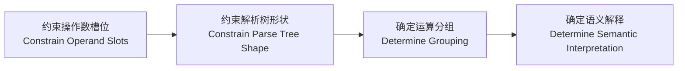
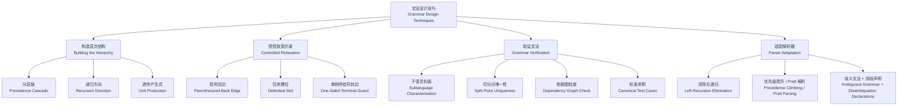
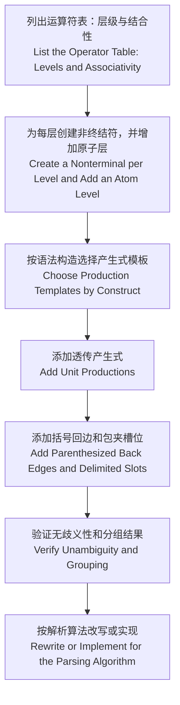

# 上下文无关文法（Context-Free Grammar, CFG）的设计技巧：以槽位约束（Slot Constraint）为核心的系统梳理

## 1. 引言

设计文法（grammar）不仅要确定哪些字符串合法，还要确定每个合法 **字符串（string）** 对应哪棵**解析树（parse tree）**。

例如，下面两个文法生成相同的语言（language），但对 `a+b+c` 的分组（grouping）不同：

$$
G_1:\ E \rightarrow E + \mathbf{id} \mid \mathbf{id} \qquad\qquad G_2:\ E \rightarrow \mathbf{id} + E \mid \mathbf{id}
$$

$G_1$ 将其分组为 $(a+b)+c$，$G_2$ 则分组为 $a+(b+c)$。可见，**优先级（precedence）** 和 **结合性（associativity）** 不是语言本身的性质，而是由文法结构编码的。

本文梳理常用的文法设计技巧及其关系，各项技巧的细节和证明留待相应子章节展开。

## 2. 核心思想：通过约束槽位来约束解析树

文法设计的基本逻辑如下：

运算符（operator）的每个操作数（operand）位置都是一个**槽位（slot）**。产生式（production）在该位置使用的非终结符（nonterminal），决定了槽位可以接受哪些表达式（expression）：

> **非终结符（nonterminal）= 槽位类型（slot type）= 子语言（sublanguage）**

因此，设计 **表达式文法（expression grammar）** 就是定义一组子语言，并将它们分配给各个**槽位**。下文的技巧都在回答同一个问题：**这个槽位允许放什么？**

## 3. 技巧体系

## 4. 构造层次结构（Building the Hierarchy）

### 4.1 分层链（Precedence Cascade）：编码优先级

为每个优先级层级（precedence level）设置一个非终结符，并让依赖关系从低优先级逐层指向高优先级：

$$
E_1 \to E_2 \to \cdots \to E_n \to E_{n+1}
$$

低优先级运算符因此靠近树根（root），高优先级运算符靠近叶子（leaf），从而先被分组。

### 4.2 递归方向（Recursion Direction）：编码结合性

结合性取决于同层运算符可以从哪一侧的槽位继续嵌套（nesting）：

| 结合性 | 产生式 | `a⊕b⊕c` |
|---|---|---|
| 左结合（left-associative） | $E_i \to E_i \oplus E_{i+1}$ | $(a \oplus b) \oplus c$ |
| 右结合（right-associative） | $E_i \to E_{i+1} \oplus E_i$ | $a \oplus (b \oplus c)$ |
| 非结合（non-associative） | $E_i \to E_{i+1} \oplus E_{i+1}$ | 语法错误（syntax error），须加括号 |

### 4.3 透传产生式（Unit Production）：连通各层

产生式 $E_i \to E_{i+1}$ 表示当前层可以不出现本层运算符，直接进入下一层。这样，一个表达式无需包含每一层的运算符，也能从开始符号（start symbol）推导（derive）出来。

## 5. 受控放宽约束（Controlled Relaxation）

严格的分层结构还需要一些受控的“出口”(逃生舱)，才能表达完整的语言。放宽约束的前提是不能引入歧义（ambiguity）。

| 技巧                                    | 典型形式                                                                | 作用                               |
| ------------------------------------- | ------------------------------------------------------------------- | -------------------------------- |
| **括号回边（parenthesized back edge）**     | $E_{n+1} \to (E_1)$                                                 | 将任意表达式封装为原子（atom），手动覆盖默认优先级      |
| **包夹槽位（delimited slot）**              | $P \to P[E_1]$                                                      | 槽位两侧有终结符（terminal）界定，可接受任意层级的表达式 |
| **单侧终结符封边（one-sided terminal guard）** | $\textit{power} \to \textit{primary}\ \texttt{**}\ \textit{factor}$ | 在切分点（split point）仍然唯一时，允许槽位引用更低层 |

设计回边（back edge）时，要避免出现不消耗终结符的环路（cycle），如 $E_1 \Rightarrow^+ E_1$，否则同一个字符串可能有多棵解析树。

## 6. 常见语法构造（Common Syntactic Constructs）

| 语法构造 | 参考模板 | 主要技巧 |
|---|---|---|
| 二元运算符（binary operator） | 按结合性选择第 4.2 节的模板 | 分层链、递归方向 |
| 前缀一元运算符（prefix unary operator） | $E_i \to -E_i \mid E_{i+1}$ | 递归方向 |
| 后缀一元运算符（postfix unary operator） | $E_i \to E_i! \mid E_{i+1}$ | 递归方向 |
| 三元条件运算符（ternary conditional operator） | $E_i \to E_{i+1}\ ?\ E_1 : E_i \mid E_{i+1}$ | 递归方向、包夹槽位 |
| 下标（subscript）与函数调用（function call） | $P \to P[E_1] \mid P(\textit{args}) \mid A$ | 递归方向、包夹槽位 |
| 悬空 else（dangling else） | 区分 `matched` 与 `unmatched` 语句 | 拆分非终结符（nonterminal splitting） |

悬空 else 说明，这套方法不限于表达式：只要能拆分非终结符并限制槽位类型，就可以用同样的思路消除其他结构歧义（structural ambiguity）。

## 7. 验证文法（Grammar Verification）

文法写完后，可以从四个方面检查：

1. **子语言刻画（sublanguage characterization）：** 能否准确说明每个非终结符生成什么？
2. **切分点唯一性（split-point uniqueness）：** 每一层的根节点（root node）是否只有一个合法切分位置？
3. **依赖图（dependency graph）：** 回到上层的边是否都有终结符保护（terminal protection）？是否存在无终结符环路？
4. **标准用例（canonical test cases）：** 关键输入能否得到预期结果？

| 用例 | 检验目标 | 预期结果 |
|---|---|---|
| `a + b * c` | 优先级（precedence） | $a + (b * c)$ |
| `a - b - c` | 左结合（left associativity） | $(a - b) - c$ |
| `a ^ b ^ c` | 右结合（right associativity） | $a ^ {(b ^ c)}$ |
| `(a + b) * c` | 括号回边（parenthesized back edge） | $(a + b) * c$ |
| `a < b < c` | 非结合（non-associativity） | 语法错误（syntax error） |

用例只能发现问题，不能证明文法无歧义（unambiguous）。严格论证仍需依靠**切分点唯一性**等方法。

## 8. 适配解析器（Parser Adaptation）

理论上合适的文法，还可能需要根据解析算法（parsing algorithm）进行调整：

| 方案 | 适用场景 | 需要注意 |
|---|---|---|
| **消除左递归（left-recursion elimination）** | LL 解析（LL parsing）、递归下降（recursive descent） | 解析树形状会变化，须通过语义动作（semantic action）或循环恢复左结合 |
| **优先级爬升（precedence climbing）/ Pratt 解析（Pratt parsing）** | 运算符层级较多的手写解析器（hand-written parser） | 优先级规则主要体现在解析代码或运算符表（operator table）中 |
| **歧义文法（ambiguous grammar）+ 消歧声明（disambiguation declaration）** | Yacc、Bison 等 LR 工具 | 文法更简洁，但需要理解冲突消解（conflict resolution）规则 |

## 9. 标准设计流程（Standard Design Workflow）

经典的 E-T-F 文法（expression-term-factor grammar）就是“两层运算符、均为左结合”时的实例：

$$
\begin{align*}
E &\rightarrow E + T \mid T \\
T &\rightarrow T * F \mid F \\
F &\rightarrow (E) \mid \mathbf{id}
\end{align*}
$$

## 10. 适用边界（Limitations）

- **同层结合性（same-level associativity）：** 同一层的运算符通常应采用相同的结合性，否则分组规则难以保持一致。
- **依赖上下文的语法（context-dependent syntax）：** C 语言的 `(T)*p` 是类型转换（type cast）还是乘法，取决于 `T` 是否为类型名（type name），这需要符号表（symbol table）信息参与判断。
- **特殊语义（special semantics）：** Python 的 `a < b < c` 表示链式比较（chained comparison），文法负责识别其结构，具体含义由后续阶段定义。
- **文法改写（grammar rewriting）：** 改写可以保持语言不变，但可能改变解析树，因此要确认原有语义是否得到保留。

## 11. 总结

| 设计目标 | 对应技巧 | 核心规则 |
|---|---|---|
| 优先级（precedence） | 分层链（precedence cascade） | 低优先级运算符不能裸露地进入高优先级运算符的槽位 |
| 结合性（associativity） | 递归方向（recursion direction） | 哪一侧放行同层运算符，就向哪一侧结合 |
| 层间连通（level connectivity） | 透传产生式（unit production） | 允许当前层不出现本层运算符 |
| 覆盖默认优先级（overriding default precedence） | 括号回边（parenthesized back edge） | 回到上层时必须有终结符保护 |
| 嵌入完整表达式（embedding full expressions） | 包夹槽位（delimited slot） | 由两侧终结符界定子表达式（subexpression）的范围 |
| 处理特殊组合（handling special combinations） | 单侧终结符封边（one-sided terminal guard） | 只有切分点仍然唯一时才能放宽分层规则 |
| 保证无歧义（ensuring unambiguity） | 切分点分析（split-point analysis） | 每层的切分位置都必须唯一确定 |

