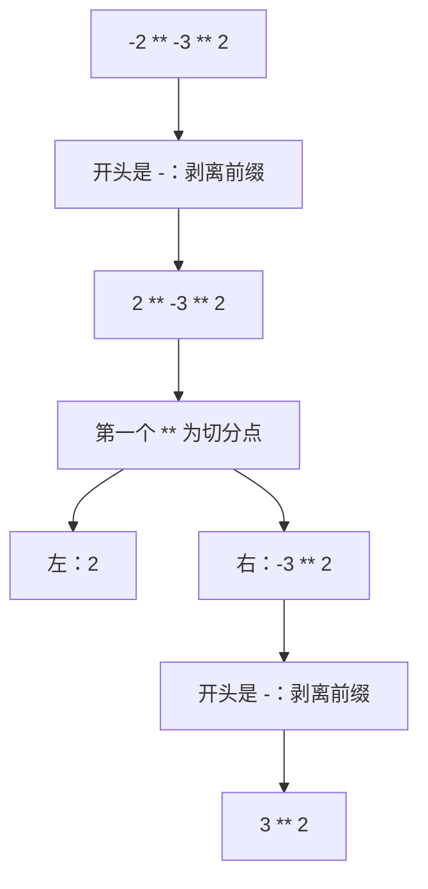
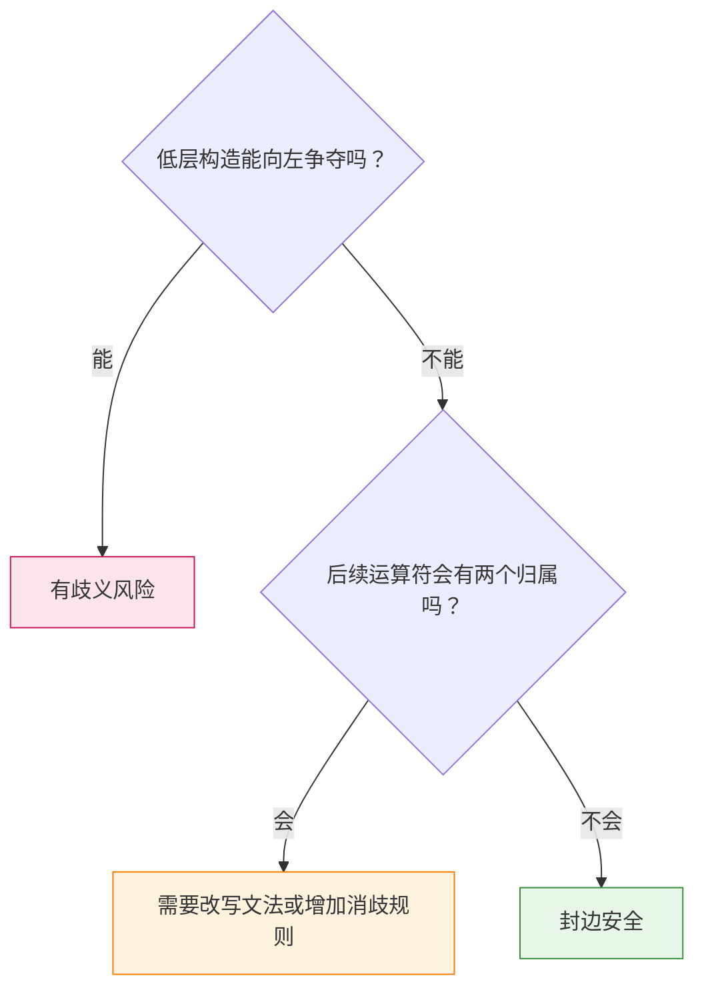

# 单侧终结符封边（One-Sided Terminal Guard）：背靠墙的运算符

## 1. 一个看似矛盾的优先级

在 Python 中：

```python
-2 ** 2   # -4，   即 -(2 ** 2)
2 ** -1   # 0.5，  即 2 ** (-1)
```

第一行说明 `**` 比前缀 `-` 结合得更紧，第二行的 `-` 却能出现在 `**` 的右操作数中。Python 文法的核心部分可简化为：

$$
\begin{align*}
\textit{factor} &\rightarrow -\ \textit{factor} \mid \textit{power} \\
\textit{power} &\rightarrow \textit{primary}\ \texttt{**}\ \textit{factor} \mid \textit{primary}
\end{align*}
$$

`power` 的优先级高于 `factor`，但它的右槽位却引用了 `factor`。这看似违反了分层链（precedence cascade）的规则，文法却没有歧义，原因就在于**单侧终结符封边**。

> **单侧终结符封边**：低层构造的一侧以终结符为边界，且这一侧不存在可争夺的操作数，因此该构造可以从这一侧进入高层槽位。

## 2. 核心直觉：中间没有人，就拔不了河

优先级要解决的是相邻运算符对操作数的争夺：

```text
a  *  b  +  c
      ↑
   * 和 + 都想要 b
```

再看 `2 ** -1`：

```text
2  **  -  1
     ↑
  中间没有操作数
```

`**` 和 `-` 之间没有操作数，也就不存在争夺。前缀 `-` 就像一个**背靠墙、只向右伸手的人**：它没有左槽位，无法向左抓取任何东西。因此，`2 ** -1` 不可能被理解成 `(2 ** ...) - 1` 这样的另一种结构。

反过来，`-2 ** 2` 中的 `2` 夹在两个运算符之间，确实存在争夺。文法规定 `**` 的左槽位是 `primary`，裸露的 `-2` 放不进去，因此只能得到 `-(2 ** 2)`。

由此可见，**优先级只在运算符之间夹着操作数时才起作用。** 这也解释了 Python 文档的描述：`**` 比左侧的一元运算符结合得更紧，比右侧的一元运算符结合得更松。

## 3. 切分点为什么唯一

设 $w \in L(\textit{factor})$，解析时的选择是唯一的：

1. **$w$ 以 `-` 开头：** 只能使用 $\textit{factor} \to -\ \textit{factor}$，因为 `primary` 不能以裸露的 `-` 开头。
2. **$w$ 不以 `-` 开头：** 只能使用 $\textit{factor} \to \textit{power}$。
3. **解析 `power`：** 第一个顶层 `**` 就是切分点，因为 `primary` 中不含顶层 `**`。

以 `-2 ** -3 ** 2` 为例：



最终分组为 $-(2^{-(3^2)})$，每一步都没有第二种选择。这里的 `factor` 还顺带实现了 `**` 的右结合，因为 `factor` 可以展开为 `power`。

## 4. 两道安全检查

封边只保护一侧，另一侧仍然开放。因此，需要分别检查左右两侧。

### 4.1 左侧检查：能否重新分组

低层构造进入槽位后，外层表达式不能被重新解释为它的左操作数。

假设允许 `+` 进入 `*` 的右槽位：

$$
T \rightarrow T * E
$$

那么 `a * b + c` 同时有两种分组：$a * (b + c)$ 和 $(a * b) + c$。`+` 有左槽位，会向左争夺操作数，所以产生歧义。前缀运算符没有左槽位，能够通过这项检查。

### 4.2 右侧检查：后续运算符是否只有一个归属

前缀运算符的操作数向右延伸。如果后面的运算符既能进入这个操作数，又能以整个外层表达式为左操作数，就会产生歧义。

Python 的 `**` 能通过检查：

```text
a ** -b ** c
```

`**` 的左槽位只接受 `primary`，所以 `(a ** -b) ** c` 无法推导，唯一结果是 `a ** (-(b ** c))`。

如果把这种写法用于左结合运算符 `*`，并假设 `-` 的优先级低于 `*`：

$$
\begin{align*}
M &\rightarrow -\ M \mid T \\
T &\rightarrow T * M \mid A
\end{align*}
$$

`a * -b * c` 就有两种分组：

$$
(a * (-b)) * c \qquad\text{和}\qquad a * (-(b * c))
$$

问题不在左侧，而在右侧的开放边。**只看到“前缀运算符以终结符开头”还不足以保证无歧义。**



## 5. 右侧不安全时的三种处理方式

### 5.1 直接禁止

Python 的 `not` 优先级较低，也不能直接放进算术运算符的右槽位：

```python
1 + not x     # SyntaxError
1 + (not x)   # 合法
```

这种方式最简单，但程序员需要手动加括号。

### 5.2 拆分非终结符

可以区分“尾部没有开放前缀”的表达式 $C$ 和其他表达式，只让前者进入 `*` 的左槽位：

$$
\begin{align*}
M &\rightarrow -\ M \mid T \\
T &\rightarrow C \mid C * -\ M \\
C &\rightarrow C * A \mid A
\end{align*}
$$

此时 `(a * -b) * c` 无法推导，`a * -b * c` 只能解析为 $a * (-(b * c))$。这和用 `matched` / `unmatched` 解决悬空 else（dangling else）是同一种思路。

### 5.3 使用元规则

Haskell 允许 `1 + \x -> x * 2` 这样的写法，并通过元规则（meta-rule）消除歧义：lambda、`let` 和条件表达式都尽可能向右延伸。这样写起来方便，但规则位于文法产生式之外。

## 6. 镜像与近亲

### 6.1 镜像：右侧封边

封边也可以出现在右侧。假设有一个优先级较低的后缀运算符 `!`：

$$ \begin{align*} \textit{factor} &\rightarrow \textit{factor}\ ! \mid \textit{power} \\ \textit{power} &\rightarrow \textit{factor}\ \hat{\ }\ \textit{primary} \mid \textit{primary} \end{align*} $$

后缀运算符没有右槽位，所以 `a!^b` 只能解析为 `(a!)^b`。这个文法只是用于说明对称性的示例。

### 6.2 近亲：C++ 条件表达式

C++ 条件表达式的最后一个槽位可以接受赋值表达式，文法可简化为：

$$
\textit{conditional} \rightarrow \textit{logical-or}\ ?\ \textit{expression}\ :\ \textit{assignment}
$$

因此 `c ? a : b = d` 解析为 `c ? a : (b = d)`。赋值运算符虽然有左槽位，但该槽位只接受 `logical-or`，所以 `(c ? a : b) = d` 无法由这条路径推导。

严格来说，这不是由前缀终结符形成的封边。两者的共同点是**堵住向左重新分组的路径**。C 语言的第三个槽位不接受赋值表达式，因此 `c ? a : b = d` 在 C 中是不合法的。

## 7. 在解析器中的实现

递归下降解析器（recursive descent parser）几乎可以直接照抄文法：

```python
def parse_factor(self):
    if self.match('-'):
        return Neg(self.parse_factor())
    return self.parse_power()

def parse_power(self):
    base = self.parse_primary()      # 左槽位：只接受 primary
    if self.match('**'):
        return Pow(base, self.parse_factor())  # 右槽位：允许前缀运算符
    return base
```

Pratt 解析（Pratt parsing）对这种情况的支持更自然。前缀运算符在表达式开头处理，不受当前最小绑定力的限制：

```python
PREFIX_BP = 25
POW_LEFT_BP, POW_RIGHT_BP = 30, 29

def parse_expr(self, min_bp=0):
    if self.match('-'):
        left = Neg(self.parse_expr(PREFIX_BP))  # 不检查 min_bp
    else:
        left = self.parse_primary()

    while self.peek_is('**') and POW_LEFT_BP >= min_bp:
        self.advance()
        left = Pow(left, self.parse_expr(POW_RIGHT_BP))
    return left
```

需要注意的是，Pratt 解析器总会给出一个确定结果，但这不代表对应的 CFG 没有歧义。它可能只是通过贪心延伸，隐式采用了类似第 5.3 节的元规则。

## 8. 与其他技巧的关系

| 技巧 | 封闭的边界 | 开放的边界 | 主要规则 |
|---|---|---|---|
| 分层链 | 无额外封闭 | 由层级约束 | 槽位不接受更低层 |
| 包夹槽位（delimited slot） | 左右两侧 | 无 | 闭界符能够正确匹配 |
| 单侧终结符封边 | 低层构造的一侧 | 另一侧 | 开放侧的切分点必须唯一 |

如果说包夹槽位是一间四面有墙的房间，单侧封边就是**背靠一堵墙**：背后安全，但前方仍要设定规则。

## 9. 设计检查清单

为某个槽位放宽层级限制时，可以依次确认：

1. **边界：** 低层构造的被保护一侧是否由终结符确定？
2. **反向分组：** 外层表达式能否被重新解释为低层构造的操作数？
3. **开放边：** 开放侧的后续运算符是否只有一个归属？
4. **消歧方式：** 如果存在两个归属，是禁止写法、拆分非终结符，还是使用元规则？
5. **标准用例：** 是否测试了下表中的组合？

| 用例 | 检验内容 | Python 的结果 |
|---|---|---|
| `-a ** b` | 左侧争夺 | `-(a ** b)` |
| `a ** -b` | 封边是否生效 | `a ** (-b)` |
| `a ** -b ** c` | 右侧开放边 | `a ** (-(b ** c))` |
| `a ** -b * c` | 与更低层运算符的交互 | `(a ** (-b)) * c` |
| `a ** --b` | 前缀叠加 | `a ** (-(-b))` |

## 10. 总结

- **基本原理：** 优先级解决相邻运算符对操作数的争夺，中间没有操作数就没有这种争夺。
- **适用条件：** 被封住的一侧不能发生重新分组，开放的一侧也必须有唯一切分点。
- **典型应用：** Python 的 `2 ** -1` 既合法又无歧义，而 `-2 ** 2` 仍然解析为 `-(2 ** 2)`。
- **主要风险：** 把同样的写法套用到其他运算符时，歧义可能从开放的一侧出现，例如 `a * -b * c`。
- **本质判据：** “槽位不得使用更低层”是保证安全的充分条件，不是必要条件。真正的判据是**切分点唯一**。

一句话概括：

> **背靠墙的运算符不怕身后有人争夺，但仍要看好它面前的那条开放边。**

**术语说明：** “单侧终结符封边（one-sided terminal guard）”是本文使用的描述性术语，并非编译原理领域的通用标准术语。