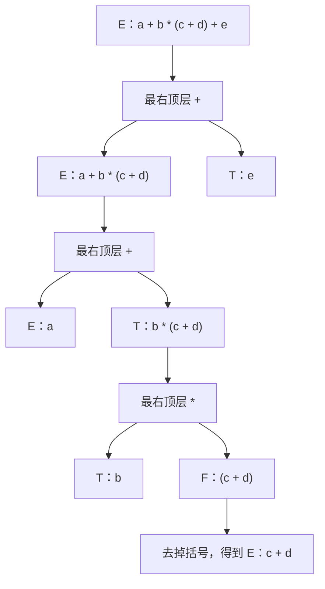

# 切分点唯一性（Split-Point Uniqueness）：每一刀只有一个下法

## 1. 把解析看成切蛋糕

给定一个字符串和一个非终结符，构造解析树就像切蛋糕。每一步都要回答两个问题：

1. **用哪条产生式？**
2. **如何把字符串分给产生式右部的各个符号？**

以 `a+b+c` 和朴素文法 $E \rightarrow E+E \mid \mathbf{id}$ 为例，第一刀有两种切法：

```text
切法 1：a + b | + | c    → (a+b)+c
切法 2：a | + | b + c    → a+(b+c)
```

两种切法都合法，因此出现了两棵解析树。如果改用 $E \rightarrow E+T \mid T$，由于 $T$ 不能包含顶层的 `+`，这一刀只能切在最右边的 `+` 处：

```text
a + b | + | c    → (a+b)+c
```

这就是切分点唯一性的直观含义：**每一步都只有一种合法的切法，整棵解析树也就只有一种可能。**

## 2. 判据：把全局问题化为局部问题

“每个字符串只有一棵解析树”是全局性质。切分点唯一性把它拆成每个节点上的局部检查。

设文法没有无用符号。对每个非终结符 $A$ 和每个 $w \in L(A)$，考察满足以下条件的“选择”：

$$
A \rightarrow X_1X_2\cdots X_k,\qquad w=w_1w_2\cdots w_k,\qquad w_i\in L(X_i)
$$

> **判据：文法无歧义，当且仅当对每一组 $(A,w)$，上述“产生式 + 切分方式”都只有一种。**

- **充分性：** 假设有两棵不同的解析树，它们一定在某个节点首次出现差异。该节点存在两种选择，与判据矛盾。
- **必要性：** 如果某个节点有两种选择，由于没有无用符号，可以把它放进一个完整句子的推导中，从而得到两棵解析树。

歧义因此分为两类，文献中常称为**垂直歧义（vertical ambiguity）**和**水平歧义（horizontal ambiguity）**：

| 类型 | 问题 | 例子 |
|---|---|---|
| 垂直歧义 | 多条产生式都能生成 $w$ | $A \rightarrow B \mid C$，且 $L(B)\cap L(C)\neq\varnothing$ |
| 水平歧义 | 同一条产生式有多种切法 | $E \rightarrow E+E$ 处理 `a+b+c` |

严格来说，判据包括“产生式唯一”和“切法唯一”两部分。本文所说的切分点唯一性同时涵盖这两部分。

## 3. 如何证明：以 E-T-F 文法为例

$$
\begin{align*}
E &\rightarrow E+T \mid T \\
T &\rightarrow T*F \mid F \\
F &\rightarrow (E) \mid \mathbf{id}
\end{align*}
$$

### 第一步：写出不变式

先刻画每个非终结符能生成什么：

- $E$、$T$、$F$ 生成的字符串括号都平衡。
- $T$ 生成的字符串没有顶层 `+`。
- $F$ 生成的字符串没有顶层 `+` 或 `*`。

这里的“顶层”是指括号深度为 0。括号平衡保证了每个子串内部的深度计算不受外部影响。

### 第二步：确定每一步的切法

| 非终结符 | 字符串的特征 | 唯一选择 |
|---|---|---|
| $E$ | 有顶层 `+` | $E \rightarrow E+T$，切在**最右**顶层 `+` |
| $E$ | 无顶层 `+` | $E \rightarrow T$ |
| $T$ | 有顶层 `*` | $T \rightarrow T*F$，切在**最右**顶层 `*` |
| $T$ | 无顶层 `*` | $T \rightarrow F$ |
| $F$ | 以 `(` 开头 | $F \rightarrow (E)$，去掉首尾括号 |
| $F$ | 是标识符 | $F \rightarrow \mathbf{id}$ |

为什么必须切在最右顶层 `+`？因为切点右边的部分属于 $L(T)$，其中不能有顶层 `+`。如果切在其他 `+` 处，右边就会留下一个顶层 `+`，违反不变式。

### 第三步：对字符串长度或推导高度归纳

每一步的选择都唯一，再对子串继续应用同样的结论，就能得到整棵树唯一。

### 手动走一遍



括号中的 `+` 深度为 1，所以不会参与外层的切分。括号的作用正是把内部的运算符藏起来。

## 4. 常见构造的切分规则

| 构造 | 产生式 | 切分依据 |
|---|---|---|
| 左结合（left-associative） | $E_i \rightarrow E_i\oplus E_{i+1}$ | 最右同层顶层运算符 |
| 右结合（right-associative） | $E_i \rightarrow E_{i+1}\oplus E_i$ | 最左同层顶层运算符 |
| 非结合（non-associative） | $E_i \rightarrow E_{i+1}\oplus E_{i+1}$ | 唯一的同层顶层运算符 |
| 前缀运算符（prefix operator） | $E_i \rightarrow -E_i$ | 第一个记号 |
| 后缀运算符（postfix operator） | $E_i \rightarrow E_i!$ | 最后一个记号 |
| 包夹槽位（delimited slot） | $P \rightarrow P[E_1]$ | 最后的 `]` 及其匹配的 `[` |
| 三元条件运算符（ternary conditional operator） | $C \rightarrow O\ ?\ E_1 : C$ | 第一个顶层 `?` 及其匹配的 `:` |

从这张表可以看出，优先级、结合性和界定符虽然形式不同，但都在做同一件事：**告诉我们这一刀应该落在哪里。**

## 5. 多个切分点从何而来

| 问题 | 文法 | 输入 | 多种选择 |
|---|---|---|---|
| 两侧都放行同层 | $E \rightarrow E+E \mid \mathbf{id}$ | `a+b+c` | 可切在任意一个 `+` |
| 序列可任意拼接 | $L \rightarrow LL \mid a$ | `aaa` | `a|aa` 或 `aa|a` |
| 相邻部分可为空 | $A \rightarrow BC$，$B \rightarrow a \mid \varepsilon$，$C \rightarrow a \mid \varepsilon$ | `a` | `a` 可分给 $B$ 或 $C$ |
| 无终结符环路 | $A \rightarrow B \mid a$，$B \rightarrow A$ | `a` | 可直接生成，也可绕环生成 |
| 悬空 else | `if` 语句的两种形式 | `if (a) if (b) s1 else s2` | `else` 可归属任一 `if` |
| 开放边放宽 | $M \rightarrow -M \mid T$，$T \rightarrow T*M \mid A$ | `a*-b*c` | 可切在任意一个 `*` |

最后一个例子很有代表性。它的两种分组如下：

$$
(a*(-b))*c \qquad\text{和}\qquad a*(-(b*c))
$$

问题在于，右槽位 $M$ 可以通过前缀 `-` 再次包含顶层 `*`，于是“右边不能有同层运算符”不再成立。

Python 的 `**` 看起来相似，却能保持唯一，因为它的左槽位只接受 `primary`：

$$
\textit{power} \rightarrow \textit{primary}\ \texttt{**}\ \textit{factor} \mid \textit{primary}
$$

`primary` 不含顶层 `**`，所以切分点只能是第一个顶层 `**`。

## 6. 切分点唯一性不能保证什么

### 6.1 不保证语义正确

$E \rightarrow T-E \mid T$ 的切分点唯一，但它把 `8-3-2` 分组为 $8-(3-2)$，求值结果是 7，而不是通常期望的 3。**唯一只代表没有歧义，不代表切法符合语言规范。**

### 6.2 不保证解析器容易实现

下面的偶数长度回文文法没有歧义：

$$
S \rightarrow aSa \mid bSb \mid \varepsilon
$$

看到整个字符串后，切分方式是确定的。但从左向右扫描时，解析器无法用固定长度的向前看符号判断是否到了中点，因此这个文法不是 LR(k) 文法。

**无歧义只说明答案唯一，不说明解析器能在有限的局部信息下找到答案。**

### 6.3 不存在通用的判定算法

判断任意 CFG 是否有歧义是**不可判定的（undecidable）**。此外，有些语言是**固有歧义的（inherently ambiguous）**，无论怎样改写文法，都无法做到切分唯一，例如：

$$
\{a^ib^jc^k \mid i=j \text{ 或 } j=k\}
$$

实践中可以使用以下方法：

- **人工证明：** 用不变式和切分规则进行证明。
- **工具检查：** 如果文法通过 LR(1) 构造且没有冲突，就可以确定它无歧义。
- **谨慎解读冲突：** 出现冲突不一定代表文法有歧义，它也可能只是超出了 LR(1) 的能力。
- **测试反例：** 用具体用例寻找反例，但测试通过并不能证明文法无歧义。

## 7. 设计检查清单

对每个非终结符依次回答：

1. **它生成什么？** 用一句话写出不变式。
2. **产生式是否互斥？** 同一个字符串能否由多个候选式生成？
3. **切分依据是什么？** 是最左运算符、最右运算符，还是界定符？
4. **为什么其他切法不行？** 其他切法具体违反了哪条不变式？
5. **是否存在隐藏的选择？** 特别留意 $\varepsilon$ 产生式、$L \rightarrow LL$ 和无终结符环路。
6. **放宽规则后结论是否仍成立？** 重点检查开放的一侧能否再次露出同层运算符。

如果某一步只能回答“应该只有这一种切法”，却说不出其他切法违反了什么，那里往往就藏着歧义。

## 8. 总结

- **核心判据：** 对每个 $(A,w)$，产生式和切分方式都必须唯一。
- **证明方法：** 先写不变式，再确定切分规则，最后进行归纳。
- **设计含义：** 分层链、递归方向和包夹槽位，都是确定切分点的手段。
- **适用范围：** 它用于判断文法是否有歧义，但不保证语义正确，也不保证文法适合特定解析算法。

一句话概括：

> **文法无歧义，就是每一步都只有一种下刀方式；优先级、结合性和括号，都在告诉我们刀该落在哪里。**

**术语说明：** “切分点唯一性（split-point uniqueness）”是本文使用的描述性术语，并非通用标准术语。相关的标准概念是上文提到的垂直歧义和水平歧义。