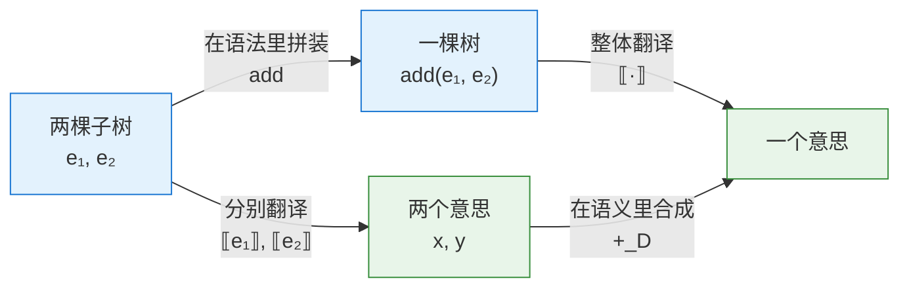

# 初始代数与初始代数语义：从直觉到理论

**Initial Algebras and Initial Algebra Semantics: From Intuition to Theory**

---

## 摘要（Abstract）

**初始代数（Initial Algebra）** 是范畴论中的一个基本概念，指某个代数范畴中的**初始对象（Initial Object）**。**初始代数语义（Initial Algebra Semantics）** 是建立在这一概念上的**语义方法论（Semantic Methodology）**：把语言的 **抽象语法（Abstract Syntax）** 视为**初始代数**，把**语义**视为另一个代数，把 **意义函数（Meaning Function）** 定义为二者之间唯一的**同态（Homomorphism）**。

本文按"直觉、定义、定理"三步展开。每个概念先用积木与解读手册的类比和可运行的代码讲清楚，再给出形式定义与证明。全文从**签名（Signature）**、**项代数（Term Algebra）**、同态与初始性讲起，经过范畴论中的 **F-代数（F-Algebra）** 表述，说明**初始代数语义**如何自动带来良定义性、**组合性（Compositionality）** 与 **结构归纳（Structural Induction）**。随后讨论**语义域**的扩展（环境、错误、副作用、非终止）、**等式规约（Equational Specification）**、初始代数的存在条件以及对偶理论**终余代数（Final Coalgebra）**。最后介绍它在**函数式编程（Functional Programming）**、**类型论（Type Theory）** 和 **代数规约（Algebraic Specification）** 中的推广与应用。

**关键词（Keywords）**：初始代数（Initial Algebra）；F-代数（F-Algebra）；初始代数语义（Initial Algebra Semantics）；下态射（Catamorphism）；组合性（Compositionality）；结构归纳（Structural Induction）；终余代数（Final Coalgebra）

---

## 阅读指南与记号约定（Reading Guide and Conventions）

**全文结构**

| 部分 | 章节 | 内容 | 前置知识 |
|---|---|---|---|
| 第一部分：直觉与基础 | §1–§5 | 积木类比、签名、项代数、同态、初始性 | 能读懂简单的 Python |
| 第二部分：理论与方法 | §6–§9 | F-代数、计算律、语义方法、语义域扩展、等式规约 | 了解基本的函数与集合 |
| 第三部分：进阶 | §10–§11 | 存在性、余代数、现代推广与应用 | 有一定范畴论基础，**首次阅读可跳过** |
| 总结 | §12 | 常见误解、术语总表 | — |

**排版约定**：直觉性讲解用正文书写。形式化内容放在引用块中，以"**定义**""**定理**""**引理**"等开头。

**记号约定**

- 语义括号统一写作 $\lbrack\!\lbrack e \rbrack\!\rbrack$，读作"$e$ 的意义"。需要区分不同语义时加下标，如 $\lbrack\!\lbrack e \rbrack\!\rbrack_S$。（Mermaid 图不渲染 LaTeX，图中以 ⟦ ⟧ 示意。）
- 下态射写作 $(\!|\alpha|\!)$（香蕉括号），上态射写作 $[\!(\gamma)\!]$（透镜括号）。
- $\sigma$ 专指签名中的运算符；程序状态记作 $\mathit{st}$。
- 本文区分两种"坏值"：
  - $\mathsf{err}$ 表示**可检测的错误**，例如除零或类型错误。它是语义域中一个普通的值，可以被检测、被传播（§8.2）。
  - $\bot$ **只**表示**完全偏序（CPO）中的最小元**，即"尚无任何信息"，用来刻画非终止（§8.5）。

---

# 第一部分：直觉与基础

## 1. 引言（Introduction）

### 1.1 一句话版本

先给出全文的一句话版本：

> **语法树（Syntax Tree）只规定"怎么拼"，不规定"是什么意思"。只要给每一种拼法规定一条"意思怎么合成"的规则，整棵树的意思就被唯一确定了；换一套规则，就得到一种新的意思。**

本文的全部内容，都是在把这句话讲清楚，再把它证明出来。

### 1.2 两个问题与一个答案

程序语言语义学需要回答两个问题：

1. 如何精确描述**归纳定义的数据类型（Inductively Defined Data Types）**，例如自然数、列表和语法树？
2. 如何为程序和表达式赋予意义，并保证这种意义是良定义的、可组合的、便于推理的？

1970 年代，**ADJ 小组（ADJ Group：J. A. Goguen、J. W. Thatcher、E. G. Wagner、J. B. Wright）** 发现，这两个问题可以用同一个数学结构回答，这个结构就是**初始代数**（Goguen et al., 1977）。

- 作为**概念**，初始代数刻画了"由**构造子**自由生成、不含多余元素、也没有多余等同"的数据结构。
- 作为**方法**，初始代数语义利用初始性给出的唯一同态来定义语义，从而自动得到良定义性、组合性和**结构归纳原理（Structural Induction Principle）**。

二者的关系类似于 **不动点（Fixed Point）** 与 **不动点语义（Fixed-Point Semantics）**：前者是数学工具，后者是使用这一工具的语义框架。

### 1.3 全文路线

```
积木目录（签名） → 能拼出的所有模型（项代数） → 一套解读规则（Σ-代数）
   → 按规则解读模型（同态） → 为什么解读方式唯一（初始性）
   → 范畴论表述（F-代数） → 语义方法与三个推论
   → 当意思需要上下文、可能失败、可能不终止时（扩展语义域）
   → 当模型之间需要"视为相同"时（等式规约）
   → 存在性、对偶与现代推广
```

---

## 2. 一个贯穿全文的类比：积木与解读手册（An Analogy: Building Blocks and Manuals）

设想一套积木，只有三种零件：

| 零件 | 外形 | 插孔数 |
|---|---|---|
| **数字块** | 正面刻着一个整数，例如 `3` | 0 个，只能放在最底层 |
| **加号块** | 上面印着 `+` | 2 个，下面能插两块积木 |
| **乘号块** | 上面印着 `×` | 2 个 |

用这些零件可以拼出各种"模型"。比如一个加号块，左边插数字块 `2`，右边插一个乘号块，乘号块下面再插 `3` 和 `4`。这就是表达式 `2 + 3 * 4` 的语法树：

```
        +
       / \
      2   ×
         / \
        3   4
```

**积木本身没有意思**，它只是一个形状。要让它有意思，还需要一本**解读手册**，说明每种零件代表什么：

- 数字块代表它刻着的那个数；
- 加号块代表"把两个插孔里的东西加起来"；
- 乘号块代表"把两个插孔里的东西乘起来"。

拿着手册从底层往上逐块解读：`3` 和 `4` 合成 `12`，`2` 和 `12` 合成 `14`。

这个过程里有一条看起来理所当然、其实非常关键的规矩：

> **解读一个零件时，只看它直接插着的那几块"已经解读出来的结果"，不看它们内部长什么样。**

加号块不关心右边插的是一个刻着 `12` 的数字块，还是一个 `3 × 4` 的乘号组合，它只拿到"12"这个结果。这条规矩就是**组合性（Compositionality）**。

本文第一部分的数学，就是把这个类比精确化：

| 类比                  | 术语                                                        | 章节   |
| ------------------- | --------------------------------------------------------- | ---- |
| 零件目录（每种零件及其插孔数）     | 签名（Signature）$\Sigma$，元数（Arity）                           | §3.1 |
| 所有能拼出的模型            | 项代数（Term Algebra）$T_\Sigma$                               | §3.2 |
| 解读结果的种类（整数、类型、指令……） | 语义域（Semantic Domain）$D$                                   | §4.1 |
| 解读手册（每种零件的合成规则）     | Σ-代数（Σ-Algebra）                                           | §4.1 |
| 按手册从下往上解读           | 同态（Homomorphism）$\lbrack\!\lbrack \cdot \rbrack\!\rbrack$ | §4.2 |
| "只看直接孩子的结果"这条规矩     | 同态条件（Homomorphism Condition）                              | §4.2 |
| 每本手册都只有一种解读方式       | 初始性（Initiality）                                           | §5   |

---

## 3. 签名与项代数（Signatures and Term Algebras）

### 3.1 签名：一份零件目录

本文的运行示例使用如下签名：

$$
\Sigma = \{\, \mathsf{lit}_n^{(0)} \mid n \in \mathbb{Z} \,\} \;\cup\; \{\, \mathsf{add}^{(2)},\ \mathsf{mul}^{(2)} \,\}
$$

翻译成日常语言：**有无穷多种数字块（每个整数一种，插孔数为 0），外加加号块和乘号块（插孔数都是 2）。** 上标里的数字叫**元数（Arity）**，也就是插孔数。

**为什么数字块的元数是 0，而不是 1？** 它明明"带着"一个整数。区别在于，"刻在零件上的标签"和"插孔"是两回事。插孔里插的是**另一块积木**，即**子树（Subtree）**；而 `3` 这个整数刻在零件表面，那里插不进一个加号块。所以 `lit` 并不是一个一元构造子，而是**一族零元常量（a Family of Nullary Constants）**，每个整数对应一个。这个区分会在 §6.5 中与函子表述自然对接。

在代码里，签名就是 **代数数据类型（Algebraic Data Type）** 的声明：

```haskell
data Expr = Lit Int          -- 0 个插孔，表面刻一个整数
          | Add Expr Expr    -- 2 个插孔
          | Mul Expr Expr    -- 2 个插孔
```

**签名只说"有哪些零件、每种几个插孔"，完全不涉及任何意思。** `Add` 这个名字叫什么都可以，叫 `Foo` 也不影响结构。

> **定义 3.1（签名）**：一个**签名** $\Sigma$ 是一组**运算符（Operators）**，每个运算符 $\sigma$ 带有一个元数 $\mathrm{ar}(\sigma)\in\mathbb{N}$。元数为 0 的运算符称为**常量（Constant）**。

### 3.2 项代数：所有能拼出来的模型

把签名中的零件按插孔规矩随意拼装，所有可能拼出的模型构成**项集合（Set of Terms）** $T_\Sigma$，也就是所有**抽象语法树（Abstract Syntax Tree, AST）**。关于它，有三件事值得在直觉层面想清楚。

**（一）它是树，不是字符串。** 字符串 `2 + 3 * 4` 本身有**歧义（Ambiguity）**，既可以理解为 $(2+3)\times 4$，也可以理解为 $2+(3\times4)$。树没有这个问题，它的形状直接告诉你谁插在谁下面。

括号、**优先级（Precedence）**、空格属于**具体语法（Concrete Syntax）**，是写给人看的拼装说明书。**解析器（Parser）** 读完说明、拼好模型之后，说明书就可以扔掉了。`(2 + 3)` 里的那对括号在树中不对应任何节点，它的全部作用就是让 `+` 块插在 `×` 块下面。

**（二）自由生成：模型之间没有任何"视为相同"的约定。** 在项代数里：

- `Add(Lit 1, Lit 2)` 和 `Add(Lit 2, Lit 1)` 是**两个不同的模型**，尽管加法可交换；
- `Add(Lit 1, Lit 2)` 和 `Lit 3` 也是**不同的模型**，尽管它们算出来一样。

这就是 **自由生成（Freely Generated）** 的含义：除了"拼法不同就是不同的树"以外，没有任何额外的**等式（Equations）**。树只记录形状，对意思一无所知，因此不会擅自把两个形状认作一个。这一点在 §5.5 会成为初始性的关键，在 §9 又会被有意放宽。

**（三）它自己也是一个"代数"。** 所谓**代数（Algebra）**，就是一个 **载体集（Carrier Set）** 加上集合上的一些**运算（Operations）**。**项代数**的载体是**所有树**，**运算**则是：

- 加号运算：给定两棵树 $t_1, t_2$，返回新树 `Add(t1, t2)`，也就是把它们插到一个加号块下面；
- 乘号运算同理；
- 数字运算：给定整数 $n$，返回一个数字块。

这些运算什么都不算，只做**拼装**。项代数是一个"只会拼、不会算"的代数。

> **定义 3.2（项代数）**：由 $\Sigma$ 中**运算符**构造的全体 **有限项（Finite Terms）** 组成集合 $T_\Sigma$。令每个运算符按语法方式作用：
> $$
> \sigma_{T_\Sigma}(t_1,\dots,t_n) = \sigma(t_1,\dots,t_n)
> $$
> 这样得到的代数称为**项代数（Term Algebra）**。

**例**：签名 $\{\mathtt{zero}:0,\ \mathtt{succ}:1\}$ 的项代数为 $\{\mathtt{zero},\ \mathtt{succ}(\mathtt{zero}),\ \mathtt{succ}(\mathtt{succ}(\mathtt{zero})),\dots\}$，同构于自然数 $\mathbb{N}$。

### 3.3 多类签名（Many-Sorted Signatures）

在抽象数据类型理论中，通常需要**多类签名（Many-Sorted Signature）**：每个运算符带有输入类（Sort）和输出类，例如 `push : Stack × Elem → Stack`。用积木的话说，插孔有了形状，只有形状对应的积木才能插进去。本文的结论都可以直接推广到多类情形。为了简洁，下文以单类为主。

---

## 4. Σ-代数与同态（Σ-Algebras and Homomorphisms）

### 4.1 Σ-代数：一本解读手册

现在给出意思，分两步：

1. **选一个结果的种类，即语义域 $D$**：解读的结果是整数？字符串？类型？
2. **为每种零件写一条合成规则**：数字块怎么变成 $D$ 中的元素；加号块拿到两个 $D$ 中的结果后怎么合成一个新结果；乘号块同理。

**一本手册就是一个 Σ-代数。** 关键在于，手册可以有很多本：

| 手册名 | 语义域 $D$ | 数字块 $n$ | 加号块拿到 $x, y$ | 乘号块拿到 $x, y$ |
|---|---|---|---|---|
| 求值（Evaluation） | 整数 | $n$ | $x + y$ | $x \times y$ |
| 打印（Pretty-Printing） | 字符串 | `"n"` | `"(x + y)"` | `"(x * y)"` |
| 深度（Depth） | 自然数 | $1$ | $1+\max(x,y)$ | $1+\max(x,y)$ |
| 栈机代码（Stack-Machine Code） | 指令列表 | `[PUSH n]` | `x ++ y ++ [ADD]` | `x ++ y ++ [MUL]` |
| 符号分析（Sign Analysis） | {负, 零, 正, 未知} | $n$ 的符号 | 正+正=正，负+负=负，零+$s$=$s$，其余=未知 | 零×$s$=零，同号得正，异号得负，含未知=未知 |

每一行的格式完全相同：**每种零件一条规则，规则只用到子结果。** 所以语义规范可以写得很短，逐个构造子说明即可。

最后一行是最简单的一种**抽象解释（Abstract Interpretation）**（Cousot & Cousot, 1977）：它不关心具体数值，只关心正负号。区间、常量传播等分析是同一思路，只是更精细。

> **注意：是同态，不等于结果正确。** 符号手册和其他手册一样，能以唯一方式接到语法树上（§5），所以它是**良定义的**。但它相对于求值语义是否**可靠（Sound）**，是另一个问题，需要另外证明。实际上，"取符号"这个映射 $\mathrm{sign}:\mathbb{Z}\to\{\text{负},\text{零},\text{正},\text{未知}\}$ **不是**从求值手册到符号手册的同态：$\mathrm{sign}(3+(-1))=\text{正}$，而符号手册给出的是"未知"。两套语义之间的关系是"近似"，而不是"相等"。可靠性的标准表述借助**伽罗瓦连接（Galois Connection）**：对每个运算符，验证抽象运算的结果覆盖所有可能的具体结果，例如 $\gamma(x)+\gamma(y)\subseteq\gamma(x\oplus y)$，其中 $\gamma$ 把抽象值映射为它所代表的具体值集合。

> **定义 4.1（Σ-代数）**：一个 **Σ-代数** $A$ 由以下两部分组成：
> - 载体集 $|A|$；
> - 对每个 $\sigma\in\Sigma$ 的**解释（Interpretation）** $\sigma_A : |A|^{\mathrm{ar}(\sigma)}\to|A|$。
>
> 在语义学语境中，载体集就是语义域 $D$。

### 4.2 同态：先拼后译，等于先译后拼

有了模型（树）和手册（代数），"按手册解读模型"就是一个从树到 $D$ 的函数，记作 $\lbrack\!\lbrack \cdot \rbrack\!\rbrack$。它需要满足：

$$
\lbrack\!\lbrack \mathsf{lit}_n \rbrack\!\rbrack = n_D
\qquad
\lbrack\!\lbrack \mathsf{add}(e_1, e_2) \rbrack\!\rbrack = \lbrack\!\lbrack e_1 \rbrack\!\rbrack \;+_D\; \lbrack\!\lbrack e_2 \rbrack\!\rbrack
\qquad
\lbrack\!\lbrack \mathsf{mul}(e_1, e_2) \rbrack\!\rbrack = \lbrack\!\lbrack e_1 \rbrack\!\rbrack \;\times_D\; \lbrack\!\lbrack e_2 \rbrack\!\rbrack
$$

满足这种等式的函数叫**同态（Homomorphism）**，字面意思是"保持结构（Structure-Preserving）"。

以中间那个等式为例：

- **左边** $\lbrack\!\lbrack \mathsf{add}(e_1, e_2) \rbrack\!\rbrack$：先在**语法世界**里用加号块把 $e_1, e_2$ 拼起来，再把整个模型翻译成意思；
- **右边** $\lbrack\!\lbrack e_1 \rbrack\!\rbrack +_D \lbrack\!\lbrack e_2 \rbrack\!\rbrack$：先把 $e_1, e_2$ 分别翻译成意思，再在**语义世界**里用加号规则合成。

同态要求两条路走到同一个终点：



数学上把这种"殊途同归"的图叫**交换图（Commutative Diagram）**。上方是语法世界，下方是语义世界，同态是一座让上下两层步调一致的桥。

**一个日常的例子：公司的层级汇报。** 每个组长只把自己组员上报的数字汇总后报给上级，每个部门经理只汇总各组长报上来的数字。CEO 看到的总数，等于"把全公司所有人排成一张大表再求和"的结果。这件事成立，是因为**每一层只依赖直接下级报上来的结果**，不需要越级查看。组织的结构（谁向谁汇报）和数字的合成（如何求和）一一对应：左边是对结构的分解，右边是对语义的组合。

> **定义 4.2（Σ-同态）**：从 Σ-代数 $A$ 到 $B$ 的 **Σ-同态**是一个函数 $h:|A|\to|B|$，对每个 $\sigma\in\Sigma$ 满足
> $$
> h(\sigma_A(a_1,\dots,a_n)) = \sigma_B(h(a_1),\dots,h(a_n))
> $$
> 所有 Σ-代数及其同态构成范畴 $\mathbf{Alg}_\Sigma$。

意义函数 $\lbrack\!\lbrack \cdot \rbrack\!\rbrack$ 就是 $A=T_\Sigma$、$B=D$ 时的特例。

### 4.3 反例：什么样的"语义"不是同态

理解一个概念，最快的办法是看它的反面。假设有人定义了这样一种"语义"：一般情况下和求值一样，但只要遇到 `Add(Lit 1, Lit 1)` 这个**特定形状**，结果就是 5。

| 树 | 左孩子的意思 | 右孩子的意思 | 整体的意思 |
|---|---|---|---|
| `Add(Lit 1, Lit 1)` | 1 | 1 | **5** |
| `Add(Mul(Lit 1, Lit 1), Lit 1)` | 1 | 1 | **2** |

两个加号块拿到的子结果完全相同，都是 `(1, 1)`，整体结果却不同。所以**不存在**任何一条"加号块拿到 $x, y$ 后怎么合成"的规则能描述它。这种"语义"偷看了孩子的**形状**，而不只是孩子的**意思**。

这就是**非组合的语义（Non-Compositional Semantics）**。它的后果很严重：再也不能放心地把 `Mul(Lit 1, Lit 1)` 化简成 `Lit 1`，因为化简可能改变整个程序的意思。§7.3.2 的可替换性说的正是同态没有这个问题。

---

## 5. 初始性：为什么解读方式只有一种（Initiality）

本节要证明的核心事实是：

> **对任意一本手册（Σ-代数）$D$，存在唯一的同态 $\lbrack\!\lbrack \cdot \rbrack\!\rbrack : T_\Sigma \to D$。**

它包含两个断言：**存在（Existence）**和**唯一（Uniqueness）**。二者都源自 §3.2 所说的树的特点。

### 5.1 存在：照着手册一层层算

对任意一棵树，都可以这样算出它的意思：

- 如果它是数字块，直接查手册；
- 如果它是加号块，先**递归（Recursively）**算出两个孩子的意思，再按加号规则合成。

树是有限的，递归总会到达**叶子（Leaf）**，所以这个过程一定**终止（Termination）**。这就是"存在"：它就是一个递归函数。

但这里有一个隐藏前提：**每棵树只有一种拆法**，即**唯一拆分（Unique Decomposition）**，也称**唯一可读性（Unique Readability）**。一棵顶部是加号块的树，必定是"一个加号块 + 左子树 + 右子树"，不可能同时又是"一个乘号块 + 别的什么"，左右子树也各自唯一确定。

如果拆法不唯一，递归定义就会出问题。字符串就是反例。假如直接对字符串 `1+2*3` 递归定义意思，它既可以拆成 `1` 和 `2*3`，也可以拆成 `1+2` 和 `3`，同一个字符串就可能算出两个不同的结果。**所以必须先解析成树，再定义语义。解析器的职责，就是把"拆法不唯一"的字符串变成"拆法唯一"的树。** 文法分层与结合性规定，都是为了让这一步的结果确定。

### 5.2 唯一：像推倒多米诺骨牌

假设有两个人，各自声称自己的函数 $g$ 和 $h$ 都是符合同一本手册的同态。它们会不会在某棵树上给出不同的结果？

不会。下面是一个从叶子推向**根（Root）**的论证，就像推倒一排多米诺骨牌：

1. **基础情形（Base Case）**：在所有叶子上，$g$ 和 $h$ 相同，因为两人都必须遵守手册对数字块的规定。
2. **归纳步骤（Inductive Step）**：如果 $g$ 和 $h$ 在两个孩子上相同，那么在父节点上也相同。两人都必须遵守 $g(\mathsf{add}(a,b)) = g(a) +_D g(b)$，而 $g(a)=h(a)$，$g(b)=h(b)$，结果自然相同。
3. 每棵树都是从叶子开始一层层拼出来的，所以骨牌从底层一路倒到根，$g$ 和 $h$ 在每棵树上都相同。

这个论证就是**结构归纳法（Structural Induction）**。

直觉上可以这样总结：**树的每一部分都由零件拼成，没有手册管不到的角落。所以手册一旦写定，每棵树的意思就完全确定了，没有自由发挥的余地。**

### 5.3 形式陈述

> **定理 5.1（项代数的初始性）**：$T_\Sigma$ 是 $\mathbf{Alg}_\Sigma$ 的初始对象。即对任意 Σ-代数 $A$，存在唯一的 Σ-同态 $h_A: T_\Sigma\to A$。
>
> **证明**：同态条件要求
> $$
> h_A(\sigma(t_1,\dots,t_n)) = \sigma_A(h_A(t_1),\dots,h_A(t_n))
> $$
> **存在性**：由唯一拆分，每个项 $t$ 都能唯一地写成 $\sigma(t_1,\dots,t_n)$。所以上式可以当作对项的结构递归定义，而且这个定义是良定义的，因为右边只用到 $t$ 的严格子项。
> **唯一性**：若 $g$ 也是同态，对 $t$ 做结构归纳可得 $g(t)=h_A(t)$，论证同 §5.2。∎

### 5.4 存在、唯一与同态条件的分工

| 初始性的组成 | 数学作用 | 语义中的作用 | 直觉 |
|---|---|---|---|
| 存在性（Existence） | 存在一个同态 | 递归定义良定义，无需另证合法性 | 照着手册一层层算，总能算完 |
| 唯一性（Uniqueness） | 同态只有一个 | 支持归纳证明；规定唯一的语义 | 多米诺骨牌：手册写完，意思就定了 |
| 同态条件（Homomorphism Condition） | 交换图成立 | 组合性：整体意义由部分意义决定 | 只看孩子的意思，不看孩子的形状 |

后文的一切都建立在这三点之上。

### 5.5 "初始"到底是什么意思

可以把"初始（Initial）"理解为"最原始、最没有偏见"。

回顾 §3.2：项代数不承认任何等式，`Add(1, 2)` 和 `Add(2, 1)` 是不同的树。正因为它什么都不预设，任何一本手册都能接到它上面。

做一个反面的思考实验。假如我们规定语法树满足交换律，把 `Add(1, 2)` 和 `Add(2, 1)` 当作同一棵树，也就是对项代数**取商（Quotient）**。这时打印手册就接不上去了：它会把这"同一棵树"打印成 `"(1 + 2)"` 和 `"(2 + 1)"` 两个不同的字符串。同一个输入对应两个输出，这就不是一个**良定义的函数（Well-Defined Function）**。

> **项代数之所以能承载任意多套语义，是因为它自身不携带任何语义。** 它像一份原始录音，每套语义都是对它的一种压缩或解读，录音本身不需要对任何一种解读负责。

这个思想实验并不是空想。§9 会看到，当我们**有意**给语法加上等式时，能接上去的手册就只剩下满足这些等式的那些。这正是代数规约中"初始语义"的出发点。

"初始代数"这个名字的意思是：它能以唯一的方式通往其他每一个代数。这正是范畴论中**初始对象（Initial Object）**的定义。

---

# 第二部分：理论与方法

## 6. 范畴论表述：F-代数（The Categorical View: F-Algebras）

### 6.1 从一组规则到一个函数

一本手册目前是"每种零件一条规则"，也就是一组函数：

$$
\mathsf{lit}_D:\mathbb{Z}\to D,\qquad \mathsf{add}_D: D\times D\to D,\qquad \mathsf{mul}_D: D\times D\to D
$$

可以把它们打包成**一个**函数。先定义"单层零件"的类型：要么是一个刻着整数的数字块，要么是一个加号块下面挂着两个**已经解读好的结果**，要么是乘号块下面挂着两个结果。记作

$$
F(D) = \mathbb{Z} + D\times D + D\times D
$$

整本手册就是一个函数 $\alpha: F(D)\to D$：给它"一层零件 + 孩子们的结果"，它还你这一层的结果。在 Haskell 里，这正是 `ExprF a -> a`（§7.2）。

这样做的好处是，"零件目录"本身变成了一个数学对象 $F$。这时不必再谈论运算符和元数，只需要谈论 $F$，理论因此可以搬到集合以外的场合（§6.5、§11）。

### 6.2 F-代数（F-Algebra）

> **定义 6.1**：设 $\mathcal{C}$ 是一个**范畴（Category）**，$F:\mathcal{C}\to\mathcal{C}$ 是一个**自函子（Endofunctor）**。一个 **F-代数**是一个二元组 $(A,\alpha)$，其中
> $$
> \alpha : FA\to A
> $$
> $A$ 称为**载体（Carrier）**，$\alpha$ 称为**结构映射（Structure Map）**。

$F$ 是**函子（Functor）**，意味着它不仅作用于对象，也作用于函数：给定 $h:A\to B$，$Fh: FA\to FB$ 就是"在一层零件里，把每个孩子的结果用 $h$ 换掉，零件本身不动"。对表达式而言，$Fh$ 把 $\mathsf{add}(x,y)$ 变为 $\mathsf{add}(h\,x,h\,y)$，把 $\mathsf{lit}_n$ 原样保留。

### 6.3 F-代数同态（F-Algebra Homomorphism）

> **定义 6.2**：从 $(A,\alpha)$ 到 $(B,\beta)$ 的同态是一个**态射（Morphism）** $h:A\to B$，使下图**交换**：
> $$
> \begin{array}{ccc}
> FA & \xrightarrow{\ \alpha\ } & A \\
> \downarrow{\scriptstyle Fh} & & \downarrow{\scriptstyle h} \\
> FB & \xrightarrow{\ \beta\ } & B
> \end{array}
> \qquad\text{即}\qquad h\circ\alpha=\beta\circ Fh
> $$
> F-代数及其同态构成范畴 $\mathbf{Alg}(F)$。

这张图是 §4.2 那张 Mermaid 图的形式版本：从左上角出发，"先在 $A$ 中合成、再翻译"（经右上到右下）等于"先把孩子翻译、再在 $B$ 中合成"（经左下到右下）。

### 6.4 初始代数与下态射（Initial Algebra and Catamorphism）

> **定义 6.3**：若 $(\mu F,\ \mathrm{in})$ 是 $\mathbf{Alg}(F)$ 的初始对象，则称它为 $F$ 的**初始代数**。此时对任意 F-代数 $(A,\alpha)$，存在唯一同态
> $$
> (\!|\alpha|\!):\mu F\to A
> $$
> 这个同态称为**下态射（Catamorphism）**，在编程中也称为**折叠（Fold）**。

记号 $(\!|\cdot|\!)$ 因形状被俗称为"香蕉括号（Banana Brackets）"（Meijer, Fokkinga & Paterson, 1991）。$\mathrm{in}:F(\mu F)\to\mu F$ 就是"把一层零件和若干棵子树拼成一棵新树"的拼装操作，也就是全体构造子打包而成的函数。

用本文的语言说：**$\mu F$ 是所有能拼出的模型，$\mathrm{in}$ 是拼装，$(\!|\alpha|\!)$ 是按手册 $\alpha$ 进行的那唯一一种解读。**

### 6.5 两种表述的统一（Unifying the Two Formulations）

每个签名 $\Sigma$ 都诱导一个**多项式函子（Polynomial Functor）**：

$$
F_\Sigma(X)=\coprod_{\sigma\in\Sigma}X^{\mathrm{ar}(\sigma)}
$$

> **命题 6.4**：$\mathbf{Alg}_\Sigma\cong\mathbf{Alg}(F_\Sigma)$，因此 $T_\Sigma\cong\mu F_\Sigma$。

一个 $F_\Sigma$-代数 $\alpha:\coprod_\sigma A^{\mathrm{ar}(\sigma)}\to A$，由**余积（Coproduct）**的泛性质分解为一组映射 $[\sigma_A]_{\sigma\in\Sigma}$，正好对应每个运算符的解释。这就是 §6.1 中"打包"的严格表述。

**回到"标签不算插孔"。** 在本文的运行示例中，$\mathsf{lit}_n$ 是一族元数为 0 的常量。代入公式：

$$
F_\Sigma(X)=\coprod_{n\in\mathbb{Z}}X^{0}\;+\;X^2\;+\;X^2
\;\cong\;\coprod_{n\in\mathbb{Z}}1\;+\;X\times X\;+\;X\times X
\;\cong\;\mathbb{Z}+X\times X+X\times X
$$

"每个整数一个零元常量"的无穷余积 $\coprod_{n\in\mathbb{Z}}1$，恰好同构于 $\mathbb{Z}$ 本身。所以 Haskell 中的 `Lit Int` 与"一族零元常量"是同一件事。表面上它像是"带一个整数参数"，但这个参数的类型 $\mathbb{Z}$ 不含 $X$，所以它是标签，不是插孔。**插孔就是 $X$ 在 $F(X)$ 中出现的位置。**

再举一例：$\{\mathtt{zero}:0,\ \mathtt{succ}:1,\ \mathtt{plus}:2\}$ 对应 $F_\Sigma(X)=1+X+X\times X$。

范畴论表述更一般。它不依赖"集合加运算"的具体形式，可以用于任意范畴，例如**完全偏序（Complete Partial Order, CPO）**范畴或**预层范畴（Presheaf Category）**，从而能处理递归、变量绑定等更复杂的结构（§8.5、§11.1）。

### 6.6 Lambek 引理（Lambek's Lemma）

> **定理 6.5（Lambek, 1968）**：若 $(\mu F,\mathrm{in})$ 是初始代数，则 $\mathrm{in}:F(\mu F)\to\mu F$ 是**同构（Isomorphism）**。
>
> **证明**：$(F(\mu F),\ F\,\mathrm{in})$ 也是一个 F-代数。由初始性，存在唯一同态 $g=(\!|F\,\mathrm{in}|\!):\mu F\to F(\mu F)$。$\mathrm{in}$ 本身是从 $(F(\mu F),F\,\mathrm{in})$ 到 $(\mu F,\mathrm{in})$ 的同态（同态条件 $\mathrm{in}\circ F\,\mathrm{in}=\mathrm{in}\circ F\,\mathrm{in}$ 平凡成立），因此 $\mathrm{in}\circ g$ 是从 $(\mu F,\mathrm{in})$ 到自身的同态。$\mathrm{id}$ 也是这样的同态，由唯一性得 $\mathrm{in}\circ g=\mathrm{id}$。进一步，由 $g$ 的同态条件，
> $$
> g\circ\mathrm{in}=F\,\mathrm{in}\circ Fg=F(\mathrm{in}\circ g)=F\,\mathrm{id}=\mathrm{id}
> $$
> ∎

**直觉**：$\mathrm{in}$ 是拼装，它的逆 $g$ 是"拆开最顶层"。$\mathrm{in}$ 是同构，说的正是 §5.1 的**唯一拆分**：每棵树都能被唯一地拆成"一层零件 + 若干子树"，拆了再拼回原样，拼了再拆也回原样。模式匹配之所以可行，靠的就是这个事实。

因此 $\mu F\cong F(\mu F)$，即 $\mu F$ 是方程 $X\cong FX$ 的解，而且是**最小不动点（Least Fixed Point）**。这是记号 $\mu$ 的由来。

### 6.7 泛性质与计算律（Universal Property and Calculational Laws）

初始性可以等价地写成一条**泛性质（Universal Property）**：

$$
h=(\!|\alpha|\!)\iff h\circ\mathrm{in}=\alpha\circ Fh
$$

由此可以推出以下**计算律（Calculational Laws）**：

| 名称 | 规律 | 含义 |
|---|---|---|
| 消去律（Cancellation Law） | $(\!\vert\alpha\vert\!)\circ\mathrm{in}=\alpha\circ F(\!\vert\alpha\vert\!)$ | fold 的计算规则：先递归解读孩子，再用手册合成 |
| 反射律（Reflection Law） | $(\!\vert\mathrm{in}\vert\!)=\mathrm{id}$ | 用"拼装"当手册来解读，等于什么都不做 |
| 融合律（Fusion Law） | 若 $h\circ\alpha=\beta\circ Fh$，则 $h\circ(\!\vert\alpha\vert\!)=(\!\vert\beta\vert\!)$ | 把后处理并入 fold |

**融合律的直觉**：先用手册 $\alpha$ 解读整棵树，再对结果做 $h$；如果 $h$ 本身是从 $\alpha$ 到 $\beta$ 的同态，这两步就可以合成一步，直接用手册 $\beta$ 解读。例如"先求值，再取奇偶性"：只要后处理与每一页规则都"可交换"，就可以直接按一本新手册解读，不必先算出中间结果。§7.2 末尾给出了这个例子的完整推导。

融合律是**程序变换（Program Transformation）**和**消除中间数据结构（Deforestation）**的理论依据（§11.8）。

### 6.8 结构归纳原理（Structural Induction Principle）

初始性的唯一性部分等价于结构归纳法：要证明两个态射 $f,g:\mu F\to A$ 相等，只需证明它们都是**同一个**代数 $(A,\alpha)$ 的同态。§5.2 的多米诺论证，就是这条原理在项代数上的展开。

在 $\mathbf{Set}$ 中，它还可以表述为谓词形式：

> **命题 6.6**：若子集 $P\subseteq\mu F$ 对构造子封闭，即 $\mathrm{in}(FP)\subseteq P$，则 $P=\mu F$。
>
> 这里 $FP$ 指 $F$ 作用于包含映射 $P\hookrightarrow\mu F$ 所得的子对象。$\mathbf{Set}$ 上的函子保持定义域非空的单射，因此这一条件是良定义的。证明思路：$P$ 本身构成 $\mu F$ 的一个子代数，由初始性可得一个同态 $\mu F\to P$；它与包含映射的复合是 $\mu F$ 到自身的同态，由唯一性等于 $\mathrm{id}$，故 $P=\mu F$。也就是说，$\mu F$ 没有真子代数。

### 6.9 典型例子（Canonical Examples）

| 数据类型 | 函子 $F X$ | 结构映射 $\mathrm{in}$ | 下态射 |
|---|---|---|---|
| 自然数（Natural Numbers） | $1+X$ | $[\mathrm{zero},\mathrm{succ}]$ | 迭代（Iteration） |
| 列表（Lists） | $1+E\times X$ | $[\mathrm{nil},\mathrm{cons}]$ | 右折叠（`foldr`） |
| 二叉树（Binary Trees） | $E+X\times X$ | $[\mathrm{leaf},\mathrm{node}]$ | 树折叠（Tree Fold） |
| 算术表达式（Arithmetic Expressions） | $\mathbb{Z}+X\times X+X\times X$ | $[\mathrm{lit},\mathrm{add},\mathrm{mul}]$ | 求值、打印等 |

**自然数**：代数 $[z,s]:1+A\to A$ 由零元 $z\in A$ 和后继 $s:A\to A$ 给出。唯一同态 $h:\mathbb{N}\to A$ 满足

$$
h(0)=z,\qquad h(n+1)=s(h(n))
$$

这正是"按次数迭代 $s$"。

**列表**：下态射就是

```haskell
foldr :: (e -> a -> a) -> a -> [e] -> a
foldr f z []     = z
foldr f z (x:xs) = f x (foldr f z xs)
```

例如 `sum = foldr (+) 0`，`length = foldr (\_ n -> n + 1) 0`。列表的"手册"只有两页：空列表的意思 `z`，以及"一个元素 + 余下部分的意思"如何合成，即 `f`。

---

## 7. 初始代数语义：方法与推论（Initial Algebra Semantics: Method and Corollaries）

### 7.1 三步法（The Three Steps）

初始代数语义把"为语言定义语义"归结为三步：

| 步骤 | 内容 | 直觉 | 数学对应 |
|---|---|---|---|
| ① 语法即初始代数（Syntax as Initial Algebra） | 用签名描述抽象语法 | 写零件目录 | $T_\Sigma\cong\mu F_\Sigma$ |
| ② 语义即代数（Semantics as an Algebra） | 选定语义域 $D$，为每个运算符给出解释 | 写一本手册 | $(D,\{\sigma_D\})$，即 $\alpha:F_\Sigma D\to D$ |
| ③ 意义函数即唯一同态（Meaning Function as Unique Homomorphism） | 由初始性自动得到 | 按手册解读，方式唯一 | $\lbrack\!\lbrack-\rbrack\!\rbrack=(\!\vert\alpha\vert\!):T_\Sigma\to D$ |

同态条件就是**组合性原则（Principle of Compositionality）**：

$$
\lbrack\!\lbrack \sigma(t_1,\dots,t_n) \rbrack\!\rbrack=\sigma_D(\lbrack\!\lbrack t_1 \rbrack\!\rbrack,\dots,\lbrack\!\lbrack t_n \rbrack\!\rbrack)
$$

也就是说，**表达式（Expression）**的意义只取决于两样东西：其**子表达式（Subexpressions）**的意义，以及把它们组合起来的运算符。这一原则通常追溯到 Frege，初始代数语义给了它精确的数学表述。用积木的话说，就是 §2 那条规矩：只看孩子的意思，不看孩子的形状。

### 7.2 一种语法，多种语义（One Syntax, Many Semantics）

下面用两种语言写同一件事。Python 版贴近直觉，Haskell 版贴近范畴论记号。两份代码的结构相同：**遍历骨架只写一次，手册可以随意更换。**

**Python 版**

```python
from dataclasses import dataclass

# ---------- ① 签名：零件目录 ----------
@dataclass
class Lit:
    n: int

@dataclass
class Add:
    l: object
    r: object

@dataclass
class Mul:
    l: object
    r: object

# ---------- ③ 唯一同态：遍历骨架，对所有手册通用 ----------
def fold(alg, e):
    match e:
        case Lit(n):    return alg["lit"](n)
        case Add(l, r): return alg["add"](fold(alg, l), fold(alg, r))
        case Mul(l, r): return alg["mul"](fold(alg, l), fold(alg, r))

# ---------- ② 各种 Σ-代数：解读手册 ----------
eval_alg = {
    "lit": lambda n: n,
    "add": lambda x, y: x + y,
    "mul": lambda x, y: x * y,
}

show_alg = {
    "lit": lambda n: str(n),
    "add": lambda x, y: f"({x} + {y})",
    "mul": lambda x, y: f"({x} * {y})",
}

depth_alg = {
    "lit": lambda n: 1,
    "add": lambda x, y: 1 + max(x, y),
    "mul": lambda x, y: 1 + max(x, y),
}

code_alg = {                      # 生成栈机指令
    "lit": lambda n: [f"PUSH {n}"],
    "add": lambda x, y: x + y + ["ADD"],
    "mul": lambda x, y: x + y + ["MUL"],
}

def sign_add(a, b):
    if a == "0": return b
    if b == "0": return a
    if a == b and a != "?": return a      # 正+正=正，负+负=负
    return "?"                            # 正+负，或含未知：无法确定

def sign_mul(a, b):
    if a == "0" or b == "0": return "0"   # 零乘任何数都是零
    if a == "?" or b == "?": return "?"
    return "+" if a == b else "-"

sign_alg = {                      # 抽象解释：只关心正负号
    "lit": lambda n: "0" if n == 0 else ("+" if n > 0 else "-"),
    "add": sign_add,
    "mul": sign_mul,
}

# ---------- 同一棵树：2 + 3 * 4 ----------
e = Add(Lit(2), Mul(Lit(3), Lit(4)))

print(fold(eval_alg,  e))   # 14
print(fold(show_alg,  e))   # (2 + (3 * 4))
print(fold(depth_alg, e))   # 3
print(fold(code_alg,  e))   # ['PUSH 2', 'PUSH 3', 'PUSH 4', 'MUL', 'ADD']
print(fold(sign_alg,  e))   # +
```

**Haskell 版**

```haskell
{-# LANGUAGE DeriveFunctor #-}

-- 通用部分：不动点类型与下态射，对所有签名都只写一次
newtype Fix f = In { out :: f (Fix f) }       -- In 即 in : F(μF) → μF

cata :: Functor f => (f a -> a) -> Fix f -> a  -- (| alg |)
cata alg = alg . fmap (cata alg) . out

-- ① 语法：基函子（Base Functor），对应 F(X) = Z + X×X + X×X
data ExprF r = LitF Int | AddF r r | MulF r r
  deriving Functor

type Expr = Fix ExprF

lit :: Int -> Expr
lit = In . LitF
add, mul :: Expr -> Expr -> Expr
add a b = In (AddF a b)
mul a b = In (MulF a b)

-- ② 语义：同一签名上的不同代数，类型都是 ExprF D -> D
evalAlg :: ExprF Int -> Int
evalAlg (LitF n)   = n
evalAlg (AddF a b) = a + b
evalAlg (MulF a b) = a * b

showAlg :: ExprF String -> String
showAlg (LitF n)   = show n
showAlg (AddF a b) = "(" ++ a ++ " + " ++ b ++ ")"
showAlg (MulF a b) = "(" ++ a ++ " * " ++ b ++ ")"

depthAlg :: ExprF Int -> Int
depthAlg (LitF _)   = 1
depthAlg (AddF a b) = 1 + max a b
depthAlg (MulF a b) = 1 + max a b

-- ③ 意义函数：由初始性唯一确定
eval   = cata evalAlg
pretty = cata showAlg
depth  = cata depthAlg

example :: Expr
example = add (lit 2) (mul (lit 3) (lit 4))
-- eval example == 14;  pretty example == "(2 + (3 * 4))";  depth example == 3
```

`cata` 的定义正是 §6.7 消去律 $(\!|\alpha|\!)\circ\mathrm{in}=\alpha\circ F(\!|\alpha|\!)$ 的直接转写：`out` 拆开最顶层（即 Lambek 引理给出的 $\mathrm{in}^{-1}$），`fmap (cata alg)` 递归解读所有孩子（$F(\!|\alpha|\!)$），`alg` 按手册合成（$\alpha$）。

**三方对照**

| 概念 | 积木类比 | Python | Haskell | 数学 |
|---|---|---|---|---|
| 签名 | 零件目录 | `Lit` / `Add` / `Mul` 三个类 | `ExprF` | $\Sigma$，$F_\Sigma$ |
| 项代数 | 所有能拼出的模型 | 所有能构造出的对象 | `Fix ExprF` | $T_\Sigma\cong\mu F_\Sigma$ |
| 拼装 | 把零件插在一起 | 构造函数调用 | `In` | $\mathrm{in}$ |
| 语义域 | 解读结果的种类 | 字典值的类型 | 代数的载体 `a` | $D$ |
| Σ-代数 | 一本手册 | 一个 `xxx_alg` 字典 | `ExprF a -> a` | $\alpha:F D\to D$ |
| 唯一同态 | 按手册解读 | `fold(alg, ·)` | `cata alg` | $(\!\vert\alpha\vert\!)=\lbrack\!\lbrack\cdot\rbrack\!\rbrack$ |

有两处细节值得注意。

- **`fold` 的实现本身就是 §5.1 存在性的证明**，它就是"照着手册一层层算"。`match` 语句之所以能写得这么干净，是因为每个对象只可能匹配一个分支，这就是唯一拆分。
- **`fold` 里没有任何一行关于加法或打印的代码。** 它只知道零件的形状，意思全在手册里。这就是**结构与语义分离（Separation of Structure and Semantics）**。

**融合律的一个具体例子。** 设想我们只关心求值结果的奇偶性。定义奇偶手册：数字块取 $n \bmod 2$，加号块取 $x\oplus y$（异或），乘号块取 $x\wedge y$（与）。取模函数 $h(v)=v \bmod 2$ 满足 $h(n)=n \bmod 2$、$h(x+y)=h(x)\oplus h(y)$、$h(x\times y)=h(x)\wedge h(y)$，所以它是从求值代数到奇偶代数的同态。由融合律，

$$
h\circ(\!|\mathsf{eval}|\!)=(\!|\mathsf{parity}|\!)
$$

即"先求值再取模"等于"直接按奇偶手册解读"。后者从不产生大整数，对任何深度的表达式都只做位运算。这就是融合律作为程序优化依据的含义。

### 7.3 三个推论（Three Corollaries）

有了初始性，下面三个推论都可以直接"看出来"，不需要死记。

#### 7.3.1 唯一性：手册写完，意思就定了

> **推论 7.1**：给定各构造子的语义运算，整体语义就唯一确定。

**直觉**：手册只需要为每种零件写一页。零件有三种，手册就是三页，无论模型拼得多大。所以语义规范可以写得很短。

**工程对应**：新增一种零件（比如 `Neg`），手册就必须加一页，否则 `fold` 遇到它时无话可说。Rust、Haskell 的**穷尽性检查（Exhaustiveness Checking）**，就是编译器在替你检查"手册是否每页都写了"。

#### 7.3.2 可替换性：意思相同的零部件可以互换

> **推论 7.2（可替换性，Substitutivity）**：若 $\lbrack\!\lbrack e \rbrack\!\rbrack = \lbrack\!\lbrack e' \rbrack\!\rbrack$，则对任何把 $e$ 嵌在其中的**上下文（Context）** $C[\cdot]$，都有 $\lbrack\!\lbrack C[e] \rbrack\!\rbrack = \lbrack\!\lbrack C[e'] \rbrack\!\rbrack$。
>
> **证明**：对上下文 $C$ 做结构归纳。若 $C$ 是空洞，结论即前提。若 $C=\mathsf{add}(C',t)$，则 $\lbrack\!\lbrack C[e] \rbrack\!\rbrack=\lbrack\!\lbrack C'[e] \rbrack\!\rbrack+_D\lbrack\!\lbrack t \rbrack\!\rbrack=\lbrack\!\lbrack C'[e'] \rbrack\!\rbrack+_D\lbrack\!\lbrack t \rbrack\!\rbrack=\lbrack\!\lbrack C[e'] \rbrack\!\rbrack$，其余情形同理。∎

**直觉**：加号块只看孩子的**结果**，不看孩子的**形状**。把模型里一个 `3 × 4` 子组件拆下来，换成一块刻着 `12` 的数字块，它上面的加号块察觉不到差异，再上面一层也察觉不到，一直到根都是如此。

这正是**常量折叠（Constant Folding）**的合法性来源：把 `Mul(Lit 3, Lit 4)` 换成 `Lit 12`，在求值语义下是安全的。§4.3 的反例从反面说明了这一点：在那个偷看形状的"语义"里，`Mul(1,1)` 和 `Lit 1` 意思相同，却不能互换。**非组合的语义会让一切化简都变得不安全。**

**但要注意，"意思相同"是相对于所选的手册而言的。**

- 在符号手册里，`Lit 3` 和 `Lit 5` 的意思都是"正"，可以互换；在求值手册里显然不行。
- 在深度手册里，`Mul(Lit 3, Lit 4)` 的意思是 2，`Lit 12` 的意思是 1，不能互换；在求值手册里却可以。

所以"能不能替换"永远要追问一句：**按哪本手册？** 编译优化真正关心的，是描述程序所有**可观察行为（Observable Behavior）**的那本手册。

设想一个函数调用 `f()`。如果手册的语义域只是整数，那么"调用 `f()`"和"`f()` 的返回值"在这本手册里意思相同。但 `f()` 可能打印日志、修改全局变量，把它换成常量会改变程序的行为。问题不在可替换性定理，定理没有错；问题在于**这本手册太粗糙，看不见副作用（Side Effects）**。要让替换真正安全，语义域必须精细到能把副作用也记录下来，例如变成"状态 → (值, 新状态)"（§8.3）。

> **可替换性忠实于手册，但手册未必忠实于现实。** 优化是否**正当（Sound）**，取决于语义域是否覆盖了所有你在乎的行为。

"什么情况下两样东西算相同"这个问题，在 §9（带方程的规约）和 §10（终语义与互模拟）中还会以更一般的形式出现。

#### 7.3.3 可换域性：同一个模型，多本手册

> **推论 7.3**：换一个语义域 $D$ 及其上的运算，就得到一套新语义；语法与遍历骨架都不必改动。

（"可换域性"是本文为方便叙述采用的说法，并非标准术语。文献中常说**语义的可插拔性（Pluggable Semantics）**，或直接说"同一初始代数到不同目标代数的同态"。）

**直觉**：§7.2 已经演示过了：同一棵树，五本手册，五种结果。

**工程对应**：编译器的**多趟遍历（Multi-Pass）**就是这个样子。解析只做一次，得到一棵树；之后**类型检查（Type Checking）**是一本手册，**常量传播（Constant Propagation）**是一本手册，**代码生成（Code Generation）**又是一本手册。每一趟都是同一个骨架配上不同的代数。**属性文法（Attribute Grammar）**的语义规则表，本质上也是一本按**产生式（Production）**逐页写出的手册（Fokkinga et al., 1991）。

### 7.4 编译正确性：一个经典应用（Compiler Correctness）

用代数方法证明编译器正确，是初始代数语义最早、也最有说服力的应用之一（Burstall & Landin, 1969；Morris, 1973；Thatcher, Wagner & Wright, 1979/1981）。下面先给出一个可运行的例子，再用两种方式证明它：一种是结构归纳，一种是唯一性。

#### 7.4.1 一个栈机

有了 `code_alg`，再写一个小小的**栈机（Stack Machine）**来执行指令：

```python
def run(code):
    stack = []
    for ins in code:
        if ins.startswith("PUSH"):
            stack.append(int(ins.split()[1]))
        else:
            y, x = stack.pop(), stack.pop()
            stack.append(x + y if ins == "ADD" else x * y)
    return stack[-1]

assert run(fold(code_alg, e)) == fold(eval_alg, e)   # 14 == 14
```

"编译后再执行"和"直接求值"得到同一个结果。我们希望证明这对**所有**表达式都成立，而不只对这一棵树成立。测试只能检查有限多个例子，证明才能覆盖全部。

#### 7.4.2 第一种证明：结构归纳

先把栈机写成数学形式。栈记作序列 $s$，$s\cdot v$ 表示把 $v$ 压到栈顶。每条指令是一个"栈 → 栈"的函数：

$$
\mathsf{push}_n(s)=s\cdot n,\qquad
\mathsf{ADD}(s\cdot x\cdot y)=s\cdot(x+y),\qquad
\mathsf{MUL}(s\cdot x\cdot y)=s\cdot(x\times y)
$$

（栈中元素不足两个时，$\mathsf{ADD}$ 与 $\mathsf{MUL}$ 无定义。严格地说它们是部分函数。这不影响下面的论证，因为由 $\mathsf{compile}$ 生成的代码不会遇到这种情况。）

一段代码 $c=[i_1,\dots,i_k]$ 的执行定义为依次作用：$\mathsf{exec}(c)=i_k\circ\cdots\circ i_1$。这里 $\mathsf{compile}=(\!|\mathsf{code}|\!)$，即 §7.2 中的 `fold(code_alg, ·)`。

> **引理 7.4（拼接引理）**：$\mathsf{exec}(c_1 \mathbin{+\!\!+} c_2)=\mathsf{exec}(c_2)\circ\mathsf{exec}(c_1)$。
>
> **证明**：对 $c_1$ 的长度归纳。∎

如果直接证 `run(compile e) == eval e`，归纳会卡住。原因是编译 $\mathsf{add}(e_1,e_2)$ 时，执行 $e_2$ 的代码时栈上**已经**压着 $e_1$ 的结果，栈不是空的，而归纳假设只讲空栈。解决办法是**加强归纳假设（Strengthening the Induction Hypothesis）**，对任意初始栈陈述结论：

> **定理 7.5（编译正确性）**：对任意表达式 $e$ 和任意栈 $s$，
> $$
> \mathsf{exec}(\mathsf{compile}\,e)(s)=s\cdot\lbrack\!\lbrack e \rbrack\!\rbrack
> $$
> **证明**：对 $e$ 做结构归纳。
> - $e=\mathsf{lit}_n$：$\mathsf{exec}([\mathsf{PUSH}\ n])(s)=s\cdot n=s\cdot\lbrack\!\lbrack \mathsf{lit}_n \rbrack\!\rbrack$。
> - $e=\mathsf{add}(e_1,e_2)$：由拼接引理和两次归纳假设，
> $$
> \begin{aligned}
> \mathsf{exec}(\mathsf{compile}\,e_1 \mathbin{+\!\!+} \mathsf{compile}\,e_2 \mathbin{+\!\!+} [\mathsf{ADD}])(s)
> &=\mathsf{ADD}\big(\mathsf{exec}(\mathsf{compile}\,e_2)(\mathsf{exec}(\mathsf{compile}\,e_1)(s))\big)\\
> &=\mathsf{ADD}\big(\mathsf{exec}(\mathsf{compile}\,e_2)(s\cdot\lbrack\!\lbrack e_1 \rbrack\!\rbrack)\big)\\
> &=\mathsf{ADD}(s\cdot\lbrack\!\lbrack e_1 \rbrack\!\rbrack\cdot\lbrack\!\lbrack e_2 \rbrack\!\rbrack)
> =s\cdot\lbrack\!\lbrack \mathsf{add}(e_1,e_2) \rbrack\!\rbrack
> \end{aligned}
> $$
> - $e=\mathsf{mul}(e_1,e_2)$：同理。∎
>
> 取 $s$ 为空栈，栈顶就是 $\lbrack\!\lbrack e \rbrack\!\rbrack$，这正是 `run(compile e) == eval e`。

#### 7.4.3 第二种证明：交换图与唯一性

ADJ 小组的做法更有代数味道：**不做归纳，而是证明两条路都是同态，然后直接引用唯一性。**

先引入一本新手册 $M$，它的语义域是"栈变换器"，即函数 $\mathrm{Stack}\to\mathrm{Stack}$：

$$
\mathsf{lit}_M(n)=\mathsf{push}_n,\qquad
\mathsf{add}_M(f,g)=\mathsf{ADD}\circ g\circ f,\qquad
\mathsf{mul}_M(f,g)=\mathsf{MUL}\circ g\circ f
$$

然后画出下面这个正方形：

$$
\begin{array}{ccc}
T_\Sigma & \xrightarrow{\ \ \mathsf{compile}\ \ } & \mathrm{Code} \\
\downarrow{\scriptstyle \lbrack\!\lbrack\cdot\rbrack\!\rbrack} & & \downarrow{\scriptstyle \mathsf{exec}} \\
\mathbb{Z} & \xrightarrow{\ \ \ \ \ \psi\ \ \ \ \ } & (\mathrm{Stack}\to\mathrm{Stack})
\end{array}
\qquad\text{其中 }\psi(v)=\lambda s.\ s\cdot v
$$

要证明的就是这个正方形交换：$\mathsf{exec}\circ\mathsf{compile}=\psi\circ\lbrack\!\lbrack\cdot\rbrack\!\rbrack$。

1. **$\mathsf{exec}$ 是从代码手册到 $M$ 的同态。** 数字页：$\mathsf{exec}([\mathsf{PUSH}\ n])=\mathsf{push}_n=\mathsf{lit}_M(n)$。加号页：由拼接引理，$\mathsf{exec}(x\mathbin{+\!\!+}y\mathbin{+\!\!+}[\mathsf{ADD}])=\mathsf{ADD}\circ\mathsf{exec}(y)\circ\mathsf{exec}(x)=\mathsf{add}_M(\mathsf{exec}\,x,\mathsf{exec}\,y)$。乘号页同理。
2. **$\psi$ 是从求值手册到 $M$ 的同态。** 加号页：$\mathsf{add}_M(\psi x,\psi y)(s)=\mathsf{ADD}(s\cdot x\cdot y)=s\cdot(x+y)=\psi(x+y)(s)$。数字页和乘号页同理。
3. 同态的复合仍是同态。所以 $\mathsf{exec}\circ\mathsf{compile}$ 和 $\psi\circ\lbrack\!\lbrack\cdot\rbrack\!\rbrack$ **都是**从 $T_\Sigma$ 到 $M$ 的同态。
4. **由初始性，从 $T_\Sigma$ 到 $M$ 的同态只有一个**，所以二者相等。∎

两种证明讨论的是同一件事，只是组织方式不同。第一种把归纳写在明面上；第二种把归纳"一次性"封装进初始性定理，每次使用时只需逐页检查同态条件。好处是证明义务被**局部化（Localized）**了：逐个构造子检查即可，不必再处理递归。语言越大，这一优势越明显。

> **观察**：步骤 2 中的 $\psi$ 恰好对应加强后的归纳假设"对任意栈 $s$"。在代数证明中，找到合适的中间代数 $M$ 和映射 $\psi$，就相当于找到了正确的加强形式。这一步通常是整个证明中最需要创造力的部分。

---

## 8. 扩展语义域：当意思需要更多信息时（Richer Semantic Domains）

到目前为止，表达式的意思都是"一个数"。在真实语言里，意思可能依赖上下文，可能失败，可能改变外部世界，也可能永远算不完。本节说明：**这些情况都不需要放弃初始代数语义，只需要换一个更丰富的语义域。** 语法仍然是那个初始代数，遍历骨架也不变，变的只是手册里每一页的内容。

### 8.1 变量与环境（Variables and Environments）

给签名加上变量：$\mathsf{var}_x^{(0)}$，每个变量名对应一个零元常量。

问题来了：`Var "x"` 的意思是什么？它取决于 $x$ 当时的值，单看这块积木回答不了。解决办法是让意思**变成一个函数**：

$$
D=\mathrm{Env}\to\mathbb{Z},\qquad \mathrm{Env}=\mathrm{Name}\to\mathbb{Z}
$$

一个表达式的意思不再是"一个数"，而是"给我一个环境，我告诉你一个数"。手册相应地改写为：

$$
\lbrack\!\lbrack \mathsf{var}_x \rbrack\!\rbrack=\lambda\rho.\ \rho(x),\qquad
\lbrack\!\lbrack \mathsf{lit}_n \rbrack\!\rbrack=\lambda\rho.\ n,\qquad
\lbrack\!\lbrack \mathsf{add}(e_1,e_2) \rbrack\!\rbrack=\lambda\rho.\ \lbrack\!\lbrack e_1 \rbrack\!\rbrack\rho+\lbrack\!\lbrack e_2 \rbrack\!\rbrack\rho
$$

加号页仍然只用到孩子的意思 $\lbrack\!\lbrack e_1 \rbrack\!\rbrack$ 和 $\lbrack\!\lbrack e_2 \rbrack\!\rbrack$，只是这些意思现在是函数。**组合性没有被破坏，只是载体变成了函数空间。**

用汇报的比喻来说：以前组长上报的是一个数字；现在组长上报的是一份**公式**，"等总部告诉我本月汇率，我组的业绩就等于……"。经理把各组的公式汇总成一份更大的公式，再往上报。到了总部，把汇率代进去，一次性得出结果。每一层仍然只依赖直接下级报上来的东西，规矩没变，只是报上来的东西从"数"变成了"公式"。

**局部绑定（Local Binding）**也能这样处理。给签名加上 $\mathsf{let}_x^{(2)}$，表示 `let x = e1 in e2`：

$$
\lbrack\!\lbrack \mathsf{let}_x(e_1,e_2) \rbrack\!\rbrack=\lambda\rho.\ \lbrack\!\lbrack e_2 \rbrack\!\rbrack\big(\rho[x\mapsto\lbrack\!\lbrack e_1 \rbrack\!\rbrack\rho]\big)
$$

这一页依然只用到 $\lbrack\!\lbrack e_1 \rbrack\!\rbrack$ 和 $\lbrack\!\lbrack e_2 \rbrack\!\rbrack$，所以仍是同态。对应的 Python 手册如下（`fold` 需补上 `Var` 与 `Let` 两个分支）：

```python
@dataclass
class Var:
    name: str

@dataclass
class Let:                 # let name = bound in body
    name: str
    bound: object
    body: object

def fold(alg, e):
    match e:
        case Lit(n):          return alg["lit"](n)
        case Var(x):          return alg["var"](x)
        case Add(l, r):       return alg["add"](fold(alg, l), fold(alg, r))
        case Mul(l, r):       return alg["mul"](fold(alg, l), fold(alg, r))
        case Let(x, b, body): return alg["let"](x, fold(alg, b), fold(alg, body))

env_alg = {   # 语义域：Env -> int，每个"意思"都是一个函数
    "lit": lambda n:       lambda env: n,
    "var": lambda x:       lambda env: env[x],
    "add": lambda f, g:    lambda env: f(env) + g(env),
    "mul": lambda f, g:    lambda env: f(env) * g(env),
    "let": lambda x, b, body:
               lambda env: body({**env, x: b(env)}),
}

# let y = x + 1 in y * y      （x 由外部给定）
prog = Let("y", Add(Var("x"), Lit(1)), Mul(Var("y"), Var("y")))
meaning = fold(env_alg, prog)       # 得到一个函数，还没算出数
print(meaning({"x": 4}))            # 25
print(meaning({"x": 9}))            # 100
```

`let` 这一页最能说明问题：它拿到 `bound` 和 `body` 两个孩子的意思（都是函数），规定"把 `bound` 算出的值加进环境，再交给 `body`"。上下文自顶向下传递，并且在传递途中被修改。

> **一个值得注意的细节**：上面的做法把变量名当作普通标签，所以 `let x = 1 in x` 和 `let y = 1 in y` 是**两棵不同的树**，尽管它们只差一个变量名，意思显然相同。这在语义上无害：它们的意思相等，§7.3.2 的可替换性保证可以互换。但如果希望在语法层面就把这类**α-等价（α-Equivalence）**的项视为同一个，项代数就不够用了，需要 §11.1 介绍的更精细的框架。

### 8.2 错误（Errors）

给签名加上除法 $\mathsf{div}^{(2)}$。除零怎么办？办法是把"出错"也当作语义域中的一个值：

$$
D=\mathbb{Z}+\{\mathsf{err}\}
$$

手册的每一页都要规定遇到 $\mathsf{err}$ 时怎么办。最常见的规定是**严格传播（Strict Propagation）**：只要有一个孩子出错，整体就出错。

$$
\mathsf{div}_D(x,y)=
\begin{cases}
\mathsf{err} & x=\mathsf{err}\ \text{或}\ y=\mathsf{err}\ \text{或}\ y=0\\
x\div y & \text{否则}
\end{cases}
$$

```python
ERR = "err"

def lift2(op):                    # 把普通二元运算提升为"遇错即错"的版本
    return lambda x, y: ERR if ERR in (x, y) else op(x, y)

safe_alg = {
    "lit": lambda n: n,
    "add": lift2(lambda x, y: x + y),
    "mul": lift2(lambda x, y: x * y),
    "div": lambda x, y: ERR if ERR in (x, y) or y == 0 else x // y,
}
# Add(Lit 1, Div(Lit 1, Lit 0))  ⟹  "err"
```

（运行时需在 `fold` 中补上 `Div` 分支，这正是 §7.3.1 说的"零件多一种，手册多一页"。）

类型检查也是同一个模式：语义域是"所有类型 ∪ {类型错误}"，`Add` 那一页写着"两个孩子都是 `Int` 就返回 `Int`，否则报错"。

$\mathsf{err}$ 是一个**普通的、可检测的值**，手册的每一页都能看到它、处理它。也可以写一本"容错"手册，比如令 $\mathsf{mul}_D(0,\mathsf{err})=0$。这仍然是一个合法的代数，只是语义不同。这正是阅读指南中区分 $\mathsf{err}$ 与 $\bot$ 的原因：$\mathsf{err}$ 可以被检测，而 $\bot$（§8.5）在有限时间内**无法**与"还在算"区分开来。

### 8.3 状态与副作用（State and Side Effects）

给语言加上赋值 `x := e` 和顺序执行 `c1; c2`。此时意思不只是"算出一个值"，还包括"改变了世界"。语义域相应地变为**状态变换器（State Transformer）**：

$$
D_{\mathrm{cmd}}=\mathrm{State}\to\mathrm{State},\qquad
D_{\mathrm{exp}}=\mathrm{State}\to\mathbb{Z}\times\mathrm{State}
$$

$$
\lbrack\!\lbrack x:=e \rbrack\!\rbrack=\lambda \mathit{st}.\ \text{let }(v,\mathit{st}')=\lbrack\!\lbrack e \rbrack\!\rbrack\mathit{st}\text{ in }\mathit{st}'[x\mapsto v],
\qquad
\lbrack\!\lbrack c_1;c_2 \rbrack\!\rbrack=\lbrack\!\lbrack c_2 \rbrack\!\rbrack\circ\lbrack\!\lbrack c_1 \rbrack\!\rbrack
$$

表达式的意思也要带上状态：

$$
\lbrack\!\lbrack \mathsf{add}(e_1,e_2) \rbrack\!\rbrack=\lambda \mathit{st}.\ 
\text{let }(v_1,\mathit{st}_1)=\lbrack\!\lbrack e_1 \rbrack\!\rbrack\mathit{st};\ 
(v_2,\mathit{st}_2)=\lbrack\!\lbrack e_2 \rbrack\!\rbrack\mathit{st}_1
\text{ in }(v_1+v_2,\ \mathit{st}_2)
$$

这一页**显式地规定了求值顺序（Evaluation Order）**：先算 $e_1$，再用它留下的状态算 $e_2$。在纯整数语义里，这个顺序无关紧要，所以根本写不出来；语义域丰富之后，它就成了必须写明的内容。这也回答了 §7.3.2 留下的问题：在这本手册里，`f()` 与其返回值的意思不再相等，因为前者还会改变状态。**手册足够精细，可替换性才足够安全。**

这里有两类语法（命令与表达式），因此要用 §3.3 的多类签名，结论不变。

### 8.4 统一的视角：单子（A Unifying View: Monads）

环境、错误、状态这三种扩展有一个共同的形状：语义域都是"把普通的值 $\mathbb{Z}$ 包装一下"：

| 计算现象 | 语义域 $T\mathbb{Z}$ |
|---|---|
| 读取环境 | $\mathrm{Env}\to\mathbb{Z}$ |
| 可能出错 | $\mathbb{Z}+\{\mathsf{err}\}$ |
| 读写状态 | $\mathrm{State}\to\mathbb{Z}\times\mathrm{State}$ |
| 非确定性 | $\mathcal{P}(\mathbb{Z})$ |
| 输出日志 | $\mathbb{Z}\times\mathrm{Log}$ |

Moggi（1991）指出，这些包装 $T$ 都是**单子（Monad）**。一旦把语义域写成 $T\mathbb{Z}$，手册就可以统一写成：

$$
\lbrack\!\lbrack \mathsf{lit}_n \rbrack\!\rbrack=\mathsf{return}\ n,\qquad
\lbrack\!\lbrack \mathsf{add}(e_1,e_2) \rbrack\!\rbrack=\lbrack\!\lbrack e_1 \rbrack\!\rbrack\gg\!\!=\lambda x.\ \lbrack\!\lbrack e_2 \rbrack\!\rbrack\gg\!\!=\lambda y.\ \mathsf{return}(x+y)
$$

换一个单子就换一种计算现象，手册的文字一个字都不用改。这是"可换域性"（§7.3.3）的更高一层：**不只换语义域，还换"计算"本身的含义。**

### 8.5 非终止与不动点（Non-Termination and Fixed Points）

最后一种情况最微妙：循环 `while b do c`。

**语法上没有任何困难。** `While` 只是一个元数为 2 的零件，插着条件和循环体。程序文本是有限的，语法树也是有限的，项代数照样是初始代数。

**困难在语义上。** 循环展开一次是 `if b then (c; while b do c) else skip`，右边又出现了 `while b do c` 本身。如果写成

$$
\lbrack\!\lbrack \mathsf{while}(b,c) \rbrack\!\rbrack=\lambda \mathit{st}.\ \text{if }\lbrack\!\lbrack b \rbrack\!\rbrack\mathit{st}\text{ then }\lbrack\!\lbrack \mathsf{while}(b,c) \rbrack\!\rbrack(\lbrack\!\lbrack c \rbrack\!\rbrack\mathit{st})\text{ else }\mathit{st}
$$

那么右边用到的并不是孩子的意思，而是**整体自身的意思**，这不再是对树的结构递归。

解决办法是：**把循环的意思定义为一个方程的解。** 设

$$
\Phi_{b,c}(f)=\lambda \mathit{st}.\ \text{if }\lbrack\!\lbrack b \rbrack\!\rbrack\mathit{st}\text{ then }f(\lbrack\!\lbrack c \rbrack\!\rbrack\mathit{st})\text{ else }\mathit{st},
\qquad
\lbrack\!\lbrack \mathsf{while}(b,c) \rbrack\!\rbrack=\mathrm{fix}(\Phi_{b,c})
$$

关键是：**$\Phi_{b,c}$ 只依赖 $\lbrack\!\lbrack b \rbrack\!\rbrack$ 和 $\lbrack\!\lbrack c \rbrack\!\rbrack$。** 因此 while 页的规则是"拿到条件的意思和循环体的意思，返回 $\Phi$ 的不动点"，它仍然只看孩子的意思。**意义函数依然是对语法树的结构递归，依然是同态；不动点只出现在手册某一页的内部。**

为了保证 $\mathrm{fix}$ 存在，语义域必须是**完全偏序（CPO）**，即带有最小元 $\bot$、且每条上升链都有上确界的偏序：

- 这里把状态变换器视为 $\mathrm{State}\to\mathrm{State}_\bot$ 的函数，"未定义"即取值为 $\bot$；
- $f\sqsubseteq g$ 表示"$g$ 至少在 $f$ 有定义的地方与 $f$ 一致"；
- $\bot=\lambda \mathit{st}.\ \bot$ 是"处处未定义"的函数，即**尚无任何信息**；
- 由 **Kleene 不动点定理（Kleene Fixed-Point Theorem）**，若 $\Phi$ 连续，则 $\mathrm{fix}(\Phi)=\bigsqcup_{k}\Phi^k(\bot)$。$\Phi^k(\bot)$ 恰好是"最多循环 $k$ 次"的近似。

直觉上：$\Phi^0(\bot)$ 什么都不知道；$\Phi^1(\bot)$ 知道"一进来条件就为假"的情况；$\Phi^2(\bot)$ 再多知道"循环一次就退出"的情况……上确界汇总了所有有限次退出的情况。**对永不退出的输入，任何一级近似都给不出答案，结果始终是 $\bot$。** 这就是 $\bot$ 刻画非终止的方式，也是它与 $\mathsf{err}$ 的本质区别：不存在任何有限的步骤能把"永远算不完"识别出来。

> **两种语义方法的分工**：初始代数语义负责**按语法结构组织语义**，不动点语义负责**在某一页内部解出递归方程**。二者并不矛盾，而是互补：前者决定"每一页写在哪里"，后者决定"某些页里的内容如何求出"。Scott–Strachey 风格的指称语义，正是二者的结合（§8.7）。

### 8.6 连续代数与递归程序模式（Continuous Algebras and Recursive Program Schemes）

§8.5 的做法是在语义域里求不动点：每换一种解释，就要重新解一次方程。ADJ 小组 1977 年论文标题中的 "Continuous Algebras" 给出了另一种做法：**先在语法层面求一次不动点，再对所有解释一次性生效。**

> **定义 8.1（连续 Σ-代数）**：一个**连续 Σ-代数（Continuous Σ-Algebra）**满足：
> - 载体是带最小元 $\bot$ 的 **ω-完全偏序（ω-CPO）**；
> - 每个运算 $\sigma_A$ 都是**单调的（Monotone）**和**连续的（Continuous）**，即保持 ω-链的上确界。
>
> 同态要求**严格（Strict）**（保持 $\bot$）且连续。

> **定理 8.2（Goguen, Thatcher, Wagner & Wright, 1977）**：连续 Σ-代数范畴中存在初始对象 $CT_\Sigma$。它由**有限、部分与无限 Σ-树（Finite, Partial and Infinite Σ-Trees）**组成，偏序为"把 $\bot$ 替换为更多结点"所得的**近似序（Approximation Order）**。

用积木的话说：$CT_\Sigma$ 里除了普通的模型，还允许"某个插孔暂时空着"（标记为 $\bot$），以及"无限高的模型"。一棵无限树是一列越来越完整的部分树的极限。

**递归程序模式（Recursive Program Scheme）**是一组方程，例如

$$
\varphi(x)=\mathtt{if}\ p(x)\ \mathtt{then}\ x\ \mathtt{else}\ \varphi(f(x))
$$

其中 $p$、$f$ 是未解释的基本运算。初始代数语义分两步给出它的意义：

1. **语法层面**：在 $CT_\Sigma$ 中把方程视为连续算子 $\Phi$，取最小不动点 $\bigsqcup_n \Phi^n(\bot)$，得到一棵可能无限的树，即程序的**语法展开（Syntactic Unfolding）**；
2. **语义层面**：对任意连续 Σ-代数 $D$（即对 $p$、$f$ 的任意解释），由初始性得到唯一的连续同态 $CT_\Sigma\to D$，把这棵树映射为程序在 $D$ 中的意义。

好处是**语法与解释分离**：递归的不动点只在语法层面算一次，对所有解释都成立。这一结果常被看作 **Mezei–Wright 定理（Mezei & Wright, 1967）**在连续代数上的推广：先在"自由"的一侧求解，再由唯一同态传递到任意解释。

### 8.7 与指称语义的联系（Connection with Denotational Semantics）

连续代数把初始代数语义与 **Scott–Strachey 指称语义（Scott & Strachey, 1971）**联系起来：

| 指称语义 | 初始代数语义 |
|---|---|
| 语义域（Semantic Domains）是 CPO | 连续代数的载体 |
| 语义方程逐个语法构造给出 | 手册逐页给出，即代数的运算 |
| 语义方程的组合性 | 同态条件 |
| 递归由 Kleene 不动点定理求解 | 不动点在页内（§8.5）或在 $CT_\Sigma$ 中（§8.6）求解 |

§10.2 的 Adámek 定理会表明，"从底部出发逐步逼近"这一模式在类型层面同样成立：数据类型本身也可以看作一个不动点。

### 8.8 小结：意思升级了，规矩没变

| 情况 | 语义域从 $D$ 变成…… | 手册每页多做的事 | 对应的单子 |
|---|---|---|---|
| 依赖上下文（Context Dependence） | $\mathrm{Env}\to D$ | 把环境传给孩子；`let` 页修改后再往下传 | Reader |
| 可能出错（Errors） | $D+\{\mathsf{err}\}$ | 把孩子的错误往上传 | Maybe / Either |
| 有副作用（Side Effects） | $\mathrm{State}\to D\times\mathrm{State}$ | 把状态按顺序串过孩子，从而规定求值顺序 | State |
| 可能不终止（Non-Termination） | 带 $\bot$ 的 CPO | 在页内求最小不动点 | 部分性（Partiality / Lifting） |

环境这一行在属性文法里也有对应：**综合属性（Synthesized Attributes）**对应"孩子的结果往上合成"；**继承属性（Inherited Attributes）**对应"意思是一个等待上下文的函数"，上下文自顶向下传递，并可在途中被修改。二者都在同一个同态框架之内。

> **上下文、错误、副作用和非终止都不破坏组合性。它们只是把"意思"从一个简单的值，升级成了一个更有表现力的东西。** 积木的规矩，"只看孩子的意思"，始终没变。

---

## 9. 带方程的初始代数与代数规约（Initial Algebras with Equations and Algebraic Specification）

### 9.1 从思想实验到方法

§5.5 做过一个思想实验：给语法树加上交换律，打印手册就接不上去了。当时这被用来说明"项代数为什么必须不带等式"。现在把它反过来看：

> **如果我们有意给语法加上等式，那么能接上去的手册，就只剩下满足这些等式的那些。**

这不是缺陷，而是一种描述工具。设计**抽象数据类型（Abstract Data Type, ADT）**时，我们往往**希望**某些项被视为相同，例如"把一个元素压入栈再弹出，等于原栈"。等式正是用来表达这种要求的。

### 9.2 等式规约（Equational Specification）

> **定义 9.1**：一个**等式规约（Equational Specification）** $(\Sigma,E)$ 由签名 $\Sigma$ 与一组**方程（Equations）** $E$ 组成。满足 $E$ 中所有方程的 Σ-代数构成一个**簇（Variety）** $\mathbf{Alg}_{(\Sigma,E)}$。

> **定理 9.2**：$\mathbf{Alg}_{(\Sigma,E)}$ 有初始对象，即**商项代数（Quotient Term Algebra）**
> $$
> T_{\Sigma,E}=T_\Sigma/{\equiv_E}
> $$
> 其中 $\equiv_E$ 是由 $E$ 生成的最小**同余关系（Congruence Relation）**。

这一结论来自泛代数中**自由代数（Free Algebra）**的存在性（Birkhoff, 1935），因此等式规约的初始模型总是存在。

**同余**是关键：$\equiv_E$ 不仅是等价关系，还要"与零件相容"，即若 $t_1\equiv_E t_1'$，则 $\sigma(\dots,t_1,\dots)\equiv_E\sigma(\dots,t_1',\dots)$。正因为如此，"在等价类上拼装"才是良定义的，商集也才构成一个代数。这和 §7.3.2 的可替换性是同一个道理，只是方向相反：那里是语义诱导的等价必然相容，这里是我们要求等价相容。

**示例**：

```
spec NAT =
  sorts  Nat
  ops    zero : → Nat
         succ : Nat → Nat
         plus : Nat × Nat → Nat
  eqns   plus(n, zero)    = n
         plus(n, succ(m)) = succ(plus(n, m))
```

其初始模型同构于 $\mathbb{N}$。项 `plus(succ(zero), succ(zero))` 与 `succ(succ(zero))` 落在同一个等价类中。

**手册视角**：从 $T_{\Sigma,E}$ 出发的唯一同态，只能通往满足 $E$ 的代数。求值手册满足上面两条方程，所以可以接上；一本把 `plus` 解释为"取左边"的手册不满足第二条，就接不上。**方程是对手册的约束。**

### 9.3 "无冗余，无混淆"（No Junk, No Confusion）

Burstall 与 Goguen（1982）用这一口号刻画初始模型。设 $A$ 是一个**满足 $E$ 的** Σ-代数，$h:T_\Sigma\to A$ 是唯一同态：

| 口号 | 含义 | 数学条件 | 积木类比 |
|---|---|---|---|
| 无冗余（No Junk） | 每个元素都能由某个项表示 | $h$ 是**满射（Surjective）**，即 $A$ 是**可达的（Reachable）** | 没有拼不出来的"模型" |
| 无混淆（No Confusion） | 只有能由 $E$ 推出相等的项才相等 | $\ker h={\equiv_E}$ | 除了方程要求的，不擅自把两个模型视为同一个 |

> **命题 9.3**：设 $A$ 满足 $E$，则 $A\cong T_{\Sigma,E}$ 当且仅当上述两条同时成立。

前提"$A$ 满足 $E$"不能省略。否则即使 $\ker h={\equiv_E}$ 成立，$A$ 也可能根本不属于这个簇。

### 9.4 初始语义与其他规约语义（Initial Semantics vs. Other Specification Semantics）

在代数规约理论中，"初始代数语义"常简称为**初始语义（Initial Semantics）**，以区别于另外两种选取模型的方式：

| 语义 | 选取的模型 | 等式的判定原则 | 典型用途 |
|---|---|---|---|
| 初始语义（Initial Semantics） | 初始模型 $T_\Sigma/{\equiv_E}$ | 尽可能少地等同：不能证明相等就不相等 | 构造性数据类型；对应归纳法 |
| 终语义（Final / Terminal Semantics） | 终模型（通常在可达模型中取） | 尽可能多地等同：不能通过观察区分就相等 | 行为与状态系统；对应余归纳与互模拟（§10.5） |
| 松散语义（Loose Semantics） | 所有满足规约的模型 | 不选定唯一模型 | 不完全规约与**逐步求精（Stepwise Refinement）** |

**示例**：在规约 `SET` 中，若只给出 `insert(x, insert(x, s)) = insert(x, s)`，而没有给出交换律 `insert(x, insert(y, s)) = insert(y, insert(x, s))`，那么初始模型会把插入顺序不同的集合视为不同元素。初始语义要求规约者把所有期望成立的等式**显式写出**。这既是它的严格之处，也是它的局限。

这里又一次出现了"什么情况下两样东西算相同"的问题（§7.3.2）。初始语义的回答是"能证明才相同"，终语义的回答是"观察不出差别就相同"。

### 9.5 层次规约与充分完全性（Hierarchical Specifications and Sufficient Completeness）

实际规约通常是分层的：在已有规约（如 `BOOL`、`NAT`）之上扩展新的类和运算。为了保证扩展不破坏原有类型，人们引入两个条件：

- **充分完全性（Sufficient Completeness）**（Guttag, 1975）：新运算作用于旧类型时，结果都能化归为旧类型的项。这保证扩展不会在旧类型中引入新的冗余元素，即"No Junk"。
- **一致性（Consistency）/ 保守性（Conservativity）**：扩展不会使旧类型中原本不同的项变得相等，即"No Confusion"。

两者同时满足时，扩展称为**持久的（Persistent）**。

这一框架在 OBJ、CafeOBJ、Maude、CASL 等语言中得到实现。这些语言把方程从左到右定向为**项重写规则（Term Rewriting Rules）**来执行，从而使初始模型**可计算**：对两个项分别化简到范式，再比较范式即可。在 Maude 中，这部分由函数模块（`fmod`）承担，其逻辑基础是**成员等式逻辑（Membership Equational Logic）**（Bouhoula, Jouannaud & Meseguer, 2000），同样具有初始语义。在此之上，Maude 用**重写逻辑（Rewriting Logic）**（Meseguer, 1992）处理系统模块（`mod`）中的非等式规则，刻画并发与状态变迁。前者描述"什么是相同的"，后者描述"什么可以变成什么"。

---

# 第三部分：进阶

> 本部分数学门槛较高，首次阅读可以跳过，直接阅读 §12。

## 10. 存在性与对偶（Existence and Duality）

### 10.1 初始代数并不总存在

到目前为止，初始代数总是存在的，因为项代数是具体构造出来的。但对一般的函子 $F$，这并不成立。

**反例**：$\mathbf{Set}$ 上的**幂集函子（Powerset Functor）** $\mathcal{P}$ 没有初始代数。如果有，由 Lambek 引理（§6.6）会得到 $\mathcal{P}X\cong X$，这与 **Cantor 定理（Cantor's Theorem）**矛盾。

用积木的话说：如果一种零件的"插孔"可以插"任意一组模型"，那么模型的总数会比任何集合都大，没有一个集合能装下它们。

### 10.2 Adámek 定理（Adámek's Theorem）

> **定理 10.1（Adámek, 1974）**：设 $\mathcal{C}$ 有初始对象 $0$ 和 **ω-链（ω-Chain）**的**余极限（Colimit）**，且 $F$ 保持 ω-链的余极限（即 $F$ 是 **ω-余连续的（ω-Cocontinuous）**），则
> $$
> \mu F=\mathrm{colim}\big(0\xrightarrow{!}F0\xrightarrow{F!}F^20\xrightarrow{F^2!}\cdots\big)
> $$

**直觉**：$0$ 是空集，什么模型都没有。$F0$ 是"高度为 1 的模型"，只有数字块。$F^20$ 是"高度不超过 2 的模型"。依此类推，$F^n0$ 是高度不超过 $n$ 的所有模型，取余极限（并起来）就得到所有有限模型。

这一构造与 §8.5 的 Kleene 不动点定理 $\mathrm{fix}(\Phi)=\bigsqcup_n \Phi^n(\bot)$ 形式完全一致：一个在**值**的层面逐步逼近，一个在**类型**的层面逐步逼近。

由**常量函子（Constant Functor）**、**恒等函子（Identity Functor）**、有限**积（Product）**和**余积（Coproduct）**构成的有限元数多项式函子都是 ω-余连续的，因此都有初始代数。本文的表达式函子 $\mathbb{Z}+X\times X+X\times X$ 正属此类。更一般地，**可达函子（Accessible Functor）**也都有初始代数，只是构造需要**超限迭代（Transfinite Iteration）**。

### 10.3 F-余代数与终余代数（F-Coalgebras and Final Coalgebras）

把 F-代数中的箭头反转，就得到对偶的概念。

> **定义 10.2**：一个 **F-余代数（F-Coalgebra）**是一个二元组 $(A,\gamma)$，其中 $\gamma:A\to FA$。余代数同态 $h:(A,\gamma)\to(B,\delta)$ 满足 $\delta\circ h=Fh\circ\gamma$。若 $(\nu F,\mathrm{out})$ 是余代数范畴的**终对象（Terminal Object）**，则称它为**终余代数（Final Coalgebra）**。对任意余代数 $(A,\gamma)$，存在唯一同态
> $$
> [\!(\gamma)\!]:A\to\nu F
> $$
> 称为**上态射（Anamorphism）**，即**展开（Unfold）**。

**直觉对照**：代数 $FA\to A$ 是"给我一层零件和孩子的结果，我合成一个结果"，即**构造**；余代数 $A\to FA$ 是"给我一个状态，我告诉你它最外一层长什么样、孩子们是哪些状态"，即**观察**。初始代数里的元素由"如何拼出来"决定，终余代数里的元素由"能观察到什么"决定。

**例**：对 $FX=E\times X$，$\nu F$ 是 $E$ 上的无限流 $E^\omega$，$\mathrm{out}=\langle\mathrm{head},\mathrm{tail}\rangle$。注意此时 $\mu F=\emptyset$：没有"最底层的零件"，有限地拼永远拼不完，但无限地观察完全没有问题。

### 10.4 对偶性质（Dual Properties）

| 初始代数（Initial Algebra） | 终余代数（Final Coalgebra） |
|---|---|
| 归纳类型（Inductive Types），有限数据 | 余归纳类型（Coinductive Types），可能无限的数据，如**流（Streams）** |
| 构造子（Constructors） | 析构子（Destructors）/ 观察（Observations） |
| 下态射（Catamorphism, fold） | 上态射（Anamorphism, unfold） |
| Lambek 引理：$\mathrm{in}$ 是同构 | 对偶 Lambek 引理：$\mathrm{out}$ 是同构 |
| 最小不动点 $\mu F$ | 最大不动点 $\nu F$ |
| 唯一性 ⇒ 归纳法（Induction） | 唯一性 ⇒ 余归纳法（Coinduction） |
| 同余关系（Congruence） | 互模拟（Bisimulation） |
| Adámek：$0\to F0\to F^20\to\cdots$ 的余极限 | Barr / Worrell：$1\leftarrow F1\leftarrow F^21\leftarrow\cdots$ 的极限（可能需超限延续） |
| 初始语义 | 终语义 |

### 10.5 余归纳证明原理（Coinduction Proof Principle）

> **命题 10.3**：在 $\mathbf{Set}$ 中，若关系 $R\subseteq\nu F\times\nu F$ 是一个**互模拟（Bisimulation）**，则 $R\subseteq\Delta$（对角线），即互模拟的元素必然相等。

这是终余代数唯一性的直接推论：$R$ 本身可以构成一个余代数，它的两个投影都是到 $\nu F$ 的同态，由唯一性，二者相等。这与 §5.2 的多米诺论证互为镜像：那里从叶子往上推"两个解读一致"，这里沿着观察往下推"两个状态无法区分"。

余归纳是**进程演算（Process Calculi）**中**行为等价（Behavioural Equivalence）**理论的基础，相关理论见 Aczel 的**非良基集合（Non-Well-Founded Sets）**（1988）与 Rutten 的**泛余代数（Universal Coalgebra）**（2000）。入门可参见 Jacobs & Rutten（1997）。

### 10.6 代数紧致性（Algebraic Compactness）

在某些范畴中，$\mu F$ 与 $\nu F$ 重合。典型情形是以严格连续函数为态射的 CPO 范畴 $\mathbf{CPO}_\bot$：对**局部连续函子（Locally Continuous Functor）**，初始代数与终余代数的载体同构（Smyth & Plotkin, 1982）。Freyd（1991）把这一性质称为**代数紧致性（Algebraic Compactness）**。

Haskell 等**惰性语言（Lazy Languages）**的语义正属于这种情形：同一个 `data` 声明既能容纳有限列表，也能容纳无限列表和部分列表，fold 和 unfold 作用于同一个类型。

这对**复合态射（Hylomorphism）**很重要。在 $\mathbf{Set}$ 中，unfold 的值域是 $\nu F$，fold 的定义域是 $\mu F$，二者一般不同，$(\!|\alpha|\!)\circ[\!(\gamma)\!]$ 根本无法复合。在 $\mathbf{CPO}_\bot$ 中，由于 $\mu F\cong\nu F$，这个复合是良类型的，并且恰好等于 hylo 递归方程

$$
h=\alpha\circ Fh\circ\gamma
$$

的最小解。代价是失去一部分归纳推理能力：类型中包含部分值和无限值，对它们做归纳需要额外的连续性条件。

---

## 11. 推广与应用（Generalisations and Applications）

初始代数语义的范畴论表述可以推广到多种更丰富的结构。本节的每一项推广，都可以理解为"换一个范畴或换一种函子，仍然寻找初始代数"。

### 11.1 变量绑定的抽象语法（Abstract Syntax with Variable Binding）

§8.1 留下了一个问题：把变量名当作普通标签时，`let x = 1 in x` 与 `let y = 1 in y` 是两棵不同的树。普通签名无法在语法层面表达 λ-抽象这类**绑定构造（Binding Constructs）**的 α-等价。主要有两种解决方案：

- **预层方法（Presheaf Approach）**（Fiore, Plotkin & Turi, 1999）：在预层范畴 $\mathbf{Set}^{\mathbb{F}}$（$\mathbb{F}$ 为有限集与函数构成的范畴）中，λ-演算的项是函子
  $$
  F(X)=V+X\times X+\delta X
  $$
  的初始代数。其中 $V$ 是变量预层，$\delta X(n)=X(n+1)$ 表示"多绑定一个变量"。每个项都按"在多少个自由变量的上下文中"分层，绑定就是"把上下文加一"。**替换（Substitution）**由额外的**幺半群结构（Monoid Structure）**刻画。
- **名义集方法（Nominal Sets Approach）**（Gabbay & Pitts, 1999）：在名义集范畴中把 α-等价直接内建于载体，从而可以对模 α-等价的项做结构递归与归纳。Nominal Isabelle 即基于这一思想。

用积木的话说：两种方法都是在设计一种"插孔会记住自己绑定了哪个名字"的零件，使名字本身不再是刻在表面的标签。

### 11.2 嵌套数据类型与 GADT（Nested Data Types and GADTs）

在形如 `data Nest a = Nil | Cons a (Nest (a, a))` 的**嵌套数据类型（Nested Data Types）**中，递归调用的类型参数发生了变化，不能用 $\mathbf{Set}$ 上的初始代数描述。解决方法是把整个类型构造子看作**函子范畴（Functor Category）** $[\mathbf{Set},\mathbf{Set}]$ 上**高阶函子（Higher-Order Functor）**的初始代数（Bird & Meertens, 1998；Bird & Paterson, 1999）。Johann 与 Ghani（2008）进一步把**广义代数数据类型（Generalised Algebraic Data Types, GADTs）**纳入了初始代数语义框架。

### 11.3 归纳族与依赖类型（Inductive Families and Dependent Types）

在**依赖类型论（Dependent Type Theory）**中：

- **W-类型（W-Types）**是**多项式函子 / 容器（Containers）**的初始代数（Moerdijk & Palmgren, 2000；Abbott, Altenkirch & Ghani, 2005）；
- **归纳族（Inductive Families）**（Dybjer, 1994），如长度索引的向量 `Vec A n`，是**索引容器（Indexed Containers）**在**切片范畴（Slice Category）** $\mathbf{Set}/I$ 中的初始代数；
- **归纳-递归（Induction-Recursion）**与**归纳-归纳（Induction-Induction）**定义也有对应的初始代数刻画。

在 Coq/Rocq、Agda、Lean、Idris 等**证明助手（Proof Assistants）**中，每个归纳类型都自动附带一条**消去规则（Elimination Rule）**。它就是 §5.4 所说的"存在性 + 唯一性"在类型论中的体现：既能用来定义函数，也能用来做归纳证明。

### 11.4 同伦类型论中的高阶归纳类型（Higher Inductive Types in Homotopy Type Theory）

在**同伦类型论（Homotopy Type Theory, HoTT）**中，"初始"需要换成**同伦初始（Homotopy-Initial）**：从该代数出发的同态构成的空间是**可缩的（Contractible）**，即"同态存在，并且任意两个同态之间都有唯一的路径"。Awodey、Gambino 和 Sojakova（2012）证明：

$$
\text{W-类型满足依赖消去规则} \iff \text{它是同伦初始代数}
$$

这在类型论内部严格确立了"初始性 ⇔ 归纳原理"的对应。**高阶归纳类型（Higher Inductive Types, HITs）**与**商归纳类型（Quotient Inductive Types, QITs）**（Altenkirch & Kaposi, 2016）可以看作 §9"带方程的初始代数"在类型论中的对应物：构造子不仅生成元素，还生成等式。

### 11.5 自由单子与代数效应（Free Monads and Algebraic Effects）

§8.4 把各种计算现象统一为单子，还可以再往前一步。对函子 $F$ 和对象 $A$，

$$
F^*A=\mu X.\ A+FX
$$

是 $F$ 生成的**自由单子（Free Monad）**。它的元素是"叶子上挂着值 $A$、内部结点是效应操作 $F$"的树，也就是**尚未被解释的计算**。

在**代数效应（Algebraic Effects）**理论（Plotkin & Power, 2001–2003）中，带效应的计算被视为某个效应签名上的项，`get`、`put`、`raise` 等操作都是零件。**效应处理器（Effect Handlers）**（Plotkin & Pretnar, 2009）则是从自由模型出发的唯一同态，也就是一种 fold：它就是一本解释效应操作的手册。

这正是本文主题在效应上的直接延伸：**先把计算当作语法树，再用手册赋予意义；换一个处理器，就得到一种新的效应语义。** Eff、Koka 和 OCaml 5 的效应处理器都基于这一思想。

### 11.6 广义折叠（Generalised Folds）

普通 fold 并不能直接表达所有结构递归。由此产生了多种推广：

- **Mendler 风格迭代（Mendler-Style Iteration）**：不要求 $F$ 是函子，适用于更广泛的类型；
- **伴随折叠（Adjoint Folds）**（Hinze, 2013）：利用伴随函子，把互递归、带累积参数的递归等统一为 fold；
- **混合变异数据类型（Mixed-Variance Data Types）**：当递归变量同时出现在协变与逆变位置时（如 `data T = T (T -> Int)`），需借助**混合变异函子（Mixed-Variance Functors）**与**双自然性（Dinaturality）**，即双自然变换（Dinatural Transformation）来处理。

### 11.7 函数式编程中的递归模式（Recursion Schemes in Functional Programming）

§7.2 定义了 `Fix` 与 `cata`。对偶地，

```haskell
ana :: Functor f => (a -> f a) -> a -> Fix f              -- 上态射 [( coalg )]
ana coalg = In . fmap (ana coalg) . coalg

hylo :: Functor f => (f b -> b) -> (a -> f a) -> a -> b   -- 复合态射
hylo alg coalg = alg . fmap (hylo alg coalg) . coalg
```

`hylo` 直接写成一般递归，不构造中间的 `Fix f`，所以"先展开再折叠"的中间结构被消除了。其语义依据见 §10.6。

| 递归模式 | 英文 | 提出者 | 特点 |
|---|---|---|---|
| 下态射 | Catamorphism | Meijer 等（1991） | 基本结构递归：只看孩子的意思 |
| 旁态射 | Paramorphism | Meertens（1992） | 还能看孩子本身（原始子结构），对应原始递归 |
| 历史态射 | Histomorphism | Uustalu & Vene（1999） | 能看所有更深层的结果，对应**值过程递归（Course-of-Values Recursion）** |
| 上态射 | Anamorphism | Meijer 等（1991） | 由种子生成结构 |
| 拟态射 | Apomorphism | Vene & Uustalu（1998） | 旁态射的对偶，可提前终止展开 |
| 未来态射 | Futumorphism | Uustalu & Vene（1999） | 历史态射的对偶 |
| 复合态射 | Hylomorphism | Meijer 等（1991） | 先展开再折叠，中间结构可被消除 |

旁态射值得多说一句。它允许每一页"偷看"孩子的形状，看起来违反了 §2 的规矩。实际上它仍是一个 cata，只不过语义域换成了"意思 × 原树"：孩子上报的是一对东西，形状被当作意思的一部分正式上报。这再次印证了 §8.8 的结论：**规矩不变，变的是上报的内容。**

Hinze、Wu 与 Gibbons（2013）以伴随函子为工具统一了上述各种模式；其后续工作（2015）进一步提出**共轭复合态射（Conjugate Hylomorphisms）**，作为所有结构化递归模式的共同推广。

在工程实践中，Haskell 的 `recursion-schemes` 库与 Scala 的 Droste 等库提供了这些模式的现成实现。

### 11.8 程序融合（Program Fusion）

§6.7 的融合律直接给出了程序优化规则。GHC 的**短路融合（Shortcut Fusion）**（Gill, Launchbury & Peyton Jones, 1993）是最著名的例子：

```haskell
{-# LANGUAGE RankNTypes #-}

build :: (forall b. (a -> b -> b) -> b -> b) -> [a]
build g = g (:) []

-- foldr/build 规则：
--   foldr k z (build g) = g k z
```

`build g` 是"用构造子 `(:)` 和 `[]` 作为手册来运行 `g`"。规则说的是：如果马上又要用手册 `(k, z)` 去折叠它，不如直接把 `(k, z)` 交给 `g`，跳过中间列表。这条规则可以从初始代数的泛性质与**参数性（Parametricity）**推出。

在现代 GHC 中，`map`、`filter`、`sum` 等标准函数都以 `foldr`/`build` 形式实现（`sum` 等严格折叠借助 `oneShot` 等技术也能参与融合），因此 `sum (map f (filter p xs))` 会被编译为一个不分配中间列表的循环。

### 11.9 数据类型通用编程（Datatype-Generic Programming）

由于所有（多项式）代数数据类型都是某个多项式函子的初始代数，许多函数，如相等判断、序列化、映射、遍历，都可以对函子的结构一次性定义，然后自动适用于所有数据类型。这是 PolyP、Generic Haskell 以及 GHC `GHC.Generics` 等**通用编程（Generic Programming）**工具的理论基础。用本文的话说：不仅手册可以换，连零件目录也可以换，而骨架只写一次。

### 11.10 应用领域总览（Overview of Application Areas）

| 领域 | 初始代数的角色 | 代表工作或系统 | 本文章节 |
|---|---|---|---|
| 抽象数据类型规约（ADT Specification） | 规约的标准模型 | OBJ, CafeOBJ, Maude, CASL | §9 |
| 指称语义（Denotational Semantics） | 组合性语义 = 唯一同态 | ADJ（1977）；连续代数 | §7, §8.5–8.7 |
| 编译器正确性（Compiler Correctness） | 唯一性给出交换图 | Burstall–Landin（1969）；Morris（1973）；Thatcher–Wagner–Wright（1979/1981） | §7.4 |
| 编译器构造（Compiler Construction） | 多趟遍历、属性文法 | 属性文法的 catamorphism 解读（Fokkinga 等, 1991） | §7.3.3, §8.8 |
| 静态分析（Static Analysis） | 抽象域上的代数 | 抽象解释（Cousot & Cousot, 1977） | §4.1 |
| 类型论与证明助手（Type Theory and Proof Assistants） | 归纳类型及其消去规则 | Coq / Rocq, Agda, Lean, Idris | §11.3–11.4 |
| 函数式编程（Functional Programming） | fold 与递归模式 | Haskell `recursion-schemes`、Scala Droste 等 | §7.2, §11.7 |
| 程序推导与优化（Program Derivation and Optimisation） | 融合律 | Bird–Meertens 形式化（Squiggol）；GHC 重写规则 | §6.7, §11.8 |
| 计算效应（Computational Effects） | 单子语义；自由模型与处理器 | Moggi（1991）；Eff, Koka, OCaml 5 | §8.4, §11.5 |
| 形式化元理论（Formalised Metatheory） | 带绑定的抽象语法 | 预层语义；Nominal Isabelle | §11.1 |

---

## 12. 常见误解与总结（Common Misconceptions and Summary）

### 12.1 六个常见误解

**误解一："同态规定了求值顺序。"**
不是。等式 $\lbrack\!\lbrack \mathsf{add}(e_1,e_2) \rbrack\!\rbrack = \lbrack\!\lbrack e_1 \rbrack\!\rbrack +_D \lbrack\!\lbrack e_2 \rbrack\!\rbrack$ 只说结果怎么合成，没说先算哪个孩子。Python 版 `fold` 碰巧先算左边，那是**宿主语言（Host Language）**的行为，不是语义的一部分。只有当语义域显式包含状态并按顺序串接时（§8.3），顺序才被规定。

**误解二："组合性意味着每个节点只能用到局部信息。"**
不是。§8.1 说明，上下文可以以"等待参数的函数"的形式进入意思。组合性限制的是**依赖孩子的什么**（只能依赖意思，不能依赖形状），而不是**能不能用到上下文**。

**误解三："语义只有一种，所以叫唯一同态。"**
不是。唯一的是**给定一本手册之后**的解读方式。手册本身可以有无数本（§7.3.3）。

**误解四："语法树就是去掉空格的源代码。"**
不是。树里没有括号、没有优先级、没有歧义，它只记录"谁插在谁下面"。正是唯一拆分这一性质（§5.1、§6.6），让递归定义的语义成为可能。

**误解五："一个分析是同态，它的结果就是对的。"**
不是。是同态只说明它**良定义、可组合**。它相对于另一套语义是否**可靠**，需要另外证明（§4.1 的符号分析）。同理，可替换性只忠实于所选的手册（§7.3.2）。

**误解六："$\bot$ 就是错误。"**
不是。$\mathsf{err}$ 是可以检测、可以处理的普通值；$\bot$ 表示"尚无任何信息"，用于刻画非终止，无法在有限时间内识别（§8.2、§8.5）。

### 12.2 术语总表：从直觉到定义

| 术语 | English | 一句话直觉 | 形式对应 | 章节 |
|---|---|---|---|---|
| 签名 | Signature | 零件目录：有哪些零件，每种几个插孔 | $\Sigma$；$F_\Sigma$ | §3.1, §6.5 |
| 元数 | Arity | 插孔数；刻在表面的标签不算插孔 | $\mathrm{ar}(\sigma)$；$X$ 在 $F(X)$ 中的出现 | §3.1, §6.5 |
| 项代数 | Term Algebra | 所有能拼出的模型；只会拼不会算，也不承认任何"视为相同" | $T_\Sigma\cong\mu F_\Sigma$ | §3.2 |
| 语义域 | Semantic Domain | 解读结果的种类 | 载体 $D$ | §4.1 |
| Σ-代数 / F-代数 | Σ-Algebra / F-Algebra | 一本手册：每种零件一页 | $\alpha:FD\to D$ | §4.1, §6.2 |
| 同态 | Homomorphism | 先拼后译 = 先译后拼 | $h\circ\alpha=\beta\circ Fh$ | §4.2, §6.3 |
| 初始性 | Initiality | 模型不带偏见，每本手册都能以唯一方式接上 | 初始对象 | §5 |
| 下态射 | Catamorphism / Fold | 按手册从下往上解读 | $(\!\vert\alpha\vert\!)$ | §6.4 |
| Lambek 引理 | Lambek's Lemma | 每棵树都能唯一地拆开最顶层 | $\mathrm{in}$ 是同构 | §6.6 |
| 结构归纳 | Structural Induction | 多米诺骨牌：手册写完，意思就定了 | 初始性的唯一性 | §5.2, §6.8 |
| 可替换性 | Substitutivity | 孩子只上报结果，意思相同的零部件可以互换（相对于手册） | 推论 7.2 | §7.3.2 |
| 环境语义 | Environment-Passing Semantics | 意思是"等待上下文的公式" | $\mathrm{Env}\to D$ | §8.1 |
| 错误语义 | Error Semantics | 意思可能是"出错"，手册负责往上传 | $D+\{\mathsf{err}\}$ | §8.2 |
| 状态语义 | State-Passing Semantics | 意思是"改变世界的操作"，顺序被写进手册 | $\mathrm{State}\to D\times\mathrm{State}$ | §8.3 |
| 不动点语义 | Fixed-Point Semantics | 循环的意思是一列越来越好的近似的极限 | $\bigsqcup_k\Phi^k(\bot)$ | §8.5 |
| 商项代数 | Quotient Term Algebra | 有意把某些模型视为同一个，只有满足这些约定的手册能接上 | $T_\Sigma/{\equiv_E}$ | §9 |
| 终余代数 | Final Coalgebra | 由"能观察到什么"决定的事物 | $(\nu F,\mathrm{out})$ | §10.3 |

### 12.3 结论

初始代数与初始代数语义的关系可以概括为一句话：**初始代数提供了"唯一同态"这一数学事实，初始代数语义则把这一事实用作定义语义与进行推理的方法。**

$$
\underbrace{(\mu F,\ \mathrm{in})}_{\text{初始代数：概念}}
\ \xrightarrow{\ \text{初始性：对任意 }(A,\alpha)\text{ 存在唯一同态}\ }\
\underbrace{\lbrack\!\lbrack-\rbrack\!\rbrack=(\!|\alpha|\!)}_{\text{初始代数语义：方法}}
$$

初始性的三个组成部分，分别对应语义学的三项基本要求：

| 初始性 | 语义学要求 | 积木类比 |
|---|---|---|
| 存在性（Existence） | 语义定义良定义（Well-Definedness） | 照着手册一层层算，总能算完 |
| 唯一性（Uniqueness） | 语义可以由结构归纳推理（Induction） | 手册写完，意思就定了 |
| 同态条件（Homomorphism Condition） | 语义满足组合性（Compositionality） | 只看孩子的意思，不看孩子的形状 |

从 Birkhoff 的泛代数、Lambek 的不动点引理，到 ADJ 小组的系统化理论，再到函数式编程中的递归模式、依赖类型论中的归纳族和同伦类型论中的高阶归纳类型，初始代数始终是描述"由构造生成的事物"的核心工具。它的对偶，终余代数，则为"由观察刻画的事物"提供了同样精确的框架。两者共同构成了现代程序语义学的代数与余代数基础。

最后，把开头那句话再读一遍，此时其中每个词都应该有了着落：

> **语法树只规定"怎么拼"，不规定"是什么意思"。只要给每一种拼法规定一条"意思怎么合成"的规则，整棵树的意思就被唯一确定了；换一套规则，就得到一种新的意思。**

---

## 参考文献（References）

正文按"作者, 年份"引用，以下按第一作者姓氏字母排序。

1. Abbott, M., Altenkirch, T., Ghani, N. *Containers: Constructing Strictly Positive Types*. Theoretical Computer Science, 342(1), 2005.
2. Aczel, P. *Non-Well-Founded Sets*. CSLI Lecture Notes 14, 1988.
3. Adámek, J. *Free Algebras and Automata Realizations in the Language of Categories*. Commentationes Mathematicae Universitatis Carolinae, 15, 1974.
4. Altenkirch, T., Kaposi, A. *Type Theory in Type Theory Using Quotient Inductive Types*. POPL, 2016.
5. Awodey, S., Gambino, N., Sojakova, K. *Inductive Types in Homotopy Type Theory*. LICS, 2012.
6. Barr, M. *Terminal Coalgebras in Well-Founded Set Theory*. Theoretical Computer Science, 114(2), 1993.
7. Bird, R., de Moor, O. *Algebra of Programming*. Prentice Hall, 1997.
8. Bird, R., Meertens, L. *Nested Datatypes*. MPC, LNCS 1422, 1998.
9. Bird, R., Paterson, R. *Generalised Folds for Nested Datatypes*. Formal Aspects of Computing, 11(2), 1999.
10. Birkhoff, G. *On the Structure of Abstract Algebras*. Proceedings of the Cambridge Philosophical Society, 31, 1935.
11. Bouhoula, A., Jouannaud, J.-P., Meseguer, J. *Specification and Proof in Membership Equational Logic*. Theoretical Computer Science, 236(1–2), 2000.
12. Burstall, R. M., Goguen, J. A. *Algebras, Theories and Freeness: An Introduction for Computer Scientists*. In Theoretical Foundations of Programming Methodology, Reidel, 1982.
13. Burstall, R. M., Landin, P. J. *Programs and Their Proofs: An Algebraic Approach*. Machine Intelligence 4, 1969.
14. Cousot, P., Cousot, R. *Abstract Interpretation: A Unified Lattice Model for Static Analysis of Programs by Construction or Approximation of Fixpoints*. POPL, 1977.
15. Dybjer, P. *Inductive Families*. Formal Aspects of Computing, 6(4), 1994.
16. Ehrig, H., Mahr, B. *Fundamentals of Algebraic Specification 1: Equations and Initial Semantics*. Springer, 1985.
17. Fiore, M., Plotkin, G., Turi, D. *Abstract Syntax and Variable Binding*. LICS, 1999.
18. Fokkinga, M., Jeuring, J., Meertens, L., Meijer, E. *A Translation from Attribute Grammars to Catamorphisms*. The Squiggolist, 2(1), 1991.
19. Freyd, P. *Algebraically Complete Categories*. In Category Theory (Como 1990), LNM 1488, Springer, 1991.
20. Gabbay, M. J., Pitts, A. M. *A New Approach to Abstract Syntax Involving Binders*. LICS, 1999.
21. Gill, A., Launchbury, J., Peyton Jones, S. *A Short Cut to Deforestation*. FPCA, 1993.
22. Goguen, J. A., Malcolm, G. (eds.) *Software Engineering with OBJ: Algebraic Specification in Action*. Kluwer, 2000.
23. Goguen, J. A., Thatcher, J. W., Wagner, E. G. *An Initial Algebra Approach to the Specification, Correctness, and Implementation of Abstract Data Types*. In Current Trends in Programming Methodology IV, Prentice Hall, 1978.
24. Goguen, J. A., Thatcher, J. W., Wagner, E. G., Wright, J. B. *Initial Algebra Semantics and Continuous Algebras*. Journal of the ACM, 24(1), 1977.
25. Guttag, J. V. *The Specification and Application to Programming of Abstract Data Types*. PhD Thesis, University of Toronto, 1975.
26. Guttag, J. V., Horning, J. J. *The Algebraic Specification of Abstract Data Types*. Acta Informatica, 10, 1978.
27. Hinze, R. *Adjoint Folds and Unfolds: An Extended Study*. Science of Computer Programming, 78(11), 2013.
28. Hinze, R., Wu, N., Gibbons, J. *Unifying Structured Recursion Schemes*. ICFP, 2013.
29. Hinze, R., Wu, N., Gibbons, J. *Conjugate Hylomorphisms, or: The Mother of All Structured Recursion Schemes*. POPL, 2015.
30. Jacobs, B., Rutten, J. *A Tutorial on (Co)Algebras and (Co)Induction*. Bulletin of the EATCS, 62, 1997.
31. Johann, P., Ghani, N. *Foundations for Structured Programming with GADTs*. POPL, 2008.
32. Lambek, J. *A Fixpoint Theorem for Complete Categories*. Mathematische Zeitschrift, 103, 1968.
33. Meertens, L. *Paramorphisms*. Formal Aspects of Computing, 4(5), 1992.
34. Meijer, E., Fokkinga, M., Paterson, R. *Functional Programming with Bananas, Lenses, Envelopes and Barbed Wire*. FPCA, 1991.
35. Meseguer, J. *Conditional Rewriting Logic as a Unified Model of Concurrency*. Theoretical Computer Science, 96(1), 1992.
36. Mezei, J., Wright, J. B. *Algebraic Automata and Context-Free Sets*. Information and Control, 11, 1967.
37. Moerdijk, I., Palmgren, E. *Wellfounded Trees in Categories*. Annals of Pure and Applied Logic, 104, 2000.
38. Moggi, E. *Notions of Computation and Monads*. Information and Computation, 93(1), 1991.
39. Morris, F. L. *Advice on Structuring Compilers and Proving Them Correct*. POPL, 1973.
40. Plotkin, G., Power, J. *Algebraic Operations and Generic Effects*. Applied Categorical Structures, 11(1), 2003.
41. Plotkin, G., Pretnar, M. *Handlers of Algebraic Effects*. ESOP, LNCS 5502, 2009.
42. Rutten, J. *Universal Coalgebra: A Theory of Systems*. Theoretical Computer Science, 249(1), 2000.
43. Scott, D., Strachey, C. *Toward a Mathematical Semantics for Computer Languages*. Technical Monograph PRG-6, Oxford University Computing Laboratory, 1971.
44. Smyth, M. B., Plotkin, G. D. *The Category-Theoretic Solution of Recursive Domain Equations*. SIAM Journal on Computing, 11(4), 1982.
45. Thatcher, J. W., Wagner, E. G., Wright, J. B. *More on Advice on Structuring Compilers and Proving Them Correct*. ICALP, LNCS 71, 1979.（期刊版：Theoretical Computer Science, 15(3), 1981.）
46. Uustalu, T., Vene, V. *Primitive (Co)Recursion and Course-of-Value (Co)Iteration, Categorically*. Informatica, 10(1), 1999.
47. Vene, V., Uustalu, T. *Functional Programming with Apomorphisms (Corecursion)*. Proceedings of the Estonian Academy of Sciences: Physics, Mathematics, 47(3), 1998.
48. Worrell, J. *On the Final Sequence of a Finitary Set Functor*. Theoretical Computer Science, 338, 2005.

---

## 附录 A：符号表（Notation）

| 符号 | 含义 | English | 章节 |
|---|---|---|---|
| $\Sigma$ | 签名 | Signature | §3.1 |
| $\sigma$ | 签名中的运算符 | Operator | §3.1 |
| $\mathrm{ar}(\sigma)$ | 元数 | Arity | §3.1 |
| $T_\Sigma$ | 项代数 | Term Algebra | §3.2 |
| $\mathbf{Alg}_\Sigma$ | Σ-代数范畴 | Category of Σ-Algebras | §4.2 |
| $\lbrack\!\lbrack-\rbrack\!\rbrack$ | 意义函数 | Meaning Function | §4.2 |
| $\mathcal{C}$ | 范畴 | Category | §6.2 |
| $F:\mathcal{C}\to\mathcal{C}$ | 自函子 | Endofunctor | §6.2 |
| $(A,\alpha)$，$\alpha:FA\to A$ | F-代数 | F-Algebra | §6.2 |
| $\mathbf{Alg}(F)$ | F-代数范畴 | Category of F-Algebras | §6.3 |
| $(\mu F,\mathrm{in})$ | 初始代数 | Initial Algebra | §6.4 |
| $(\!\vert\alpha\vert\!)$ | 下态射（香蕉括号） | Catamorphism (Banana Brackets) | §6.4 |
| $F_\Sigma$ | 签名诱导的多项式函子 | Polynomial Functor Induced by a Signature | §6.5 |
| $\rho$ | 环境 | Environment | §8.1 |
| $\mathsf{err}$ | 可检测的错误值 | Detectable Error Value | §8.2 |
| $\mathit{st}$ | 程序状态 | Program State | §8.3 |
| $T\mathbb{Z}$ | 单子作用于值域 | Monad Applied to Values | §8.4 |
| $\bot$ | CPO 的最小元（尚无信息，刻画非终止） | Bottom (No Information; Non-Termination) | §8.5 |
| $\mathrm{fix}(\Phi)$ | 最小不动点 | Least Fixed Point | §8.5 |
| $CT_\Sigma$ | 初始连续代数（有限、部分与无限树） | Initial Continuous Algebra | §8.6 |
| $T_\Sigma/{\equiv_E}$ | 商项代数 | Quotient Term Algebra | §9.2 |
| $(A,\gamma)$，$\gamma:A\to FA$ | F-余代数 | F-Coalgebra | §10.3 |
| $(\nu F,\mathrm{out})$ | 终余代数 | Final Coalgebra | §10.3 |
| $[\!(\gamma)\!]$ | 上态射（透镜括号） | Anamorphism (Lens Brackets) | §10.3 |
| $F^*A$ | 自由单子 | Free Monad | §11.5 |

---

## 附录 B：术语对照表（Glossary）

### B.1 范畴论基础

| 中文 | English | 中文 | English |
|---|---|---|---|
| 范畴 | Category | 自函子 | Endofunctor |
| 函子 | Functor | 态射 | Morphism |
| 同构 | Isomorphism | 交换图 | Commutative Diagram |
| 初始对象 | Initial Object | 终对象 | Terminal Object |
| 泛性质 | Universal Property | 伴随函子 | Adjoint Functors |
| 积 | Product | 余积 / 和 | Coproduct / Sum |
| 极限 | Limit | 余极限 | Colimit |
| ω-链 | ω-Chain | ω-余连续 | ω-Cocontinuous |
| 多项式函子 | Polynomial Functor | 可达函子 | Accessible Functor |
| 幂集函子 | Powerset Functor | 函子范畴 | Functor Category |
| 预层范畴 | Presheaf Category | 切片范畴 | Slice Category |
| 双自然变换 | Dinatural Transformation | 超限迭代 | Transfinite Iteration |

### B.2 代数与余代数

| 中文 | English | 中文 | English |
|---|---|---|---|
| 初始代数 | Initial Algebra | 终余代数 | Final / Terminal Coalgebra |
| F-代数 | F-Algebra | F-余代数 | F-Coalgebra |
| 载体 / 载体集 | Carrier / Carrier Set | 结构映射 | Structure Map |
| 同态 | Homomorphism | 初始性 | Initiality |
| 泛代数 | Universal Algebra | Σ-代数 | Σ-Algebra |
| 签名 | Signature | 多类签名 | Many-Sorted Signature |
| 运算符 | Operator | 元数 | Arity |
| 项代数 | Term Algebra | 商项代数 | Quotient Term Algebra |
| 自由代数 | Free Algebra | 簇 | Variety |
| 同余关系 | Congruence Relation | 互模拟 | Bisimulation |
| 唯一拆分 | Unique Decomposition | 最小 / 最大不动点 | Least / Greatest Fixed Point |
| 代数紧致性 | Algebraic Compactness | 局部连续函子 | Locally Continuous Functor |

### B.3 语义与规约

| 中文 | English | 中文 | English |
|---|---|---|---|
| 初始代数语义 | Initial Algebra Semantics | 指称语义 | Denotational Semantics |
| 初始 / 终 / 松散语义 | Initial / Final / Loose Semantics | 抽象语法 / 具体语法 | Abstract / Concrete Syntax |
| 语义域 | Semantic Domain | 意义函数 | Meaning Function |
| 组合性 | Compositionality | 可替换性 | Substitutivity |
| 抽象解释 | Abstract Interpretation | 可靠性 | Soundness |
| 伽罗瓦连接 | Galois Connection | 可观察行为 | Observable Behavior |
| 抽象数据类型 | Abstract Data Type (ADT) | 等式规约 | Equational Specification |
| 无冗余 / 无混淆 | No Junk / No Confusion | 可达的 | Reachable |
| 充分完全性 | Sufficient Completeness | 持久的 | Persistent |
| 成员等式逻辑 | Membership Equational Logic | 重写逻辑 | Rewriting Logic |
| 完全偏序 | Complete Partial Order (CPO) | 连续代数 | Continuous Algebra |
| 近似序 | Approximation Order | 递归程序模式 | Recursive Program Scheme |
| 单子 | Monad | 状态变换器 | State Transformer |
| 综合属性 / 继承属性 | Synthesized / Inherited Attributes | 编译器正确性 | Compiler Correctness |

### B.4 递归、归纳与编程

| 中文 | English | 中文 | English |
|---|---|---|---|
| 归纳类型 | Inductive Type | 余归纳类型 | Coinductive Type |
| 构造子 | Constructor | 析构子 | Destructor |
| 结构归纳法 | Structural Induction | 余归纳法 | Coinduction |
| 下态射 / 折叠 | Catamorphism / Fold | 上态射 / 展开 | Anamorphism / Unfold |
| 旁态射 | Paramorphism | 拟态射 | Apomorphism |
| 历史态射 | Histomorphism | 未来态射 | Futumorphism |
| 复合态射 | Hylomorphism | 共轭复合态射 | Conjugate Hylomorphism |
| 伴随折叠 | Adjoint Fold | Mendler 风格迭代 | Mendler-Style Iteration |
| 消去律 / 反射律 / 融合律 | Cancellation / Reflection / Fusion Law | 短路融合 | Shortcut Fusion |
| 消除中间数据结构 | Deforestation | 参数性 | Parametricity |
| 基函子 | Base Functor | 穷尽性检查 | Exhaustiveness Checking |
| 自由单子 | Free Monad | 效应处理器 | Effect Handler |

### B.5 类型论

| 中文 | English | 中文 | English |
|---|---|---|---|
| 依赖类型论 | Dependent Type Theory | 证明助手 | Proof Assistant |
| W-类型 | W-Type | 消去规则 | Elimination Rule |
| 容器 / 索引容器 | Container / Indexed Container | 归纳族 | Inductive Family |
| 嵌套数据类型 | Nested Data Type | 广义代数数据类型 | GADT |
| 归纳-递归 | Induction-Recursion | 归纳-归纳 | Induction-Induction |
| 同伦类型论 | Homotopy Type Theory (HoTT) | 同伦初始 / 可缩的 | Homotopy-Initial / Contractible |
| 高阶归纳类型 | Higher Inductive Type (HIT) | 商归纳类型 | Quotient Inductive Type (QIT) |
| 变量绑定 | Variable Binding | α-等价 | α-Equivalence |
| 名义集 | Nominal Sets | 替换 | Substitution |

---

## 附录 C：与《结构承载语义》的对应（Correspondence with *Structure Carries Semantics*）

本文第一部分最初是对《结构承载语义》§2"语义是从语法到语义域的同态"的解读。下表供同时阅读两篇的读者对照：

| 《结构承载语义》章节 | 内容 | 本文对应章节 |
|---|---|---|
| §2 | 语义是从语法到语义域的同态 | §3–§5, §7.3 |
| §2.4 | 上下文与失败 | §8.1–§8.2 |
| §3 | 文法分层与结合性 | §5.1（唯一拆分与解析器的职责） |
| §5 | 属性文法；综合属性与继承属性 | §7.3.3, §8.8 |
| §6 | 结构化操作语义（SOS）；状态串接规则 | §8.3 |
| §7 | `ExprF a -> a` 与 `cata`；Visitor 模式；穷尽性检查 | §6.1, §7.2, §7.3.1 |
| 第二部分 | 让非法状态不可表示 | 本文未涉及。它是反过来设计零件目录本身，使不该被拼出的模型从一开始就拼不出来；§3.3 的多类签名与 §11.2–§11.3 的 GADT、归纳族是其理论基础 |

其中 Visitor 模式是同一结构的面向对象版本：`accept` 方法是遍历骨架，Visitor 对象是手册。