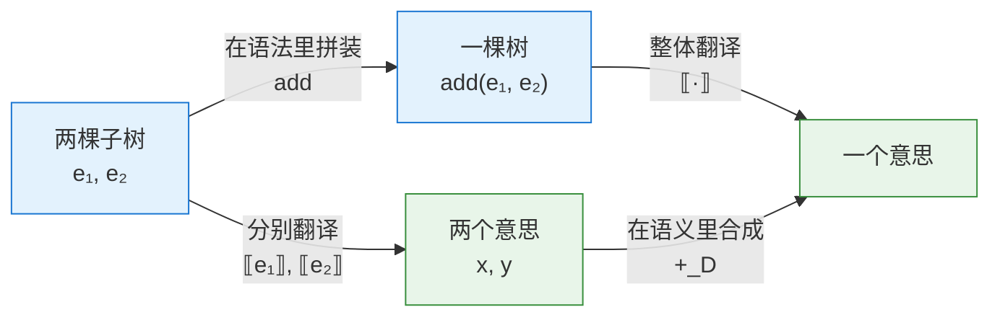

# 语义是一种"保结构的翻译"：用直觉读懂初始代数语义

> 本文是对《结构承载语义》§2「数学内核：语义是从语法到**语义域**的**同态**」的解读。原文用五六个术语和三行公式讲完了这件事，信息密度很高。本文把每个术语对应到日常经验和可运行的代码，再回到原文的公式，看清它们说的是什么。

---

## 0. 这一节难在哪里

原文 §2 一口气用了这些概念：**签名**、**元数**、**项代数**、**Σ-代数**、**初始代数**、**同态**、**语义域**。每个词单独查都不难，难在不知道它们为什么要按这个顺序出现、合起来想说明什么。

先给出整节的一句话版本：

> **语法树只规定"怎么拼"，不规定"是什么意思"。只要给每一种拼法规定一条"意思怎么合成"的规则，整棵树的意思就被唯一确定了，而且换一套规则就得到一种新的意思。**

下面所有内容都是在把这句话讲清楚并证明它。全文的路线是：

```
积木目录（签名） → 能拼出的所有模型（项代数） → 一套解读规则（Σ-代数）
      → 按规则解读模型（同态） → 为什么解读方式唯一（初始性）
      → 三个推论 → 当意思需要上下文或可能失败时
```

---

## 1. 一个贯穿全文的类比：积木与解读手册

设想一套积木，只有三种零件：

| 零件 | 外形 | 插孔数 |
|---|---|---|
| **数字块** | 正面刻着一个整数，例如 `3` | 0 个，它只能放在最底层 |
| **加号块** | 上面印着 `+` | 2 个，下面能插两块积木 |
| **乘号块** | 上面印着 `×` | 2 个 |

用这些零件可以拼出各种"模型"，比如一个加号块，左边插数字块 `2`，右边插一个乘号块，乘号块下面再插 `3` 和 `4`。这就是表达式 `2 + 3 * 4` 的语法树：

```
        +
       / \
      2   ×
         / \
        3   4
```

请注意：**积木本身没有意思。** 它只是一个形状。要让它"有意思"，还需要一本**解读手册**，告诉你每种零件代表什么：

- 数字块代表它刻着的那个数；
- 加号块代表"把两个插孔里的东西加起来"；
- 乘号块代表"把两个插孔里的东西乘起来"。

拿着手册，从底层往上逐块解读：`3` 和 `4` 合成 `12`，`2` 和 `12` 合成 `14`。

这个过程里有一条看起来理所当然、其实非常关键的规矩：

> **解读一个零件时，只看它直接插着的那几块"已经解读出来的结果"，不看它们内部长什么样。**

加号块不关心右边插的是一个 `12` 的数字块，还是一个 `3 × 4` 的乘号组合，它只拿到"12"这个结果。这条规矩就是**组合性**。原文 §2 的数学全部是在把这个类比精确化：

| 类比                  | 原文术语                                         |
| ------------------- | -------------------------------------------- |
| 零件目录（每种零件及其插孔数）     | 签名 $\Sigma$，元数                               |
| 所有能拼出的模型            | 项代数 $T_\Sigma$                               |
| 解读结果的种类（整数、类型、指令……） | 语义域 $D$                                      |
| 解读手册（每种零件的合成规则）     | $\Sigma$-代数                                  |
| 按手册**从下往上**解读       | 同态 $\lbrack\!\lbrack \cdot \rbrack\!\rbrack$ |
| "只看直接孩子的结果"这条规矩     | 同态的分配律                                       |

---

## 2. 签名：一份零件目录

原文写道：

$$
\Sigma = \{\, \mathsf{lit}_n^{(0)} \mid n \in \mathbb{Z} \,\} \;\cup\; \{\, \mathsf{add}^{(2)},\ \mathsf{mul}^{(2)} \,\}
$$

翻译成人话：**有无穷多种数字块（每个整数一种，插孔数为 0），外加加号块和乘号块（插孔数都是 2）。**

上标里的数字叫**元数（arity）**，就是**插孔数**。

一个容易绊住人的细节是：**为什么数字块的元数是 0，而不是 1？** 它明明"带着"一个整数。

区别在于"刻在零件上的标签"和"插孔"是两回事。插孔里插的是**另一块积木**（子树），而 `3` 这个整数是刻在零件表面的，你不能在那里插一个加号块进去。所以原文说：`Lit Int` 的参数是整数而不是子项，它不是**一元构造子**，而是一族**零元常量**，每个整数对应一个。

在代码里，**签名**就是**数据类型**的声明：

```haskell
data Expr = Lit Int          -- 0 个插孔，表面刻一个整数
          | Add Expr Expr    -- 2 个插孔
          | Mul Expr Expr    -- 2 个插孔
```

**签名只说"有哪些零件、每种几个插孔"，它完全不涉及任何意思。** `Add` 这个名字叫什么都行，叫 `Foo` 也不影响结构。

---

## 3. 项代数：所有能拼出来的模型

把**签名**里的零件按插孔规矩随意拼装，所有可能拼出的模型构成的集合，就是**项集合** $T_\Sigma$，也就是所有**抽象语法树**。

关于它，有三件事值得在直觉层面想清楚。

### 3.1 它是树，不是字符串

字符串 `2 + 3 * 4` 本身是有歧义的，它可以被理解为 $(2+3)\times 4$，也可以被理解为 $2+(3\times4)$。树没有这个问题：一棵树的形状一眼就告诉你谁插在谁下面。

括号、优先级、空格这些东西，是**写给人看的拼装说明**。解析器读完说明、拼好模型之后，**说明书**就可以扔掉了。所以原文说"它们已经在解析阶段被吸收进树的形状里了"。`(2 + 3)` 里的那对括号在树中不对应任何节点，它的全部作用就是决定了 `+` 块插在 `×` 块下面。

### 3.2 "自由生成"：模型之间没有任何"视为相同"的约定

在项代数里：

- `Add(Lit 1, Lit 2)` 和 `Add(Lit 2, Lit 1)` 是**两个不同的模型**，尽管我们知道加法可交换；
- `Add(Lit 1, Lit 2)` 和 `Lit 3` 也是**不同的模型**，尽管它们算出来一样。

这就是"自由"的含义：**除了"拼法不同就是不同的树"以外，没有任何额外的等式。** 树只记录形状，对"意思"一无所知，因此它不会擅自把两个形状认作一个。这个特点在第 6 节会成为"唯一性"的关键。

### 3.3 它自己也是一个"代数"

这一点很像绕口令，但很重要。所谓"代数"，就是"一个集合，加上集合上的一些运算"。**项代数**的集合是所有树，运算呢？

- "加号运算"：给我两棵树 $t_1, t_2$，我还你一棵新树 `Add(t1, t2)`，也就是把它们插到一个加号块下面；
- "乘号运算"同理；
- "数字运算"：给我一个整数 $n$，我还你一个数字块。

这些"运算"什么都不算，只是**拼装**。**项代数**是一个"只会拼、不会算"的代数。

---

## 4. Σ-代数：一本解读手册

现在给出意思。原文说：

> 选定一个**语义域** $D$，并为每个**构造子**指定一个 $D$ 上的运算，$D$ 便成为一个 $\Sigma$-代数。

拆成两步：

1. **选一个结果的种类 $D$**：解读的结果是整数？是字符串？是类型？
2. **为每种零件写一条合成规则**：数字块怎么变成 $D$ 里的东西；加号块拿到两个 $D$ 里的结果后怎么合成一个新结果；乘号块同理。

**一本手册 = 一个 $\Sigma$-代数。** 关键在于，手册可以有很多本：

| 手册名 | 结果种类 $D$ | 数字块 | 加号块拿到 $x, y$ | 乘号块拿到 $x, y$ |
|---|---|---|---|---|
| 求值 | 整数 | $n$ | $x + y$ | $x \times y$ |
| 打印 | 字符串 | `"n"` | `"(x + y)"` | `"(x * y)"` |
| 深度 | 自然数 | $1$ | $1+\max(x,y)$ | $1+\max(x,y)$ |
| 栈机代码 | 指令列表 | `[PUSH n]` | `x ++ y ++ [ADD]` | `x ++ y ++ [MUL]` |
| 符号分析 | {负, 零, 正, 未知} | $n$ 的符号 | 正+正=正，零+s=s，正+负=未知…… | 正×负=负，零×s=零…… |

最后一行就是一种最简单的**抽象解释**：它不关心具体数值，只关心正负号。原文的"区间"语义域是同一思路的更精细版本。

请注意每一行的格式完全相同：**每种零件一条规则，规则只用到子结果。** 这正是原文想说的"语义规范可以写得很短，只需逐**构造子**说明"。

---

## 5. 同态：先拼后译，等于先译后拼

有了模型（树）和手册（代数），"按手册解读模型"就是一个从树到 $D$ 的函数，记作 $\lbrack\!\lbrack \cdot \rbrack\!\rbrack$。双方括号读作"……的意思"。原文要求它满足：

$$
\lbrack\!\lbrack \mathsf{lit}_n \rbrack\!\rbrack = n_D
\qquad
\lbrack\!\lbrack \mathsf{add}(e_1, e_2) \rbrack\!\rbrack = \lbrack\!\lbrack e_1 \rbrack\!\rbrack \;+_D\; \lbrack\!\lbrack e_2 \rbrack\!\rbrack
\qquad
\lbrack\!\lbrack \mathsf{mul}(e_1, e_2) \rbrack\!\rbrack = \lbrack\!\lbrack e_1 \rbrack\!\rbrack \;\times_D\; \lbrack\!\lbrack e_2 \rbrack\!\rbrack
$$

满足这种等式的函数叫**同态（homomorphism）**，字面意思是"保持形状"。

### 5.1 看等式两边在做什么

以中间那个等式为例：

- **左边** $\lbrack\!\lbrack \mathsf{add}(e_1, e_2) \rbrack\!\rbrack$：先在**语法世界**里用加号块把 $e_1, e_2$ 拼起来，再把整个模型翻译成意思。
- **右边** $\lbrack\!\lbrack e_1 \rbrack\!\rbrack +_D \lbrack\!\lbrack e_2 \rbrack\!\rbrack$：先把 $e_1, e_2$ 分别翻译成意思，再在**语义世界**里用加号规则合成。

同态的要求就是：**两条路走到同一个终点。**



数学上管这种"两条路殊途同归"的图叫**交换图**。上方是语法世界，下方是语义世界，**同态**就是一座让上下两层"步调一致"的桥。

### 5.2 用日常经验理解"保结构"

一个更生活化的例子：公司的层级汇报。

每个组长只把自己组员上报的数字汇总后，再报给上级；每个部门经理只汇总各组长报上来的数字。CEO 看到的总数，等于"先把全公司所有人排成一张大表再求和"的结果。这件事之所以成立，是因为**每一层只依赖直接下级报上来的结果**，不需要越级查看。

这就是同态：**组织的结构**（谁向谁汇报）和**数字的合成**（如何求和）一一对应。原文那句"左边是对结构的分解，右边是对语义的组合，二者一一对应"，说的正是这个。

### 5.3 反例：什么样的"语义"不是同态

理解一个概念，最快的办法是看它的反面。假设有人定义了这样一种"语义"：

- 一般情况下和求值一样；
- 但只要遇到 `Add(Lit 1, Lit 1)` 这个**特定形状**，结果就是 5。

检查一下：

| 树 | 左孩子的意思 | 右孩子的意思 | 整体的意思 |
|---|---|---|---|
| `Add(Lit 1, Lit 1)` | 1 | 1 | **5** |
| `Add(Mul(Lit 1, Lit 1), Lit 1)` | 1 | 1 | **2** |

两个加号块拿到的子结果完全相同，都是 `(1, 1)`，整体结果却不同。这意味着**不存在**任何一条"加号块拿到 $x, y$ 后怎么合成"的规则能描述它，因为这种"语义"偷看了孩子的**形状**，而不只是孩子的**意思**。

这就是**非组合的语义**。它的后果很严重：你再也不能放心地把 `Mul(Lit 1, Lit 1)` 化简成 `Lit 1`，因为化简可能改变整个程序的意思。下一节的"**可替换性**"恰恰就是在说**同态**没有这个问题。

---

## 6. 初始性：为什么解读方式只有一种

原文最"数学"的一句话是：

> 由于 $T_\Sigma$ 是**初始代数**，存在**唯一的**同态 $\lbrack\!\lbrack \cdot \rbrack\!\rbrack : T_\Sigma \to D$。

这句话包含两个断言：**存在**，以及**唯一**。它们都源自第 3 节所说的那棵树的两个特点。

### 6.1 存在：照着手册一层层算就行

对任意一棵树，你都可以这样算它的意思：

- 如果它是数字块，直接查手册；
- 如果它是加号块，先递归算出两个孩子的意思，再按加号规则合成。

因为树是有限的，递归总会到达叶子，所以这个过程一定能算完。这就是"存在"，它就是一个递归函数。

但这里有一个隐藏前提：**每棵树只有唯一一种拆法。** 一棵顶部是加号块的树，必定是"一个加号块 + 左子树 + 右子树"，不可能同时也是"一个乘号块 + 别的什么"。

如果拆法不唯一，递归定义就会出问题。字符串就是反例：如果试图直接对字符串 `1+2*3` 递归定义意思，它既可以拆成 `1` 和 `2*3`，也可以拆成 `1+2` 和 `3`，于是一个字符串可能被算出两个不同的结果。**这正是为什么我们必须先解析成树，再定义语义：解析器的职责，就是把"拆法不唯一"的字符串，变成"拆法唯一"的树。**

### 6.2 唯一：像推倒多米诺骨牌

假设有两个人，各自声称自己的函数 $g$ 和 $h$ 都是符合同一本手册的**同态**，它们会不会在某棵树上给出不同的结果？

不会。理由是一个从叶子推向根的论证，就像推倒一排多米诺骨牌：

1. **在所有叶子上，$g$ 和 $h$ 相同。** 因为两人都必须遵守手册对数字块的规定。
2. **如果在两个孩子上相同，那么在父节点上也相同。** 因为两人都必须遵守 $g(\mathsf{add}(a,b)) = g(a) +_D g(b)$，而 $g(a)=h(a)$，$g(b)=h(b)$，所以结果相同。
3. 每棵树都是从叶子开始一层层拼出来的，所以骨牌从底层一路倒到根，**$g$ 和 $h$ 在每棵树上都相同。**

这个论证在编程语言理论中叫**结构归纳法**。

直觉总结：**树的每一部分都是由零件拼起来的，没有任何"手册管不到"的角落，所以手册一旦写定，每棵树的意思都被逼死了，没有自由发挥的空间。**

### 6.3 "初始"到底是什么意思

"初始"可以理解为"最原始、最没有偏见"。

回顾第 3.2 节：**项代数**不承认任何**等式**，`Add(1, 2)` 和 `Add(2, 1)` 是不同的树。正因为它什么都不预设，任何一本手册都能接到它上面去。

做一个反面思考实验：假如我们规定语法树满足交换律，把 `Add(1, 2)` 和 `Add(2, 1)` 当作同一棵树。那么"打印"手册就接不上去了，因为它会把这两棵"同一棵树"打印成 `"(1 + 2)"` 和 `"(2 + 1)"` 两个不同的字符串，同一个输入对应两个输出，这就不是一个函数了。

所以：

> **项代数之所以能承载任意多套语义，正是因为它自身不携带任何语义。** 它就像一份原始录音，每套语义都是对它的一种"压缩"或"解读"，而原始录音不需要对任何一种解读负责。

"初始代数"这个名字，指的就是"它能以唯一方式通往其他每一个代数"。

---

## 7. 用代码看一遍：一棵树，五套语义

下面用 Python 把上面的一切写出来。注意代码分成两部分：**遍历骨架只写一次，手册可以随意更换。**

```python
from dataclasses import dataclass

# ---------- 签名：零件目录 ----------
@dataclass
class Lit:
    n: int

@dataclass
class Add:
    l: object
    r: object

@dataclass
class Mul:
    l: object
    r: object

# ---------- 唯一同态：遍历骨架，对所有手册通用 ----------
def fold(alg, e):
    match e:
        case Lit(n):    return alg["lit"](n)
        case Add(l, r): return alg["add"](fold(alg, l), fold(alg, r))
        case Mul(l, r): return alg["mul"](fold(alg, l), fold(alg, r))

# ---------- 各种 Σ-代数：解读手册 ----------
eval_alg = {
    "lit": lambda n: n,
    "add": lambda x, y: x + y,
    "mul": lambda x, y: x * y,
}

show_alg = {
    "lit": lambda n: str(n),
    "add": lambda x, y: f"({x} + {y})",
    "mul": lambda x, y: f"({x} * {y})",
}

depth_alg = {
    "lit": lambda n: 1,
    "add": lambda x, y: 1 + max(x, y),
    "mul": lambda x, y: 1 + max(x, y),
}

code_alg = {                      # 生成栈机指令
    "lit": lambda n: [f"PUSH {n}"],
    "add": lambda x, y: x + y + ["ADD"],
    "mul": lambda x, y: x + y + ["MUL"],
}

def sign_add(a, b):
    if a == "0": return b
    if b == "0": return a
    if a == b and a != "?": return a      # 正+正=正，负+负=负
    return "?"                            # 正+负：无法确定

def sign_mul(a, b):
    if a == "0" or b == "0": return "0"   # 零乘任何数都是零
    if a == "?" or b == "?": return "?"
    return "+" if a == b else "-"

sign_alg = {                      # 抽象解释：只关心正负号
    "lit": lambda n: "0" if n == 0 else ("+" if n > 0 else "-"),
    "add": sign_add,
    "mul": sign_mul,
}

# ---------- 同一棵树：2 + 3 * 4 ----------
e = Add(Lit(2), Mul(Lit(3), Lit(4)))

print(fold(eval_alg,  e))   # 14
print(fold(show_alg,  e))   # (2 + (3 * 4))
print(fold(depth_alg, e))   # 3
print(fold(code_alg,  e))   # ['PUSH 2', 'PUSH 3', 'PUSH 4', 'MUL', 'ADD']
print(fold(sign_alg,  e))   # +
```

把这段代码和前面的概念逐一对上：

| 代码 | 概念 |
|---|---|
| `Lit` / `Add` / `Mul` 三个类 | 签名 $\Sigma$ |
| 所有能用它们构造出的对象 | 项代数 $T_\Sigma$ |
| 一个 `xxx_alg` 字典 | 一个 $\Sigma$-代数（一本手册） |
| 字典里值的类型（整数、字符串、列表……） | 语义域 $D$ |
| `fold(alg, ·)` | 唯一同态 $\lbrack\!\lbrack \cdot \rbrack\!\rbrack$ |

还有两处细节值得点出来：

- **`fold` 的实现本身就是第 6.1 节"存在性"的证明。** 它就是"照着手册一层层算"。而 `match` 语句之所以能写得这么干净，是因为每个对象只可能匹配一个分支，这就是"拆法唯一"。
- **`fold` 里没有任何一行关于"加法"或"打印"的代码。** 它只知道零件的形状。所有意思都在手册里，这就是"**结构与语义分离**"。

### 7.1 一个顺手的收获：两套语义可以互相验证

有了 `code_alg`，再写一个小小的栈机来执行指令：

```python
def run(code):
    stack = []
    for ins in code:
        if ins.startswith("PUSH"):
            stack.append(int(ins.split()[1]))
        else:
            y, x = stack.pop(), stack.pop()
            stack.append(x + y if ins == "ADD" else x * y)
    return stack[-1]

assert run(fold(code_alg, e)) == fold(eval_alg, e)   # 14 == 14
```

"编译后再执行"和"直接求值"得到同一个结果，这就是**编译器正确性**的一个缩影。而且，因为两边都是沿结构定义的**同态**，证明这个等式对**所有**树成立，只需要对每种零件各检查一次，再用第 6.2 节的多米诺骨牌论证推到全部。这是**组合性**在工程上最有力的回报之一：**大问题被拆成了每个构造子一个的小问题。**

---

## 8. 三个推论：用直觉重读

原文 §2.3 列了三个推论。有了前面的积木与手册，它们都可以"看出来"，而不需要背。

### 8.1 唯一性：手册写完，意思就定了

> 给定各构造子的语义运算，整体语义就唯一确定。

**直觉**：手册只需要为每种零件写一页。零件有三种，手册就是三页，无论模型拼得多大。这就是为什么原文说"语义规范可以写得很短"。

**工程对应**：新增一种零件（比如 `Neg`），手册就必须加一页，否则 `fold` 遇到它时无话可说。Rust、Haskell 的**穷尽性检查**，就是编译器在替你检查"手册是否每页都写了"。

### 8.2 可替换性：意思相同的零部件可以互换

> 语义相同的子项可以互相替换，而不改变整体语义。

**直觉**：回到第 1 节那条规矩，加号块只看孩子的**结果**，不看孩子的**形状**。所以如果把模型里的一个 `3 × 4` 子组件拆下来，换成一块刻着 `12` 的数字块，它上面的加号块根本察觉不到差异，再上面一层也察觉不到，一直到根。

形式地写：若 $\lbrack\!\lbrack e \rbrack\!\rbrack = \lbrack\!\lbrack e' \rbrack\!\rbrack$，则对任何把 $e$ 嵌在其中的上下文 $C[\cdot]$，都有 $\lbrack\!\lbrack C[e] \rbrack\!\rbrack = \lbrack\!\lbrack C[e'] \rbrack\!\rbrack$。证明就是沿着从"被替换处"到根的那条路径，逐层套用同态等式。

这正是**常量折叠**的合法性来源：把 `Mul(Lit 3, Lit 4)` 换成 `Lit 12`，在求值语义下是安全的。

第 5.3 节的反例恰好反过来说明：那个偷看形状的"语义"里，`Mul(1,1)` 和 `Lit 1` 意思相同却不能互换。**非组合的语义，会让一切化简都变得不安全。**

**但要注意那个限定：意思"相同"是相对于你选的手册而言的。**

- 在**符号分析**手册里，`Lit 3` 和 `Lit 5` 的意思都是 `"+"`，可以互换；在**求值**手册里显然不行。
- 在**深度**手册里，`Mul(Lit 3, Lit 4)` 的意思是 2，`Lit 12` 的意思是 1，不能互换；在求值手册里却可以。

所以"能不能替换"永远要问一句：**按哪本手册？** 而一个编译优化真正关心的手册，是描述"程序所有可观察行为"的那本。

这就是原文那个 `f()` 例子的要害。如果手册的语义域只是整数，那么"调用 `f()`"和"`f()` 的返回值"在这本手册里意思相同；但 `f()` 可能打印日志、修改全局变量，把它换成常量会改变程序的行为。问题不在可替换性定理，定理没错；问题在于**这本手册太粗糙了，它看不见副作用**。要让替换真正安全，语义域必须精细到能把副作用也记录下来，例如变成"状态 → (值, 新状态)"。

> 一句话：**可替换性忠实于手册，但手册未必忠实于现实。** 优化的正当性取决于语义域是否覆盖了所有你在乎的行为。

### 8.3 可换域性：同一个模型，多本手册

> 换一个 $D$，就得到一套新语义。

**直觉**：第 7 节已经演示过了：同一棵树，五本手册，五种结果。模型不用改，`fold` 不用改，只换手册。

**工程对应**：编译器的"多趟遍历"就是这个样子：解析只做一次，得到一棵树；之后类型检查是一本手册，常量传播是一本手册，代码生成又是一本手册。每一趟都是同一个骨架配上不同的代数。

---

## 9. 当意思需要上下文，或者可能失败

到目前为止，例子都太干净了：每块积木的意思只取决于它自己和它的孩子。真实语言里有两类麻烦，原文 §2.4 专门处理了它们。我们分别来看。

### 9.1 麻烦一：变量的意思"看情况"

给零件目录加一种**变量块** `Var("x")`，表面刻着一个名字。它的意思是什么？

答不上来。`x` 是几，取决于程序在哪里、此前做了什么赋值。看起来组合性要破产了：一块积木的意思竟然不由它自己和孩子决定，而依赖"外面"的东西。

**化解的办法是换一个问题**：不要问"`x` 是几"，而问"**如果告诉你所有变量的取值，`x` 是几**"。后者是可以回答的：

$$
\lbrack\!\lbrack x \rbrack\!\rbrack = \lambda \rho.\ \rho(x)
$$

意思是："给我一张变量表 $\rho$，我就查表告诉你结果。"

于是每块积木的意思都从"一个数"变成了"**一个等着拿到变量表的函数**"，语义域从 $D$ 变成了 $\mathit{Env} \to D$。加号块的规则也跟着变：

$$
\lbrack\!\lbrack e_1 + e_2 \rbrack\!\rbrack = \lambda \rho.\ \lbrack\!\lbrack e_1 \rbrack\!\rbrack\rho + \lbrack\!\lbrack e_2 \rbrack\!\rbrack\rho
$$

读作："等我拿到变量表，就把它分别交给两个孩子，再把它们的答案加起来。"

**用汇报的比喻来说**：以前组长上报的是一个数字；现在组长上报的是一份**公式**，"等总部告诉我本月汇率，我组的业绩就等于……"。经理把各组的公式汇总成一份更大的公式，再往上报。到了总部，把汇率代进去，一次性得出结果。每一层仍然只依赖直接下级报上来的东西，**规矩没变，只是报上来的东西从"数"变成了"公式"。**

在代码里，这甚至不需要改 `fold`，只需要新增一种零件、换一本手册：

```python
@dataclass
class Var:
    name: str

@dataclass
class Let:                 # let name = bound in body
    name: str
    bound: object
    body: object

def fold(alg, e):
    match e:
        case Lit(n):          return alg["lit"](n)
        case Var(x):          return alg["var"](x)
        case Add(l, r):       return alg["add"](fold(alg, l), fold(alg, r))
        case Mul(l, r):       return alg["mul"](fold(alg, l), fold(alg, r))
        case Let(x, b, body): return alg["let"](x, fold(alg, b), fold(alg, body))

env_alg = {   # 语义域：Env -> int，每个"意思"都是一个函数
    "lit": lambda n:       lambda env: n,
    "var": lambda x:       lambda env: env[x],
    "add": lambda f, g:    lambda env: f(env) + g(env),
    "mul": lambda f, g:    lambda env: f(env) * g(env),
    "let": lambda x, b, body:
               lambda env: body({**env, x: b(env)}),
}

# let y = x + 1 in y * y      （x 由外部给定）
prog = Let("y", Add(Var("x"), Lit(1)), Mul(Var("y"), Var("y")))
meaning = fold(env_alg, prog)       # 得到一个函数，还没算出数
print(meaning({"x": 4}))            # 25
print(meaning({"x": 9}))            # 100
```

`Let` 这一页手册最能说明问题：它拿到 `bound` 和 `body` 两个孩子的"意思"（都是函数），然后规定"把 `bound` 算出的值加进变量表，再交给 `body`"。**上下文是自顶向下、被修改后再往下传的**，这正是原文 §5 中**继承属性**做的事。也就是说：

> 综合属性对应"孩子的结果往上合成"；继承属性对应"意思是一个等待上下文的函数"。二者都在同一个同态框架之内。

### 9.2 麻烦二：意思可能根本不存在

再加一种**除号块** `Div`。`Div(Lit 1, Lit 0)` 的意思是什么？没有意思，除零了。

办法同样是**扩大语义域**：在所有整数之外，再加一个特殊值"失败"，记作 $\bot$，代码里就是 `None`、`Maybe`、`Result`。每页手册多承担一件事：**如果孩子失败了，我也失败。**

```python
@dataclass
class Div:
    l: object
    r: object

def lift(op):              # 把普通运算包装成"会传播失败"的运算
    return lambda x, y: None if x is None or y is None else op(x, y)

safe_alg = {
    "lit": lambda n: n,
    "add": lift(lambda x, y: x + y),
    "mul": lift(lambda x, y: x * y),
    "div": lambda x, y: None if x is None or y is None or y == 0 else x // y,
}
# Add(Lit 1, Div(Lit 1, Lit 0))  ⟹  None
```

（`fold` 需照样补一个 `Div` 分支，这里从略。）

类型检查是同一个模式：语义域是"所有类型 ∪ {类型错误}"，`Add` 那页手册写着"两个孩子都是 `Int` 就返回 `Int`，否则报错"。

### 9.3 两种升级的共同点

| 麻烦 | 语义域从…… | 变成…… | 手册每页多做的事 |
|---|---|---|---|
| 依赖上下文 | $D$ | $\mathit{Env} \to D$ | 把上下文传给孩子 |
| 可能失败 | $D$ | $D \cup \{\bot\}$ | 把孩子的失败往上传 |
| 有副作用 | $D$ | $\mathit{State} \to D \times \mathit{State}$ | 把状态按顺序串过孩子 |

最后一行是第 8.2 节"手册要看得见副作用"的落地方式，而且它顺带规定了**求值顺序**：状态先穿过左孩子，再穿过右孩子，"先左后右"就写进了手册里（这对应原文 §6.2 的状态串接规则）。

所以原文那句关键结论可以这样理解：

> **上下文、失败、副作用都不破坏组合性，它们只是把"意思"从一个简单的值，升级成了一个更有表现力的东西。** 积木的规矩，"只看孩子的意思"，始终没变。

---

## 10. 回到原文：这一节在全文中支撑了什么

读懂了 §2，原文后面的许多章节其实都是它的"换装出场"：

| 原文章节 | 在本文框架里是什么 |
|---|---|
| §3 文法分层与结合性 | 解析器的工作：把"拆法不唯一"的字符串变成"拆法唯一"的树（本文 6.1） |
| §5 属性文法的语义规则表 | 一本手册，按产生式逐页写出 |
| §5 综合属性 / 继承属性 | 往上合成的结果 / $\mathit{Env} \to D$ 形式的意思（本文 9.1） |
| §6 结构化操作语义 | 规则仍按构造子逐条给出；求值顺序写在规则里，如同本文 9.3 的状态串接 |
| §7 `ExprF a -> a` 与 `cata` | 手册字典与 `fold` 的 Haskell 版本 |
| §7 Visitor 模式 | 面向对象版本：`accept` 是骨架，Visitor 是手册 |
| §7.3 穷尽性检查 | 编译器检查"手册是否每页都写了"（本文 8.1） |

换句话说，§2 不是一个孤立的数学插曲，而是全文第一部分的**公共骨架**。

---

## 11. 四个常见误解

**误解一："同态规定了求值顺序。"**
不是。等式 $\lbrack\!\lbrack \mathsf{add}(e_1,e_2) \rbrack\!\rbrack = \lbrack\!\lbrack e_1 \rbrack\!\rbrack +_D \lbrack\!\lbrack e_2 \rbrack\!\rbrack$ 只说结果怎么合成，没说先算哪个孩子。Python 版 `fold` 碰巧先算左边，那是宿主语言的行为，不是语义的一部分。只有当语义域里显式包含状态并按顺序串接时（9.3），顺序才被规定。

**误解二："组合性意味着每个节点只能看到局部信息。"**
不是。9.1 节说明，上下文可以以"等待参数的函数"形式进入意思之中。组合性限制的是**依赖孩子的什么**（只能依赖意思，不能依赖形状），而不是**能不能用到上下文**。

**误解三："语义只有一种，所以叫唯一同态。"**
不是。唯一的是"**给定一本手册之后**"的解读方式。手册本身可以有无数本，这正是可换域性。

**误解四："语法树就是去掉空格的源代码。"**
不是。树里没有括号、没有优先级、没有歧义，它只记录"谁插在谁下面"。正是这个"拆法唯一"的性质，让递归定义的语义成为可能。

---

## 12. 总结

用一张表把整节的术语都翻译成直觉：

| 术语 | 一句话直觉 |
|---|---|
| 签名 $\Sigma$ | 零件目录：有哪些零件，每种几个插孔 |
| 元数 | 插孔数；刻在零件表面的标签（如整数）不算插孔 |
| 项代数 $T_\Sigma$ | 所有能拼出来的模型；只会拼，不会算，也不承认任何"视为相同" |
| 语义域 $D$ | 解读结果的种类：整数、字符串、类型、指令、符号…… |
| $\Sigma$-代数 | 一本解读手册：每种零件一页，说明如何用孩子的结果合成自己的结果 |
| 同态 $\lbrack\!\lbrack \cdot \rbrack\!\rbrack$ | 按手册从下往上解读；"先拼后译"等于"先译后拼" |
| 初始性 | 模型不带任何偏见，因此每本手册都能以唯一方式接上去 |
| 唯一性 | 手册写完，每棵树的意思就被逼死了（多米诺骨牌论证） |
| 可替换性 | 孩子只上报结果，所以意思相同的零部件可以互换；但"相同"是相对手册而言的 |
| 可换域性 | 一个模型，多本手册；编译器的多趟遍历 |
| $\mathit{Env} \to D$ | 意思变成"等待上下文的公式"，对应继承属性 |
| $D \cup \{\bot\}$ | 意思可能是"失败"，手册负责把失败往上传 |

最后，把开头那句话再读一遍，此时每个词都应该有了着落：

> **语法树只规定"怎么拼"，不规定"是什么意思"。只要给每一种拼法规定一条"意思怎么合成"的规则，整棵树的意思就被唯一确定了，而且换一套规则就得到一种新的意思。**

原文用"语义是从语法到语义域的同态"这一行字说完了这件事。它之所以值得被称为全文的"数学内核"，是因为后面所有关于属性文法、操作语义、fold、Visitor 的讨论，都只是在用不同的语言重写这本"逐零件的解读手册"；而第二部分"让非法状态不可表示"，则是在反过来设计零件目录本身，让那些不该被拼出来的模型，从一开始就拼不出来。