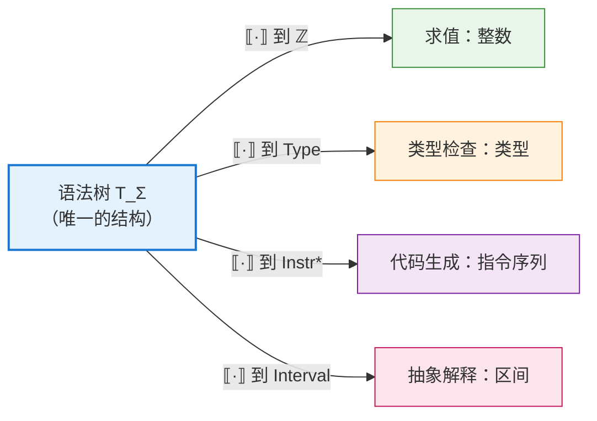
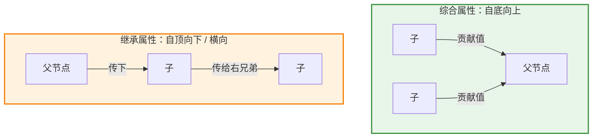
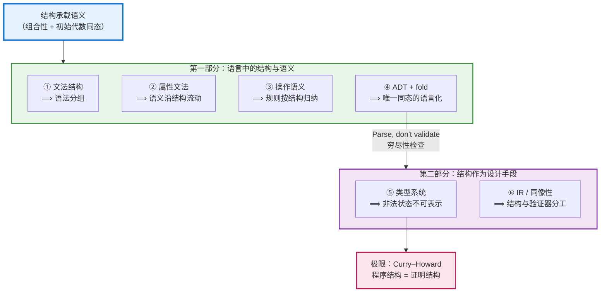
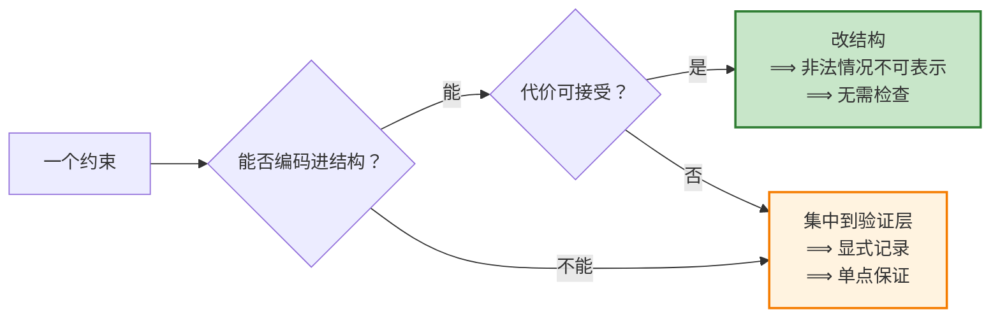

# 结构承载语义：从表达式文法到"让非法状态不可表示"

> *Structure Carries Semantics: From Expression Grammars to Making Illegal States Unrepresentable*

> **本文的缘起**：在拆解龙书 4.1 的经典 E-T-F 表达式文法时（见 [表达式文法如何"编码"结合性与优先级](associativity-and-precedence.md)），我们看到一个令人印象深刻的事实：运算符的优先级与结合性并没有写成一段 `if/else` 判断，而是被"雕刻"进了文法的**产生式结构**里。这个观察背后有一条贯穿编译原理、程序语言理论、形式语义学乃至类型系统与软件设计的主线：**让结构来承载语义**。本文把这条主线完整展开。

---

## 导读

### 这篇文章要回答什么

本文围绕两个问题展开：

1. **语义如何依附于结构？** 一段程序的含义，怎样由它的**语法结构**和各部分的含义计算出来？这是程序语言理论中经典的**语法与语义的关系**问题，答案是**组合性**：**语义**是从**语法**到**语义域**的**同态**。
2. **约束如何借助结构来保证？** 一条"不允许出现的情况"，能否通过设计结构使它根本无法被构造，而不是在事后检查？这是一个**表示设计**问题，答案凝练为一句工程格言：**让非法状态不可表示**。

这两个问题都以"结构"为中心，但并不是同一个问题。前者问的是"结构如何**算出**意义"，后者问的是"结构如何**排除**错误"。本文把它们分别称为**弱形式**和**强形式**，并论证：后者是前者从语言理论向一般软件设计的自然推广。

### 文章的组织

| 部分                 | 章节      | 核心问题              | "结构"指         | "语义"指      |
| ------------------ | ------- | ----------------- | ------------- | ---------- |
| **准备**             | §1–§2   | 命题如何精确表述？数学内核是什么？ | 抽象语法树         | **语义域**中的值 |
| **第一部分：语言中的结构与语义** | §3–§7   | 语义如何沿语法结构定义与计算？   | 文法、语法树、代数数据类型 | 分组、含义、执行行为 |
| **第二部分：结构作为设计手段**  | §8–§9   | 约束如何借助结构来保证？      | 类型、数据结构、IR    | 合法性与不变式    |
| **收束**             | §10–§13 | 统一图景、能力边界与方法论     |               |            |

### 阅读路线建议

- **编译原理学习者**：按顺序阅读 §1–§7，重点关注 §3 与 §6 对"分组"和"求值顺序"的区分，这是最常见的混淆点。
- **关注工程设计的读者**：可以先读 §1，然后直接跳到 §8、§11、§12，再回头看 §2 和 §7 了解理论依据。
- **偏好理论的读者**：§2（初始代数语义）、§7（catamorphism）和 §8.3（Curry–Howard）构成一条完整的理论线索。

### 阅读时请留意

"结构"和"语义"这两个词在本文中会随层次变化，其含义在 §1.3 中有专门说明。全文最重要的一条边界是：

> **结构决定"有什么、如何组合"，但并不决定一切。** 求值顺序、上下文相关约束和业务逻辑的正确性，都在结构的能力之外（§11）。

本文的目标不是主张"一切都应编码进结构"，而是帮助读者在每个约束面前做出清醒的判断：**这一条，是用结构让它不可能出错，还是用检查让它出错时被发现？**

---

## 目录

**准备**
1. [命题的精确表述](#1-命题的精确表述)
2. [数学内核：语义是从语法到语义域的同态](#2-数学内核语义是从语法到语义域的同态)

**第一部分：语言中的结构与语义**

3. [第一层：文法结构决定语法分组](#3-第一层文法结构决定语法分组)
4. [反面案例：当结构不够用时，信息就得"外挂"](#4-反面案例当结构不够用时信息就得外挂)
5. [第二层：属性文法——让语义沿结构流动](#5-第二层属性文法让语义沿结构流动)
6. [第三层：结构化操作语义——推理规则按语法归纳](#6-第三层结构化操作语义推理规则按语法归纳)
7. [第四层：代数数据类型与折叠——组合语义的函数式化身](#7-第四层代数数据类型与折叠组合语义的函数式化身)

**第二部分：结构作为设计手段**

8. [第五层：类型系统——让非法状态不可表示](#8-第五层类型系统让非法状态不可表示)
9. [第六层：IR 与同像性——工程系统中的结构承载](#9-第六层ir-与同像性工程系统中的结构承载)

**收束**

10. [统一图景：一条从语法到证明的谱系](#10-统一图景一条从语法到证明的谱系)
11. [边界：结构不能表达什么](#11-边界结构不能表达什么)
12. [方法论：如何在自己的设计中运用](#12-方法论如何在自己的设计中运用)
13. [总结](#13-总结)
14. [参考文献与延伸阅读](#14-参考文献与延伸阅读)

---

## 1. 命题的精确表述

"结构承载语义"如果只作为一句口号使用，很容易滑向玄学。要让它成为可操作的原则，需要先把它拆成两个强度不同的命题，再说明其中两个关键词的含义。

### 1.1 弱形式（描述性）：语义由结构唯一决定

> **弱形式**：一个复合表达式的含义，由它的**结构**以及各个**直接成分的含义**唯一决定。

这就是语言哲学与形式语义学中的**组合性原则（principle of compositionality）**，通常追溯到 Frege，并在 Montague 语法中被形式化（参见 [Stanford Encyclopedia of Philosophy: Compositionality](https://plato.stanford.edu/entries/compositionality/)）。

它的工程价值在于**可计算性**。如果语义是组合的，就可以写出一个沿**语法树**递归的求值器、类型检查器或代码生成器，而不必对整个程序做全局分析。整个 **语法制导翻译（syntax-directed translation）** 的技术栈都建立在这个前提上。

### 1.2 强形式（构造性）：结构排除非法情况

> **强形式**：通过精心设计结构，使**非法的东西在结构上根本无法被表示**。

弱形式说的是结构**能算出**语义，强形式说的是结构**能拒绝**错误。英文中对应的说法是 **correct by construction（构造即正确）**。

E-T-F 文法就是强形式的范例。它不是"检查" `2 + 3 * 4` 应该分组为 $2 + (3*4)$，而是让另一种分组**在语法上无法推导出来**，因为 `T` 的产生式里没有 `+`。错误的可能性不是被检测掉的，而是**从来没有存在过**。


### 1.3 术语约定："结构"与"语义"在本文中的三种含义

这两个词的外延会随讨论层次而变化。不加区分，就容易把类比当成等同。

| 本文中的"语义" | 例子 | 严格归属 |
|---|---|---|
| **分组** | 优先级、结合性决定的树形 | 其实属于**语法**内部（§3） |
| **含义 / 行为** | `eval` 的结果、状态转移 | 狭义的**语义**（§2、§5–§7） |
| **合法性 / 不变式** | 非法状态不可表示、`NonEmpty` | **约束**或规格（§8–§9） |

"结构"同样有多种所指：具体文法、抽象语法树、代数数据类型、类型、IR 的嵌套形状。

**第一部分（§3–§7）讨论的是严格意义上的语法与语义的关系；第二部分（§8–§9）讨论的是这一思想在表示设计中的推广。** 二者共享同一套代数骨架（§2），因此可以放在一条主线上，但它们回答的不是同一个问题。

---

## 2. 数学内核：语义是从语法到语义域的同态

组合性之所以不是修辞，是因为它有一个干净的代数表述，即**初始代数语义（initial algebra semantics）**（Goguen、Thatcher、Wagner、Wright，1977）。

### 2.1 语法作为项代数

给定一个**签名（signature）** $\Sigma$，即一组带元数（arity）的构造子。以算术表达式为例：

$$
\Sigma = \{\, \mathsf{lit}_n^{(0)} \mid n \in \mathbb{Z} \,\} \;\cup\; \{\, \mathsf{add}^{(2)},\ \mathsf{mul}^{(2)} \,\}
$$

这里每个整数字面量是一个零元常量。实践中常把它写成"携带一个整数参数的构造子" `Lit Int`，二者等价；注意它的参数是整数而不是子项，因此不是一元构造子。

由 $\Sigma$ 自由生成的**项集合** $T_\Sigma$ 就是所有抽象语法树。关键在于，$T_\Sigma$ 中的元素是**树**，不是字符串。具体语法中的括号、优先级、空格，已经在解析阶段被吸收进树的形状里了。

### 2.2 语义作为同态

选定一个**语义域** $D$，并为每个构造子指定一个 $D$ 上的运算，$D$ 便成为一个 $\Sigma$-代数。由于 $T_\Sigma$ 是**初始代数**，存在**唯一的**同态：

$$
\lbrack\!\lbrack \cdot \rbrack\!\rbrack : T_\Sigma \longrightarrow D
$$

它满足对每个构造子的分配律：

$$
\lbrack\!\lbrack \mathsf{lit}_n \rbrack\!\rbrack = n_D
\qquad
\lbrack\!\lbrack \mathsf{add}(e_1, e_2) \rbrack\!\rbrack = \lbrack\!\lbrack e_1 \rbrack\!\rbrack \;+_D\; \lbrack\!\lbrack e_2 \rbrack\!\rbrack
\qquad
\lbrack\!\lbrack \mathsf{mul}(e_1, e_2) \rbrack\!\rbrack = \lbrack\!\lbrack e_1 \rbrack\!\rbrack \;\times_D\; \lbrack\!\lbrack e_2 \rbrack\!\rbrack
$$

这组等式就是弱形式的**数学定义**：左边是对**结构**的分解，右边是对**语义**的组合，二者一一对应。

### 2.3 三个推论

| 推论 | 含义 | 工程后果 |
|---|---|---|
| **唯一性** | 给定各构造子的语义运算，整体语义就唯一确定 | 语义规范可以写得很短，只需逐构造子说明 |
| **可替换性** | 语义相同的子项可以互相替换，而不改变整体语义 | 编译优化（常量折叠、公共子表达式消除）的正当性来源 |
| **可换域性** | 换一个 $D$，就得到一套新语义 | 同一棵树可以求值、生成代码、做类型检查、做抽象解释 |

关于可替换性有一点需要注意：它只对语义域中**被刻画的那些性质**成立。如果 $D$ 只记录值、不记录副作用，那么 `f()` 与它的返回值在 $D$ 中"相等"，但把调用替换成常量显然不是合法优化。**优化的正当性取决于语义域是否足够精细，能够覆盖全部可观察行为。**

可换域性尤其值得强调：**同一个结构可以承载多套语义**。



这正是编译器能够"一棵树、多趟遍历"的理论依据。

### 2.4 当语义需要上下文或可能失败时

上面的例子过于干净。真实语言的语义常常依赖上下文（变量环境、符号表），或者可能失败（类型错误）。这时**语义域**需要相应地"升级"，但组合性依然保持：

- **依赖上下文**：把语义域从 $D$ 换成函数空间 $\mathit{Env} \to D$。例如变量的含义是 $\lbrack\!\lbrack x \rbrack\!\rbrack = \lambda \rho.\, \rho(x)$，加法的含义是 $\lbrack\!\lbrack e_1 + e_2 \rbrack\!\rbrack = \lambda \rho.\, \lbrack\!\lbrack e_1 \rbrack\!\rbrack\rho + \lbrack\!\lbrack e_2 \rbrack\!\rbrack\rho$。整体含义仍由子项含义组合而成，只是子项的含义变成了"等待上下文的函数"。
- **可能失败**：把语义域从 $\mathit{Type}$ 换成 $\mathit{Type} \cup \{\bot\}$（在代码里就是 `Maybe Type` 或 `Result<Type, Error>`），构造子的运算负责传播失败。

这两种升级的意义在于：**上下文与失败并不破坏组合性，它们只是改变了语义域的形状。** §5 的继承属性正是"$\mathit{Env} \to D$"在属性文法中的对应物。

---

# 第一部分：语言中的结构与语义

> 本部分中的"结构"是程序语言的语法，"语义"是程序的含义与行为。这是严格意义上的**语法与语义的关系**。

## 3. 第一层：文法结构决定语法分组

这是"结构承载语义"在编译原理中的第一次亮相，也是最容易亲手验证的一层。

回顾龙书 4.1 的文法：

$$
\begin{align*}
E &\rightarrow E + T \mid T \\
T &\rightarrow T * F \mid F \\
F &\rightarrow (E) \mid \mathbf{id}
\end{align*}
$$

它用三种结构手段编码了三件事：

| 结构手段 | 编码的内容 | 机制 |
|---|---|---|
| **分层**（`E → T → F` 单向下降） | 优先级 | 高优先级运算符只能出现在更深的非终结符层，因而在树中被嵌套得更深 |
| **递归方向**（`E → E + T` 左递归） | 结合性 | 左递归强制树向左偏斜，得到 $(a+b)+c$ 的分组；右递归则给出 $a+(b+c)$ |
| **回路**（`F → (E)`） | 显式覆盖 | 括号让最底层重新跳回最高层，从而人为改变分组 |

细节推导见 [[front-end/gramars/context-free-grammar/associativity-and-precedence/index|associativity-and-precedence]]

### 3.1 严格说，这一层发生在语法内部

需要澄清一点：优先级与结合性决定的是**具体文法如何映射到抽象语法树**，即"`2 + 3 * 4` 对应哪一棵 $T_\Sigma$ 中的树"。按 §1.3 的约定，这仍然是**语法**层面的事。

它之所以影响**语义**，是因为**语义**沿**抽象语法树组合**（§2）：树形不同，组合方式就不同，结果也不同。所以更准确的说法是：

> **文法结构决定树形，树形决定语义的组合方式。** **文法**对**语义**的影响是**间接**的，经由抽象语法树传递。

### 3.2 分组不等于求值顺序

> ⚠️ **文法结构决定的是"语法分组"，不是"运行时求值顺序"。**

这两件事在纯算术例子中往往重合，导致不少教材与博客把它们混为一谈。一旦表达式带副作用，区别立刻显现：`f() + g()` 的分组毫无疑义，`+` 的两个操作数分别是两次调用；但 `f` 与 `g` 谁先执行，文法**完全没有规定**，那取决于语言的动态语义。§6 会说明真正规定这件事的是什么。

### 3.3 一个容易被忽略的代价：结构与分析方法的耦合

E-T-F 文法是左递归的，自顶向下的 LL 分析器无法直接使用它。消除左递归后得到：

$$
\begin{align*}
E &\rightarrow T\, E' & E' &\rightarrow +\, T\, E' \mid \varepsilon \\
T &\rightarrow F\, T' & T' &\rightarrow *\, F\, T' \mid \varepsilon
\end{align*}
$$

新文法接受的语言完全相同，但**解析树的形状变了**：它不再直接呈现左结合的分组。为了得到正确的 $(a+b)+c$，必须借助继承属性把"左边已算出的部分"传进 $E'$（龙书 5.3 节对此有完整讨论）。

这个例子说明：**用结构承载信息时，结构就与处理它的算法绑在了一起。** 当算法要求改变结构，原本由结构免费提供的信息，就得用语义规则重新补回来。

---

## 4. 反面案例：当结构不够用时，信息就得"外挂"

要真正理解"结构承载信息"的价值，最好的办法是看它**缺席**时会发生什么。

考虑龙书中那个刻意写得"平坦"的文法（4.3）：

$$
E \rightarrow E + E \mid E * E \mid (E) \mid \mathbf{id}
$$

它把 `+` 和 `*` 放在同一层，结构上完全对称。后果是 `a + b * c` 有两棵合法的解析树，文法**有歧义**。此时结构不再承载优先级信息，优先级必须从别处来。

工程上的通行做法是给 parser generator 加优先级声明。以 GNU Bison 为例：

```yacc
%left  '+' '-'      /* 优先级最低，左结合 */
%left  '*' '/'      /* 优先级更高，左结合 */
%right UMINUS       /* 一元负号：优先级最高 */

%%
expr : expr '+' expr
     | expr '-' expr
     | expr '*' expr
     | expr '/' expr
     | '-' expr  %prec UMINUS   /* 借用 UMINUS 的优先级 */
     | '(' expr ')'
     | ID
     ;
```

这里发生的事情很值得玩味。`%left`、`%right` 并没有改变文法，文法依然有歧义。它们改变的是**分析表中移入/归约冲突的消解方式**，也就是把优先级信息从"文法结构"搬到了"分析器配置"里（见 [Bison: Using Precedence](https://www.gnu.org/software/bison/manual/html_node/Using-Precedence.html)、[Bison: Precedence Decl](https://www.gnu.org/software/bison/manual/html_node/Precedence-Decl.html)）。`%prec UMINUS` 更能说明问题：同一个 `'-'` 记号在二元和一元两种用法下需要不同的优先级，而这个区分完全由声明完成，文法结构本身对此一无所知。

两条路线的对照：

| 维度 | 分层文法（结构承载） | 歧义文法 + 优先级声明（外挂承载） |
|---|---|---|
| 优先级信息的位置 | 产生式结构本身 | 分析器配置（`%left` / `%right` / `%prec`） |
| 文法是否无歧义 | 是 | 否，靠**冲突消解规则**"选一棵" |
| 新增一个优先级层的成本 | 新增一个非终结符，改动多条产生式 | 加一行声明 |
| 可读性 | 优先级关系需从产生式链推断 | 优先级表一目了然 |
| 出错时的表现 | 文法写错 → 语言接受的串就不对 | 声明写漏 → 移入/归约冲突警告，或被默认规则静默消解 |
| 保证来自哪里 | 文法本身，不依赖分析算法 | 依赖工具正确应用消解规则 |

**结论不是"外挂一定不好"。** C 语言的二元与三元运算符有十余个优先级层，C 标准本身确实用 `assignment-expression → conditional-expression → logical-OR-expression → …` 这样一条长链来**定义**它们，因为规范需要无歧义。但主流编译器在**实现**时大多不照搬这条长链：GCC 与 Clang 的 C 前端都用一张优先级表驱动的算符优先分析来处理二元表达式。这一思路可以追溯到 Pratt 1973 年提出的**自顶向下算符优先分析**，他用一张"绑定强度"数据表取代了冗长的非终结符链（见 [Top Down Operator Precedence](https://tdop.github.io/)，[ACM DL](https://dl.acm.org/doi/10.1145/512927.512931)）。

规范用结构，实现用表，这本身就是一个很好的启示：

> **结构承载是一种可选的强度。** 把信息放进结构，换来的是"不可能出错"的保证，代价是结构的膨胀与刚性。工程决策的实质，是在**保证强度**与**表达便利**之间取舍；而同一份信息，在规范和实现中完全可以选择不同的承载方式。

---

## 5. 第二层：属性文法——让语义沿结构流动

§3 的结构只承载了"分组"这一件事。要让结构承载**任意**语义计算，需要 Knuth 1968 年引入的**属性文法（attribute grammar）**（[Semantics of Context-Free Languages](https://link.springer.com/article/10.1007/BF01692511)，[PDF](https://courses.cs.umbc.edu/331/fall12/resources/papers/Knuth67AG.pdf)）。

其做法是把 §2 的同态**逐产生式地写出来**：为每个文法符号配备**属性**，为每条产生式配备**语义规则**。

| 产生式 | 语义规则 |
|---|---|
| $E \to E_1 + T$ | $E.val = E_1.val + T.val$ |
| $E \to T$ | $E.val = T.val$ |
| $T \to T_1 * F$ | $T.val = T_1.val \times F.val$ |
| $T \to F$ | $T.val = F.val$ |
| $F \to (E)$ | $F.val = E.val$ |
| $F \to \mathbf{id}$ | $F.val = \mathbf{id}.lexval$ |

这张表就是同态 $\lbrack\!\lbrack \cdot \rbrack\!\rbrack$ 的"分片定义"：每一行说明一种构造如何把子结构的语义组合成自身的语义。**结构提供骨架，属性沿骨架流动。** 注意 $E \to T$、$F \to (E)$ 这类产生式的规则只是原样传递，这正对应它们在抽象语法树中"消失"的事实（§2.1）。

属性的流动方向区分了两类信息传递：



- **综合属性**：由孩子算父亲，信息自底向上，例如表达式求值、代码生成结果。它对应 §2.2 中最直接的同态。
- **继承属性**：由父亲或左兄弟算自己，信息自顶向下或横向传递，例如类型分发、符号表上下文。它对应 §2.4 中的 $\mathit{Env} \to D$：继承属性就是那个"等待传入的上下文"。

### 5.1 用结构保证无环

这里出现了一个极具启发性的转折。属性文法允许任意的依赖方向，于是可能出现**循环依赖**，导致不存在合法的求值顺序。而判定一个属性文法是否可能产生循环，被 Jazayeri、Ogden、Rounds（1975）证明是**本质上指数时间**的问题。这是一个无条件的下界，与 P 是否等于 NP 无关。

编译领域的应对方式恰恰是强形式：不去做那个昂贵的检测，而是**限制到结构上天生无环的子类**。

- **S-属性文法**：只使用综合属性，依赖总是自底向上，必然无环。
- **L-属性文法**：继承属性只能依赖父节点的继承属性和左兄弟的属性，于是一次从左到右的深度优先遍历必然能完成求值。

对这两类文法，"无环且存在求值顺序"是**结构白送的保证**。

> 完整推导见：[SDD 循环依赖判定：为什么"即使 P = NP 也难解"](NP-hard-to-cycle-detection-in-dependency-graph.md)；SDD 与 SDT 的概念区分见 [语法制导：SDD、SDT 与翻译方案](Syntax-directed-translation&SDD&SDT.md)。

这个案例的方法论价值极高：

> **当一个性质难以验证时，考虑重新设计结构，使该性质成为结构的推论。**

---

## 6. 第三层：结构化操作语义——推理规则按语法归纳

Plotkin 1981 年的讲义 *A Structural Approach to Operational Semantics*（2004 年正式刊于 JLAP）把组合思想带入了动态语义领域（[PDF](https://homepages.inf.ed.ac.uk/gdp/publications/sos_jlap.pdf)）。它的核心特征就写在标题的 **structural** 一词上：**每条推理规则对应一个语法构造子，整个语义定义就是对语法结构的归纳。**

以小步语义（small-step SOS）描述加法为例，$\langle e, \sigma \rangle$ 表示表达式 $e$ 在状态 $\sigma$ 下的配置：

$$
\frac{\langle e_1, \sigma\rangle \to \langle e_1', \sigma'\rangle}
     {\langle e_1 + e_2, \sigma\rangle \to \langle e_1' + e_2, \sigma'\rangle}
\quad\text{(Add-L)}
$$

$$
\frac{\langle e_2, \sigma\rangle \to \langle e_2', \sigma'\rangle}
     {\langle n_1 + e_2, \sigma\rangle \to \langle n_1 + e_2', \sigma'\rangle}
\quad\text{(Add-R)}
$$

$$
\frac{}{\langle n_1 + n_2, \sigma\rangle \to \langle n_1 \oplus n_2, \sigma\rangle}
\quad\text{(Add-Done)}
$$

其中 $n_1, n_2$ 表示已求值完毕的数值，$\oplus$ 是语义域中的加法。

### 6.1 求值顺序写在规则里，不写在文法里

请仔细看 (Add-R)：**它的前提要求左操作数已经是一个值 $n_1$。** 正是这个约束，而不是文法，规定了"先求值左子表达式"。如果把 (Add-R) 左侧的 $n_1$ 换成任意 $e_1$，就得到一个允许两侧交错求值的非确定性语义。

这就精确地回答了 §3.2 留下的问题：

> **语法结构决定"有哪些子表达式、它们如何组合"；语义规则决定"以什么顺序处理这些子表达式"。**
>
> 前者是分组，后者是求值顺序。**二者都沿结构定义，但不是同一件事。**

这也解释了为什么 C 中 `f() + g()` 两个操作数的求值顺序是未指定的，C++ 中函数实参之间的顺序同样不确定：语言标准在这一点上**故意不给出**那条限定规则，把选择权留给实现，以便优化。结构在那里，顺序被刻意留空。

### 6.2 大步语义：同一结构，另一套规则

大步语义（big-step，又称 natural semantics，由 Kahn 1987 年系统化）给出另一套沿同一结构定义的规则。对于无副作用的表达式：

$$
\frac{\langle e_1, \sigma\rangle \Downarrow n_1 \qquad \langle e_2, \sigma\rangle \Downarrow n_2}
     {\langle e_1 + e_2, \sigma\rangle \Downarrow n_1 \oplus n_2}
$$

这条规则的两个前提是对称的，看不出顺序。一旦表达式可以修改状态，状态就必须**串接**起来：

$$
\frac{\langle e_1, \sigma\rangle \Downarrow \langle n_1, \sigma_1\rangle \qquad \langle e_2, \sigma_1\rangle \Downarrow \langle n_2, \sigma_2\rangle}
     {\langle e_1 + e_2, \sigma\rangle \Downarrow \langle n_1 \oplus n_2, \sigma_2\rangle}
$$

第二个前提使用 $\sigma_1$ 而非 $\sigma$，这就再次把"先左后右"写进了规则。**求值顺序总要在某处被规定，它的位置是语义规则，而不是语法。**

同一个结构、不同的规则集，这正是 §2.3 "可换域性"在动态语义中的体现。

---

## 7. 第四层：代数数据类型与折叠——组合语义的函数式化身

函数式编程把 §2 的代数视角变成了日常写代码的方式。

### 7.1 ADT 即签名，fold 即同态

**代数数据类型（ADT）就是签名 $\Sigma$ 的语言级声明：**

```haskell
data Expr
  = Lit Int
  | Add Expr Expr
  | Mul Expr Expr
```

这三行做了两件事。第一，定义了 $T_\Sigma$，即所有可能的表达式树。第二，这已经是强形式：**结构上不完整的树不可表示**。你无法构造一个"缺少右操作数的 `Add`"，因为 `Add` 的类型要求两个 `Expr`。

而**语义就是一个折叠（fold，又称 catamorphism）**：

```haskell
eval :: Expr -> Int
eval (Lit n)     = n
eval (Add e1 e2) = eval e1 + eval e2
eval (Mul e1 e2) = eval e1 * eval e2
```

把这段代码与 §5 的属性文法表逐行对照，会发现它们几乎**是同一张表**：每个构造子一行，每行把子结构的语义组合成自身的语义。`eval` 就是那个唯一的同态 $\lbrack\!\lbrack \cdot \rbrack\!\rbrack$。

为了让"唯一同态"在代码中真正显形，可以把递归从语义中分离出来：

```haskell
-- 基函子：把递归位置抽象为类型参数 r
data ExprF r = LitF Int | AddF r r | MulF r r

-- 一个"代数"就是为每个构造子指定一个运算
type Algebra a = ExprF a -> a

evalAlg :: Algebra Int
evalAlg (LitF n)   = n
evalAlg (AddF x y) = x + y
evalAlg (MulF x y) = x * y

-- cata 负责遍历骨架，对所有代数通用
-- cata :: Algebra a -> Fix ExprF -> a
```

`evalAlg` 正是 §2.2 中"为每个构造子指定一个 $D$ 上的运算"，而 `cata` 正是"从初始代数到任意代数的唯一同态"。换一个代数，就换了一套语义，骨架完全不变。这套 recursion scheme 演算由 Meijer、Fokkinga、Paterson 系统发展（[Functional Programming with Bananas, Lenses, Envelopes and Barbed Wire](https://ris.utwente.nl/ws/portalfiles/portal/6142049/meijer91functional.pdf)）。

### 7.2 Visitor 模式：面向对象的对应物

在面向对象语言中，同一件事以**访问者模式（Visitor）**的形式出现：每个 AST 节点类对应一个 `visit` 方法，遍历骨架由结构固定，语义放在 visitor 里替换。Nystrom 在 *Crafting Interpreters* 的 [Representing Code](https://craftinginterpreters.com/representing-code.html) 一章对此有清晰的讲解。

三者的关系可以概括为：

| 范式 | 骨架 | 可替换的语义 |
|---|---|---|
| 属性文法 | 产生式 | 语义规则 |
| 函数式 | `cata` / 模式匹配递归 | 代数 `ExprF a -> a` |
| 面向对象 | `accept` 双分派 | Visitor 实现 |

需要说明这种对应的精确程度：**S-属性文法与 fold 直接对应**；带继承属性的文法则对应"折叠之后再执行的函数"：继承属性就是 §2.4 中的上下文 $\mathit{Env}$，折叠的结果类型从 $D$ 变成 $\mathit{Env} \to D$。依赖关系任意的一般属性文法则超出了简单折叠的范围，需要借助惰性求值等技术才能直接表达（Johnsson 1987）。所以"三者同构"是对其核心部分而言的，不是对全部属性文法而言的。

### 7.3 穷尽性检查：结构完备性转化为实现完备性

Rust 中的等价写法进一步展示了结构排除错误的力度：

```rust
enum Expr {
    Lit(i64),
    Add(Box<Expr>, Box<Expr>),
    Mul(Box<Expr>, Box<Expr>),
}

fn eval(e: &Expr) -> i64 {
    match e {
        Expr::Lit(n)    => *n,
        Expr::Add(a, b) => eval(a) + eval(b),
        Expr::Mul(a, b) => eval(a) * eval(b),
    }
}
```

如果新增一个构造子 `Neg(Box<Expr>)` 却忘了在 `match` 中处理，编译器的**穷尽性检查（exhaustiveness checking）**会直接报错。这是组合语义带来的额外红利：**结构的完备性，转化成了语义实现的完备性检查。** 每一套语义都必须对每个构造子给出解释，漏掉任何一个都无法通过编译。

这里也能看到 §1 两种形式的交汇：`eval` 本身体现弱形式，即语义沿结构计算；ADT 和穷尽性检查体现强形式，即不完整的树和不完整的语义都不可表示。这正是从第一部分过渡到第二部分的桥梁。

---

# 第二部分：结构作为设计手段

> 从本部分开始，"结构"不再局限于程序语言的语法，而是泛指**数据结构、类型和 IR 的形状**；"语义"主要指**合法性与不变式**。我们讨论的问题也随之改变：从"结构如何算出意义"，转向"结构如何排除错误"。这是第一部分思想在表示设计中的推广，二者是**类比与推广**的关系，而非同一个问题。

## 8. 第五层：类型系统——让非法状态不可表示

### 8.1 让非法状态不可表示

考虑一个常见的坏设计：

```rust
struct Connection {
    is_connected: bool,
    socket: Option<Socket>,   // 只有 is_connected 为真时才有意义
}
```

这个结构允许四种组合，其中两种是**非法**的：`is_connected` 为真但 `socket` 为 `None`，以及反之。于是代码里必然长出一堆防御性检查，而且无法保证覆盖完全。

改成用结构表达状态：

```rust
enum Connection {
    Disconnected,
    Connected(Socket),   // socket 只在此分支存在
}
```

非法组合**消失了**，不是被检查掉，而是无法构造。这就是 Yaron Minsky 概括的 **"make illegal states unrepresentable"**（[Effective ML](https://blog.janestreet.com/effective-ml/)，[讲稿 PDF](https://www.cs.cornell.edu/courses/cs3110/2013fa/lectures/27/lecture27_Minsky_EffectiveML.pdf)）。

一个简单的计数视角可以说明问题：原设计的状态空间是 $2 \times (1 + |\mathit{Socket}|)$，而真正合法的状态只有 $1 + |\mathit{Socket}|$ 个。**好的类型设计，就是让类型的基数恰好等于合法状态的个数。** 这也是"代数数据类型"中"代数"二字的含义：积类型对应乘法，和类型对应加法。

它与 E-T-F 文法的关系是一种**类比**：

| E-T-F 文法 | 类型设计 |
|---|---|
| `T` 的产生式里没有 `+` | `Disconnected` 分支里没有 `Socket` 字段 |
| ⟹ 错误分组无法推导 | ⟹ 非法状态无法构造 |
| 无需在 parser 里检查优先级 | 无需在业务代码里检查一致性 |

二者共享同一个动作：**删去结构中允许错误出现的那条路径。** 不同之处在于，前者约束的是语言的句子，后者约束的是程序运行时的数据。

### 8.2 状态转移也可以结构化

上面的 `enum` 消除了非法的**状态**，但没有消除非法的**操作**：仍然可以对一个 `Disconnected` 的值调用 `send`，只是会在运行时失败。把状态提升到类型层面，可以进一步排除非法的**转移**：

```rust
struct Disconnected;
struct Connected { socket: Socket }

impl Disconnected {
    fn connect(self, addr: &str) -> std::io::Result<Connected> { /* ... */ }
}

impl Connected {
    fn send(&mut self, data: &[u8]) -> std::io::Result<()> { /* ... */ }
    fn close(self) -> Disconnected { /* ... */ }
}
```

`send` 只定义在 `Connected` 上，因此"对未连接的对象发送数据"在类型上不可表达。`close` 按值消耗 `self`，因此关闭之后旧的连接对象无法再被使用。这种做法常被称为 **typestate 模式**。

它也展示了强度与代价的取舍（§4、§11.3）：状态越多、转移越复杂，类型就越多，调用方的代码也越难写。当状态需要在运行时动态决定时，§8.1 的 `enum` 往往是更合适的平衡点。

### 8.3 Parse, don't validate

Alexis King 的 [Parse, don't validate](https://lexi-lambda.github.io/blog/2019/11/05/parse-don-t-validate/) 把这条原则提炼成了一句可执行的口号，而且用词恰好落在编译原理的术语上：

- **validate（验证）**：检查数据是否合法，返回 `bool`。调用者拿到的仍是原类型，**"已验证"这一信息在返回时被丢弃**，后续代码不得不重复检查，或依赖口头约定。
- **parse（解析）**：把弱结构的输入转换成**结构更强的类型**，把"已验证"这个事实**编码进类型**，后续代码从类型上就能确信不变式成立。

例如把 `validateNonEmpty :: [a] -> Bool` 换成 `parseNonEmpty :: [a] -> Maybe (NonEmpty a)`。一旦拿到 `NonEmpty a`，"非空"就不再是一个需要记住的约定，而是结构事实，`head` 也从一个可能失败的部分函数变成了全函数。

这与解析器的工作完全同构：parser 把**无结构的字符串**转换成**有结构的语法树**，此后所有下游阶段都不必再关心"这段文本是否符合语法"。**Parse, don't validate 就是把编译器前端的做法推广到了一般软件设计。** 这也是全文两部分之间最直接的一座桥：第一部分里"解析"是语言处理的一个阶段，第二部分里它成了一种设计原则。

### 8.4 极限情形：命题即类型

沿这条路走到尽头，会到达 **Curry–Howard 对应**：类型是命题，程序是证明，程序的**结构**就是证明的**结构**。

| 逻辑 | 类型 |
|---|---|
| 蕴含 $A \to B$ | 函数类型 `A -> B` |
| 合取 $A \wedge B$ | 积类型 `(A, B)` |
| 析取 $A \vee B$ | 和类型 `Either A B` |
| 假 $\bot$ | 空类型 `Void` |
| 全称量化 $\forall x{:}A.\, P(x)$ | 依赖函数类型 `(x : A) -> P x` |
| 存在量化 $\exists x{:}A.\, P(x)$ | 依赖对类型 `(x : A ** P x)` |

在这一极限下，强形式达到最强形态：**一段程序能被构造出来，本身就是对应命题为真的证明。** 约束不再是附加在结构上的检查，而与结构合一。

需要注意两点限定：

- 这种对应要求语言是**全函数式**的，即所有程序都终止。在 Haskell、Rust 这类允许无限递归的语言中，`let x = x in x` 可以"证明"任何命题，逻辑因此不一致。Coq、Agda、Lean 等证明助手正是通过强制终止性来保证类型可以当作命题使用。
- 这里的"语义"已经从"程序的含义"转为"程序所证明的命题"，与第一部分的语法–语义关系距离最远。它在本文中的位置，是展示强形式的**理论极限**，而非组合语义的延续。

Wadler 的 *Propositions as Types* 是这个主题最好的普及性论述（[PDF](https://homepages.inf.ed.ac.uk/wadler/papers/propositions-as-types/propositions-as-types.pdf)，[CACM](https://cacm.acm.org/research/propositions-as-types/)）。

---

## 9. 第六层：IR 与同像性——工程系统中的结构承载

这条主线在真实系统中同样处处可见。

### 9.1 S-表达式与同像性

Lisp 把程序直接表示为 S-表达式，即"程序的表示就是语言自身的基本数据结构"，这一性质称为**同像性（homoiconicity）**。McCarthy 1960 年的原始论文建立在这个设计之上（[Recursive Functions of Symbolic Expressions and Their Computation by Machine](https://dl.acm.org/doi/10.1145/367177.367199)）。

其后果是宏系统变得异常自然：宏就是一个把语法树映射到语法树的普通函数。**因为结构本身就是可操作的一等对象，"变换程序"退化成了"变换数据结构"。**

这里也有一个值得注意的边界：S-表达式只记录了树形，而没有记录**绑定关系**。一个宏若引入临时变量 `tmp`，就可能意外捕获用户代码中同名的 `tmp`。这正是"结构承载得不够"的典型表现，Scheme 的**卫生宏（hygienic macro）**就是通过在结构中额外携带作用域信息来修补它。这与 §3.3 是同一个教训：结构没有承载的信息，最终要在别处补回来。

### 9.2 MLIR：结构与验证器的分工

现代编译基础设施 MLIR 把这条原则做到了系统层面（[MLIR Language Reference](https://mlir.llvm.org/docs/LangRef/)）。它的 IR 由 Operation、Region、Block 嵌套构成，大量语义信息直接由结构承载：

- **Region 嵌套**天然表达了作用域与层次，值的可见性由嵌套关系决定，无需单独维护一张作用域表。
- **SSA 支配关系（dominance）**由值在结构中的位置定义，"定义先于使用"因此成为一个可以沿结构局部检查的性质。
- **Trait 与 Interface** 把"这个 op 满足某性质"编码进类型，pass 可以据此安全地做变换。例如带有 `IsolatedFromAbove` trait 的 op，其 region 不能引用外部定义的值，这使得对这类 op 的变换可以安全地并行进行。
- **Verifier** 负责那些结构无法保证的约束，例如操作数类型的一致性、属性取值的合法范围。

这个分工非常有代表性：**能由结构保证的，交给结构；不能的，集中交给验证器。** 它与 §5.1 中"用 S/L-属性文法取代通用循环检测"是同一个决策模式，也是 §12 方法论的工业级实例。

---

# 收束

## 10. 统一图景：一条从语法到证明的谱系

把六层放在一起，可以看到一条清晰的递进：

| 层次 | 部分 | 结构载体 | "语义"指 | 结构决定了什么 | 形式 |
|---|---|---|---|---|---|
| 1. 表达式文法 | 一 | 产生式分层与递归方向 | 分组 | 抽象语法树的形状 | 强 |
| 2. 属性文法 | 一 | 产生式 + 属性依赖 | 属性值 | 语义计算的骨架与求值顺序的存在性 | 弱 + 强 |
| 3. 操作语义 | 一 | 按构造子归纳的推理规则 | 执行行为 | 规则的组织方式（顺序由规则本身规定） | 弱 |
| 4. 代数数据类型 | 一→二 | 构造子签名 | 含义 | 可表示的项 + 遍历骨架 | 弱 + 强 |
| 5. 类型系统 | 二 | 类型构造 | 不变式 / 命题 | 可表示的状态、可通过的程序 | 强 |
| 6. IR / 同像性 | 二 | Region 嵌套、S-表达式 | 作用域与合法性 | 可见性、支配关系、可变换性 | 弱 + 强 |



从左到右读这张表，可以看到两条同时发生的变化：

- **"语义"一词的含义逐渐偏移**：从分组，到含义与行为，再到不变式与命题。
- **重心从弱形式移向强形式**：从"结构如何计算意义"，移向"结构如何排除错误"。

第四层是两部分的交汇点：ADT 既是组合语义的载体，也是"不完整的树不可表示"的第一个例子。

---

## 11. 边界：结构不能表达什么

一个原则若不划出边界，就会被滥用。下面几条是结构承载确实力不能及或代价过高的地方。

### 11.1 上下文相关约束

上下文无关文法**无法**表达以下要求：

- 标识符必须先声明后使用；
- 赋值两侧类型必须相容；
- 函数调用的实参个数必须与形参一致。

原因在于，这些约束涉及树中**相距很远的两个节点之间的一致性**，而 CFG 的产生式只能约束父节点与其直接孩子之间的局部关系。因此它们必须交给**属性文法**、**符号表**与**类型检查器**，也就是语义分析阶段。

这划出了编译器阶段划分的理论依据：**语法分析处理能由文法结构表达的部分，语义分析处理不能的部分。**

不过也要注意，并非所有通常交给语义分析的约束都超出了 CFG 的能力。"`break` 只能出现在循环内部"其实**可以**用 CFG 表达：把语句非终结符拆成"循环内的语句"和"循环外的语句"两套即可。之所以实践中仍交给语义分析，是因为这样做会让文法规模翻倍。这又回到了 §4 的取舍：**能用结构表达，不等于值得用结构表达。**

### 11.2 边界随结构的表达力移动

上一节的边界是**相对于 CFG 而言**的。换一种表达力更强的结构，边界就会移动：

- 使用 GADT 或依赖类型定义的**内在类型化语法树（intrinsically typed AST）**，可以让类型错误的表达式在宿主语言中根本无法构造；
- 使用 de Bruijn 索引配合类型化的上下文，可以让"引用未声明变量"的项不可表示。

所以更准确的表述是：**结构能承载什么，取决于结构本身的表达力。** 表达力越强，能排除的错误越多，但结构也越难构造和维护，这正是 §11.4 要讨论的代价。

### 11.3 求值顺序与副作用

§6 已详述：结构给出分组，规则给出顺序。把二者混同，是关于优先级与结合性最常见的误解。带副作用的表达式、短路求值、惰性求值、并发交错，都属于"结构之外"的语义，它们必须由语义规则来规定。

### 11.4 结构膨胀的代价

C 语言十余层的表达式优先级若严格分层，就会产生一条极长的非终结符链，每次新增运算符都要改动多处。这正是主流编译器在实现中改用优先级表的原因（§4）。**结构承载的强度与结构的复杂度成正比，二者之间存在一个工程上的最优点。**

类型设计中也有同样的现象：过度用类型编码不变式会导致"类型体操"，牺牲可读性、错误信息质量与编译速度。§8.2 的 typestate 模式就是一个需要权衡的典型例子。

### 11.5 结构正确不等于程序正确

最后一条提醒：结构只能保证它所编码的那部分性质。文法保证 `2 + 3 * 4` 分组正确，但保证不了程序逻辑正确；类型保证不出现空指针，但保证不了业务规则无误。**结构的作用是把一部分错误提前到构造时消灭，而不是消灭所有错误。**

---

## 12. 方法论：如何在自己的设计中运用

把这条原则落到日常设计上，可以归纳为六个动作。

**① 先问"这个约束能不能变成结构"**

每当你准备写一段运行时检查、一条注释约定或一份文档规范时，先问：能否改变数据结构或类型，让被禁止的情况根本无法构造？

**② 用和类型替代"标志位 + 可选字段"**

`bool` 加若干 `Option` 字段的组合几乎总意味着存在非法状态。改用 enum 或 sum type，让每个分支只携带该状态下有意义的数据。可以用 §8.1 的计数方法自检：类型的基数是否等于合法状态的个数？

**③ 在边界上 parse，而不是在内部反复 validate**

在系统入口把外部输入一次性转换成强结构类型，此后内部代码依赖类型而不依赖约定。这与"编译器前端把字符串变成语法树"是同一件事。

**④ 让遍历骨架由结构决定，语义可替换**

用 fold、Visitor 或 pass 的方式组织代码：结构定义遍历骨架，语义作为参数注入。这样"一棵树、多套语义"就成为自然结果，而不是需要额外设计的能力。

**⑤ 评估结构化的代价**

在把约束编码进结构之前，估计一下代价：类型或非终结符会增加多少？调用方的代码会变复杂多少？错误信息是否仍然可读？如果代价超过收益，就选择检查（§4、§11.4）。

**⑥ 明确写下结构无法保证的部分**

结构承载不了的约束不会自动消失。把它们集中到一处（验证器、类型检查器、契约层），并显式记录，避免它们散落成隐性假设。



---

## 13. 总结

```
【两个问题】
    语义如何依附于结构？  ⟹ 组合性（弱形式）
    约束如何借助结构保证？⟹ 构造即正确（强形式）
    前者是语法与语义的关系，后者是它在表示设计中的推广

【数学内核】
    语法 = 项代数 T_Σ（初始代数）
    语义 = 唯一同态 ⟦·⟧ : T_Σ → D
    ⟦add(e1,e2)⟧ = ⟦e1⟧ +_D ⟦e2⟧
        ⟹ 一棵树可承载多套语义（求值 / 类型 / 代码生成 / 抽象解释）
    上下文与失败不破坏组合性，只改变语义域的形状（Env → D、Maybe D）

【第一部分：语言中的结构与语义】
    ① 文法分层与递归方向  ⟹ 抽象语法树的形状（优先级、结合性）
    ② 属性文法（Knuth）    ⟹ 语义沿结构流动；S/L 属性文法用结构保证无环
    ③ 结构化操作语义       ⟹ 规则按构造子归纳；求值顺序写在规则里
    ④ ADT + fold           ⟹ 唯一同态的语言化；穷尽性检查

【第二部分：结构作为设计手段】
    ⑤ 类型系统             ⟹ 非法状态不可表示；Parse, don't validate
                              极限是 Curry–Howard
    ⑥ IR / 同像性          ⟹ 结构与验证器分工

【必须守住的边界】
    结构决定「分组」，规则决定「求值顺序」
    CFG 表达不了上下文相关约束；边界随结构的表达力移动
    结构承载的强度与复杂度成正比，存在最优点
    结构正确 ≠ 程序正确

【方法论】
    每个约束都先问：它能不能变成结构？代价是否值得？
    能且值得 ⟹ 改结构，让错误不可表示
    否则     ⟹ 集中到验证层，显式记录
```

> 📌 **核心洞察**：龙书 4.1 那个只有三行的 E-T-F 文法之所以值得反复咀嚼，是因为它在最小的篇幅里演示了计算机科学中一种反复出现的技巧：**不去实现规则，而去设计一个让规则自动成立的结构**。优先级不是被判断出来的，而是被分层"逼"出来的；结合性不是被选择的，而是被递归方向"定"下来的。
>
> 沿着这条线索，本文经过了两个层次。在语言内部，结构让语义**可计算**：语义是从语法到语义域的唯一同态，属性文法、操作语义、fold 与 Visitor 都是它的不同写法。在语言之外，结构让错误**不可表示**：和类型消灭非法状态，`NonEmpty` 取代运行时判空，MLIR 用 Region 嵌套承载作用域，依赖类型用类型编码定理。后者是前者的推广，二者共享同一个动作：**把约束从"事后检查的逻辑"迁移为"事前保证的结构"**。
>
> 这一迁移带来两个质变。第一，正确性从"我检查过了"升级为"它不可能错"，因为错误的表示根本不存在。第二，约束从"藏在代码里的实现细节"升级为"写在结构里的公共规范"，读结构就读到了规则。
>
> 但这条原则也有诚实的边界：CFG 表达不了上下文相关的一致性，结构规定不了带副作用的求值顺序，强行把一切塞进结构又会让结构本身变得难以维护。这正是编译器要分出语义分析阶段、MLIR 仍需要 verifier、主流 C 编译器宁愿用优先级表也不照搬十几层非终结符的原因。
>
> 因此，成熟的运用不是教条地追求"一切皆结构"，而是每遇到一个约束都清醒地做一次判断：**这一条，是用结构让它不可能出错，还是用检查让它出错时被发现？** 能持续、准确地做出这个判断，"结构承载语义"就从一句口号变成了一种可靠的设计能力。

---

## 14. 参考文献与延伸阅读

### 本仓库内相关文章

- [表达式文法如何"编码"结合性与优先级：拆解经典的 E-T-F 文法](associativity-and-precedence.md)：本文的直接出发点### 本仓库内相关文章（续）

- [4.1 Introduction 原文与笔记](front-end/grammar/structure-is-semantics/index.md)：龙书 4.1 节，含 4.1 / 4.2 / 4.3 三个代表性文法
- [语法制导：SDD、SDT 与翻译方案](Syntax-directed-translation&SDD&SDT.md)：属性文法的声明式与过程式两种形式
- [SDD 循环依赖判定：为什么"即使 P = NP 也难解"](NP-hard-to-cycle-detection-in-dependency-graph.md)：用结构保证性质、取代检测性质的经典案例

### 教材与工具文档

- Aho, Lam, Sethi, Ullman. *Compilers: Principles, Techniques, and Tools*（龙书）。§4.1 与 §4.3 对应本文 §3–§4，§5.3 讨论消除左递归后如何用继承属性恢复左结合（本文 §3.3）。官方页面：<https://suif.stanford.edu/dragonbook/>
- Robert Nystrom. *Crafting Interpreters*，Representing Code 一章（AST 与 Visitor 模式）：<https://craftinginterpreters.com/representing-code.html>
- GNU Bison Manual，Using Precedence：<https://www.gnu.org/software/bison/manual/html_node/Using-Precedence.html>
- GNU Bison Manual，Precedence Declarations：<https://www.gnu.org/software/bison/manual/html_node/Precedence-Decl.html>
- MLIR Language Reference（Operation / Region / Block 结构）：<https://mlir.llvm.org/docs/LangRef/>

### 经典论文

**组合语义与代数基础**

- J. A. Goguen, J. W. Thatcher, E. G. Wagner, J. B. Wright. *Initial Algebra Semantics and Continuous Algebras*. Journal of the ACM 24(1), 1977：初始代数语义的奠基之作（本文 §2）
- Erik Meijer, Maarten Fokkinga, Ross Paterson. *Functional Programming with Bananas, Lenses, Envelopes and Barbed Wire*. FPCA 1991：catamorphism 与 recursion schemes（本文 §7）
  - PDF：<https://ris.utwente.nl/ws/portalfiles/portal/6142049/meijer91functional.pdf>

**属性文法**

- Donald E. Knuth. *Semantics of Context-Free Languages*. Mathematical Systems Theory 2(2), 1968：属性文法的奠基之作（本文 §5）
  - Springer：<https://link.springer.com/article/10.1007/BF01692511>
  - PDF：<https://courses.cs.umbc.edu/331/fall12/resources/papers/Knuth67AG.pdf>
- M. Jazayeri, W. F. Ogden, W. C. Rounds. *The Intrinsically Exponential Complexity of the Circularity Problem for Attribute Grammars*. Communications of the ACM 18(12), 1975：循环性判定的指数下界（本文 §5.1）
- Thomas Johnsson. *Attribute Grammars as a Functional Programming Paradigm*. FPCA 1987：用惰性求值直接表达一般属性文法（本文 §7.2）

**操作语义**

- Gordon D. Plotkin. *A Structural Approach to Operational Semantics*. Aarhus 大学讲义 DAIMI FN-19, 1981；正式刊于 Journal of Logic and Algebraic Programming 60–61, 2004（本文 §6）
  - PDF：<https://homepages.inf.ed.ac.uk/gdp/publications/sos_jlap.pdf>
- Gilles Kahn. *Natural Semantics*. STACS 1987, LNCS 247：大步语义的系统化（本文 §6.2）

**分析技术**

- Vaughan R. Pratt. *Top Down Operator Precedence*. POPL 1973：用绑定强度表替代分层文法（本文 §4）
  - 重排版：<https://tdop.github.io/>
  - ACM DL：<https://dl.acm.org/doi/10.1145/512927.512931>

**同像性与宏**

- John McCarthy. *Recursive Functions of Symbolic Expressions and Their Computation by Machine, Part I*. Communications of the ACM 3(4), 1960：S-表达式的起点（本文 §9.1）
  - ACM DL：<https://dl.acm.org/doi/10.1145/367177.367199>
- E. Kohlbecker, D. P. Friedman, M. Felleisen, B. Duba. *Hygienic Macro Expansion*. LFP 1986：卫生宏，在结构中补上作用域信息（本文 §9.1）

**类型与逻辑**

- Robert E. Strom, Shaula Yemini. *Typestate: A Programming Language Concept for Enhancing Software Reliability*. IEEE Transactions on Software Engineering 12(1), 1986：typestate 概念的出处（本文 §8.2）
- Thorsten Altenkirch, Bernhard Reus. *Monadic Presentations of Lambda Terms Using Generalized Inductive Types*. CSL 1999：内在类型化语法树的早期工作（本文 §11.2）
- Philip Wadler. *Propositions as Types*. Communications of the ACM 58(12), 2015：Curry–Howard 对应的普及性论述（本文 §8.4）
  - PDF：<https://homepages.inf.ed.ac.uk/wadler/papers/propositions-as-types/propositions-as-types.pdf>
  - CACM：<https://cacm.acm.org/research/propositions-as-types/>

### 理论背景与设计实践

- *Compositionality*, Stanford Encyclopedia of Philosophy：组合性原则的系统梳理：<https://plato.stanford.edu/entries/compositionality/>
- Alexis King. *Parse, don't validate* (2019)：把"已验证"编码进类型：<https://lexi-lambda.github.io/blog/2019/11/05/parse-don-t-validate/>
- Yaron Minsky. *Effective ML*："make illegal states unrepresentable" 的出处
  - 博客：<https://blog.janestreet.com/effective-ml/>
  - 讲稿 PDF：<https://www.cs.cornell.edu/courses/cs3110/2013fa/lectures/27/lecture27_Minsky_EffectiveML.pdf>

---

---

# 修订说明

以下说明本次修订做了什么、为什么这样做，方便你逐项核对和取舍。

## 一、结构性调整

| 改动 | 理由 |
|---|---|
| **标题改为"结构承载语义"**，并加英文副标题 | "即"暗示等同，与 §11 的边界讨论矛盾；"承载"既表达依附关系，也为边界留出余地 |
| **新增"导读"** | 开宗明义地点出文章回答的两个问题，给出阅读路线，提前预告最重要的边界 |
| **新增 §1.3 术语约定** | 原文"结构""语义"含义在各节之间滑动，这是前面分析中指出的主要问题。显式说明后，类比不再被误读为等同 |
| **全文分为"准备 / 第一部分 / 第二部分 / 收束"** | 让"语法–语义关系"和"表示设计"两条线索在结构上可见，每部分开头加一段说明本部分中两个词的含义 |
| **§10 表格增加"部分"和"'语义'指"两列**，流程图按两部分分组 | 统一图景中直接呈现"语义一词逐渐偏移"和"重心从弱形式移向强形式"这两条变化 |
| **方法论从五步扩为六步**，流程图增加"代价可接受？"判断 | 原文正文反复强调取舍，但方法论流程图只问"能不能"，没问"值不值" |

## 二、内容补充

| 位置 | 新增内容 | 理由 |
|---|---|---|
| §2.4 | 上下文与失败如何保持组合性（$\mathit{Env} \to D$、`Maybe D`） | 原文例子过于干净，读者容易以为组合性只适用于玩具语言；同时为 §5 的继承属性提供理论对应 |
| §3.1 | 说明优先级本质上是语法内部的事，对语义的影响经由 AST 间接传递 | 这是前面分析中指出的概念不严谨之处 |
| §3.3 | 消除左递归后树形改变，需要继承属性补回结合性 | 展示"结构与算法耦合"这一原文未提及的代价，并与 §5 呼应 |
| §6.2 | 带状态串接的大步语义规则 | 原文的大步规则两个前提对称，无法体现求值顺序，与 §6.1 的论点衔接不上 |
| §7.1 | `ExprF` / `Algebra` / `cata` 的代码 | 让"唯一同态"在代码中真正显形，而不只是口头对应 |
| §7.3 末 | 指出 ADT 是两部分的交汇点 | 为第二部分提供过渡 |
| §8.1 | 状态空间计数视角 | 给出一个可操作的自检方法，并解释"代数数据类型"的命名 |
| §8.2 | typestate 模式 | 从"非法状态不可表示"延伸到"非法转移不可表示"，同时作为代价权衡的例子 |
| §8.4 | 全函数性的前提；说明这一节在全文中的定位 | 原文未提及 Curry–Howard 要求终止性；同时承认这一节离语法–语义关系最远 |
| §9.1 | 卫生宏 | 同像性的一个"结构承载不够"的反例，与 §3.3 形成同一教训 |
| §11.2 | 边界随结构表达力移动 | 原文的边界只相对于 CFG 成立，补充后避免过度概括 |

## 三、事实性修正

| 原文 | 修正 | 说明 |
|---|---|---|
| $\mathsf{lit}^{(1)}$ | $\mathsf{lit}_n^{(0)}$，一族零元常量 | 字面量的参数是整数而非子项，不是一元构造子 |
| 循环判定"连 $P = NP$ 都救不了" | 改为"本质上指数时间，是无条件下界"，并给出 Jazayeri 等 1975 的出处 | 原表述容易让人误以为与 NP 相关；保留了与仓库内文章标题的链接 |
| C 语言"宁愿用优先级表" | 区分规范与实现：C 标准用长链定义，GCC/Clang 实现用优先级表 | 原文暗示 C 语言本身放弃了分层文法，这与 C 标准不符 |
| "`break` 只能出现在循环内"列为 CFG 无法表达 | 指出它其实可以用 CFG 表达，只是代价过高 | 原例子不成立，改为说明"能表达不等于值得表达" |
| 可替换性推论无限定 | 补充"只对语义域所刻画的性质成立" | 否则会推出"把函数调用替换为返回值"也是合法优化 |
| "属性文法 ≅ fold ≅ Visitor" | 改为只有 S-属性文法与 fold 直接对应，一般属性文法需要更多技术 | 原等式过强 |
| Bison 示例只声明了 `UMINUS` 而未使用 | 补上 `'-' expr %prec UMINUS` 及减法、除法产生式 | 原代码中声明了却无对应产生式 |
| Plotkin 1981 | 标注为讲义，2004 年正式刊于 JLAP | 链接的 PDF 实际是 2004 年版本 |
| Curry–Howard 表 | 补充"假"与"存在量化"两行 | 表格更完整 |

## 四、需要你确认的地方

1. **仓库内链接**：文中所有相对路径链接沿用原文，请确认文件名，尤其是 `front-end/grammar/structure-is-semantics/index.md` 这一路径。如果标题改为"结构承载语义"，可以考虑同步调整目录名。
2. **仓库内文章标题**：`NP-hard-to-cycle-detection-in-dependency-graph.md` 的标题"即使 P = NP 也难解"保留原样。如果那篇文章的论述也是基于指数下界，表述是一致的；如果那里另有不同论证，请核对 §5.1 的措辞。
3. **新增参考文献**：Goguen 等、Jazayeri 等、Kahn、Johnsson、Kohlbecker 等、Strom & Yemini、Altenkirch & Reus 这几条是本次新增，只给出了书目信息而没有链接，可以按需补充 DOI。
4. **篇幅**：修订后篇幅增加了约三分之一。如果希望保持精简，§3.3、§8.2、§9.1 末段、§11.2 是相对独立的补充，删去不影响主线。