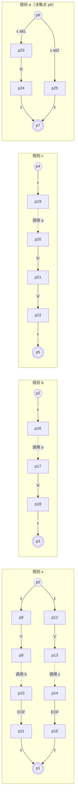
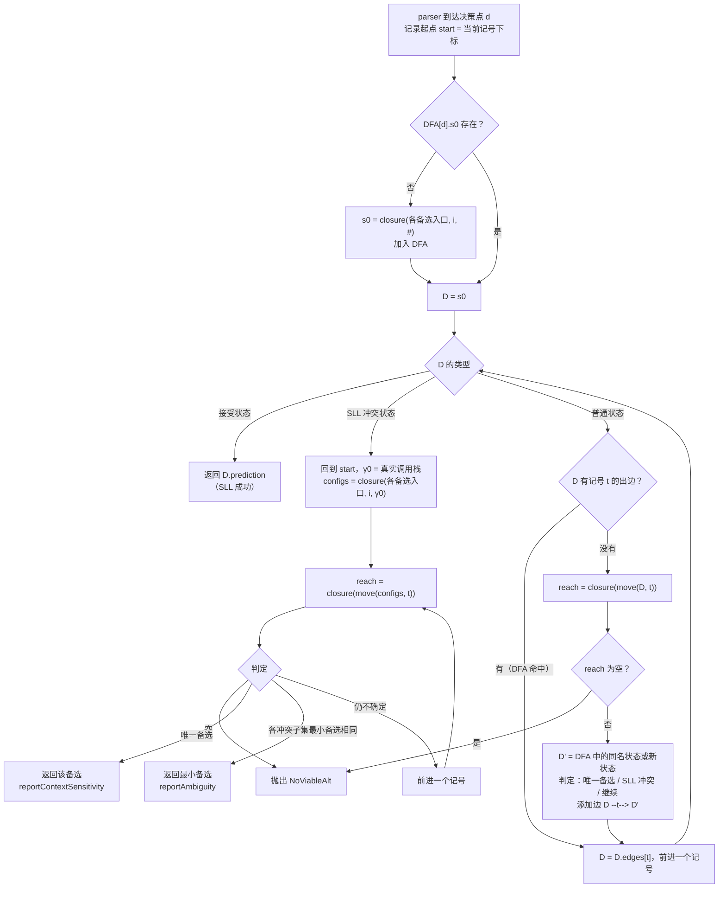

# ANTLR4 ALL(*) 解析算法：从递归下降到自适应预测

> 一份由浅入深的技术文档。配套可运行的 Python 复现：[`mini_allstar.py`](./mini_allstar.py)（只依赖标准库，约 600 行）。运行 `python3 mini_allstar.py` 得到的完整输出见 [`run_output.txt`](./run_output.txt)，文中引用的输出都是从这里复制的，没有改过。

---

## 0. 导读

### 0.1 你将掌握什么

读完本文并跑通代码后，你应当能够：

1. 说清楚 ANTLR4 生成的 parser 为什么能**直接写左递归、几乎不用改文法**，而传统 LL(1) 做不到；
2. 手工画出一段文法的 **ATN**，并用 **配置 $(p, i, \gamma)$** 与 **closure / move** 推演一次预测；
3. 理解 **SLL → LL 两阶段预测**：为什么先用"忘掉调用栈"的 SLL，什么时候必须回退到全上下文 LL；
4. 理解 **DFA 缓存**为什么让 ANTLR4 在实践中接近线性；
5. 区分 **上下文相关（context-sensitive）** 与 **真二义性（ambiguity）**，知道 ANTLR 怎样处理；
6. 理解 ANTLR4 如何把**直接左递归**改写成"优先级爬升 + 语义谓词"。

### 0.2 阅读路线

| 层次 | 主题 | 一句话 | 对应 Demo |
|---|---|---|---|
| 第 1 层 | 递归下降与 LL(1) | 解析 = 一连串"选哪个备选"的决策 | Demo 1 |
| 第 2 层 | 为什么 LL(k) 不够 | 有的决策要看任意多个记号 | Demo 3 |
| 第 3 层 | ATN | 把文法画成一张"可模拟"的状态机 | Demo 2 |
| 第 4 层 | 配置、closure、move | 在 ATN 上**并行模拟所有备选** | Demo 3 |
| 第 5 层 | SLL + DFA 缓存 | 忘掉调用栈、把模拟结果缓存成 DFA | Demo 3 |
| 第 6 层 | SLL 冲突 → 全上下文 LL | 用真实调用栈重新模拟 | Demo 4 |
| 第 7 层 | 真二义性 | 两个备选都能走完 → 选编号最小的 | Demo 5 |
| 第 8 层 | 左递归改写 + 谓词 | `expr : expr '*' expr` 是怎么跑起来的 | Demo 7 |
| 汇总 | adaptivePredict 全流程 + 代码导读 + 与 ANTLR runtime 对照 | | |

### 0.3 名词速查

| 术语 | 含义 |
|---|---|
| 决策（decision） | 文法中"有多个备选"的位置，parser 运行到这里必须选一条 |
| 备选（alternative，alt） | 规则 `r : A | B | C ;` 中的 `A`、`B`、`C`，编号从 1 开始 |
| 向前看（lookahead） | 为了做决策而**偷看但不消费**的后续记号 |
| ATN | Augmented Transition Network，增强转移网络，文法的状态机表示 |
| 配置（configuration） | 三元组 $(p, i, \gamma)$：ATN 状态 $p$、它代表的备选 $i$、调用栈 $\gamma$ |
| SLL | Strong LL：预测时**不使用真实调用栈**，结果可缓存 |
| LL（全上下文） | 预测时**使用真实调用栈**，更精确但不可缓存 |
| ALL(*) | Adaptive LL(*)：先 SLL，冲突时再 LL，向前看长度不设上限，并在运行时增量缓存 |

---

## 1. 第 1 层：解析就是一连串决策

### 1.1 递归下降

看一个最简单的语句文法：

```antlr
stat : 'if' ID 'then' stat      // alt 1
     | 'print' ID ';'           // alt 2
     | ID '=' ID ';'            // alt 3
     ;
```

手写递归下降 parser 时，**每条规则就是一个函数，每个备选就是一个分支**：

```python
def stat(self):
    alt = self.predict_stat()          # ← 决策：选哪个备选？
    if alt == 1:
        self.match('if'); self.match('ID'); self.match('then'); self.stat()
    elif alt == 2:
        self.match('print'); self.match('ID'); self.match(';')
    else:
        self.match('ID'); self.match('='); self.match('ID'); self.match(';')
```

`match` 只是机械地吃记号，**真正难的是 `predict_stat`**。ANTLR4 生成的代码结构和上面完全一样，只是 `predict_xxx` 统一换成了一个运行时函数：

```java
switch (getInterpreter().adaptivePredict(_input, 0 /*决策编号*/, _ctx)) {
    case 1: ... break;
    case 2: ... break;
}
```

**所以整篇文章都在讲一件事：`adaptivePredict` 怎么做决策。**

### 1.2 LL(1)：看一个记号

对 `stat`，每个备选的第一个记号各不相同（`'if'`、`'print'`、`ID`），看一个记号就能选出来。这就是 LL(1)：

$$
\text{FIRST}(\alpha_1)\cap\text{FIRST}(\alpha_2)=\varnothing,\quad \text{FIRST}(\alpha_1)\cap\text{FIRST}(\alpha_3)=\varnothing,\ \dots
$$

配套代码 Demo 1 解析 `if a then print b ;`，ALL(*) 在这里退化成 LL(1)：

```text
[预测] 决策 stat，从记号 #0 'if' 开始
  构造 s0 = D0 {(p2,1,[#]), (p7,2,[#]), (p11,3,[#])}
  ATN 模拟 D0 --'if'--> D1 {(p3,1,[#])}
  ✔ SLL 预测 alt 1（向前看 1 个记号）
[预测] 决策 stat，从记号 #3 'print' 开始
  ATN 模拟 D0 --'print'--> D2 {(p8,2,[#])}
  ✔ SLL 预测 alt 2（向前看 1 个记号）
语法树: (stat#1 if a then (stat#2 print b ;))
```

`{(p2,1,[#]), ...}` 这种写法后面会解释。先记住结论：**读一个记号后只剩一个备选"活着"，于是预测完成。**

---

## 2. 第 2 层：为什么固定长度的向前看不够

### 2.1 一个需要"无限向前看"的例子

C 语言风格的声明：

```antlr
decl : mods 'int' ID ';'      // alt 1:  unsigned unsigned int x;
     | mods ID ID ';'         // alt 2:  unsigned unsigned T x;   （T 是类型名）
     ;
mods : 'unsigned' mods        // 任意多个 unsigned
     |
     ;
```

两个备选都以任意多个 `unsigned` 开头，只有越过所有 `unsigned`、看到 `'int'` 还是 `ID`，才能决定走哪个备选：

| 输入 | 需要向前看的记号数 |
|---|---|
| `int x ;` | 1 |
| `unsigned int x ;` | 2 |
| `unsigned unsigned unsigned int x ;` | 4 |
| $n$ 个 `unsigned` + `int` | $n+1$ |

**没有任何固定的 $k$ 能让 LL(k) 处理这条规则。** 传统做法只能改文法（左提取公因子），让文法变丑，也让语法树结构偏离语义。

### 2.2 历史上的几种办法

| 方案 | 思路 | 代价 |
|---|---|---|
| LL(k) | 固定看 $k$ 个记号 | 遇到上例就得改文法 |
| 回溯 / PEG | 先试 alt 1，失败退回再试 alt 2 | 可能指数级；有序选择会悄悄掩盖二义性 |
| ANTLR3 的 LL(*) | **生成 parser 时**静态分析出向前看 DFA | 静态分析不可判定，有些文法只能报错或回退到回溯 |
| GLR / GLL | 所有可能并行推进，产出解析森林 | 实现复杂，动作代码难写，常数大 |
| **ANTLR4 的 ALL(*)** | **运行时**针对实际输入做有限的并行模拟，结果缓存成 DFA | 理论最坏 $O(n^4)$，实践中接近线性 |

> **ALL(*) 的核心想法**：静态分析回答的是"对**所有可能输入**该怎么选"，很难；运行时只需回答"对**眼前这段输入**该怎么选"，容易得多。不过每次都从头模拟会很慢，所以要把模拟结果缓存起来，下次遇到同样的向前看序列直接查表。

接下来三层把这个想法变成算法：先把文法变成能模拟的结构（ATN），再定义怎么模拟（closure/move），最后定义怎么缓存（DFA）。

---

## 3. 第 3 层：把文法变成 ATN

### 3.1 定义

ATN（增强转移网络）可以看成"每条规则一个 NFA，规则之间能互相调用"：

$$
M = (Q,\ \Sigma,\ \Delta,\ E,\ F)
$$

- $Q$：状态集合；$\Sigma$：记号（终结符）集合；
- $E = \{p_A\}$：每条规则 $A$ 的**入口状态**；$F = \{p'_A\}$：每条规则 $A$ 的**出口状态**；
- $\Delta$：转移，有三种：

| 转移 | 写法 | 含义 |
|---|---|---|
| 记号转移（atom） | $p \xrightarrow{a} q$ | 匹配一个记号 $a$ |
| ε 转移 | $p \xrightarrow{\varepsilon} q$ | 不消耗输入 |
| 规则转移（rule） | $p \xrightarrow{B} q$ | **调用**规则 $B$：跳到 $p_B$，并记住返回点 $q$（压栈） |

ANTLR4 中还有谓词转移（$\pi$）和动作转移（$\mu$），在预测时都当作 ε 转移处理，其中谓词会被求值。

### 3.2 构造规则

对规则 $A \to \alpha_1 \mid \alpha_2 \mid \dots \mid \alpha_n$，其中 $\alpha_i = X_1 X_2 \dots X_m$：

$$
p_A \xrightarrow{\varepsilon} p_{A,i} \xrightarrow{X_1} q_1 \xrightarrow{X_2} \cdots \xrightarrow{X_m} q_m \xrightarrow{\varepsilon} p'_A
$$

**规则入口 $p_A$ 就是这条规则的决策状态**：从它出发有 $n$ 条 ε 边，各通向一个备选。

### 3.3 例子

后面第 6 层要用的文法（它来自 ALL(*) 原论文的经典例子，改成了 ANTLR 语法）：

```antlr
s : 'x' b EOF
  | 'y' c EOF
  ;
b : a 'a' ;
c : a 'b' 'a' ;
a : 'b'
  |
  ;
```

`mini_allstar.py` 的 Demo 2 打印出它的 ATN：

```text
规则 s: 入口 p0  出口 p1
    p0 --ε--> p8
    p0 --ε--> p12
    p8 --'x'--> p9
    p9 --b--> p2   (调用 b，返回到 p10)
    p10 --'EOF'--> p11
    p11 --ε--> p1
    p12 --'y'--> p13
    p13 --c--> p4   (调用 c，返回到 p14)
    p14 --'EOF'--> p15
    p15 --ε--> p1
规则 b: 入口 p2  出口 p3
    p2 --ε--> p16
    p16 --a--> p6   (调用 a，返回到 p17)
    p17 --'a'--> p18
    p18 --ε--> p3
规则 c: 入口 p4  出口 p5
    p4 --ε--> p19
    p19 --a--> p6   (调用 a，返回到 p20)
    p20 --'b'--> p21
    p21 --'a'--> p22
    p22 --ε--> p5
规则 a: 入口 p6  出口 p7
    p6 --ε--> p23
    p6 --ε--> p25
    p23 --'b'--> p24
    p24 --ε--> p7
    p25 --ε--> p7
```

画成图（规则调用边画成虚线，表示"跳进去，回来到返回点"）：



记住几个关键状态，第 6 层要用：

| 状态 | 含义 |
|---|---|
| `p23` | `a` 的 alt 1，等待匹配 `'b'` |
| `p25` | `a` 的 alt 2（空），直接到出口 |
| `p17` | 在 `b` 里，`a` 返回后等待 `'a'` |
| `p20` | 在 `c` 里，`a` 返回后等待 `'b'` |
| `p10` / `p14` | 在 `s` 的 alt1 / alt2 里等待 `EOF` |
| `p1` | 起始规则 `s` 的出口 |

对应代码（`ATN.__init__`，有删减）：

```python
for r, alts in g.rules.items():
    for i, alt in enumerate(alts, 1):
        cur = self._new(r, "basic")
        self.rule_start[r].transitions.append(Transition("eps", cur))   # p_A --ε--> p_{A,i}
        for sym in alt:
            nxt = self._new(r, "basic")
            if g.is_terminal(sym):
                cur.transitions.append(Transition("atom", nxt, g.token_type(sym)))
            else:
                cur.transitions.append(Transition("rule", self.rule_start[sym], sym, nxt))
                self.callers[sym].append(nxt)      # 记录 sym 的所有调用点的返回状态
            cur = nxt
        cur.transitions.append(Transition("eps", self.rule_stop[r]))       # q_m --ε--> p'_A
```

---

## 4. 第 4 层：在 ATN 上并行模拟所有备选

### 4.1 配置

做决策时，我们让每个备选**各派一个"分身"**同时在 ATN 上往前走。每个分身用一个**配置**描述：

$$
c = (p,\ i,\ \gamma)
$$

- $p$：分身当前所在的 ATN 状态；
- $i$：这个分身是从哪个备选出发的，也就是**它在替哪个备选投票**；
- $\gamma$：调用栈（返回状态序列），栈顶写在最左边。走进一条规则时压入返回点，走到规则出口时弹出。

代码里配置就是一个 tuple：`(state_id, alt, stack)`，例如 `(p21,1,[p12 #])` 表示"替 alt 1 投票的分身，在 `p21`，栈顶是 `p12`，栈底是 `#`"（`#` 的含义见第 5 层）。

### 4.2 closure：沿着不消耗输入的边扩散

一个分身站在某个状态上，只要不需要消耗记号就能到达的地方（ε 边、进入规则、从规则返回），它都能"瞬移"过去。closure 就是求这个扩散集合：

$$
\text{closure}(p,i,\gamma) = \{(p,i,\gamma)\}\ \cup
\begin{cases}
\text{closure}(q,i,\gamma) & \text{若 } p\xrightarrow{\varepsilon} q \\[2pt]
\text{closure}(p_B,i,\ q\gamma) & \text{若 } p\xrightarrow{B} q\quad(\text{调用：压入返回点 } q)\\[2pt]
\text{closure}(q,i,\gamma') & \text{若 } p=p'_B,\ \gamma=q\gamma'\quad(\text{返回：弹栈})\\[2pt]
\bigcup_{\,p_1\xrightarrow{B}q}\text{closure}(q,i,\#) & \text{若 } p=p'_B,\ \gamma=\#\quad(\text{SLL：调用者未知})\\[2pt]
\varnothing & \text{若 } p=p'_B,\ \gamma=\varepsilon\quad(\text{LL：起始规则结束})
\end{cases}
$$

第四种情况先跳过，第 5 层专门讲。

### 4.3 move：一起吃掉一个记号

$$
\text{move}(D, a) = \{(q, i, \gamma) \mid (p, i, \gamma) \in D,\ p \xrightarrow{a} q\}
$$

能匹配记号 $a$ 的分身前进一步，匹配不了的分身**直接死掉**。

一步完整的模拟是：

$$
\text{reach}(D, a) = \bigcup_{c \in \text{move}(D, a)} \text{closure}(c)
$$

### 4.4 什么时候停

- **唯一备选**：活着的分身全都替同一个备选投票，就预测这个备选：
  $$\big|\{\,i \mid (p,i,\gamma)\in D\,\}\big| = 1$$
- **冲突**：两个替不同备选投票的分身走到了**完全相同的位置**（状态相同、栈也相同）：
  $$\exists\,(p,i,\gamma),(p,j,\gamma)\in D,\ i\neq j$$
  从此以后它们的命运完全一样，再往前看也区分不开，属于"这段输入本身就能被两种方式解释"。后面详细讨论。
- **全部死亡**：$D=\varnothing$，语法错误（`no viable alternative`）。

### 4.5 手推一次：`unsigned unsigned unsigned int x ;`

`decl` 文法的 ATN（Demo 中 `G_DECL` 打印出来的结果）里，需要关注的状态有：

| 状态 | 含义 |
|---|---|
| `p12` | `decl` alt 1：`mods` 返回后等待 `'int'` |
| `p17` | `decl` alt 2：`mods` 返回后等待 `ID` |
| `p21` | `mods` alt 1：等待 `'unsigned'` |
| `p22` | `mods` alt 1：吃完 `'unsigned'`，准备递归调用 `mods`（返回点 `p23` 是尾部） |

Demo 3 的真实输出：

```text
[预测] 决策 decl，从记号 #0 'unsigned' 开始
  构造 s0 = D0 {(p12,1,[#]), (p21,1,[p12 #]), (p17,2,[#]), (p21,2,[p17 #])}
  ATN 模拟 D0 --'unsigned'--> D0 {(p12,1,[#]), (p21,1,[p12 #]), (p17,2,[#]), (p21,2,[p17 #])}
  DFA 命中 D0 --'unsigned'--> D0
  DFA 命中 D0 --'unsigned'--> D0
  ATN 模拟 D0 --'int'--> D1 {(p13,1,[#])}
  ✔ SLL 预测 alt 1（向前看 4 个记号）
```

逐步解读：

| 步骤 | 发生了什么 | 配置集 |
|---|---|---|
| 起点 | alt 1 从 `p11` 出发，调用 `mods`（压入 `p12`）：要么在 `p21` 等 `unsigned`，要么 `mods` 取空、弹栈回到 `p12` 等 `int`。alt 2 同理，只是返回点为 `p17` | `(p12,1,[#])` `(p21,1,[p12 #])` `(p17,2,[#])` `(p21,2,[p17 #])` |
| 吃 `unsigned` | 只有站在 `p21` 的两个分身能走；走到 `p22` 后递归调用 `mods`，closure 又展开成**与起点完全相同的配置集** | 同上 |
| 吃第 2、3 个 `unsigned` | 配置集一样，所以 DFA 状态还是 D0（下一层解释"DFA 命中"） | 同上 |
| 吃 `int` | 只有 `p12` 上的 alt 1 分身能匹配 `'int'` | `(p13,1,[#])` → **唯一备选 1** |

这就是 LL(\*) 中 `*` 的含义：**向前看长度没有上限，模拟到能分出胜负为止。**

> 实现细节：`mods` 的递归调用位于备选末尾（尾调用），返回点 `p23` 之后只有一条 ε 边通向出口，代码里把这样的返回点标为 `is_tail`，预测时不压栈，否则栈会随着 `unsigned` 的个数不断变长，配置集就永远不会重复。真实的 ANTLR 一般用 EBNF 写成 `'unsigned'*`，ATN 里是一个循环，不存在递归，效果一样。

---

## 5. 第 5 层：SLL 与 DFA 缓存

### 5.1 问题：每次都模拟太慢

一个文件里可能有上万条声明，每条都从头做一遍 ATN 模拟太浪费。我们希望模拟一次就把结果记下来，**下次看到同样的向前看序列直接查表**。

能缓存的前提是：**预测结果只依赖向前看的记号，不依赖"我是从哪里被调用的"**。但配置里有调用栈 $\gamma$，不同调用位置的栈不同，缓存就不能复用。

### 5.2 SLL：干脆不看真实调用栈

SLL（Strong LL）预测时，起始栈不用 parser 的真实调用栈，而用一个通配符 `#`，意思是"不知道是谁调用了我"：

$$
D_0 = \bigcup_{i=1}^{n}\text{closure}(p_{A,i},\ i,\ \#)
$$

分身走到当前规则的出口、栈里只剩 `#` 时，它不知道该返回哪里，于是**去所有可能的调用点**，即 closure 定义的第四种情况：

$$
p = p'_B,\ \gamma = \# \ \Longrightarrow\ \bigcup_{\,p_1\xrightarrow{B}q}\text{closure}(q,\ i,\ \#)
$$

这相当于用传统 LL 的全局 FOLLOW 集合做近似。代码只有几行：

```python
if st.kind == "stop":
    if stack and stack[0] == WILDCARD:            # SLL：调用者未知
        if st.rule == self.atn.g.start:
            out.add(c)                             # 起始规则结束：后面只能是输入结尾
        for f in self.atn.callers[st.rule]:        # 所有调用点的返回状态
            self.closure((f.id, alt, stack), out, busy)
    elif not stack:
        out.add(c)                                 # LL：真实调用栈已空
    else:
        self.closure((stack[0], alt, stack[1:]), out, busy)   # 正常弹栈
    return
```

既然 SLL 不依赖真实栈，**同一个决策、同一段向前看，结果一定相同**，于是可以缓存。

### 5.3 DFA：把模拟结果缓存成状态机

ANTLR4 为**每个决策**维护一个 DFA：

- **DFA 状态** = 一个 ATN 配置集，配置集相同就是同一个 DFA 状态；
- **DFA 边** = 记号，`D --a--> D'` 表示 $D' = \text{reach}(D, a)$；
- **接受状态** = 只剩唯一备选的配置集，上面标着预测结果。

预测时先在 DFA 上走，有边就直接走（**DFA 命中**），没有边才做一次 ATN 模拟，并把新的状态和边加进 DFA（**增量构建**）：

```python
d, i = dfa.s0, start
while True:
    if d.requires_full_ctx: return self.ll_predict(rule, start)   # 第 6 层
    if d.prediction is not None: return d.prediction             # 到达接受状态
    t = self.la(i).type
    nxt = d.edges.get(t)
    if nxt is None:                                              # 缓存未命中 → 模拟一步
        reach = self.sim.reach(d.configs, t)
        if not reach: raise NoViableAltError(...)
        nxt = dfa.add(reach, self.sim)                           # 配置集去重：相同 → 同一状态
        d.edges[t] = nxt
    d, i = nxt, i + 1
```

Demo 3 解析完第一条声明后，`decl` 决策的 DFA 是：

```text
DFA[decl]  共 2 个状态
  D0  (s0)
      --'unsigned'--> D0
      --'int'--> D1
  D1  ⇒ 预测 alt 1
```

`D0 --'unsigned'--> D0` 是一个**环**，因为吃掉 `unsigned` 后配置集与 D0 完全相同。这个 DFA 用有限个状态表达了"任意多个 unsigned 之后看到 int 就选 alt 1"。

### 5.4 缓存的效果

Demo 3 接着用**同一个缓存**解析更多输入：

```text
  unsigned int y ;                                        ATN 模拟  0 步，DFA 命中  6 次
  unsigned unsigned T z ;                                 ATN 模拟  2 步，DFA 命中  6 次
  int a ; T b ; unsigned unsigned unsigned unsigned int c ; ATN 模拟  2 步，DFA 命中 16 次
```

- 第一行：所有决策都已在缓存里，**完全不做 ATN 模拟**；
- 第二行：第一次见到 "`unsigned` 之后是 `ID`"，补了 2 条边（`decl` 和 `mods` 两个决策各一条）；
- 第三行：新增的 2 步都来自 `prog` 决策，它第一次见到以 `'int'` 和 `ID` 开头的声明。`decl` 和 `mods` 全部命中缓存，4 个 `unsigned` 也只是在 D0 的环上多转几圈。

最终 `decl` 的 DFA：

```text
DFA[decl]  共 3 个状态
  D0  (s0)
      --'unsigned'--> D0
      --'int'--> D1
      --'ID'--> D2
  D1  ⇒ 预测 alt 1
  D2  ⇒ 预测 alt 2
```

> **工程上的意义**：ANTLR4 的 DFA 缓存是**静态共享**的（Java runtime 里是 `static DFA[] _decisionToDFA`），同一个 Parser 类的所有实例共用。所以 parser 有"预热"效应：前几个文件解析时会不断模拟 ATN 并填充 DFA，之后几乎全部是查表，速度接近 LL(1)。做性能测试时要先预热再计时。

---

## 6. 第 6 层：SLL 冲突与全上下文 LL

### 6.1 SLL 的代价

SLL 把"所有调用点"合并在一起考虑。如果一个决策的正确答案**取决于是谁调用了它**，合并就会把本来能区分的情况混成冲突。

回到第 3 层的文法：

```antlr
s : 'x' b EOF | 'y' c EOF ;
b : a 'a' ;          // a 后面跟 'a'
c : a 'b' 'a' ;      // a 后面跟 'b' 'a'
a : 'b' | ;          // ← 决策点
```

对输入 `y b a`，`a` 是从 `c` 里被调用的：

- 选 alt 1（`a` 吃掉 `b`）：剩下 `a`，而 `c` 要求接着出现 `'b' 'a'` → ✘
- 选 alt 2（`a` 为空）：剩下 `b a`，正好匹配 `c` 的 `'b' 'a'` → ✔

但 SLL 不知道调用者是 `c`。它会同时考虑"`a` 之后跟 `'a'`"（来自 `b`）和"`a` 之后跟 `'b' 'a'`"（来自 `c`）。这时 alt 1 也有一条活路：把 `b a` 解释成"`a` 吃掉 `b`，然后接 `b` 里的 `'a'`"。

### 6.2 手推 SLL

Demo 4 的真实输出：

```text
[预测] 决策 a，从记号 #1 'b' 开始
  构造 s0 = D0 {(p23,1,[#]), (p17,2,[#]), (p20,2,[#])}
  ATN 模拟 D0 --'b'--> D1 {(p17,1,[#]), (p20,1,[#]), (p21,2,[#])}
  ATN 模拟 D1 --'a'--> D2 {(p10,1,[#]), (p14,2,[#])}
  ATN 模拟 D2 --'EOF'--> D3 {(p1,1,[#]), (p1,2,[#])}
  D3 是 SLL 冲突状态 [1, 2] → 回退全上下文 LL
```

| 记号 | alt 1 的分身 | alt 2 的分身 | 说明 |
|---|---|---|---|
| 起点 | `p23`（等 `'b'`） | `p17`（在 b 里等 `'a'`）、`p20`（在 c 里等 `'b'`） | alt 2 为空，走到 `a` 的出口，栈为 `#`，于是**同时去 `b`、`c` 两个调用点** |
| `b` | `p17`、`p20`（`a` 结束后同样去两个调用点） | `p21`（c 里等 `'a'`） | `p17` 上的 alt 2 分身匹配不了 `b`，死掉 |
| `a` | `p10`（经 `b` 返回 `s` alt1） | `p14`（经 `c` 返回 `s` alt2） | 两个备选都还活着，但走的是**不同的"虚构路线"** |
| `EOF` | `p1` | `p1` | **状态相同、栈都是 `#` → 冲突** |

alt 1 那条路线（`'x'` 开头的 `s` alt 1 里走 `b`）在真实输入中根本不可能出现，因为输入以 `'y'` 开头。但 SLL 已经丢掉了这个信息。

### 6.3 判定 SLL 冲突

ANTLR 的 SLL 在满足下面条件时停止，并把 DFA 状态标记为"需要全上下文"（`PredictionMode.hasSLLConflictTerminatingPrediction`）：

1. 配置集中**存在**一个冲突子集，即按 $(p,\gamma)$ 分组后某组包含多个备选；
2. **并且**没有任何状态只关联一个备选。否则那个备选还有机会胜出，应该继续往前看；
3. 或者所有配置都已经到达规则出口，没有记号可看了。

```python
def sll_should_stop(self, configs) -> bool:
    if all(self.atn.states[s].kind == "stop" for s, _, _ in configs):
        return True
    has_conflict = any(len(x) > 1 for x in conflicting_alt_subsets(configs))      # 按 (状态,栈) 分组
    has_state_with_one_alt = any(len(x) == 1 for x in state_to_alts(configs))   # 按 状态 分组
    return has_conflict and not has_state_with_one_alt
```

**注意：SLL 冲突不等于真的二义。** 它的意思只是"不看调用栈的话分不出来"。这种冲突状态同样被缓存进 DFA：

```text
DFA[a]  共 4 个状态
  D0  (s0)
      --'b'--> D1
  D1
      --'a'--> D2
  D2
      --'EOF'--> D3
  D3  ⇒ SLL 冲突 [1, 2]，需全上下文 LL
```

### 6.4 全上下文 LL：用真实调用栈重算

回退时，从决策起点**重新**模拟，但起始栈换成 parser 的真实调用栈 $\gamma_0$（ANTLR 中是 `ParserRuleContext` 链所对应的返回状态）：

$$
D_0^{LL} = \bigcup_{i=1}^{n}\text{closure}(p_{A,i},\ i,\ \gamma_0)
$$

```text
  [LL] 真实调用栈 γ0 = [p20 p14]，起始 {(p23,1,[p20 p14]), (p20,2,[p14])}
  [LL] --'b'--> {(p20,1,[p14]), (p21,2,[p14])}
  [LL] --'a'--> {(p14,2,[ε])}
  ✔ LL 预测 alt 2（向前看 2 个记号；SLL 做不到，属于上下文相关决策）
语法树: (s#2 y (c#1 (a#2) b a) <EOF>)
```

`γ0 = [p20 p14]` 表示"`a` 返回后到 `c` 的 `p20`，`c` 返回后到 `s` 的 `p14`"。alt 2 为空，弹栈后只会去 `p20`，不会再"误入" `b`。读到第 2 个记号 `a` 时 alt 1 就死了。

同一个文法，输入 `x b a` 时：

```text
[预测] 决策 a，从记号 #1 'b' 开始
  DFA 命中 D0 --'b'--> D1
  DFA 命中 D1 --'a'--> D2
  DFA 命中 D2 --'EOF'--> D3
  D3 是 SLL 冲突状态 [1, 2] → 回退全上下文 LL
  [LL] 真实调用栈 γ0 = [p17 p10]，起始 {(p23,1,[p17 p10]), (p17,2,[p10])}
  [LL] --'b'--> {(p17,1,[p10])}
  ✔ LL 预测 alt 1（向前看 1 个记号；SLL 做不到，属于上下文相关决策）
```

两个要点：

1. **SLL 部分全部命中了 DFA 缓存**，直接走到冲突状态 D3，省掉了 SLL 模拟；
2. **LL 的结果不缓存**，因为它依赖调用栈。所以这类决策每次都要付一次全上下文模拟的代价，这就是 ALL(*) 的性能瓶颈来源。

### 6.5 LL 何时停止

全上下文模拟中（`execATNWithFullContext`），ANTLR 默认的 `PredictionMode.LL` 用两条规则终止：

1. 只剩唯一备选 → 预测它（ANTLR 会调用 `reportContextSensitivity`，告诉你这是 SLL 冲突、LL 能解决的上下文相关决策）；
2. 每个冲突子集的**最小备选都相同** → 无论往后看多远最终都会选它，提前停止，并调用 `reportAmbiguity`：

```python
def single_viable_alt(subsets):
    mins = {min(s) for s in subsets}
    return mins.pop() if len(mins) == 1 else None
```

---

## 7. 第 7 层：真二义性

### 7.1 例子：C++ 的 `T(x);`

```antlr
prog      : stat EOF ;
stat      : decl
          | expr_stmt
          ;
decl      : ID '(' ID ')' ';' ;   // T(x);  声明一个类型为 T 的变量 x
expr_stmt : ID '(' ID ')' ';' ;   // f(x);  调用函数 f
```

`T ( x ) ;` 用两个备选都能完整解析，这不是向前看不够，而是**文法本身二义**。

### 7.2 算法表现

```text
[预测] 决策 stat，从记号 #0 'T' 开始
  ...（SLL 一路模拟到 ';'）
  ATN 模拟 D4 --';'--> D5 {(p9,1,[#]), (p9,2,[#])}
  D5 是 SLL 冲突状态 [1, 2] → 回退全上下文 LL
  [LL] 真实调用栈 γ0 = [p9]，起始 {(p15,1,[p9]), (p21,2,[p9])}
  ...
  [LL] --';'--> {(p9,1,[ε]), (p9,2,[ε])}
  ⚠ 真二义性：备选 [1, 2] 都能匹配 'T ( x ) ;'，按规则选最小编号 alt 1
语法树: (prog#1 (stat#1 (decl#1 T ( x ) ;)) <EOF>)
```

用了真实调用栈，两个分身仍然在 `(p9, ε)` 会合，说明**在这个上下文里**两种解释都成立。

### 7.3 ANTLR 的处理策略

| 情况 | ANTLR 行为 |
|---|---|
| 真二义性 | **选编号最小的备选**（写在前面的优先），解析继续，不报错 |
| 想知道哪里有二义性 | 给 parser 加 `DiagnosticErrorListener`，它会打印 `reportAmbiguity` 等诊断 |
| 想要精确的二义性集合 | `PredictionMode.LL_EXACT_AMBIG_DETECTION`：不提前停止，一直模拟到所有冲突子集完全相同 |
| 想改变选择 | 调整备选顺序，或加语义谓词 `{isType($ID.text)}?` 根据符号表决定 |

"先写的优先"正好符合 C++ 标准里"凡是能当作声明的，就当作声明"的规则，所以把 `decl` 写在前面就行。

---

## 8. 第 8 层：左递归改写与语义谓词

### 8.1 问题

自顶向下预测碰到左递归 `expr : expr '*' expr | ...` 时，closure 会无限地"调用 expr → 调用 expr → ..."，栈无限增长。配套代码会检测并拒绝左递归（Demo 6）：

```text
GrammarError: 检测到左递归: expr -> expr
GrammarError: 检测到左递归: a -> b -> a
```

但 ANTLR4 **允许直接左递归**，它在生成 parser 前做了一次改写。间接左递归（`a -> b -> a`）ANTLR4 同样会报错。

### 8.2 ANTLR4 的改写

原始写法：

```antlr
expr : <assoc=right> expr '^' expr     // 优先级 3（越靠前越高）
     | expr ('*'|'/') expr             // 优先级 2
     | expr ('+'|'-') expr             // 优先级 1
     | INT
     | '(' expr ')'
     ;
```

改写后（示意）：

```antlr
expr[int _p]
  : ( INT | '(' expr[0] ')' )                       // 非左递归的备选 = primary
    ( {precpred(_p <= 3)}? '^' expr[3]              // 右结合：右操作数用同一优先级
    | {precpred(_p <= 2)}? ('*'|'/') expr[3]        // 左结合：右操作数用 优先级+1
    | {precpred(_p <= 1)}? ('+'|'-') expr[2]
    )*
  ;
```

- 规则多了一个参数 `_p`，表示"当前这层 `expr` 只接受优先级 $\ge$ `_p` 的运算符"；
- `{...}?` 是**语义谓词**。它在 ATN 里是一条谓词转移，预测时会被求值，为假的路线直接死掉；
- 左结合运算符的右操作数用 `prec+1`，所以 `8 - 3 - 2` 中第二个 `-` 不会被右侧的子表达式吞掉；右结合用 `prec`，所以 `2 ^ 3 ^ 2` 中第二个 `^` 会被右侧吞掉。

这正是经典的**优先级爬升（precedence climbing）**算法。

### 8.3 Python 复现与运行

```python
def expr(self, p: int):
    tok = self.la()
    if tok.type == "INT":   self.i += 1; left = int(tok.text)
    elif tok.type == "(":   self.i += 1; left = self.expr(0); self.expect(")")
    else: raise SyntaxError(...)
    while self.la().type in self.BINARY:          # ( ... )* 循环
        op = self.la().type
        prec, assoc = self.BINARY[op]
        if not p <= prec:                          # 语义谓词 precpred 为假 → 交给外层
            break
        self.i += 1
        right = self.expr(prec if assoc == "right" else prec + 1)
        left = (op, left, right)
    return left
```

Demo 7 的输出：

```text
  1 + 2 * 3            => (+ 1 (* 2 3))                    = 7
  2 ^ 3 ^ 2            => (^ 2 (^ 3 2))                    = 512
  8 - 3 - 2            => (- (- 8 3) 2)                    = 3
  1 + 2 * 3 ^ 2 ^ 2    => (+ 1 (* 2 (^ 3 (^ 2 2))))        = 163
  ( 1 + 2 ) * 3        => (* (+ 1 2) 3)                    = 9
```

跟踪 `1 + 2 * 3 - 4`，可以看到谓词是如何把 `-` "退回"给外层的：

```text
expr[_p=0]
  precpred(0 <= 1) 为真，吃掉 '+'
  expr[_p=2]
    precpred(2 <= 2) 为真，吃掉 '*'
    expr[_p=3]
      precpred(3 <= 1) 为假，遇到 '-' 退出循环
    precpred(2 <= 1) 为假，遇到 '-' 退出循环
  precpred(0 <= 1) 为真，吃掉 '-'
  expr[_p=2]
```

结果是 `((1 + (2 * 3)) - 4)`。

> 简化说明：真实 ANTLR 中 `( ... )*` 的"继续循环还是退出"也是一个决策，由 `adaptivePredict` 决定，谓词在预测过程中求值。ANTLR 还为这类决策建立了专门的"优先级 DFA"（precedence DFA），按 `_p` 区分缓存。教学代码直接用 `if` 判断谓词，逻辑等价。

---

## 9. 汇总：adaptivePredict 全流程



对应伪代码：

```text
adaptivePredict(d, start, γ0):
    D ← DFA[d].s0 ?: addDFAState(closure({(p_{A,i}, i, #)}))
    i ← start
    loop:
        if D.requiresFullCtx:  return LLPredict(d, start, γ0)
        if D.isAccept:         return D.prediction
        t ← LA(i)
        D' ← D.edges[t]
        if D' = ⊥:
            R ← reach(D.configs, t)          # SLL，栈底为 #
            if R = ∅: error
            D' ← addDFAState(R)              # 标记 唯一备选 / SLL 冲突
            D.edges[t] ← D'
        D ← D'; i ← i + 1

LLPredict(d, start, γ0):
    C ← closure({(p_{A,i}, i, γ0)}); i ← start
    loop:
        C ← reach(C, LA(i))
        if C = ∅: error
        if uniqueAlt(C):                    return it
        if allSubsetsSameMinAlt(C):         reportAmbiguity; return minAlt
        i ← i + 1
```

---

## 10. Python 复现代码导读

### 10.1 文件结构

```text
antlr4-allstar/
├── ANTLR4-ALL-star-算法详解.md   ← 本文
├── mini_allstar.py               ← 教学版实现 + 7 个 Demo
└── run_output.txt                ← 完整运行输出
```

### 10.2 模块与 ANTLR4 runtime 的对应关系

| `mini_allstar.py` | 作用 | ANTLR4 runtime 中的对应物 |
|---|---|---|
| `Grammar` | 解析 BNF、检测左递归 | ANTLR Tool（生成期） |
| `Lexer` | 最长匹配分词 | 生成的 `XxxLexer` + `LexerATNSimulator` |
| `ATN` / `ATNState` / `Transition` | 文法的 ATN 表示 | `ATN`、`ATNState`、`RuleTransition`、`AtomTransition`、`EpsilonTransition` |
| 配置 `(p, alt, stack)` | ATN 配置 | `ATNConfig(state, alt, context, semanticContext)` |
| `stack` 元组 + `WILDCARD` | 调用栈 / 栈底通配符 | `PredictionContext`（图结构栈）、`EMPTY` |
| `ATNSimulator.closure` / `reach` | ε 闭包 / 匹配一个记号 | `ParserATNSimulator.closure`、`computeReachSet` |
| `sll_should_stop` | SLL 终止条件 | `PredictionMode.hasSLLConflictTerminatingPrediction` |
| `single_viable_alt` | LL 终止条件 | `PredictionMode.resolvesToJustOneViableAlt` |
| `DFA` / `DFAState` | 每决策一个预测 DFA | `DFA`、`DFAState`（`requiresFullContext` 字段） |
| `PredictionCache` | 跨 parser 共享缓存 | `_decisionToDFA`、`PredictionContextCache` |
| `Parser.adaptive_predict` | SLL 阶段 | `ParserATNSimulator.adaptivePredict` + `execATN` |
| `Parser.ll_predict` | 全上下文阶段 | `execATNWithFullContext` |
| `Parser._rule` | 由预测驱动的递归下降 | 生成的 `XxxParser` 规则方法 |
| `ExprParser` | 左递归改写后的效果 | 生成代码中的 `precpred(_ctx, n)` 与 `enterRecursionRule` |

### 10.3 如何用它做实验

```python
from mini_allstar import build, parse

grammar = r"""
prog : stat prog | EOF ;
stat : ID '=' expr ';'
     | ID '(' ')' ';'
     ;
expr : ID | INT ;
"""
g, atn, cache, lexer = build(grammar)
print(atn.dump())                                  # 查看 ATN
p = parse(cache, lexer, "a = 1 ; f ( ) ;", trace=True)   # 逐步跟踪预测过程
print(p.tree.to_lisp())                           # 语法树
print(cache.dfas["stat"].dump())                  # 查看某个决策的 DFA
print(cache.stats)                                # ATN 模拟步数 / DFA 命中 / LL 回退次数
```

---

## 11. 与真实 ANTLR4 runtime 的差异

教学实现为了可读性做了简化。理解了下面这些差异，就能直接去读 `ParserATNSimulator.java`：

| 方面 | 教学实现 | 真实 ANTLR4 |
|---|---|---|
| 调用栈 | Python tuple，各配置独立 | **图结构栈**（`PredictionContext`），相同 $(p, i)$ 的配置会把栈合并成一个节点（`merge`），避免配置数量爆炸 |
| 文法 | 仅 BNF | 完整 EBNF；`?` `*` `+` 子规则和循环在 ATN 里是 `BlockStartState`、`StarLoopEntryState` 等，**每个子规则、每个循环都是独立的决策点** |
| SLL 的 `#` | 显式查找所有调用点 | 规则出口状态带有到所有返回点的 **follow 链接**，空栈时沿 follow 链接走，效果相同 |
| 语义谓词 | 只在表达式解析器里演示 | 配置带 `SemanticContext`，预测时求值；DFA 状态可携带"谓词 → 备选"表 |
| 左递归 | 手写优先级爬升 | 工具自动改写 + 优先级 DFA |
| 二义性检测 | `LL` 模式的提前终止 | 另有 `LL_EXACT_AMBIG_DETECTION` |
| 错误处理 | 直接抛异常 | `DefaultErrorStrategy`：单记号插入 / 删除、同步恢复，继续解析 |
| 线程安全 | 不考虑 | DFA 的增量构建需要同步 |

---

## 12. 工程实践

### 12.1 两阶段解析（官方推荐的提速技巧）

大多数输入用纯 SLL 就能正确解析。可以先用 SLL 加"遇错立即失败"策略跑一遍，失败了再用完整的 LL 重跑：

```python
# 以 antlr4-python3-runtime 为例（示意，MyLexer / MyParser 为生成的类）
from antlr4 import CommonTokenStream, InputStream
from antlr4.atn.PredictionMode import PredictionMode
from antlr4.error.ErrorStrategy import BailErrorStrategy, DefaultErrorStrategy
from antlr4.error.Errors import ParseCancellationException

tokens = CommonTokenStream(MyLexer(InputStream(text)))
parser = MyParser(tokens)

parser._interp.predictionMode = PredictionMode.SLL     # 第 1 阶段：SLL，不做全上下文回退
parser._errHandler = BailErrorStrategy()               # 一出错立即抛异常
try:
    tree = parser.prog()
except ParseCancellationException:
    tokens.seek(0)
    parser.reset()
    parser._interp.predictionMode = PredictionMode.LL   # 第 2 阶段：完整 ALL(*)
    parser._errHandler = DefaultErrorStrategy()
    tree = parser.prog()
```

纯 SLL 可能因为本该由 LL 解决的冲突而选错备选，进而报错。所以第 1 阶段成功时结果一定正确，失败时也不能断定输入有错，只能交给第 2 阶段。

### 12.2 文法写法对性能的影响

| 现象 | 原因 | 建议 |
|---|---|---|
| 某些规则特别慢 | 频繁 SLL 冲突，每次都要做 LL 回退，而 LL 结果不缓存 | 用 `DiagnosticErrorListener` 找到 `reportAttemptingFullContext` 频繁的决策，尽量让 FOLLOW 不重叠 |
| 冷启动慢、预热后快 | DFA 尚未建立 | 基准测试先预热；长期运行的服务共享 parser 类 |
| 向前看很长 | 备选的公共前缀很长（如上面的 `T(x);`） | 公共前缀提到一个子规则里，让决策尽早分叉 |
| 结果"不对"但不报错 | 真二义性被"选最小备选"悄悄消解 | 用诊断监听器查二义性，再调整备选顺序或加谓词 |

### 12.3 复杂度

- **理论**：ALL(*) 原论文证明最坏时间复杂度为 $O(n^4)$（$n$ 为输入长度）。
- **实践**：原论文在多种真实编程语言文法上的测试表明，解析时间与输入大小近似线性，原因是：
  1. 绝大多数决策的向前看很短（1~2 个记号）；
  2. DFA 缓存使重复出现的向前看序列只需查表；
  3. 真正需要全上下文 LL 的决策很少。

---

## 13. 练习

1. **手画 ATN**：为 `list : '[' elems ']' ; elems : ID ',' elems | ID ;` 画出 ATN，并推演 `[a, b, c]` 在 `elems` 决策上的配置集序列。看几个记号能决定？用 `trace=True` 验证。
2. **制造 SLL 冲突**：仿照第 6 层的例子，自己写一个"同一条规则在两个调用点后面跟不同记号"的文法，让 `cache.stats['ll_predict'] > 0`。
3. **观察 DFA 的环**：把 `mods` 改成非尾递归 `mods : 'unsigned' mods 'x' | ;`（输入形如 `unsigned unsigned x x int y ;`），观察 `decl` 的 DFA 状态数随 `unsigned` 个数如何变化，并解释原因（提示：栈不再重复。参考结果：n = 1、3、6 时分别为 4、8、14 个状态）。
4. **二义性与顺序**：把第 7 层文法中 `decl` 和 `expr_stmt` 的顺序对调，观察语法树的变化。
5. **加一元负号**：给 `ExprParser.BINARY` 增加优先级为 4 的一元前缀负号 `-`（提示：它属于 primary，需要处理"前缀运算符的操作数用多高的优先级"）。
6. **进阶**：把教学实现中的 tuple 栈改成图结构栈。相同 `(state, alt)` 的配置合并为一个，栈用"父指针 + 返回状态"节点表示，比较修改前后配置集的大小。

---

## 14. 参考资料

1. Terence Parr, Sam Harwell, Kathleen Fisher. **Adaptive LL(*) Parsing: The Power of Dynamic Analysis.** OOPSLA 2014。ALL(*) 原论文，本文第 4~6 层的形式化定义与第 6 层的例子均来自此文。
2. Terence Parr, Kathleen Fisher. **LL(*): The Foundation of the ANTLR Parser Generator.** PLDI 2011。ANTLR3 的静态 LL(*)，适合对比阅读。
3. Terence Parr. **The Definitive ANTLR 4 Reference**（Pragmatic Bookshelf）。其中有专门章节讲 ANTLR 如何消除直接左递归。
4. ANTLR4 runtime 源码（Java 版最权威）：`org.antlr.v4.runtime.atn.ParserATNSimulator`、`PredictionMode`、`PredictionContext`、`org.antlr.v4.runtime.dfa.DFA`。阅读时可以对照本文第 10.2 节的表格。

---

> **一句话总结**：ALL(*) = 在 ATN 上**并行模拟所有备选**直到只剩一个（LL(\*)）+ 先**忽略调用栈**做模拟并**缓存成 DFA**（SLL）+ 冲突时**带上真实调用栈**重做（LL）+ 真二义时**选最小备选**。左递归由工具改写为**优先级爬升 + 语义谓词**。
