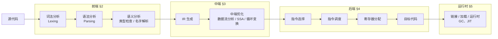
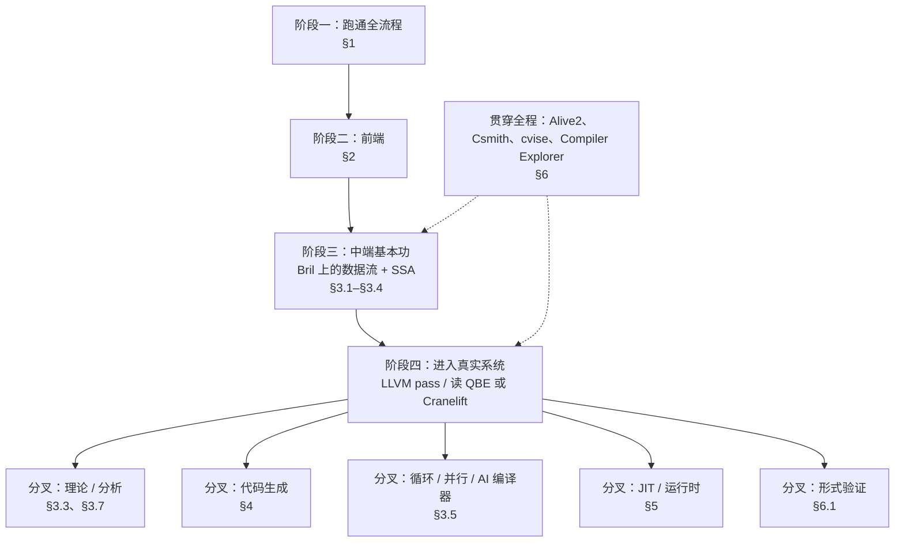

# [ 学习&练习 ]路径

本文按照**编译器的结构**（前端、中端、后端、运行时）整理学习和练习编译器理论与技术的路径。目标是回答两个问题：**每一层该读什么**，以及**每一层该动手练什么**。

| 主题 | 在本文中的位置 |
|---|---|
| 入门书籍与项目（含知乎上的推荐） | §0.2、§1、附 |
| 前端：词法、语法、语义分析 | §2 |
| 数据流分析的格论基础（单调不动点迭代）的书籍 | §3.3 |
| 中端与后端优化的权威书单 | §3、§4、§5、§10 |
| 后端优化的工具、开源项目与练习 | §3、§4、§6 |
| 必读论文 | §7 |
| 课程与比赛 | §8 |
| 分阶段学习路线 | §9 |

本仓库对应章节：[前端](../front-end/index.md)、[中端](../middle-end/index.md)、[后端](../back-end/index.md)。

---

## 0. 导读

### 0.1 编译器的结构与本文的组织



| 章节 | 内容 |
|---|---|
| §1 | 先把整条流水线跑通：小而完整的解释器 / 编译器 |
| §2 | 前端：词法、语法、语义分析 |
| §3 | 中端：IR 与 SSA、数据流分析与格论、标量优化、循环与多面体、过程间分析、静态分析 |
| §4 | 后端：指令选择、指令调度、寄存器分配、目标机器 |
| §5 | 运行时与相邻领域：GC、链接、JIT、部分求值 |
| §6 | 贯穿全程的基础设施：正确性验证、测试与 fuzzing、测量与 benchmark |
| §7 | 书覆盖不到的必读论文 |
| §8 | 课程与比赛 |
| §9 | 分阶段的学习路线 |
| §10 | 不建议作为主线的资料 |

### 0.2 三本经典：龙书、虎书、鲸书

编译原理界有三本经典书籍，分别被称为龙书、虎书、鲸书。很多人只知道龙书，对另外两本不了解。参见知乎 [编译器龙书虎书鲸书基本抽象概念](https://zhuanlan.zhihu.com/p/492432300)，其中有简单介绍。

| 昵称 | 书 | 侧重 | 本文中的定位 |
|---|---|---|---|
| 龙书 | Aho, Lam, Sethi & Ullman, *Compilers: Principles, Techniques, and Tools*（2nd ed., 2006），中译《编译原理》 | 前端最全面；第 9 章数据流分析扎实 | 前端主教材；中端理论入门 |
| 虎书 | Appel, *Modern Compiler Implementation in ML*（1998） | 从前端到后端完整实现一遍，后端讲得最干净 | 动手实现一遍完整编译器 |
| 鲸书 | Muchnick, *Advanced Compiler Design and Implementation*（1997），中译《高级编译器设计与实现》 | 优化的百科全书 | 查手册，不通读 |

龙书第 2 版的章节与编译器结构的对应关系如下，后文各节会反复引用：

| 章 | 内容 | 对应本文 |
|---|---|---|
| 1–2 | 引论；一个简单的语法制导翻译器 | §1 |
| 3 | 词法分析 | §2.1 |
| 4 | 语法分析 | §2.2 |
| 5 | 语法制导翻译 | §2.3 |
| 6 | 中间代码生成 | §3.1 |
| 7 | 运行时环境 | §5 |
| 8 | 代码生成 | §4 |
| 9 | 机器无关优化（数据流分析） | §3.3、§3.4 |
| 10 | 指令级并行 | §4.2 |
| 11 | 并行性与局部性优化（Lam 的多面体工作） | §3.5 |
| 12 | 过程间分析 | §3.6 |

### 0.3 关于"后端优化"要先说一件要紧的事

"后端优化"实际上是**五个耦合不深、文献分布极不均衡**的子领域：

| 子领域                      | 有好书吗                     |
| ------------------------ | ------------------------ |
| 数据流分析 / 静态分析理论           | ✅ 书很多很好                  |
| SSA 与标量优化（GVN/PRE/SCCP）  | ✅ 有专门的权威书                |
| 循环变换 / 依赖分析              | ✅ 有经典（但偏 Fortran 时代）     |
| **寄存器分配 / 指令调度 / 指令选择**  | ⚠️ **书都落后 15 年以上，必须读论文** |
| **多面体编译 / 自动向量化 / MLIR** | ❌ **没有权威教材**             |

所以本文不只给书，也标明哪里必须转向论文（§7）和源码。

在本文中，前三个子领域放在**中端**（§3），第四个放在**后端**（§4），第五个放在中端的循环部分（§3.5）。这只是按编译器结构归类，许多资料把它们统称为"后端优化"。

---

## 1. 起步：先把整条流水线跑通

学编译器最常见的困境是：龙书、虎书理论太多，读起来干燥，迟迟看不到一个能跑的东西。比较好的做法是**先用一个小而完整的项目把"源代码 → 运行结果"的全流程走一遍**，再回头按层深入。参见知乎问题 [如何想学点编译原理，又不想直接看龙虎之类的书籍，太多理论，干燥?](https://www.zhihu.com/question/265364484/answer/293733831)。

### 1.1 教程式项目

| 项目 | 说明 | 来源 |
|---|---|---|
| [Let's Build A Simple Interpreter](https://ruslanspivak.com/lsbasi-part1/)（Ruslan Spivak） | 用 Python 一步步写一个 Pascal 子集的解释器，从计算器开始逐步加功能 | [罗然的回答](https://www.zhihu.com/question/265364484/answer/293645562) |
| [Crafting Interpreters](http://www.craftinginterpreters.com)（Robert Nystrom） | ⭐ 免费在线。同一门语言 Lox 实现两遍：jlox（Java，树遍历解释器）和 clox（C，字节码虚拟机，含 GC）。前端讲得极清楚 | [罗然的回答](https://www.zhihu.com/question/265364484/answer/293645562) |
| [cwalk/PL0-Compiler](https://github.com/cwalk/PL0-Compiler) | PL/0 编译器。PL/0 是 Wirth 设计的教学语言，国内编译原理课的经典实验 | [罗然的回答](https://www.zhihu.com/question/265364484/answer/293645562) |
| Niklaus Wirth, [*Compiler Construction*](https://book.douban.com/subject/3152162/) | 根据 Wirth 在 ETH 的讲义修改而成。一百多页的篇幅，编译器从前端到后端代码生成优化 | [祖与占的回答](https://www.zhihu.com/question/265364484/answer/295127489) |
| [rswier/c4](https://github.com/rswier/c4) | 用四个函数、几百行 C 写成的 C 子集编译器（编译到自带虚拟机），能自举 | [清风的回答](https://www.zhihu.com/question/265364484/answer/294368120) |

### 1.2 小型真实编译器

| 项目                      | 语言 | 适合练什么                         |
| ----------------------- | --- | ----------------------------- |
| **chibicc / 8cc / tcc** | C   | 从零理解"IR → 汇编"，适合先把 pipeline 跑通 |
| **LCC**                 | C   | 教科书式的指令选择（树覆盖），配套书 *A Retargetable C Compiler* |
| **Nanopass framework**  | Scheme | pass 拆分思想：每个 pass 只做一件小事 |

> ⚠️ 这一类"自制编译器 / 手写编译器"项目，**前端练手可以，后端优化一律跳过**（见 §10）。它们的价值是让你先看到全貌。

### 1.3 扩展：增量式构造编译器

以下资料采用"每次只给语言加一个特性、每一步都能跑"的组织方式，适合在 §1.1 之后、深入各层之前读：

| 资料 | 说明 |
|---|---|
| Ghuloum, *An Incremental Approach to Compiler Construction*（2006） | 从"编译一个整数"开始，一路加到堆分配、闭包、尾调用，每一步都生成 x86 汇编 |
| Siek, *Essentials of Compilation*（MIT Press, 2023） | 基于上文与 nanopass 思想的教材，有 Racket 版与 Python 版。覆盖活跃分析、图着色寄存器分配、函数、闭包、GC，是从"跑通"过渡到"后端"的好桥梁 |
| LLVM 官方 *Kaleidoscope* 教程 | 手写一个小语言前端，生成 LLVM IR 并接入 JIT。适合作为进入 §3、§4 的 LLVM 生态的第一步 |

---

## 2. 前端：从字符串到带类型的抽象语法树

前端的理论最成熟，龙书最强的部分也在这里。练习的重点是**亲手实现一遍，再学会使用生成器工具**。

### 2.1 词法分析（Lexical Analysis）

| 学什么 | 资料 |
|---|---|
| 正则表达式 → NFA（Thompson 构造）→ DFA（子集构造）→ DFA 最小化 | 龙书第 3 章 |
| 手写词法分析器的工程做法 | Crafting Interpreters 第 4 章（jlox 扫描器）、第 16 章（clox 扫描器） |

**练习**：

1. 手写一个正则引擎：正则 → NFA → DFA → 最小化，用它识别一门小语言的 token。
2. 用 **flex / re2c** 为同一门语言生成词法分析器，对比手写版本。

### 2.2 语法分析（Syntax Analysis）

| 学什么 | 资料 |
|---|---|
| 上下文无关文法、二义性、优先级与结合性 | 龙书第 4 章 |
| 自顶向下：递归下降、LL(1)、预测分析表 | 龙书第 4 章；Crafting Interpreters 第 6 章 |
| 自底向上：LR(0)、SLR、LR(1)、LALR | 龙书第 4 章 |
| 表达式解析的工程做法：Pratt 解析（优先级爬升） | Crafting Interpreters 第 17 章；Nystrom 的博文 *Pratt Parsers: Expression Parsing Made Easy* |
| 解析技术的全景与参考 | Grune & Jacobs, *Parsing Techniques: A Practical Guide*（2nd ed., 2008） |
| 错误恢复 | 龙书第 4 章；本仓库 front-end 下的错误恢复章节 |

**练习**：

1. 为一门小语言手写递归下降解析器，再用 Pratt 解析重写表达式部分。
2. 手工构造一个小文法的 LR(1) / LALR 分析表，再与 **bison / yacc** 生成的表对照（`bison -v` 会输出状态机）。
3. 体验不同的生成器：**ANTLR4**（ALL(*)）、**Menhir**（OCaml，LR(1)，错误信息友好）、**LALRPOP**（Rust）、**tree-sitter**（增量解析，编辑器场景）。

### 2.3 语义分析（Semantic Analysis）

| 学什么 | 资料 |
|---|---|
| 语法制导翻译、属性文法（综合属性 / 继承属性） | 龙书第 5 章 |
| 符号表、作用域、名字解析 | 龙书第 2、6 章；Crafting Interpreters 第 11 章（Resolving and Binding） |
| 类型检查、类型推导 | 龙书第 6 章；Pierce, *Types and Programming Languages*（TAPL, 2002） |
| 语义的代数视角：语义是从语法到语义域的同态 | 本仓库 front-end/gramars 下的"结构承载语义"系列 |

**练习**：为 §2.2 的语言加上作用域检查和类型检查，并把"类型检查"写成对 AST 的一次折叠（fold）。

### 2.4 前端的验收

前端做完，应该能产出一棵**名字已解析、类型已检查**的 AST，下一步就是把它降低（lower）到 IR。验收方式：

- 用 §1.3 的 Kaleidoscope 教程，把 AST 直接生成为 LLVM IR，然后交给 `clang` / `llc` 编出可执行文件。
- 或者生成 **Bril**（§3.1），进入中端练习。

---

## 3. 中端：IR、分析与机器无关优化

### 3.1 中间表示（IR）与 SSA

现代后端的核心就是 **SSA**。**现代后端的一切都建立在 SSA 上，这是绕不过去的分水岭**：不做这一步，后面所有工业代码都读不懂。

**书**

| 书 | 说明 |
|---|---|
| 龙书第 6 章 | 三地址码、四元式等传统 IR |
| **Rastello & Bouchez Tichadou (eds.), *SSA-based Compiler Design*** (Springer, 2022) | ⭐ **现代后端的核心就是 SSA，这本不可替代**。章节作者是该领域本人：Zadeck、Cytron、Sebastian Hack、Bouchez、Rastello、Sebastian Pop。含 SSA 构造/销毁、SSA 上的寄存器分配、谓词化、Hashed SSA、SSI。**早期草稿 PDF（ssabook）长期免费流传，可先读草稿。** |
| **Cooper & Torczon, *Engineering a Compiler*** | SSA 构造的工程讲法；Keith Cooper 本人是 SSA 支配边界快速算法的作者 |

**必读论文**（详见 §7）：Cytron et al. 1991（支配边界、SSA 构造）；Cooper, Harvey & Kennedy 2001（快速支配树算法）。

**⭐ 最推荐的练习平台：Bril**

**Bril**（Big Red Intermediate Language）是 Adrian Sampson 为 Cornell CS 6120 *Advanced Compilers* 设计的教学 IR。

| 特点            | 说明                                              |
| ------------- | ----------------------------------------------- |
| **IR 是 JSON** | `json.load()` 就拿到了 CFG，无需学 API                  |
| 极小的指令集        | 整数、布尔、`br`/`jmp`、`call`、SSA 扩展（`phi`）           |
| 工具链齐全         | `bril2json`/`bril2txt`、参考解释器 `brili`、Turnt 测试框架 |
| 多语言 SDK       | Python (`briltxt`)、TypeScript、Rust              |
| **课程完全公开**    | 讲义、视频、作业、往届学生的实现报告全部在线，可自学                      |

CS 6120 的作业序列几乎就是中端的学习顺序：local DCE → 数据流框架 → 支配树 → SSA 构造/销毁 → LVN/GVN → 循环不变量外提 → 别名分析。如果你已经写过一个通用的数据流求解器，它可以直接当第 2 个作业的答案，然后一路往上搭。

```bash
git clone https://github.com/sampsyo/bril
# 作业列表与讲义：https://www.cs.cornell.edu/courses/cs6120/2023fa/
```

> ⚠️ Bril 的局限要清楚：**没有真实机器后端**，所以寄存器分配、指令调度、指令选择这三块练不了。那部分必须去 LLVM 或 Cranelift（§4）。

**练习**：

1. 构造 CFG、支配树（用 Cooper–Harvey–Kennedy 迭代算法）、支配边界 → SSA 构造（Cytron 算法）→ SSA 销毁。⭐ **SSA 销毁是真正的难点**（lost-copy / swap 问题），别跳过。
2. 在 LLVM 中阅读 `mem2reg` 如何把栈上变量提升为 SSA 值，对照自己的实现。

### 3.2 工业级中端：LLVM / MLIR / GCC

**LLVM** 是性价比最高的选择，社区活跃、文档全。

**入门方式：out-of-tree pass**

不要 fork LLVM，用**独立项目 + `opt -load-pass-plugin`**：

```bash
# 骨架模板（社区维护，CMake 配好）
git clone https://github.com/banach-space/llvm-tutor
```

`llvm-tutor` 是目前最好的 out-of-tree pass 教程集，每个 pass 都有配套讲解和 lit 测试，强烈推荐。其它入门资料：`llvm/docs/WritingAnLLVMPass`、*LLVM Cookbook*。

IR 层的 pass 在 `llvm/lib/Transforms/` 下，使用新 PassManager，用 `opt -passes=...` 调试。

**该读哪些目录（中端部分）**

| 路径                                         | 内容                   | 对应知识点                                           |
| ------------------------------------------ | -------------------- | ------------------------------------------------- |
| `llvm/include/llvm/Analysis/SparsePropagation.h` | 稀疏数据流框架              | push 式的前向求解（只唤醒受影响的变量）                        |
| `llvm/lib/Transforms/Scalar/SCCP.cpp`（求解器在 `Transforms/Utils/SCCPSolver.cpp`） | ⭐ Wegman–Zadeck SCCP | 常量传播 + 不可达边，格为 `Product(Env(Flat), Powerset(edges))` |
| `llvm/lib/Transforms/Scalar/NewGVN.cpp`    | 值编号                  | Cooper–Simpson 那条线                                |
| `llvm/lib/Analysis/DependenceAnalysis.cpp` | ⭐ 依赖测试               | **Goff–Kennedy–Tseng 的分级 ZIV/SIV/MIV 实现**         |
| `llvm/lib/Analysis/ScalarEvolution.cpp`    | SCEV                 | 归纳变量的符号表示，循环优化的前提                                 |

后端相关目录见 §4.5。

**MLIR**：如果想做 AI/DSL 编译器，练 dialect 设计、pattern rewrite、bufferization、affine/linalg 变换、lowering 到 LLVM。MLIR 没有权威书，只有论文与官方文档（§7）。

**GCC**：GIMPLE/RTL 两层 IR，plugin 机制可以写外部 pass（`-fplugin=`）。学习曲线陡，但 RTL 层的 combine/reload 是另一套思路，值得对比。

> **现代实践只有源码和文档**：LLVM 的官方文档 + `lib/Transforms`、`lib/CodeGen` 源码 + LLVM Dev Meeting 录像。**没有权威书**（Lopes & Auler 2014 已严重过时；Min-Yih Hsu 的 *LLVM Techniques, Tips, and Best Practices* 2021 较新但是 cookbook）。

### 3.3 数据流分析与格论：单调不动点迭代

这个主题在文献里通常叫 **数据流分析的格论基础**、**单调框架（Monotone Framework）** 或 **抽象解释** 。它是中端所有分析的共同骨架：把分析写成格上的单调函数 $f$，结果就是最小不动点 $\mathrm{lfp}(f)=\bigsqcup_k f^k(\bot)$。

**核心推荐**

1. **Møller & Schwartzbach, *Static Program Analysis***
   - **免费**，可在作者主页（cs.au.dk/~amoeller/spa/）下载，持续更新。
   - 入门最友好。第 4 章讲格论（偏序、完全格、高度、单调函数、Kleene 不动点定理），第 5 章讲数据流分析与不动点求解算法（朴素迭代、混沌迭代、worklist），后面还讲 widening/narrowing。
   - 南京大学《软件分析》课程（李樾、谭添）大量参考了这本书。
   - **第一本建议读它。**
2. **Nielson, Nielson & Hankin, *Principles of Program Analysis***（Springer, 1999）
   - 简称 "NNH"，该领域公认的权威教材。
   - 第 2 章系统讲单调框架、MFP 与 MOP 解；附录 A 给出格与不动点（Tarski 定理、上升链条件）的严格数学处理；第 6 章专讲 worklist 等求解算法。
   - 覆盖数据流 + 抽象解释 + 类型系统 + 约束分析，严格但**难且勘误多**。偏形式化，定位是参考，适合想彻底搞懂理论的读者，不适合入门。
3. **龙书第 2 版**（中译本《编译原理》，机械工业出版社）
   - **第 9.3 节 "Foundations of Data-Flow Analysis"** 是经典讲法：半格、传递函数的单调性与可分配性、迭代算法的正确性与收敛性、MFP 与 MOP 的关系。
   - 篇幅不长但要点齐全，适合编译器方向的读者。

**深入与专题**

| 书名 | 特点 |
|---|---|
| **Khedker, Sanyal & Karkare, *Data Flow Analysis: Theory and Practice*** (CRC, 2009) | ⭐ 专门讲数据流分析。MFP/MOP 的严格处理、复杂度分析、双向数据流（bidirectional，龙书几乎没讲）、格的高度与收敛趟数、过程间分析。对收敛性、迭代次数的分析最细致，专书级深度 |
| **Rival & Yi, *Introduction to Static Analysis: An Abstract Interpretation Perspective*** (MIT Press, 2020) | ⭐ **抽象解释的现代入门首选**。Xavier Rival 是 Cousot 的学生。从抽象解释角度讲不动点计算，格论/Galois 连接/widening 讲得清楚，比 NNH 可读得多，比读 Cousot 原始论文容易 |
| **Wilhelm, Seidl & Hack, *Compiler Design: Analysis and Transformation*** (Springer, 2013) | 德国学派，简洁严谨。Sebastian Hack 就是 SSA 寄存器分配那篇突破性论文的作者。篇幅小、信息密度高 |
| **Davey & Priestley, *Introduction to Lattices and Order*** | 纯数学基础。讲 CPO 和不动点定理的章节（Knaster–Tarski、Kleene）是标准参考 |
| **Cooper & Torczon, *Engineering a Compiler*** | 工程视角，讲迭代数据流求解的实际实现和逆后序遍历等技巧 |
| **Muchnick, *Advanced Compiler Design and Implementation*** | 第 8 章讲数据流分析，偏工程 |

**经典原始论文**

- **Kildall (1973)**，*A Unified Approach to Global Program Optimization*：最早提出格上迭代的数据流框架。
- **Kam & Ullman (1976/1977)**，*Monotone Data Flow Analysis Frameworks*：单调框架、MFP 与 MOP 的关系、分配性、收敛趟数。
- **Cousot & Cousot (1977)**，*Abstract Interpretation: A Unified Lattice Model…*：抽象解释的奠基论文，引入 widening。

**中文学习资源**

- **南京大学《软件分析》**（李樾、谭添）：B 站有完整视频。其中 "Data Flow Analysis – Foundations" 两讲专门讲格、单调性、不动点定理与迭代算法的关系，讲解非常清晰，强烈推荐。
- **北京大学《软件分析技术》**（熊英飞）：课件公开，理论讲得较扎实。

**推荐阅读路线**

1. 南大课程视频，配合 **Møller & Schwartzbach** 建立直觉；
2. 读 **龙书 9.3 节**，把理论和编译器优化对应起来；
3. 需要严格理论时读 **NNH**，数学部分可查 **Davey & Priestley**；
4. 想深入数据流本身（收敛性、双向分析）读 **Khedker**；对 widening 和无限高度格感兴趣，再读 **Rival & Yi**。

**练习**：

1. 写一个**通用的 `lfp` 求解器**：参数是格（`bottom`、`join`、`leq`）、传递函数与 CFG，按逆后序 + worklist 迭代。用 `Dual` 包装统一 may / must 分析，用 `Product`、`Env`、`Flat`、`Powerset` 等组合子构造复合格。
2. 把它接到 Bril 上：把 Bril 的函数转成 `succ: Dict[str, List[str]]`，喂给 `reverse_postorder` 和 `solve`，跑活跃变量 + DCE，用 Turnt 验证输出程序行为不变。这一步的价值是把"抽象框架"和"真实 CFG 的脏细节"（多入口、不可达块、关键边）对上。
3. 实现 `Interval` 域与 `widen` / `narrow`，观察无限高度格上不加 widening 时迭代不终止。

### 3.4 标量优化

| 学什么 | 资料 |
|---|---|
| 经典优化：DCE、CSE、复写传播、常量传播、强度削弱 | 龙书第 9 章；Cooper & Torczon；Muchnick |
| 值编号：LVN → GVN | Cooper & Torczon；LLVM `NewGVN.cpp` |
| SCCP | Wegman & Zadeck 1991（§7）；LLVM `SCCP.cpp` |
| 部分冗余消除（PRE）、Lazy Code Motion | Knoop, Rüthing & Steffen 1992（§7）；Muchnick |
| 为什么分开跑 pass 会丢精度 | Click & Cooper 1995（§7） |
| 声明式重写规则 | Go 编译器 `cmd/compile/internal/ssa` |

⭐ **Go 的 SSA 后端是被低估的学习材料**：`.rules` 文件用声明式规则写重写优化，可读性极高；pass 列表在 `compile.go` 里一目了然。`_gen/generic.rules` 里一行 `(Add64 (Const64 [c]) (Const64 [d])) => (Const64 [c+d])` 就是一条优化，几千条规则构成了整个标量优化。看完你会明白为什么 Click–Cooper 说"把分析合并"重要。

**练习**：

1. LVN（局部值编号）→ GVN；DCE、CSE、复写传播、强度削弱。
2. **SCCP**：格用 `Product(Env(Flat), Powerset(edges))`，同时做常量传播和不可达边消除。⭐ **跑完后对比"先跑常量传播再跑 CFG 简化、反复两轮"的结果**，你会亲眼看到 Click–Cooper 说的那部分精度差。可以在 LLVM 的 `opt` 插件（C++）或 Python 的 `llvmlite` 上实现。
3. **Lazy Code Motion**（Knoop–Rüthing–Steffen）：四个数据流分析串联（anticipated / available / earliest / latest）。⭐ 这是把数据流框架用到极致的练习：**四个分析里有前向有后向、有 may 有 must**，`Dual` 包装会在这里体现价值。

### 3.5 循环优化、依赖分析与多面体

**书**

| 书                                                                           | 说明                                                                                                                               |
| --------------------------------------------------------------------------- | -------------------------------------------------------------------------------------------------------------------------------- |
| **Allen & Kennedy, *Optimizing Compilers for Modern Architectures*** (2001) | 该领域圣经。依赖分析、方向/距离向量、unimodular 变换、fusion/fission/interchange/tiling。Ken Kennedy 是 Rice 并行编译学派的奠基人（参见 [Rice并行编译学派](../books&courses/Rice并行编译学派.md)）。**偏向 Fortran/向量机时代，但依赖理论是永恒的。** |
| **Wolfe, *High Performance Compilers for Parallel Computing*** (1995)       | 与上书互补，更偏实践直觉。Michael Wolfe 后来做了 PGI 编译器。                                                                                         |
| 龙书第 11 章 | Monica Lam 的多面体工作，深但孤立（见 §10） |

⭐ **LLVM 的 `DependenceAnalysis.cpp` 值得专门读**：它是 Rice 学派那套分级依赖测试的工业实现，你能在代码里直接看到 `testZIV` / `testSIV` / `testMIV` / `gcdMIVtest` / `banerjeeMIVtest` 的函数名。

**多面体工具**

| 工具              | 说明                                                                                           |
| --------------- | -------------------------------------------------------------------------------------------- |
| **isl**         | ⭐ Sven Verdoolaege 的整数集库。这是"两种 lattice 共存"的地方：仿射多面体 ∩ $\mathbb Z$-格（序意义上的格与几何意义上的整数格同时出现），Hermite 标准形在里面 |
| **Pluto**       | Bondhugula 的自动并行化器，仿射调度 ILP 求解                                                               |
| **Polly**       | LLVM 里的多面体框架（`-mllvm -polly`）                                                                |
| **PPCG**        | 自动生成 CUDA                                                                                    |
| **CLooG**       | 从多面体生成循环代码                                                                                   |
| **Tiramisu**    | 多面体模型上的调度语言                                                                                   |
| **Polybench/C** | ⭐ 标准 benchmark，30 个科学计算核心，所有多面体论文都用它                                                         |
| **TSVC**        | 循环优化专用 benchmark，验证向量化效果                                                                      |

**调度语言与张量 / AI 编译器**

- **Halide**：schedule 与算法分离，练 tiling/fusion/vectorize 的直觉。⭐ 建议至少读一遍 **Halide 的 tutorial**：它把 "algorithm 与 schedule 分离"这个 HPF 教训的产物讲得极清楚，`tile/vectorize/parallel/reorder` 这些 scheduling primitive 的名字直接来自 Rice/Illinois 的循环变换目录。
- **TVM / TensorIR**、**Triton**、**XLA**、**IREE**：AI 编译器后端（tiling、layout、auto-tuning、codegen 到 GPU）。
- **Exo**（MIT）比较新，强调"用户可扩展的调度 + 变换的正确性检查"，适合想研究"变换合法性如何被形式化"的方向。
- **MLIR** 的 affine / linalg dialect（§3.2）。

**练习**：

1. 循环识别 → LICM、归纳变量分析、展开、unswitching。
2. 在 **Polybench** 上实现 tiling + 置换选择，用 McKinley–Carr–Tseng 的 cache 代价模型，对比 Polly 的结果。

### 3.6 过程间分析

| 资料 | 说明 |
|---|---|
| 龙书第 12 章 | 过程间分析入门 |
| Reps, Horwitz & Sagiv 1995（**IFDS**） | ⭐ 把"call/return 必须配对"（即只考虑调用栈上可实现的路径）形式化为 CFL-reachability |
| Sagiv, Reps & Horwitz 1996（**IDE**） | IFDS 的推广，用于常量传播 |
| Khedker et al. | 过程间数据流的专书级处理 |

### 3.7 静态分析与抽象解释的工具（数据流的直接延伸）

| 工具                  | 说明                                                                                |
| ------------------- | --------------------------------------------------------------------------------- |
| **Apron**           | 经典数值抽象域库：区间、octagon、polyhedra、congruence。INRIA 出品，OCaml 带 C 绑定                    |
| **ELINA**           | ETH Zurich，比 Apron 快的多面体实现                                                        |
| **Crab / Clam**     | ⭐ Crab 是抽象解释框架，**Clam = Crab for LLVM**。想把自己的 `lfp` 求解器思路用到真 LLVM IR 上，这是最接近的参照    |
| **IKOS**            | NASA 的抽象解释器，C/C++ 验证                                                              |
| **Frama-C**（EVA 插件） | C 代码的工业级抽象解释，插件架构清晰                                                               |
| **Infer**           | Meta，基于 separation logic + abstract interpretation，有通用的 `AbstractDomain` 接口可以照抄设计 |
| **SVF**             | LLVM 上的指针分析/值流分析，稀疏分析的实现参考                                                        |

⭐ **把自己的 `Interval` + `widen/narrow` 和 Apron 的实现对照看**，你会看到真实实现里的 widening 策略比教科书复杂得多（阈值、延迟加宽、loop-local 加宽点）。

**Datalog 路线 → Soufflé**

```
https://souffle-lang.github.io/
```

⭐ **这是最有"顿悟感"的一个工具**：Soufflé 是高性能 Datalog 引擎，它的求值策略就是 **semi-naive evaluation**，**和 worklist 求解器里"只唤醒受影响的变量"字面上是同一个算法**。

```prolog
// 到达定值，三行
reaches(D, N) :- gen(D, N).
reaches(D, N) :- reaches(D, M), edge(M, N), !kill(D, N).
```

看看 Soufflé 为这三行生成的 C++（`souffle -g`），你会看到：索引选择、SCC 分层、增量求值，**全是手写 worklist 时手动做的决策，被编译器自动化了**。

配套项目：**Doop**（Java 指针分析，用 Datalog 写的，上下文敏感），**cclyzer++**（LLVM 上的 Datalog 分析）。

**练习**：

1. 用 **Soufflé** 重写自己的数据流分析，对比 LOC 和性能。
2. 把 `Interval` 域换成 **octagon**（或直接接 Apron），在真实 C 代码上跑数组越界检查，看 widening 策略对误报率的影响。

---

## 4. 后端：从 IR 到机器码

后端是龙书最弱的部分，也是**书普遍落后、必须读论文和源码**的部分（§0.3）。

### 4.1 书

| 书                                                                                    | 评价                                                                                                                                                                              |
| ------------------------------------------------------------------------------------ | ------------------------------------------------------------------------------------------------------------------------------------------------------------------------------- |
| **Cooper & Torczon, *Engineering a Compiler*** (3rd ed., 2022)                       | ⭐ **后端部分优于龙书的首选**，后端部分最实用。指令选择（树覆盖 / peephole）、指令调度（list scheduling）、寄存器分配（图着色全链条）讲得清楚且现代。Keith Cooper 本人就是 Briggs-Chaitin 着色、SSA 支配边界快速算法的作者。**如果只读一本，读这本。**                           |
| **Muchnick, *Advanced Compiler Design and Implementation*** (1997)                   | ⭐ **"鲸鱼书"**。后端优化的百科全书，覆盖度至今无人超越（PRE、强度削弱、过程间分析、别名分析、代码布局……）。缺点诚实讲：1997 年，SSA 处理单薄、无多面体、伪代码风格老派。**定位是"查手册"，不是通读。** 中译《高级编译器设计与实现》质量可以。                                           |
| **Rastello & Bouchez Tichadou (eds.), *SSA-based Compiler Design*** (Springer, 2022) | 见 §3.1。SSA 上的寄存器分配、SSA 销毁是后端的关键章节 |
| **Appel, *Modern Compiler Implementation in ML*** (1998)                             | "虎书"。后端讲得**最干净**：活跃分析、图着色、maximal munch / 动态规划指令选择。ML 版是正统，Java/C 版是移植（代码风格受损）。**适合动手实现一遍。**                                                                                    |

> **搭配建议**：Cooper&Torczon 打底 → SSA Book 补现代 → Muchnick 当词典。

### 4.2 目标机器与 ILP

后端优化的前提是懂机器。

| 书                                                                                          | 说明                                                        |
| ------------------------------------------------------------------------------------------ | --------------------------------------------------------- |
| **Hennessy & Patterson, *Computer Architecture: A Quantitative Approach*** (6th ed., 2017) | 流水线、cache、乱序执行、向量/SIMD。                       |
| **Fisher, Faraboschi & Young, *Embedded Computing: A VLIW Approach*** (2004)               | Josh Fisher 是 trace scheduling 发明人。VLIW/ILP 调度、软件流水的权威处理。 |
| **Agner Fog, *Optimization manuals*** (免费在线，持续更新)                                          | 微架构级真实延迟/吞吐表。**这是书里永远给不了的东西。** 配合 Intel/ARM 官方优化指南，理解"为什么这样 codegen 更快" |
| 龙书第 10 章 | 指令级并行，偏弱（见 §10） |

### 4.3 指令选择、指令调度、寄存器分配

| 子领域 | 书里的内容 | 必须补的论文（详见 §7） | 工业实现 |
|---|---|---|---|
| 指令选择 | 树覆盖、maximal munch、动态规划（虎书、Cooper & Torczon） | Aho & Johnson 1976；iburg 1992；Ertl 1999 | LLVM SelectionDAG / **GlobalISel**（当前热点，很多架构在迁移）、TableGen 模式；Cranelift **ISLE** |
| 指令调度 | list scheduling（Cooper & Torczon）；VLIW 与软件流水（Fisher et al.） | Lam 1988；Rau 1994 | LLVM `MachineScheduler` |
| 寄存器分配 | 书基本停在 Briggs-Chaitin 图着色 | Chaitin 1982；Briggs et al. 1994；Poletto & Sarkar 1999；Wimmer & Franz 2010；**Hack 2007** | LLVM `RegAllocGreedy`（不是图着色，是优先级 + split）；Cranelift `regalloc2` |
| 窥孔优化 | Cooper & Torczon | — | LLVM `MachineCombiner`、GCC RTL combine |

### 4.4 小而完整的后端（适合通读）

| 项目                                    | 语言  | 规模     | 特点                                                             |
| ------------------------------------- | --- | ------ | -------------------------------------------------------------- |
| **QBE**                               | C   | ~10k 行 | 完整的后端：SSA、寄存器分配（线性扫描 + 合并）、ABI、x64/arm64/riscv64 代码生成，代码极简洁。**一周能读完全部**                             |
| **Cranelift**（Wasmtime 的后端）            | Rust | 比 LLVM 小一到两个数量级，可通读 | 现代设计：e-graph（aegraph）中端优化、ISLE 规则、regalloc2、VCode；文档好，issue 里有大量 good-first-issue |
| **libFirm**                           | C   | 中等     | 图结构 SSA（Firm IR），KIT 出品，配 `cparser` 前端                         |
| **MIR**                               | C   | 小      | Vladimir Makarov 的轻量 JIT，有 C→MIR 前端                            |
| **Go 编译器** `cmd/compile/internal/ssa` | Go  | 中等     | ⭐ 声明式重写规则（§3.4），同时含各架构的 lowering 规则 |

**寄存器分配 / 指令选择 → Cranelift**

|                 |                                                                                           |
| --------------- | ----------------------------------------------------------------------------------------- |
| 位置              | Bytecode Alliance / Wasmtime，Rust                                                         |
| 规模              | 比 LLVM 小一到两个数量级，可通读                                                                       |
| **`regalloc2`** | ⭐ 独立 crate 的回溯式寄存器分配器（Chris Fallin），**接口干净、有 fuzzer、文档写了设计决策**。想动手改寄存器分配，这是比 LLVM 友好得多的入口 |
| **ISLE**        | 用 DSL 写指令选择规则（term rewriting），还有形式化验证的配套研究                                                |

> **这是"想练寄存器分配"的首选推荐**。LLVM 的 `RegAllocGreedy` 耦合太深，`regalloc2` 可以单独 benchmark、单独 fuzz。

### 4.5 LLVM / GCC 的后端层

LLVM 的"真正的后端"：

- 指令选择：SelectionDAG、**GlobalISel**、TableGen 模式。
- MachineIR 优化、`MachineScheduler`、`RegAllocGreedy`、PEI/Prologue、`MachineCombiner`。
- 加一个自定义 target 或给 RISC-V backend 补 pattern 是很好的练手方式。

| 路径                                         | 内容                   | 说明                                           |
| ------------------------------------------ | -------------------- | ------------------------------------------------- |
| `llvm/lib/CodeGen/RegAllocGreedy.cpp`      | 寄存器分配                | 不是图着色，是优先级 + split                                |
| `llvm/lib/Target/*/*ISelLowering.cpp`     | 指令选择                 | SelectionDAG / GlobalISel                         |

```bash
opt -passes='loop-unroll' -S -print-after-all a.ll
llc -march=riscv64 -debug-only=isel a.ll
llvm-mca -mcpu=skylake a.s        # 静态流水线性能分析
llvm-reduce / bugpoint            # 自动缩小复现用例
```

GCC 的 RTL 层（combine / reload）是另一套思路，值得与 LLVM 对比（§3.2）。

### 4.6 后端练习（按难度）

1. **线性扫描寄存器分配**（Poletto–Sarkar）→ 升级到 **SSA 上的线性扫描**（Wimmer–Franz）。
2. **图着色寄存器分配**：Chaitin → 加 Briggs 乐观着色 → 加 rematerialization。对比 spill 数量，并加上 spill 代价模型。
3. 窥孔优化、指令调度（list scheduling）。
4. 读完 QBE 或 Cranelift 的一个后端，自己为 RISC-V 写一个简易 codegen + 线性扫描 RA。
5. 在 **`regalloc2`** 里实现一个新的 spill 启发式，用它的 fuzzer + benchmark 验证。
6. 在 LLVM 中进入 MachineIR / GlobalISel，给 RISC-V backend 补 pattern。

---

## 5. 运行时与相邻领域

### 5.1 书

| 书                                                                                         | 说明                                               |
| ----------------------------------------------------------------------------------------- | ------------------------------------------------ |
| 龙书第 7 章 | 运行时环境：栈帧、调用约定、堆管理、GC 入门 |
| **Jones, Hosking & Moss, *The Garbage Collection Handbook*** (2nd ed., 2023)              | GC 领域唯一权威，且后端要为 GC 生成 stack map / write barrier。 |
| **Levine, *Linkers and Loaders*** (1999)                                                  | 后端下游。老但基础不变；LTO/重定位要懂。                           |
| **Jones, Gomard & Sestoft, *Partial Evaluation and Automatic Program Generation*** (1993) | 免费在线。JIT / 特化 / Futamura 投影的理论源头。                |

### 5.2 JIT / 运行时后端

- **V8**：Sparkplug（baseline）→ Maglev → TurboFan（Sea-of-Nodes）
- **JavaScriptCore B3/Air**：B3 是很干净的 SSA 后端，论文/文档质量高
- **HotSpot C1/C2**、**GraalVM Graal 编译器**（Java 写的，可读性好，适合看 partial escape analysis、推测优化）
- **LuaJIT**：trace JIT + 极致的 IR 设计（lj_ir / 折叠引擎），代码精炼
- **Wasmtime/Cranelift、WAMR** 的 wasm 后端
- **MIR**（§4.4）：轻量 JIT

线性扫描寄存器分配是 JIT 的事实标准；HotSpot / V8 实际用的是 SSA 上的线性扫描（Wimmer & Franz 2010）。

**练习**：Crafting Interpreters 的 clox 部分自带一个标记-清除 GC，可以在它上面实现分代或增量 GC，对照 *The Garbage Collection Handbook*。

---

## 6. 贯穿全程：正确性、测试与测量

这一部分不属于编译器的某一层，但**从第一个 pass 开始就应该用起来**。

### 6.1 验证与超优化

| 工具            | 说明                                                                     |
| ------------- | ---------------------------------------------------------------------- |
| **Alive2**    | ⭐ translation validation，见下                                            |
| **Souper**    | 用 SMT 自动**发现 LLVM 漏掉的优化**，常直接产出 LLVM patch。跑一遍你会得到一堆"LLVM 本该优化但没优化"的报告 |
| **STOKE**     | 随机搜索做 x86 超优化                                                          |
| **CompCert**  | Coq 验证的 C 编译器。后端优化不多，但**每个变换都有机器检查的正确性证明**，想理解"优化为什么正确"必看              |
| **Vellvm**    | LLVM IR 的 Coq 形式化                                                      |
| **Z3 / CVC5** | 自己写变换验证器时的 SMT 后端                                                      |

**⭐ Alive2：验证你的变换是否正确**

```
https://alive2.llvm.org/ce/
```

你写一个 peephole 变换，Alive2 用 SMT 自动检查它在所有输入（含 `undef`/`poison`）下是否等价，不等价就给反例。**它在 LLVM 里真实发现了几百个 bug**。

**练这个会彻底改变你对"优化正确性"的理解**：你会发现自己想当然的变换，有一半在 `poison` 语义下是错的。

### 6.2 测试与 fuzzing

| 工具                                  | 说明                                         |
| ----------------------------------- | ------------------------------------------ |
| **Csmith**                          | Regehr 的随机 C 程序生成器，历史上在 GCC/LLVM 找出几百个 bug |
| **YARPGen**                         | Intel 出品，专门针对标量优化与 UB                      |
| **C-Reduce / cvise**                | 测试用例自动缩小                                   |
| **`llvm-reduce` / bugpoint**        | 把触发 bug 的大 IR 文件自动缩到十几行 |
| **EMI / Equivalence Modulo Inputs** | 变异式 fuzzing 思路                             |

⭐ **想真正理解某个优化，最快的方法是 fuzz 它**：写一个变换，用 Csmith 生成一万个程序，对比变换前后行为（differential testing）。你会在第一天就发现自己的实现有 bug。

### 6.3 观察编译器在做什么

| 工具                                          | 用途                  |
| ------------------------------------------- | ------------------- |
| `opt -passes=... -print-after-all`          | 看每个 pass 改了什么       |
| `opt -debug-only=<pass-name>`               | pass 内部的决策日志        |
| **Compiler Explorer**（godbolt.org）          | 改一行看汇编变化，最快看到 codegen 差异，支持本地部署     |
| `-fsave-optimization-record` + `opt-viewer` | 看编译器在哪里**没有**优化、为什么 |

最后那个常被忽略但极有用：**优化失败的原因日志**比成功日志信息量大得多。

### 6.4 测量与建模（优化必须闭环）

- **llvm-mca / uiCA / OSACA / IACA**：指令级吞吐与端口压力分析（`llvm-mca` 静态估算一段汇编的吞吐/延迟/端口压力）。
- **perf / VTune / nanoBench / Google Benchmark**。
- **gem5**：周期级模拟，做调度/预取相关实验。
- **CompilerGym**：把编译器优化包装成 RL 环境（pass ordering、phase ordering 研究）。

### 6.5 Benchmark

| 名字                       | 规模  | 用途                          |
| ------------------------ | --- | --------------------------- |
| **LLVM test-suite**      | 大   | 正确性 + 性能，LLVM 官方            |
| **Polybench/C**          | 小   | ⭐ 循环优化/多面体的事实标准             |
| **TSVC**                 | 小   | 向量化                         |
| **embench-iot**          | 小   | 嵌入式，代码体积与性能                 |
| **CoreMark / Dhrystone** | 极小  | 快速 sanity check（但容易被编译器钻空子） |
| **DaCapo / Renaissance** | 大   | JVM，GC 与 JIT 研究             |
| **SPEC CPU 2017**        | 大   | 工业标准，**需付费**（学术机构常有授权）      |
| **Phoronix Test Suite**  | 大   | 综合性能测试                       |

⚠️ **别用 CoreMark 这类微基准评价优化效果**：它太容易被整体内联 + 常量折叠掉。做标量优化用 LLVM test-suite，做循环优化用 Polybench。

---

## 7. 书覆盖不到的：必读论文

按编译器结构排列。

**SSA 与标量优化（中端）**

- Cytron et al., "Efficiently Computing SSA Form and the Control Dependence Graph" (TOPLAS 1991) — 支配边界
- Cooper, Harvey & Kennedy, "A Simple, Fast Dominance Algorithm" (2001) — 实践中比 Lengauer–Tarjan 更常用
- Wegman & Zadeck, "Constant Propagation with Conditional Branches" (TOPLAS 1991) — **SCCP**，LLVM 里的 `SCCP` pass
- Knoop, Rüthing & Steffen, "Lazy Code Motion" (PLDI 1992) — PRE 的正确做法
- Click & Cooper, "Combining Analyses, Combining Optimizations" (TOPLAS 1995) — ⭐ 为什么分开跑 pass 会丢精度

**数据流分析的理论源头（中端）**

- Kildall (POPL 1973)、Kam & Ullman (1976/1977) — MFP、分配性、收敛趟数
- Cousot & Cousot (POPL 1977) — 抽象解释

**过程间分析（中端）**

- Reps, Horwitz & Sagiv, "Precise Interprocedural Dataflow Analysis via Graph Reachability" (POPL 1995) — ⭐ **IFDS**，正是把"call/return 必须配对"（只考虑调用栈中栈顶以下各帧都能正确返回的路径）形式化为 CFL-reachability
- Sagiv, Reps & Horwitz, "Precise Interprocedural Dataflow Analysis with Applications to Constant Propagation" (1996) — IDE

**循环与多面体（中端）**

- 只有论文：Verdoolaege 的 isl、Grosser 的 Polly、Bondhugula 的 Pluto + 官方文档。MLIR 同样只有论文与官方文档。

**指令选择与调度（后端）**

- Aho & Johnson, "Optimal Code Generation for Expression Trees" (1976)
- Fraser, Hanson & Proebsting, "Engineering a Simple, Efficient Code Generator Generator" (iburg, 1992)
- Ertl, "Optimal Code Selection in DAGs" (POPL 1999)
- Lam, "Software Pipelining" (PLDI 1988) / Rau, "Iterative Modulo Scheduling" (1994)

**寄存器分配（后端，书基本停在 Briggs-Chaitin）**

- Chaitin, "Register Allocation & Spilling via Graph Coloring" (1982)
- Briggs, Cooper & Torczon, "Improvements to Graph Coloring Register Allocation" (TOPLAS 1994) — 乐观着色
- Poletto & Sarkar, "Linear Scan Register Allocation" (TOPLAS 1999) — JIT 的事实标准
- Wimmer & Franz, "Linear Scan Register Allocation on SSA Form" (CGO 2010) — HotSpot/V8 实际用的
- **Hack, *Register Allocation for Programs in SSA Form*** (PhD, 2007) — ⭐ SSA 形式下干涉图是 chordal，着色变多项式时间。**范式转移级别的工作。**

**现代实践（只有源码和文档）**

- LLVM：官方文档 + `lib/Transforms`、`lib/CodeGen` 源码 + LLVM Dev Meeting 录像（见 §3.2）。
- LLVM 社区：`llvm-dev` 邮件列表（现为 Discourse 论坛）、LLVM Weekly、每年的 LLVM Dev Meeting 视频。

---

## 8. 课程与比赛

### 8.1 课程（有作业和参考答案）

| 课程                                                       | 覆盖 | 特点                                           |
| -------------------------------------------------------- | --- | -------------------------------------------- |
| **Cornell CS 6120** *Advanced Compilers*（Adrian Sampson） | 中端 | ⭐ 最适合自学：Bril、全部讲义视频公开、往届学生项目报告可读，强烈推荐             |
| **CMU 15-745** *Optimizing Compilers*                    | 中端、后端 | 经典 lab 序列，slides 质量高                         |
| **CMU 15-411** *Compiler Design*                         | 全流程 | 公开材料，从前端写到后端 |
| **Stanford CS 243** *Program Analysis and Optimization*  | 中端 | ⭐ **Monica Lam 本人的课**，龙书第 11 章那条线的原始出处       |
| **Rice COMP 412 / 512**                                  | 全流程 / 优化 | Keith Cooper 的课，*Engineering a Compiler* 的配套 |
| **南京大学《软件分析》**（李樾、谭添）                       | 静态分析 | B 站有完整视频，见 §3.3 |
| **北京大学《软件分析技术》**（熊英飞）                       | 静态分析 | 课件公开 |
| **MIT 6.172** *Performance Engineering*                  | 测量 | 不是编译器课，但教"如何测量和推理性能"，是做优化的前提                 |
| **Nand2Tetris / 自制编译器类**                                 | 全流程入门 | 后端优化部分可跳过                                    |

### 8.2 带评测的"比赛式"练习

- **全国大学生计算机系统能力大赛 — 编译系统设计赛**：SysY 语言 → ARM/RISC-V，有公开测试集和历年优秀作品，是中文圈最好的后端优化实战项目。它覆盖完整流程，前端也要自己写，适合作为 §1–§4 的综合练习。
- 给 LLVM / Cranelift / Wasmtime 提 PR：从 `good first issue`、missed-optimization 标签入手。

---

## 9. 分阶段的学习路线

### 9.1 总路线



| 阶段 | 时间参考 | 读 | 练 |
|---|---|---|---|
| 一、跑通全流程 | 2–4 周 | Crafting Interpreters 或 Let's Build A Simple Interpreter；Wirth *Compiler Construction* | 跟着实现一遍；读 c4 / chibicc |
| 二、前端 | 1–2 月 | 龙书第 3–6 章 | 手写词法 / 语法 / 类型检查；用 flex、bison、ANTLR 各做一遍（§2） |
| 三、中端基本功 | 2–4 周 | Møller & Schwartzbach；龙书 9.3；SSA Book 前 5 章 | Bril 上实现 SSA + 数据流 + 若干经典 pass（§3.1–§3.4） |
| 四、真实系统 | 1–2 月 | Cooper & Torczon 后端章节；llvm-tutor | 读完 QBE 或 Cranelift 一个后端，为 RISC-V 写简易 codegen + 线性扫描 RA；进入 LLVM，先写 IR pass，再进 MachineIR / GlobalISel；同时用 llvm-mca + perf 做量化验证 |
| 五、分叉 | 长期 | 见下 | 见下 |

**阶段五的分叉方向**：

- 偏**理论/分析** → Khedker + Rival & Yi；工具用 Crab + Apron，或 Soufflé。格论背景在这边能直接变现。
- 偏**代码生成**（传统 CPU 后端：调度 / RA / 向量化）→ `regalloc2` 或 QBE/Go SSA。龙书在这块最弱。
- 偏**循环/并行** → isl + Polybench + Pluto，接着 Rice 学派的依赖理论往下走。
- 偏 **AI 编译器** → MLIR / TVM / Triton。
- 偏 **JIT** → 推测优化、去优化（V8、Graal、LuaJIT）。
- 偏**形式验证** → Alive2 系、CompCert。

**贯穿全程**：从一开始就把 **Alive2** 和 **Csmith/cvise** 用起来。**"我的优化是对的"这个信念，在你第一次被 fuzzer 打脸之后才真正开始有意义。**

### 9.2 针对已读到龙书第 9 章、有格论 / 不动点基础的读者

如果你已经读到龙书第 9 章，对格论 / 不动点的理解超出教材，并且已经写了一个能跑的通用 `lfp` 求解器，那么**缺的是真实 IR 和真实 benchmark**。所以优先级不是"学一个大系统"，而是**尽快把求解器接到真 IR 上，看它在真实代码上的表现**。

| 阶段        | 用什么                              | 为什么                                     |
| --------- | -------------------------------- | --------------------------------------- |
| **立刻**    | **Bril**（Cornell CS 6120）        | JSON 格式的 SSA IR，Python 几行读进来，求解器今天就能跑 |
| **两周后**   | **LLVM out-of-tree pass**        | 真实 IR、真实 benchmark、工业级验证基础设施            |
| **按兴趣分叉** | Cranelift / Crab / Soufflé / isl | 分别对应寄存器分配、抽象解释、Datalog、多面体              |

**读书路径**：

1. **横向补现代实现**：Cooper & Torczon 第 11–13 章（指令选择、调度、寄存器分配），这是龙书最弱、也最缺的部分。
2. **纵向补理论深度**：Khedker 的 *Data Flow Analysis* + Rival & Yi（抽象解释）。
3. **转向 SSA**：SSA Book 前 5 章 + Cytron 1991 + Cooper-Harvey-Kennedy 2001。**现代后端的一切都建立在 SSA 上，这是绕不过去的分水岭。**
4. **动手**：把 `lfp` 求解器接到真实 IR 上，建议用 LLVM 的 `opt` 插件（C++）或 Python 的 `llvmlite`，实现一遍 SCCP。SCCP 的妙处在于它**同时**做常量传播和不可达分支消除，正是 Click & Cooper 那篇"合并分析"的最小例证，也会让你亲眼看到"分开跑两个 pass 丢掉的精度"。
5. **按需查** Muchnick。

**动手路径**：

- **第 1 步（本周）**：Bril + 你的求解器。目标是**一天内看到自己的 lfp 在真 IR 上跑出活跃变量**。这一步的价值是把"抽象框架"和"真实 CFG 的脏细节"（多入口、不可达块、关键边）对上。
- **第 2 步**：在 Bril 上做 SSA 构造与销毁。⭐ **这是现代后端的分水岭**，不做这一步，后面所有工业代码都读不懂。
- **第 3 步（分叉点）**：见 §9.1 的分叉方向。

**项目清单（按难度）**：

- 热身（1–2 周，用 Bril）
  1. 把 `solve()` 接到 Bril，实现活跃变量 + DCE，用 Turnt 验证。
  2. 支配树（用 Cooper–Harvey–Kennedy 迭代算法）→ SSA 构造 → SSA 销毁。
  3. LVN（局部值编号）→ GVN。
- 核心（1–2 月）
  4. **SCCP**（§3.4）。
  5. **Lazy Code Motion**（§3.4）。
  6. **线性扫描寄存器分配** → **SSA 上的线性扫描**（§4.6）。
  7. **图着色寄存器分配**：Chaitin → Briggs 乐观着色 → rematerialization（§4.6）。
- 进阶
  8. 在 **`regalloc2`** 里实现一个新的 spill 启发式（§4.6）。
  9. 用 **Soufflé** 重写数据流分析（§3.7）。
  10. 写一个 LLVM pass，用 **Souper** 找 LLVM 漏掉的优化，挑一个实现出来，用 **Alive2** 验证正确性，提 patch。⭐ **这是一条完整的"从发现到贡献"的路径。**
  11. 在 **Polybench** 上实现 tiling + 置换选择（§3.5）。
  12. 把 `Interval` 域换成 **octagon**（§3.7）。

---

## 10. 不建议作为主线的

| 书                                      | 理由                                                                                      |
| -------------------------------------- | --------------------------------------------------------------------------------------- |
| 龙书第 2 版第 10–11 章                       | 第 9 章（数据流）扎实，**第 10 章 ILP 偏弱、第 11 章（Lam 的多面体工作）深但孤立**，寄存器分配/指令选择的讲法明显落后于 Cooper&Torczon |
| Grune et al., *Modern Compiler Design* | 覆盖面广但每处都浅                                                                               |
| 各类"自制编译器/手写编译器"书                       | 前端练手可以，后端优化一律跳过                                                                         |
| NNH（*Principles of Program Analysis*）作为入门 | 严格但难且勘误多，定位是参考 |
| Lopes & Auler 的 LLVM 书（2014）           | 已严重过时 |

---

## 附：更多书籍讨论

- 知乎 [学习编译原理有什么好的书籍?](https://www.zhihu.com/question/315313590)，其中 [陈乐群的回答](https://www.zhihu.com/question/315313590/answer/626705164) 回答得非常好。
- 知乎 [编译器龙书虎书鲸书基本抽象概念](https://zhuanlan.zhihu.com/p/492432300)：三本经典书的简单介绍。
